# Verification

Phase 0 acceptance criteria from [PRD.md](../PRD.md), with the evidence gathered on 2026-11-05 on branch `p0-foundation` (macOS, Apple M4 Max, Metal GPU backend).

## P0 acceptance

| ID | Criterion | Evidence | Status |
| --- | --- | --- | --- |
| P0-A1 | `make checkall`, `make checkall-ci` and `make e2e` are green on a fresh clone. `make dev`, `make dev-stop` and `make dev-restart` work on port 4252. | `make checkall-ci` exit 0 (includes checkall: lint, typecheck, 12 test files with 100 tests passing, build, bundle-check; then `gitleaks dir` and `gitleaks git` with no leaks over 34 commits, `bun audit` with no vulnerabilities, `asset-check` with 21 files verified). `make e2e E2E_PORT=4283` exit 0, 4 of 4 Playwright tests passed. Fresh clone (2026-11-05, `git clone` of 0424b5f into /tmp, then `make install`): `make checkall-ci` exit 0 (100 tests), `make e2e E2E_PORT=4293` exit 0 (4 of 4). Dev half: `make dev` answered HTTP 200 on 4252, `make dev-stop` printed "Stopped; port 4252 is free." and `lsof` showed no listener, `make dev-restart` answered HTTP 200 again. | Met |
| P0-A2 | The e2e suite boots IWER `metaQuest3`, enters an immersive session, presses a controller trigger, and reads `__goghDiag()`. The production bundle contains no IWER code, checked by a bundle grep in `checkall`. | `tests/e2e/harness.spec.ts` "IWER Quest 3 enters immersive VR and reports a right-trigger press" passed in the e2e run (renderer `ANGLE Metal Renderer: Apple M4 Max`). `bundle-check` printed "dist/ contains no IWER code" inside `make checkall-ci`. | Verified |
| P0-A3 | The desktop preview walks a ground plane with WASD and mouse. | Unit coverage in `tests/walk.test.ts` and `tests/controls.test.ts` passed within the 100 tests. The e2e `setPose` test moves the camera. No interactive desktop session was run in this round. Since P3.2, WASD walking runs through locomotion: `tests/locomotion*.test.ts` and `tests/e2e/locomotion.spec.ts` cover it, and `tests/walk.test.ts` covers mouse look only. | Verified by unit tests, interactive check not run |
| P0-A4 | `assets/PROVENANCE.md` lists all 7 scans with file name, URL, license, painting version and SHA-256. Committed runtime derivatives are a 1024 px `frame.webp` per painting. The Starry Night bake input is the 3840 px source scan in `assets/scans/`, which is never served. A frame that fails vetting is recorded as a placeholder. | `bun scripts/asset-check.ts` printed "asset-check: 21 files verified" and passed inside `make checkall-ci`. It recomputes every hash, requires a row for each painting scan and frame, and now fails on any file under `assets/` or `public/paintings/` that has no row. | Verified |
| P0-A5 | The live site at `https://gogh-xr.pardev.net` renders the bare scene in a browser, verified by a live render, not an HTTP 200. | 2026-11-05, deploy of 342252d (Pages run 42138613476 green, CI run 42138613489 green). In a browser, `https://gogh-xr.pardev.net/?diag` rendered the bare scene (night sky, ground grid, "VR not available" notice). `__goghDiag()` returned build 0.1.0, 181 frames, 2 draw calls on ANGLE Metal. No console errors, and `__goghIwer` is undefined in production. HTTPS certificate approved and enforced. | Met |
| P0-A6 | Headset check. The owner runs the benchmark on the Quest 3. `docs/perf.md` records the measured stroke counts at which 72, 90 and 120 Hz hold, `supportedFrameRates`, timer-query availability, and alpha-to-coverage vs blended cost. The P1 budgets are updated from these numbers. | Run by Paul on 2026-11-05 at fd7a1ab and 7a4de62. `docs/perf.md` records full-sphere counts at 72, 80, 90 and 120 Hz for both modes, `supportedFrameRates` [72, 80, 90, 120], the GPU timer as unavailable, the a2c vs blend cost and look, and foveation. The P1 budget table in `plans/phase-1-stroke-engine.md` is updated from them. One data point remains unmeasured and is listed in `perf.md`. Paul signed off on 2026-11-05. | Met |

## P1 acceptance

Evidence for the Phase 1 criteria from [PRD.md](../PRD.md), gathered on branch `p1-stroke-engine` (macOS, Apple M4 Max, Metal GPU backend).

| ID | Criterion | Evidence | Status |
| --- | --- | --- | --- |
| P1-A2 | A test canvas (the scan on a plane, painted in strokes) is recognizably the painting in the desktop preview, captured with `?shot`. | 2026-11-05, commit bd3bb84, production build served by `vite preview`. Captured `/?diag&shot&demo=canvas&noanim&seed=1` at 1600 × 1200 with `bun scripts/capture-shot.ts <url> docs/shots/p1-canvas.png --wait canvas` (headless Chromium, ANGLE Metal). The canvas holds 200,359 strokes in 56 chunks, all near band and all visible. On the M4 Max the build took 169 ms: 80 ms decode, 57 ms placement, 32 ms batch, with the 176 ms brush atlas counted separately. Quest CPU time is not measured yet. A second capture with no `?seed` was byte-identical. For the comparison, the canvas region of the shot (pixels (128, 67) to (1472, 1133), from the camera and canvas geometry) and the scan (inset 12 px at the sides and 4 px at top and bottom, matching the colour sampling) were both downscaled with Lanczos to 256 px wide. The mean absolute RGB difference is 7.8 of 255, and mean lightness matches (92.0 vs 92.3). These figures came from a one-off comparison script that is not in the repo. Shots and comparison are below. Paul reviewed the shot against the scan and signed off on 2026-11-06. | Met |

### P1-A2 shot

| `?demo=canvas` shot, seed 1 | Scan reference (`frame.webp`) |
| --- | --- |
| 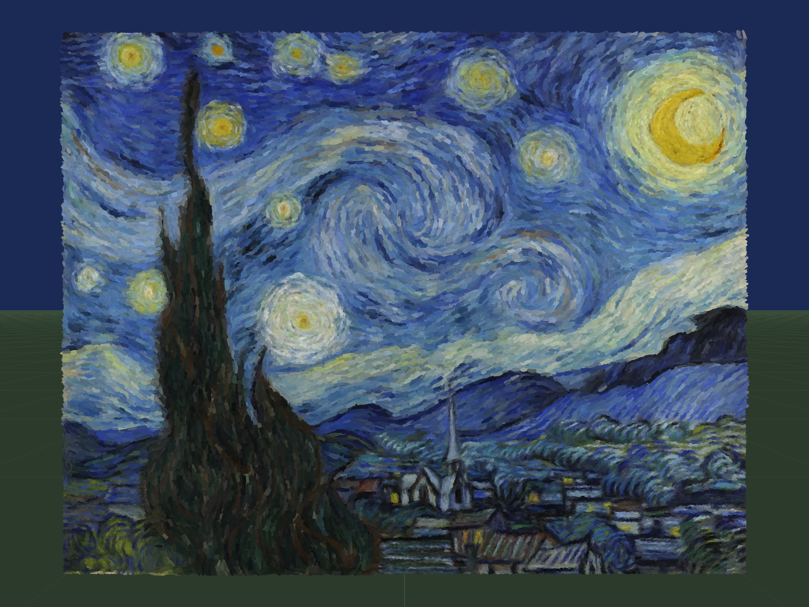 | 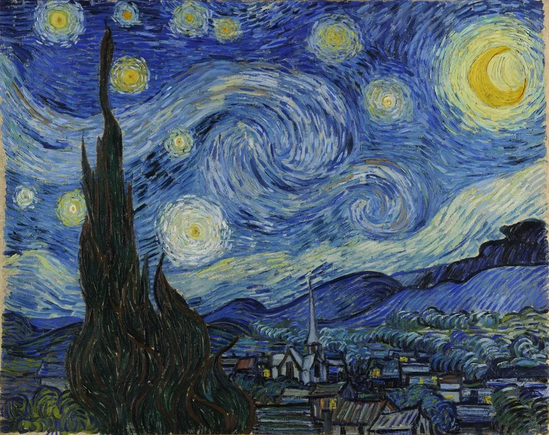 |

Detail at 100%: 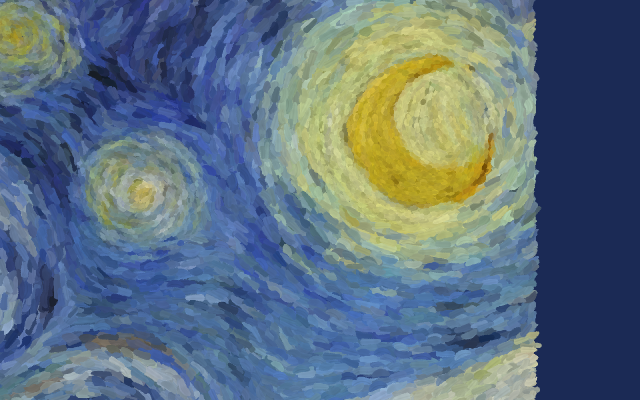

At a glance the shot is the painting. The swirls follow the flow field, including the large central double swirl. The stars and the crescent moon read as concentric rings of short strokes. The cypress reads as dark vertical flames, and the village keeps the church spire, the lit windows and the roof lines. Colour and value match the scan closely, because each stroke averages three samples of the scan along its own length.

Several things do not read as the painting.
- The strokes are finer and more uniform than Van Gogh's. A visible stroke fragment is about 1–3 cm on a 4 m canvas, so up close the sky reads as a mosaic of short dabs, not his long continuous ribbons. Longer sky strokes were tried (7 spacings instead of 5.2). They looked more painterly but blurred the dark swirl outlines, and the sky's difference from the scan rose from 9.5 to 12.1, so they were rejected.
- Heavy overlap hides most of each stroke. The painted area per stroke is about 5× its grid cell where the flow is flat and up to 12× in coherent swirls. As a result, the brush shapes show mainly as stroke ends.
- The canvas edge is ragged within about one stroke spacing (9 mm), because strokes centre on the canvas.

## P2 acceptance

Evidence for the Phase 2 criteria from [PRD.md](../PRD.md), gathered on branch `worktree-p2-starry-night` (macOS, Apple M4 Max, Metal GPU backend).

| ID | Criterion | Evidence | Status |
| --- | --- | --- | --- |
| P2-A1 | Generators are deterministic for a given seed (unit snapshot of vertex and stroke counts and bounds). | 2026-11-06, commit 4768e33. `tests/world-starry-night.test.ts` pins the seed-1 world as literals, over the real `CanvasSource` (frame.webp, regions.png and flow.png decoded with sharp). Generators: vertex and triangle counts and axis-aligned bounds rounded to 1 mm for the terrain (16,384 vertices, 32,258 triangles), ridge, houses, roofs, windows, church, cypress and sky dome. Scatter: the `scatterWorld` total (535,011), the per-layer counts and its `hashStrokeBuffers` (`9724bad8`, then `480f43d7`: SCATTER_VERSION 3 sets the lit-window depth flag in the spare meta byte, with the counts unchanged; then `51173374`: SCATTER_VERSION 6, see [Shared lift share](#shared-lift-share-walking-reorder); then `5b9be613`: SCATTER_VERSION 7 adds the village colours, see [Village house colours](#village-house-colours); then `6ed76c8a` on 46eb08f's base: SCATTER_VERSION 8 raises the dark house-wall strokes and darkens the church trim, see [Upper walls and church trim](#upper-walls-and-church-trim); then `696165d1`: SCATTER_VERSION 10 keeps the cypress in its own palette, see [Cypress blue patches](#cypress-blue-patches); then `cf326988`: SCATTER_VERSION 11 is the wall raise with the trim on every structure, on the cypress fix and the moon and stars, see [Trim on every structure](#trim-on-every-structure-ruling-q31); the versions after 11 are recorded in their own sections; now `38922948`, total 554,834: SCATTER_VERSION 16, the one canvas uv extent with the face-clamped placement and size cap, see [One canvas uv extent](#one-canvas-uv-extent-2026-11-09-card-01a1b27d2184)). Haze: 30,000 strokes, hash `49bf0339`, now `01933fb0`. Both tests pass inside `make checkall`. A scatter pin change requires a `SCATTER_VERSION` bump. A generator pin change does not, because the cache key carries the build SHA. | Met |
| P2-A2 | The painter's spot screenshot (`?shot`, `?noanim`, fixed seed) is compared to the reference scan with the downscaled perceptual metric defined in the P2 plan, and its threshold is set and recorded here. | 2026-11-06, commit bf9d9a9, production build served by `vite preview`. URL `/?painting=starry-night&diag&shot&noanim&seed=1&painter` (`?painter` puts the desktop camera on the painter camera, so the frame is exactly canvas uv [0, 1]²). Captured at 1280 × 1014 (the canvas aspect) with `bun scripts/fidelity.ts --url "<url>" --capture docs/shots/p2-painter-spot.png`, which runs `scripts/capture-shot.ts --size 1280x1014 --wait world` (headless Chromium, ANGLE Metal). Metric (`scripts/fidelity-lib.ts`): the scan `assets/scans/starry-night.jpg` is inset past its mat by the colour-sampling inset (45 px at the sides, 15 px at top and bottom), and both images go to 256 × 203 with sharp Lanczos in sRGB. SSIM is Wang et al. 2004 on Rec. 709 luma of the gamma-encoded sRGB values (11 × 11 Gaussian, σ 1.5, K1 0.01, K2 0.03, L 255, valid windows). ΔE is the mean CIEDE2000 over 16 × 12 block-mean colours averaged in linear light, CIELAB under D65. Measured **SSIM 0.2943** and **mean ΔE2000 5.6961**. The e2e build gives the same values to 4 decimals. The worst blocks (column, row from the top-left) are (14, 2) 51.4, (11, 11) 43.2, (15, 2) 35.3, (14, 1) 33.5 and (5, 6) 30.9: the moon three times, one near lit window, and the large star left of the swirl. Margin rule: the measured values are rounded to 4 decimals, then SSIM threshold = measured − 0.03 and ΔE threshold = measured + 1.5, giving **SSIM ≥ 0.2643** and **mean ΔE2000 ≤ 7.1961**. They are the exported constants `SSIM_THRESHOLD` and `DELTA_E_THRESHOLD`, and `tests/e2e/fidelity.spec.ts` asserts both. Determinism: a second capture was byte-identical (SHA-256 `960a0b8e…ba57`). A framing check found the capture's best shift against the scan at (0, 0) of a ±3 px search at 64 px wide. The thresholds are Paul accepted them on 2026-11-06 as the regression floor. He judges the look itself in the headset at P2.9 (P2-A4). Moved on 2026-11-09, when canvas uv became the painted canvas past the mat for every source and the reference became 256 × 206 and the capture 1280 × 1028: the accepted anchor keeps its headroom and moves by that change's measured delta. Its base 5171098 read SSIM 0.3474 and ΔE 5.2419 on the old reference and capture, and the change reads 0.3599 and 5.1701 on the new ones, so the anchor is 0.2943 + 0.0125 = 0.3068 and 5.6961 − 0.0718 = 5.6243, and by the same margins the thresholds are **SSIM ≥ 0.2768** and **mean ΔE2000 ≤ 7.1243** (`ACCEPTED_*` and `UV_CHANGE_*` in `scripts/fidelity-lib.ts`; see [One canvas uv extent](#one-canvas-uv-extent-2026-11-09-card-01a1b27d2184)). | Met |
| P2-A3 | Every world surface is stroke-covered, with no bare mesh visible from any point inside the boundary, checked by an e2e sweep of sample poses that counts background-colour pixels. | `tests/e2e/world-coverage.spec.ts` renders 24 poses with `?painting=starry-night&noanim&seed=1&shot&coverage` at 1280 × 720 and fails a pose over 0.5% bare. Maximum binary bare share 0.442% at hill west. The sweep renders through the 70° vertical desktop camera, which is narrower than the Quest 3's roughly 96° vertical view, so the edges of a headset view are not checked here. Widening the sweep is deferred, and the gap is recorded here. The coverage-weighted share, which also counts MSAA rims, peaks at 0.591% at hill west and is logged as telemetry only (ruling P21). The same figures came out of the P2.8 `make e2e` run on 2026-11-06. Since the one canvas uv extent (2026-11-09, SCATTER_VERSION 16): maximum bare 0.466% and weighted 0.621%, both at hill west (5171098 read 0.460% at village uphill and 0.602% at hill west), see [One canvas uv extent](#one-canvas-uv-extent-2026-11-09-card-01a1b27d2184). | Met |

### P2-A2 shot

Scan, capture and ΔE heat map (black 0, red 10, yellow 20 and above), each at 256 × 206 shown at 2×:

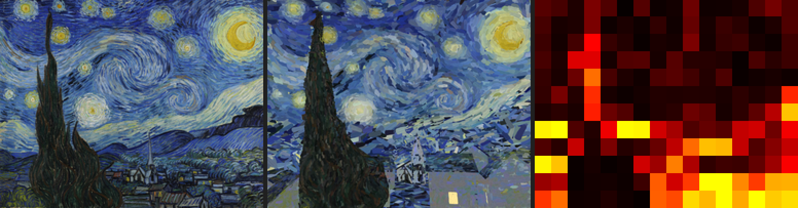

Full capture: 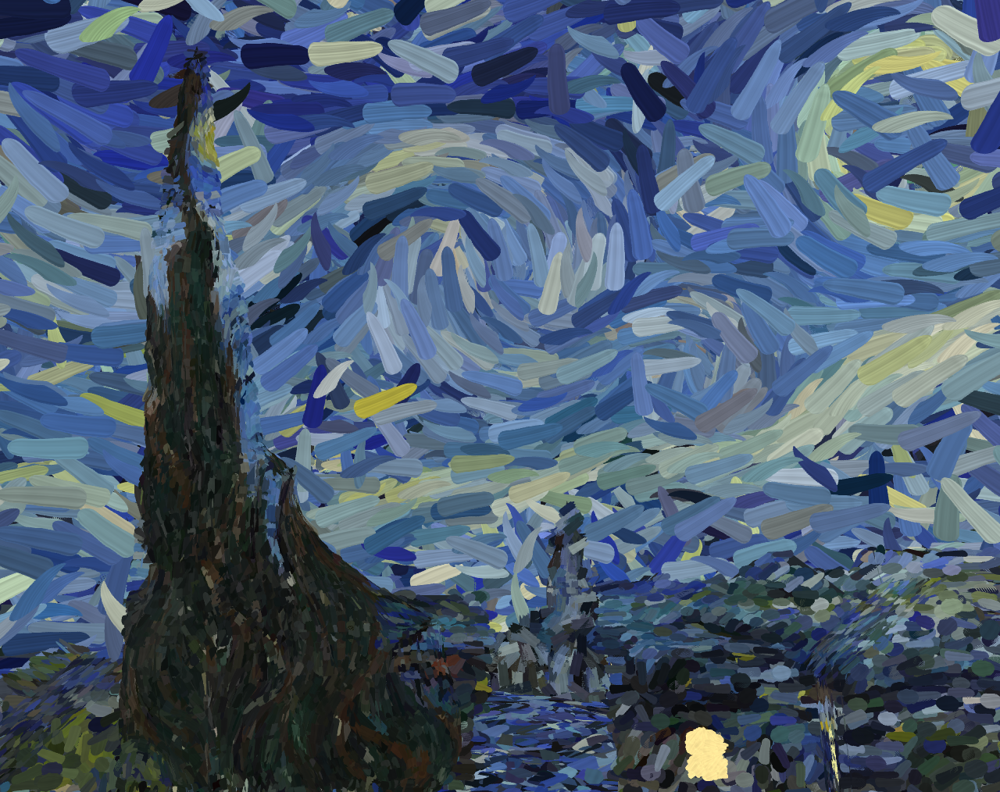

The P2-A2 row above records bf9d9a9: its measured values, worst blocks and SHA-256, and the thresholds set from them. These two images were regenerated on 2026-11-07 under the nowrite default (Nowrite stroke policy is the default, fix round 2): SSIM 0.3482, mean ΔE2000 5.2914, SHA-256 `bb9252fd…00ce`. They were regenerated again on 2026-11-09 for the one canvas uv extent and its window pane coverage fix, at 1280 × 1028: SSIM 0.3599, mean ΔE2000 5.1701, SHA-256 `31706eff…b122`.

SSIM is low because the comparison is luma structure at 256 px, where the scan's fine brushwork and the world's 1.8× strokes differ in texture everywhere. The threshold therefore catches gross breakage, such as lost framing, a missing cypress or a blank region, not subtle drift. The block ΔE carries the colour match. Visible gaps in this render, none of them tuned for P2.8:
- The stars and the moon are absent. Their rings are P4.3, so `world.counts` shows `star` and `moon` at 0, and the metric can only improve when they land.
- The distant ridge band on the right (v_down 0.50–0.72) reads as sky strokes, so blocks (15, 6) and (15, 7) are hot.
- The village houses are not legible as houses, and the church reads as a pale ghost.
- One near lit window reads as a large cream blob at the bottom, block (11, 11).

## Stroke flicker

Paul saw strokes behind the front layer strobe in the headset on 2026-11-06 (build ce29161). Head-tracking noise moves the eye about 0.1 mm a frame, and that swapped which of two overlapping strokes won the depth test. The fixes landed on 2026-11-06:
- Commit 934cf30 raises the camera near plane from 0.05 m to 0.1 m (`src/main.ts`). XR inherits it as `depthNear`.
- Commit 38a1f23 adds a depth tie-break in the stroke vertex shader (`src/render/strokes/depth-tie-break.ts`). Each stroke moves towards the eye by a stable per-instance hash share of 2048 depth steps (2^-23 in NDC z each), capped in metres of view depth. Only `gl_Position.z` changes, so early-z holds and no stroke moves on screen. Lit windows carry a flag in the spare meta byte and take the whole range, so almost every wall stroke stays behind them.
- Commit c538925 lowers the cap from 1.5 m to 0.5 m, and uses the step term alone for vertices behind the eye (clip w ≤ 0), where the cap's 1 / w is unbounded.
- Ruling Q21 then sets the cap to 0.25 m.

The probe is `bun scripts/zfight-probe.ts <base-url>`. It captures its poses at the painter's spot (four at first, eight now) with `?painting=starry-night&diag&shot&nogov&nocache` at 1280 × 1014, then captures each pose again unmoved, shifted 0.1 mm and shifted 1 mm along x. It reports the share of pixels whose summed RGB change exceeds 24 (`scripts/zfight-lib.ts`), per screen third. The runs used headless Chromium on ANGLE Metal (Apple M4 Max) against `make dev`. The unmoved capture changed 0.000% at every pose in every run, so the render is deterministic. The before row matches the deployed ce29161 exactly.

A shift that small still flips single pixels on stroke edges by parallax, because one MSAA sample's alpha-to-coverage bit changes. That floor was measured with a diagnostic build that removes the depth fight: near 1.0 m and a 0.5 lift jitter (SCATTER_DEPTH_JITTER), neither of them shippable. It grows linearly with the shift and ignores both settings. Acceptance counts the flips above that floor.

Share of pixels changed after a 0.1 mm shift, top / mid / bottom third (%):

| Build | painter-level (yaw 0, pitch 0) | painter-down (pitch -0.25) | village-look (yaw 0.6, pitch -0.1) | back (yaw π, pitch -0.1) |
| --- | --- | --- | --- | --- |
| Before: near 0.05 | 0.080 / 0.377 / 0.748 | 0.119 / 0.741 / 0.666 | 1.482 / 2.276 / 1.747 | 0.113 / 0.509 / 0.615 |
| Near 0.1 alone | 0.064 / 0.304 / 0.620 | 0.114 / 0.641 / 0.607 | 0.804 / 1.319 / 1.143 | 0.115 / 0.505 / 0.510 |
| After: near 0.1 and tie-break, 0.25 m cap | 0.039 / 0.100 / 0.258 | 0.054 / 0.194 / 0.582 | 0.247 / 0.406 / 0.661 | 0.058 / 0.209 / 0.444 |
| Parallax floor (diagnostic) | 0.039 / 0.080 / 0.260 | 0.053 / 0.147 / 0.529 | 0.048 / 0.094 / 0.461 | 0.031 / 0.052 / 0.346 |

Share after a 1 mm shift, same layout (%):

| Build | painter-level | painter-down | village-look | back |
| --- | --- | --- | --- | --- |
| Before: near 0.05 | 0.477 / 1.306 / 3.131 | 0.624 / 2.637 / 5.326 | 1.683 / 3.255 / 5.430 | 0.585 / 1.605 / 3.594 |
| Near 0.1 alone | 0.472 / 0.947 / 2.509 | 0.629 / 1.960 / 5.194 | 1.137 / 2.028 / 4.804 | 0.584 / 1.125 / 3.421 |
| After: near 0.1 and tie-break, 0.25 m cap | 0.396 / 0.711 / 2.070 | 0.450 / 1.377 / 5.050 | 0.574 / 0.976 / 4.187 | 0.373 / 0.750 / 3.292 |
| Parallax floor (diagnostic) | 0.375 / 0.705 / 2.412 | 0.476 / 1.314 / 5.115 | 0.375 / 0.691 / 4.202 | 0.259 / 0.432 / 3.186 |

Drop in the 0.1 mm flips above the floor, (before − floor) / (build − floor), top / mid. The target is at least 5× at the first three poses and 2.5× at back (ruling Q21; it was 3× at back before). "Floor" means the build reads at or below the floor.

| Build | painter-level | painter-down | village-look | back |
| --- | --- | --- | --- | --- |
| Near 0.1 alone | 1.6× / 1.3× | 1.1× / 1.2× | 1.9× / 1.8× | 1.0× / 1.0× |
| Tie-break, 0.1 m cap | 4.6× / 6.8× | floor / 5.3× | 3.3× / 5.4× | 2.6× / 1.6× |
| After: tie-break, 0.25 m cap | floor / 14.8× | 66× / 12.6× | 7.2× / 7.0× | 3.0× / 2.9× |
| Tie-break, 0.5 m cap (c538925) | 41× / 16.5× | floor / 12.9× | 11.4× / 7.4× | 3.9× / 5.0× |
| Tie-break, 1.5 m cap (38a1f23) | floor / 27.0× | floor / 12.9× | 31.9× / 14.1× | 11.7× / 6.3× |

The near plane alone barely moves the 0.1 mm flips. When the head moves less than one depth step, the flip rate depends only on how far apart the overlapping strokes sit, not on the step. Near 0.1 does cut the 1 mm flips, where the head moves more than a step.

Tie-break range: 1024 steps missed painter-down top (0.073% against a limit of 0.066%), and 2048 cleared every cell. The range is about 1.22e-3·d² m at view depth d, so the 0.25 m cap binds beyond 14 m.

Trade-off: two separate surfaces closer than the cap can trade places, so the cap bounds the reorder. 0.25 m does not exceed the 0.25 m roof overhang or the 0.3 m `OUTLINE_GAP` between neighbouring roofs. In far views, eaves, walls and roof edges still trade places along thin lines where they meet. A surface-id render of the village from 30 m up (pose 0, 30, -10, pitch -0.6) counts the bottom-third pixels whose surface changes against no tie-break: 0.18% at a 0.1 m cap, 0.41% at 0.25 m, 0.78% at 0.5 m and 1.78% at 1.5 m. At 0.25 m, the shipped cap, they are 1 to 3 px lines at the eaves and the wall bases. At 0.5 m those lines are about twice as thick, and at 1.5 m they spread into blobs. A finer id that also splits roofs and walls by facing (16 sectors) gives 0.19%, 0.47% and 0.86% at 0.1, 0.25 and 0.5 m, with no new swaps where differently facing roofs meet. Neighbouring roofs that face the same way share an id there, so a roof-to-roof swap between them is not measured. Ruling Q21 chose 0.25 m over 0.5 m. Its back mid reads 2.9×, short of the earlier 3× target, and that shortfall is within the hash-choice noise. The 0.5 m cap would double the swaps. `tests/strokes-depth-tie-break.test.ts` checks that the cap does not exceed the roof overhang or the roof gap, and checks that the range at the sky dome stays inside the gap to the ridge's farthest reach.

Village from 30 m up, bottom of the frame at half size. Top row: no tie-break, then the 0.25 m cap. Middle row: the surface-id render, then the pixels whose surface changes at 0.25 m. Bottom row: the same mask at 0.5 m, then at 1.5 m.

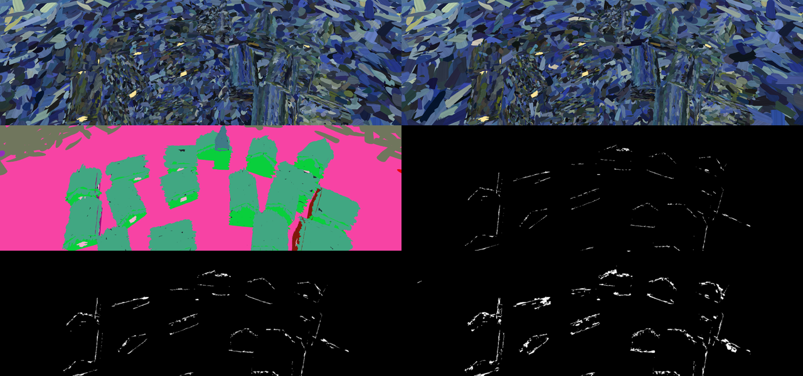

The coverage and fidelity gates stayed green with their thresholds unchanged. Before is the P2.8 record, and after is the 0.25 m cap:

| Gate | Before | After |
| --- | --- | --- |
| `world-coverage.spec.ts` max bare share (limit 0.5%) | 0.442% at hill west (weighted 0.591%) | 0.440% at hill west (weighted 0.590%) |
| `fidelity.spec.ts` SSIM (limit ≥ 0.2643) | 0.2943 | 0.2967 |
| `fidelity.spec.ts` mean ΔE2000 (limit ≤ 7.1961) | 5.6961 | 5.7021 |
| Near lit window, block (11, 11) ΔE | 43.17 | 42.61 |

The lit windows stay intact in the painter view and up close at the cypress base. In the painter view the church reads slightly paler and more defined, because its overlapping strokes now resolve in a fixed order.


### Sky dome strokes

Paul still saw the outermost sky strokes strobe in the headset on build e018c2f. At the dome's 120 m one window-depth step is about 8.6 mm, so the 0.25 m cap spans only about 29 steps. Dome strokes are about 7 m long, lie tangent to a curved dome and overlap heavily, so they still traded places.

The fix (`src/render/strokes/backdrop-depth.ts`) orders dome strokes by a stable per-instance rank instead of by geometric depth:
- The scatter sets `DEPTH_BACKDROP_FLAG` (bit 1 of the spare meta byte, counted from 0, value 2) on strokes from a surface with `userData.backdrop`, which only the sky dome carries (`src/world/sky.ts`). The boundary haze, `?demo=canvas` and `?strokesTest` also use stroke layer 0 (`STROKE_LAYER.sky`), so the flag selects the dome, not the layer. The ridge is layer `terrain`, region hills, so it uses `STROKE_LAYER.ground` and never gets the flag. Haze keeps its normal depth and the tie-break.
- The vertex shader writes clip z = w × (1 − (16 + 4·rank) · 2^-23) for a flagged stroke. The rank is the top 10 bits of the stroke's position hash, so 1024 ranks 4 steps apart sit between 16 and 4108 steps in front of the far plane. Each quad is flat in depth, so two overlapping dome strokes keep one order whatever the eye does. The 4-step spacing exceeds the GPU's rounding of z / w near 1.
- Stars and moon (layers 1 and 2) get a reserved front tier: the next 256 ranks, nearer than every dome rank. Since the moon and stars landed (see Moon and stars below), the shader takes a flagged star or moon stroke's rank from the top 8 bits of the hash (`h >> 24`) and then offsets it by 1024. Offsetting the dome's 10-bit rank instead would reach rank 2047. That rank still sits behind the 168.7 m world reach the budget test asserts, at about 169.8 m, but ranks 1280-2047 fall outside the 256-rank front tier the test checks, and the real margin shrinks from about 78 m to about 1 m.
- About 284k dome strokes share the 1024 ranks, about 277 per rank. Two overlapping strokes of the same rank sit at the same NDC z, so the GPU's rounding can still flip them under head motion. This residual is inherent: about 2060 ranks fit in front of the 169 m world reach, and the front tier takes 256 of them. The headset check should look for it.
- The nearest reserved rank is at 246 m of view depth at near 0.1 and far 1000. The farthest non-dome surface, seen from anywhere inside the boundary, is 169 m away, so every backdrop stroke draws behind the whole world. `tests/strokes-backdrop-depth.test.ts` checks this budget. A change to the camera's far plane in `src/main.ts` needs that test rerun.
- The dome has no base mesh any more (`base-meshes.ts`). At its true depth it would cover the far-end strokes, and the clear colour is already the dome's under-paint, or magenta in the debug paint.
- SCATTER_VERSION 4. Only the scatter hash changed (`bb6f674f`); every count is the same.

The probe gained three sky-heavy poses at the painter's eye: pitch +0.5, pitch +1.0, and a horizon pose toward the ridge (yaw −0.7, pitch +0.05). Before is e018c2f and after is the backdrop rank, both production builds served by `vite preview` and probed back to back on the same host. The first four poses match the earlier "After" row exactly, so the render is deterministic.

Share of pixels changed after a 0.1 mm shift, top / mid / bottom third (%):

| Pose | Before (e018c2f) | After (backdrop rank) |
| --- | --- | --- |
| painter-level | 0.039 / 0.100 / 0.258 | 0.037 / 0.098 / 0.258 |
| painter-down | 0.054 / 0.194 / 0.582 | 0.051 / 0.194 / 0.582 |
| village-look | 0.247 / 0.406 / 0.661 | 0.050 / 0.337 / 0.661 |
| back | 0.058 / 0.209 / 0.444 | 0.046 / 0.209 / 0.444 |
| sky-up-0.5 (pitch +0.5) | 0.030 / 0.039 / 0.093 | 0.028 / 0.037 / 0.091 |
| sky-up-1.0 (pitch +1.0) | 0.145 / 0.048 / 0.039 | 0.028 / 0.030 / 0.037 |
| ridge-horizon (yaw −0.7, pitch +0.05) | 0.235 / 0.346 / 0.383 | 0.044 / 0.345 / 0.383 |

Share after a 1 mm shift, same layout (%):

| Pose | Before (e018c2f) | After (backdrop rank) |
| --- | --- | --- |
| painter-level | 0.396 / 0.711 / 2.070 | 0.365 / 0.710 / 2.070 |
| painter-down | 0.450 / 1.377 / 5.050 | 0.449 / 1.377 / 5.050 |
| village-look | 0.574 / 0.976 / 4.187 | 0.367 / 0.911 / 4.187 |
| back | 0.373 / 0.750 / 3.292 | 0.297 / 0.750 / 3.292 |
| sky-up-0.5 | 0.316 / 0.370 / 0.676 | 0.288 / 0.343 / 0.662 |
| sky-up-1.0 | 0.429 / 0.332 / 0.354 | 0.226 / 0.281 / 0.345 |
| ridge-horizon | 0.429 / 0.653 / 1.279 | 0.207 / 0.653 / 1.279 |

The sky thirds drop to the parallax floor: village-look top reads 0.050%, against the 0.048% floor measured above, and ridge-horizon top drops 5.3×. The sky's flips now grow linearly with the shift (sky-up-1.0: 0.032% at 0.1 mm, 0.284% at 1 mm over the frame), the signature of edge parallax.

A second measure separates depth fights from edge flips: the share of the frame whose flipped pixel has at least 4 of its 8 neighbours flipped too. A depth fight flips a patch, and a parallax flip a 1 px line. After a 0.1 mm shift (% of the frame):

| Pose | Before | After |
| --- | --- | --- |
| sky-up-1.0 | 0.0206 | 0.0016 |
| ridge-horizon | 0.1059 | 0.0651 |
| village-look | 0.1011 | 0.0450 |
| sky-up-0.5 | 0.0052 | 0.0052 |
| painter-level | 0.0026 | 0.0026 |

In the after build, a diagnostic build that hid the haze measured 0.0000 clustered at sky-up-1.0, so the dome itself no longer fights and the 0.0016 left there is haze. The patches left at ridge-horizon and village-look sit on the horizon band. They are the boundary haze (45-55 m) and the ridge's 3-5 m strokes at 70-110 m, both at normal depth with the 0.25 m cap. With the haze hidden, the ridge alone flickers in large patches (0.63% clustered at ridge-horizon), which the haze mostly covers in the normal view. This is not fixed here.

The coverage and fidelity gates stayed green with their thresholds unchanged:

| Gate | Before (0.25 m cap) | After (backdrop rank) |
| --- | --- | --- |
| `world-coverage.spec.ts` max bare share (limit 0.5%) | 0.440% at hill west (weighted 0.590%) | 0.440% at hill west (weighted 0.590%) |
| `fidelity.spec.ts` SSIM (limit ≥ 0.2643) | 0.2967 | 0.2970 |
| `fidelity.spec.ts` mean ΔE2000 (limit ≤ 7.1961) | 5.7021 | 5.7006 |

### Shared lift share (walking reorder)

On build 616f0c9 Paul saw scattered spots on buildings and ground strobe from the painter's spot, each spot stable. He read one pose over CDP: eye (0.067, 1.551, 0.0), yaw −0.571, pitch −0.26. It is now the probe's `paul-strobe1`. On fce5dab he saw "a ton of strokes changing z-positions" as he walked, at particular angles and distances.

The walking reorder comes from two random orders that disagree:
- The scatter lifts each stroke off its surface by J × length × rand(), where J is `SCATTER_DEPTH_JITTER`, 0.02. That is a world-space order. Seen from in front of a flat face, the stroke lifted more is nearer along every ray, from any view.
- The shader's tie-break is a second, independent order by position hash. It works in depth space, and its size in metres grows with the square of the view depth up to the 0.25 m cap: about 5 mm at 2 m and 30 mm at 5 m, the same size as the lift.

Where the two orders disagree for an overlapping pair, the pair's depth gap crosses zero at some view distance and angle, and past it the order flips as the viewer walks. This does not explain the per-spot strobe in the 0.1 mm probe, which the fix leaves unchanged (below).

The fix (`src/render/strokes/depth-tie-break.ts`) makes one share drive both:
- A scattered stroke carries `DEPTH_RANKED_FLAG` (meta bit 6, value 64). Bits 0 and 1 stay the front and backdrop flags, and bits 2-5 the fit level.
- Its share, in [0, 1), is `sizeShare`: a `lowbias32` hash of its quad length and width as stored in float32. The scatter writes the size exactly and the lift does not move it, so the scatter and the vertex shader compute the same share. One unit test checks the JS hash against a BigInt reference. Another reads the shader's `lowbias32` body and its share lines from `stroke.vert.glsl`, evaluates them statement by statement on fixed sizes, and asserts they equal `sizeShare`. Swapping length and width on either side fails it.
- The lift is J × graded length × share. The graded length leaves out the ±15% size jitter, which would let the lift order and the share order disagree. The shader's tie-break takes the same share of its range.
- The two orders now agree for nearly every overlapping pair, but not for all of them. The lift scales with the graded length, which grows with the distance from the painter's eye, so two overlapping neighbours with close shares can still disagree. Measured on d36f7a4 in the seed-1 world, 0.66% of overlapping ground pairs disagree, 0.18% of building pairs and 0.21% of cypress pairs, against about half of them with two independent orders.
- The lift's old `rand()` draw is kept and discarded, so the brush, flip, phase and colour draws after it stay put.
- Outlines take the size share like every other stroke. Three other designs were tried and dropped:
  - Outline shares in the upper half, [0.5, 1) (dfaf236), so a contour lies over at least half of the body strokes on its face. It raised the clustered flips at 3 of 4 poses (table below) with no visible gain in the near-wall capture, so the controller ruled it backed out: flicker is what Paul reported, and a buried outline at some untested angle gets a targeted fix if it shows up.
  - A top band of shares for outlines (0.75-1) packed overlapping outlines four times as densely in depth and raised the clustered flips at the village poses.
  - A first version with 256 ranks stored in the colour alpha piled equal-rank pairs onto one lift and a narrow bias spread. It raised the bottom-third flips at 6 of 8 poses (+0.02 to +0.09 points).
- Haze, `?demo=canvas` and `?strokesTest` may repeat a size, so they keep the position hash.
- SCATTER_VERSION 6. Every count is unchanged, and the scatter hash is `51173374`. The village colours on top make it SCATTER_VERSION 7, hash `5b9be613` ([Village house colours](#village-house-colours)), and the house wall raise and church trim SCATTER_VERSION 8, hash `6ed76c8a`, on that base. On the cypress palette fix (SCATTER_VERSION 10, hash `696165d1`), the wall raise with the trim on every structure is SCATTER_VERSION 11, hash `cf326988`.

Order stability is measured without parallax, with a fixed eye. An id build colours each stroke by layer and hash, and a temporary uniform scales the tie-break range by 1.25, which is what walking about 12% farther does to the range against the lift. This is a proxy for distance only. It does not sweep the view angle. The table gives the share of the frame whose owning stroke changes. The after column is d36f7a4, whose scatter and shader the final build matches (same scatter hash).

| Pose | Before (fce5dab) | After (d36f7a4) |
| --- | --- | --- |
| painter-level | 3.234% | 1.817% |
| painter-down | 4.732% | 1.944% |
| village-look | 4.192% | 2.304% |
| back | 5.580% | 2.515% |
| ridge-horizon | 3.066% | 1.558% |
| paul-strobe1 | 4.887% | 1.813% |

The whole-stroke reorders on the near ground and the walls are gone. What is left:
- thin lines where tilted terrain strokes cross, since each takes its interpolated normal;
- the cypress;
- the haze, which is unranked.

In the figure, the top row is `paul-strobe1` and the bottom row `village-look`, before on the left and after on the right. Yellow marks a changed owner.

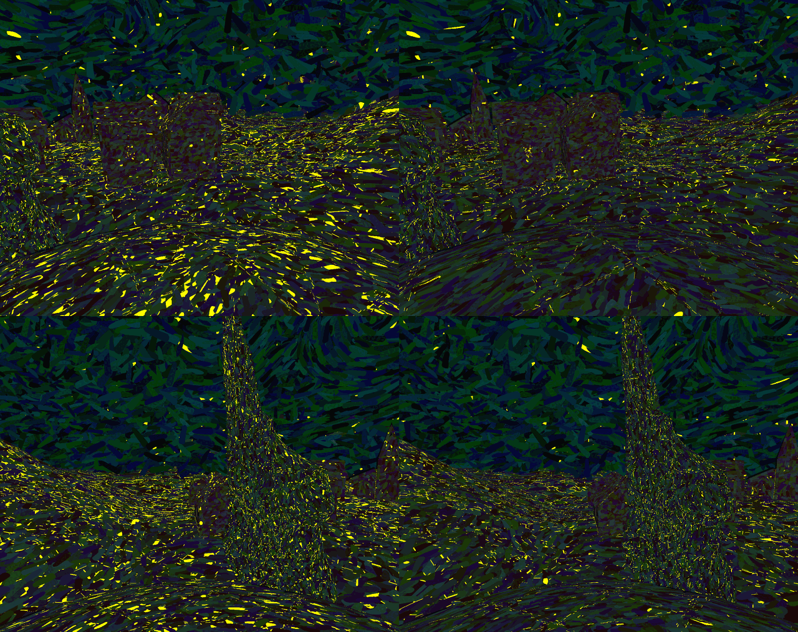

The distance bands (`bands.ts`) cannot cause these reorders. The test holds the eye still under `?nogov`, so no chunk changes band or density, and scaling the tie-break range alone reproduces them. A band still resizes every stroke of a chunk at once when the chunk crosses 6 m or 25 m (0.5 m hysteresis), and the governor resizes and thins chunks in the headset. Neither was measured here.

Clustered is the share of the frame whose flipped pixel has at least 4 of its 8 neighbours flipped, after a 0.1 mm shift (%). The final build reads the same as d36f7a4 at every pose:

| Pose | fce5dab | Upper-half outlines (dfaf236, backed out) | Final |
| --- | --- | --- | --- |
| paul-strobe1 | 0.076 | 0.100 | 0.085 |
| village-look | 0.049 | 0.059 | 0.047 |
| painter-level | 0.008 | 0.003 | 0.005 |
| ridge-horizon | 0.066 | 0.078 | 0.064 |

A near-wall capture shows house 11 from 6 m (eye (9.04, −3.27, −30.74), yaw −0.286, pitch 0.25): fce5dab on the left, the final build in the middle and the backed-out upper-half outlines on the right. In all three, the contour strokes along the corners and the roof line lie over the wall strokes, so this view shows no buried outline with or without the upper-half share.

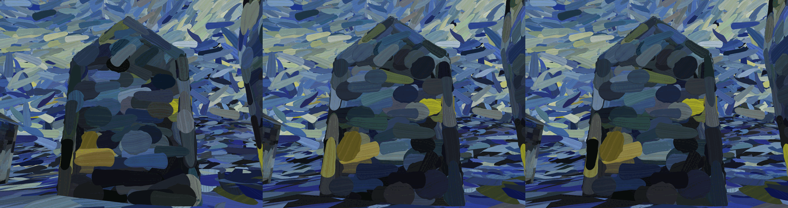

The 0.1 mm probe covers 8 poses, using production builds served by `vite preview` and probed back to back. Every unmoved capture changed 0.000%. The after column is the final build, which reads the same as d36f7a4 at every pose.

| Pose | Before (fce5dab), all (top / mid / bottom) | After, all (top / mid / bottom) | Parallax floor estimate, all |
| --- | --- | --- | --- |
| painter-level | 0.142 (0.043 / 0.128 / 0.257) | 0.125 (0.043 / 0.095 / 0.238) | 0.139 |
| painter-down | 0.283 (0.053 / 0.226 / 0.570) | 0.285 (0.051 / 0.220 / 0.584) | 0.256 |
| village-look | 0.357 (0.076 / 0.352 / 0.645) | 0.351 (0.076 / 0.309 / 0.667) | 0.215 |
| back | 0.238 (0.060 / 0.258 / 0.397) | 0.249 (0.068 / 0.269 / 0.409) | 0.155 |
| sky-up-0.5 | 0.052 (0.036 / 0.035 / 0.085) | 0.061 (0.036 / 0.039 / 0.109) | 0.053 |
| sky-up-1.0 | 0.037 (0.041 / 0.034 / 0.037) | 0.038 (0.040 / 0.035 / 0.039) | 0.036 |
| ridge-horizon | 0.268 (0.067 / 0.342 / 0.396) | 0.260 (0.070 / 0.349 / 0.361) | 0.102 |
| paul-strobe1 | 0.467 (0.165 / 0.482 / 0.754) | 0.449 (0.180 / 0.442 / 0.724) | 0.267 |

The share after a 1 mm shift, over the whole frame, in the table's pose order (%):
- before: 1.089, 2.342, 1.865, 1.472, 0.446, 0.305, 0.773, 2.434;
- after: 1.031, 2.356, 1.872, 1.467, 0.443, 0.310, 0.806, 2.376.

This fix leaves the 0.1 mm fixed-spot strobe unchanged. Per pose the whole frame moved between −0.018 and +0.011 points, and the eight totals sum 0.026 points lower than before. Single cells moved more:
- `village-look` mid fell 0.043 points and its bottom rose 0.022, `paul-strobe1` mid fell 0.040 and `painter-level` mid 0.033.
- The bottom third rose at 5 of 8 poses, by 0.002 to 0.024 points, and fell at `painter-level`, `ridge-horizon` and `paul-strobe1`. With the backed-out upper-half outlines it rose at 6 of 8, by up to 0.065.

The floor column is an estimate, not a lower bound. It comes from a diagnostic build with near 1.0 m and lift jitter 0.5, on the earlier 256-rank tree, and that build changes the depth precision and the scene as well as removing depth fights. `painter-level` reads 0.125% after, below its 0.139% floor estimate. So the column does not show whether a depth fix could bring `paul-strobe1` (0.449%) or `village-look` (0.351%) to the ≤ 0.2% goal, and neither pose reaches it.

What the fixed-spot flicker is made of, from id builds of fce5dab and of the 256-rank version:
- The id builds classify the flipped pixels at `paul-strobe1`, `village-look` and `ridge-horizon`. Over 93% are stroke against stroke within one layer. Ground leads at every pose, and the second layer is walls and roofs or the cypress, depending on the pose (cypress is 30% at `village-look` on fce5dab). Haze is a few percent.
- Each of these is under 1%: strokes against a base mesh (a `?coverage` id run of the before build), window against wall, and every other cross-layer pair.
- Past about 14 m the 0.25 m cap binds, so the tie-break spans 0.25 m / step(d) steps: about 1,000 at 20 m and 470 at 30 m. Two overlapping strokes whose shares fall within the GPU's 1-2 steps of rounding still fight. A larger range there needs a larger cap, which ruling Q21 rejected.

The gates stayed green with their thresholds unchanged:

| Gate | The overhang record | Before (fce5dab) | After (final) |
| --- | --- | --- | --- |
| `world-coverage.spec.ts` max bare share (limit 0.5%) | 0.459% at village uphill | not measured | 0.451% at hill west (weighted 0.605%) |
| `fidelity.spec.ts` SSIM (limit ≥ 0.2643) | 0.2963 | 0.3202 | 0.3196 |
| `fidelity.spec.ts` mean ΔE2000 (limit ≤ 7.1961) | 5.7457 | 5.7934 | 5.7553 |
| Near lit window, block (11, 11) ΔE | 42.61 (e018c2f) | 37.25 | 37.32 |

The SSIM rise of 0.023 over the overhang record predates this fix. The same capture (`scripts/fidelity.ts --url` with `?painting=starry-night&diag&shot&noanim&seed=1&painter`) reads 0.3202 on fce5dab, so the rise came in with the commits between the overhang record and fce5dab, which were not traced here. This fix moves SSIM by −0.0006. Diagnostic builds of the dfaf236 tree (with the backed-out upper-half outlines), each restoring one layer's old lift (J × length × rand()) and position-hash tie-break, attribute the change:

| Build | SSIM |
| --- | --- |
| fce5dab | 0.3202 |
| Final (same as d36f7a4) | 0.3196 |
| dfaf236 | 0.3191 |
| dfaf236, every layer reverted | 0.3202 |
| dfaf236, ground reverted | 0.3186 |
| dfaf236, buildings and outlines reverted | 0.3209 |
| dfaf236, cypress reverted | 0.3180 |
| dfaf236, sky reverted | 0.3197 |

Reverting every layer gives exactly fce5dab's 0.3202, so the diagnostic reproduces the old order. No single layer moves SSIM by more than 0.002. The buildings and outlines lower it most (0.0018), and the cypress and ground raise it (0.0011 and 0.0005).

The figure crops the painter capture to the band from the ridge to the village (rows 520-820 of 1280 × 1014), fce5dab on top and the final build below. Stroke layout and orientation match, and no upright strokes vanished. An earlier note said fewer strokes stood upright there after the fix. It came from captures taken without `&noanim`, which differ in animation time, and it is withdrawn.

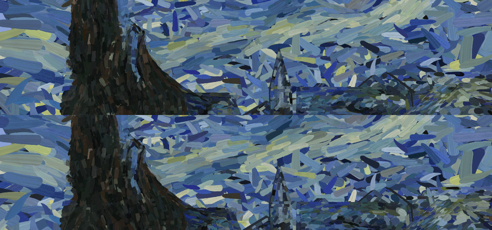

## Village stroke overhang

Paul saw strokes hang past the house and church edges into the sky on build e018c2f. The scatter placed every stroke at a point on its triangle and drew its whole quad, so a stroke near a face edge stuck out by up to its own width.


### What changed

`src/render/strokes/face-clamp.ts` fits the strokes of the `building`, `roof`, `window` and `church` layers (`FACE_CLAMPED_LAYERS` in `scatter.ts`) into their host face, and the walls, roofs and church get a row of outline strokes. Terrain, cypress, sky and haze strokes are unchanged, bit for bit.
- A face is the set of coplanar triangles joined by shared edges, held as its convex hull. A quad's diagonal and a gable end's eave line never clip a stroke. On the seed-1 village, 448 triangles form 205 faces, all convex.
- What is fitted is the stroke's painted footprint, not its quad. Brush masks span only 50-94% of their quad (`BRUSH_FOOTPRINT`, the largest box measured over atlas seeds 1-12). Fitting the whole quad held the paint a quarter of a stroke inside every edge.
- The clamp: move across by the overhang, or narrow to the face where it is narrower than the stroke. Then slide along the stroke's axis if the face has room for its length, otherwise shrink to the room. The footprint may reach past the face by 10% of its own width. A bevel half-plane at each hull vertex keeps the Euclidean overhang within that margin beside sharp corners.
- Edge alignment (`fitStrokeToFace`): a stroke whose clamped footprint still reaches past a side is turned to run along that side, keeping the way it points. Its scattered centre moves in until its outer long side sits at the edge plus the margin, and it is clamped again at its original size. Between sides it reaches past by as much, it takes the one it already runs most nearly along. The brush's rounded ends then lie along the edge instead of across it.
- Outline pass (`placeOutlines` in `scatter.ts`): every side of every wall, roof and church face gets a row of strokes laid along it and fitted flush inside it the same way, from their own rand stream. There is one per 0.8 of the graded stroke length, thinned evenly so the rows total at most 5% of the face-clamped strokes (`OUTLINE_SHARE`). They use the ridge and bristle brushes, the canvas colour at the edge darkened to 75% (`OUTLINE_DARKEN`), and a lift and tie-break share from their quad size like every other stroke (`sizeShare`, see Shared lift share). Van Gogh draws the village in dark contours, and the row covers the rim the rounded brush ends leave bare. Seed 1 gets 3,105 outline strokes, 3.7% of the 84,264 face-clamped strokes (budget 4,213). Since ruling Q31 every outlined layer is a tagged village mesh, whose outlines take their region's trim undarkened instead ([Trim on every structure](#trim-on-every-structure-ruling-q31)).
- The shader scales strokes by the distance-band factor (1.05 mid, 1.6 far, more under the governor). The scatter stores the largest factor that still fits as a 4-bit fit level in the spare meta byte, bits 2-5 counted from 0 (mask 60), above the tie-break flag (bit 0, value 1) and the backdrop flag (bit 1, value 2), and the vertex shader caps the factor there. Level k caps at 1 + (k - 1)/16, so the cap tops out at 1.875.
- SCATTER_VERSION 5. The face-clamped strokes keep their count and their triangle, because their rand stream is unchanged. The world gains the 3,105 outline strokes: 538,116 strokes in all, 87,369 in stroke layer `building`, and the scatter hash is `177391e4`.

`tests/world-starry-night.test.ts` measures the overhang on the seed-1 world without the scatter's face grouping. Each stroke is matched to the coplanar village triangles that hold its centre: a window stroke to the panes only, since the wall 2 cm behind a pane would otherwise absorb a stroke spilling past it, and every other stroke to the rest only. The test measures its paint box from the default-seed atlas, at the near, mid and far band factors capped by its fit level, and at the fit cap itself, the largest factor the governor can grow it to (1.875 for an unfitted stroke). Overhang is the furthest corner's distance outside those triangles, as a share of the stroke's footprint width (the `BRUSH_FOOTPRINT` table width, which bounds the measured paint by up to 1.22 times):

| Seed-1 village strokes | Before (c982599, 84,264) | After (87,369, outlines included) |
| --- | --- | --- |
| Over 10% of their footprint width, near / mid / far / cap | 26.4% / 27.6% / 39.5% / 45.0% | 0 / 0 / 0 / 0 |
| Worst overhang, any band | 1.33 footprint widths | 0.083 footprint widths |

With the window fit switched off, the same test fails: 2,886 strokes over 10% at near, worst 1.32 footprint widths. The fit keeps 99.55% of the building, roof and church footprint area and 95.50% of the windows', and under 0.5% of the building, roof and church strokes (3.2% of the window strokes) keep less than a quarter of their area. The test asserts floors of 98% and 1% (93% and 5% for windows).

### Coverage and fidelity

Fitting alone pulls the paint inside the edges and exposes the base mesh along them, because the brush masks have rounded ends and corners. A diagnostic build that drew every quad solid read 0.04% bare at the close house pose, so that band comes from the brush shapes, not from the fit's geometry. Edge alignment closes most of it and the outlines most of the rest. Each step was measured as its own production build. `world-coverage.spec.ts` (limit 0.5% per pose, unchanged):

| Pose | Before (c982599) | Footprint clamp | + edge alignment | + outlines (final) |
| --- | --- | --- | --- | --- |
| village church | 0.080% | 1.720% | 0.114% | 0.096% |
| village uphill | 0.333% | 1.167% | 0.486% | 0.459% |
| village west | 0.296% | 0.926% | 0.353% | 0.298% |
| village street | 0.117% | 0.904% | 0.178% | 0.157% |
| boundary 47 m inward | 0.043% | 0.778% | 0.087% | 0.081% |
| hill slope | 0.094% | 0.556% | 0.210% | 0.208% |
| spot ahead | 0.276% | 0.512% | 0.367% | 0.359% |
| high over the valley | 0.039% | 0.433% | 0.164% | 0.135% |
| max over the 24 poses | 0.440% (hill west) | 1.720% (village church) | 0.486% (village uphill) | 0.459% (village uphill) |

The village poses still read a little more bare than before: rounded brush corners leave small wedges where two edges meet. The worst pose keeps 0.041 percentage points of headroom. The fragment-shader clip against the face edges was not needed, so no per-instance data was added.

| Gate | Before (c982599) | Footprint clamp | + edge alignment | + outlines (final) |
| --- | --- | --- | --- | --- |
| `fidelity.spec.ts` SSIM (limit ≥ 0.2643) | 0.2970 | 0.2992 | 0.2990 | 0.2963 |
| `fidelity.spec.ts` mean ΔE2000 (limit ≤ 7.1961) | 5.7006 | 5.8256 | 5.6130 | 5.7457 |

`docs/shots/village-overhang.png` shows house 11 from 6 m, eye (9.04, −3.27, −30.74), yaw −0.286, pitch 0.25. The left column is c982599 and the right column the final build. The top row is the normal render and the bottom row `?coverage`. Before, strokes hang past the gable and the walls into the sky. After, the house keeps its silhouette with a dark contour along its edges. The bare share at this pose is 0.112%, against 0.081% before and 1.148% with the footprint clamp alone.

## Village house colours

Paul reported from the headset at ground level that the houses and the church "look almost the same pallet at the ground". Every wall, roof and church stroke that the scatter could not read from the scan drew at random from the one village-region histogram, whose blues match the hills. A count over the seed-1 village found a second cause: `projectToCanvas` has no back-face test, so about 30% of the wall, roof and church area that faces away from the painter (backs and far sides) also took scan pixels, painted from whatever house the painting shows along that ray.

### What changed (rulings Q28 and Q30)

- `src/paintings/starry-night/village-tint.ts` splits the village region's colour histogram into bands by texel-weighted L* quantile. Roofs and the church's nave roof take the darker half (L* 1.1-25.0). House walls take the 0.9-0.97 band, and the church walls and spire the 0.97-1 band. Each wall band keeps only bins at or under a texel-weighted chroma quantile of the region: the median for house walls (L* 46.6-56.8), the lower quartile for the church (L* 57.0-78.3). Without the cap, the lit windows' yellows, which are among the village's lightest paint, turned whole walls yellow. The church band lies wholly above the house band, so the church is lighter than every house. The house floor was 0.85 (L* 41.7-56.8) until ruling Q30. 0.9 is the lowest floor that lifts house 19's back past 15.
- `src/world/village.ts` tags every building, roof and church triangle in `userData.tint` with its owner (house index; the church is owner 0) and role. Church triangles that are exactly vertical (tower shaft, nave walls and gables) and the spire (every vertex at or above the tower top) take the church wall tint, as the painting's spire is pale. Only the nave roof is dark.
- Each owner picks one texel-weighted bin per role from its band, seeded from the world seed, the layer and the owner. Each stroke takes one of the 6 bins nearest that tint (CIE76), so a house reads as one object and neighbours differ. The jitter stays within CIE76 5.90 of the tint over the seed-1 houses, which get 15 distinct wall tints and 18 distinct roof tints among 20.
- In `scatter.ts` the change is colour only. A stroke keeps the scan pixel when its face is turned toward the painter's spot and the stroke is in frame on its layer's region. There is no occlusion test, so a turned face hidden behind a nearer house also keeps the scan. On the church walls and spire, those scan pixels are lifted in lightness, and on house walls the ones darker than the wall band are raised to its floor (both below). Every other village stroke takes its owner's tint. Outlines are darkened to 75%, and on the church walls and spire they draw from the church trim instead of the wall tint, so they read dark (mean L* 8.2 for seed 1, see [Upper walls and church trim](#upper-walls-and-church-trim)). Since ruling Q31, every outline on the houses, roofs, church and spire draws from its region's trim, undarkened ([Trim on every structure](#trim-on-every-structure-ruling-q31)). The tints draw from their own streams (purposes 3 and 4), so positions, normals, tangents, sizes and meta bytes are bit-identical to before. `tests/starry-night-village-tint.test.ts` checks this over the whole seed-1 scatter. The counts are unchanged, and coverage cannot move.
- SCATTER_VERSION 7, on top of the shared lift share's 6. The only pin that moved is the scatter hash, because only colours changed. On their own branch, before integration, the colours moved it from `177391e4` to `54f8c866` (Q28), then `b6a97b83` (Q30). Combined with the shared lift share (`51173374`) it is `5b9be613`. The house wall raise and church trim make it SCATTER_VERSION 8, hash `6ed76c8a`. On the cypress palette fix, the wall raise with the trim on every structure is SCATTER_VERSION 11, hash `cf326988`. The haze pin and every count stay. The generator pins are unchanged, because the tags live in `userData`.

### Faces turned toward the painter keep the scan

Three builds were measured with those faces moved toward the house tint by α in linear light (house walls and roofs only, never the church). They used earlier settings: the house walls took 0.8-0.95 with no chroma cap, and the poses came from a double-sided raycast. The wall column is house 18's gable, a face turned toward the painter, from eye (10.01, −3.22, −30.94). That pose is not in the final A1 table:

| α | SSIM (limit ≥ 0.2643) | mean ΔE2000 (limit ≤ 7.1961) | house 18 gable wall–ground ΔE |
| --- | --- | --- | --- |
| 0 (keep the scan) | 0.3182 | 5.8646 | 11.1 |
| 0.5 | 0.3030 | 6.8984 | 12.2 |
| 1 (tint everywhere) | 0.2763 | 7.6855 (fails) | 16.5 |

α = 1 breaks fidelity. α = 0.5 spends 1.03 of the 1.40 ΔE margin and still leaves that wall under 15. So these faces keep the scan under the blend (`SEEN_TINT_BLEND` 0), and the church faces turned toward the painter keep it under the blend as well, as Paul asked. There are two exceptions, and both move L* only and keep the hue. The Q30 lightness lift on the church front (below) raises the lighter scan strokes on the church walls and spire. The house wall raise ([Upper walls and church trim](#upper-walls-and-church-trim)) raises the house-wall scan strokes darker than the wall band up to its floor.

### Church front lightness lift (ruling Q30)

Paul sees the church from the painter's spot as white with dark trim. The church keeps the scan's hue and trim, but its lighter scan strokes are stretched toward the church wall tint. On church wall and spire triangles only, a seen stroke whose L* is above the church region's texel-weighted median (L* 27.4) moves its L* toward the owner's church wall tint (L* 60.9 for seed 1) by α_L. Its a* and b* are kept. Strokes at or below the median are the painted trim and keep the scan colour (`SEEN_LIGHTNESS_LIFT`, `LIFT_PIVOT_QUANTILE`).

α_L was measured in 0.25 steps on production builds of this change. The pick rule keeps at least half of round 1's fidelity margin (SSIM 0.3180 and ΔE 5.8433, so SSIM ≥ 0.29115 and ΔE ≤ 6.5197) and asks for a church-front wall–ground ΔE ≥ 15:

| α_L | SSIM (rule ≥ 0.29115) | mean ΔE2000 (rule ≤ 6.5197) | church front wall–ground ΔE | church front wall L* |
| --- | --- | --- | --- | --- |
| 0 | 0.3182 | 5.8805 | 5.4 | 38.3 |
| 0.25 | 0.3184 | 5.8984 | 5.8 | 40.4 |
| 0.5 | 0.3183 | 5.9200 | 7.0 | 42.8 |
| 0.75 | 0.3181 | 5.9458 | 8.8 | 45.4 |
| **1 (chosen)** | 0.3176 | 5.9748 | 11.2 | 48.2 |

Every step keeps the margin, and none reaches 15, so α_L = 1, the best value within the margin. The ceiling comes from the pivot: about half of the church region's scan paint lies at or below the median and stays dark by design. As a diagnostic only, the 0.25 quantile pivot (L* 15.8) at α_L = 1 reads 18.2 (wall L* 55.3) with SSIM 0.3153 and ΔE 6.0689, also within the margin. It is not adopted, because the ruling puts the trim boundary at the median.

### Upper walls and church trim

The figures in this section were measured on 46eb08f's base. SCATTER_VERSION 11 keeps α_W 1 on the cypress palette fix and the moon and stars, see [Trim on every structure](#trim-on-every-structure-ruling-q31).

Paul checked 46eb08f in the headset at ground level. The church read mostly white with no dark trim, and the houses read white at the bottom with ground colours on the top half.

Diagnosis (seed 1, at 46eb08f). The roofs are not the cause: at the roofs pose the roof reads L* 6.4 against 33.5 for the ground (roof–ground ΔE 20.5, roof–wall 36.7), and the roof tint strokes average L* 14.5. The cause is the scan pixel kept on house walls turned toward the painter. Such a stroke keeps the scan when it projects into the painting's village region. The 3D walls rise past the painted wall tops, so their upper parts project onto the painting's dark roofs and shadows, while their lower parts more often fall below the frame and take the pale wall tint. Over the 24,236 painter-facing house-wall strokes, by height up the wall from base to eaves:

| Height band | Strokes | Out of frame (tint) | On the village region (scan kept) | Other region (tint) | Scan-kept L* | Tint L* |
| --- | --- | --- | --- | --- | --- | --- |
| 0-25% | 5,404 | 48.7% | 39.2% | 12.1% | 23.9 | 51.4 |
| 25-50% | 5,563 | 37.7% | 49.3% | 13.0% | 24.0 | 51.3 |
| 50-75% | 5,362 | 23.9% | 62.1% | 14.0% | 25.4 | 51.0 |
| 75-100% | 5,388 | 15.4% | 62.2% | 22.4% | 29.0 | 50.6 |
| gable, above the eaves | 2,519 | 3.7% | 58.8% | 37.5% | 33.1 | 49.8 |

The church outlines took the pale church wall tint at 75%: its 294 outline strokes averaged L* 38.7 (42.2 on vertical faces, 32.6 on sloped ones), and only 21.1% were at L* 30 or below.

House walls. A painter-facing house-wall stroke whose scan pixel is darker than the house wall band's floor (L* 46.6) has its L* raised toward that floor by α_W (`SEEN_WALL_LIFT`, `raiseLightness`). Its a* and b* are kept, so the wall keeps the scan's hue. The half-margin rule binds α_L only, so α_W answers to the fidelity thresholds. Production builds on 46eb08f, all with the church trim below:

| Variant | SSIM (limit ≥ 0.2643) | mean ΔE2000 (limit ≤ 7.1961) | house 2 front, wall L* upper / lower half | house 16 gable, wall L* upper / lower half | wall–ground ΔE, house 2 front / house 16 gable |
| --- | --- | --- | --- | --- | --- |
| 46eb08f | 0.3163 | 5.9204 | 41.4 / 52.8 | 39.3 / 53.0 | 21.5 / 19.9 |
| trim only (α_W 0) | 0.3163 | 5.9146 | 41.4 / 52.8 | 39.3 / 53.0 | 21.5 / 19.9 |
| tint replaces the scan below the floor | 0.2908 | 7.7074 (fails) | 52.6 / 53.0 | 54.9 / 54.7 | 23.7 / 26.4 |
| α_W 0.5 | 0.3108 | 6.3296 | 44.7 / 52.9 | 43.5 / 53.4 | 22.4 / 20.2 |
| α_W 0.75 | 0.3036 | 6.6699 | 46.8 / 52.9 | 46.3 / 53.7 | 23.0 / 20.7 |
| **α_W 1 (chosen)** | 0.2946 | 7.0740 | 49.2 / 52.9 | 49.6 / 54.1 | 23.7 / 21.4 |

Replacing the scan with the tint breaks fidelity. α_W = 1 is the largest raise, and brings each wall's upper half to within 4.5 L* of its lower half. It spends 1.15 of the 1.28 ΔE margin left at 46eb08f. The cost is in the painter-spot view: the raised strokes lighten the foreground houses' painted shadows there too.

Church trim. Each church owner also picks a trim colour from the church region's paint at or below the lift pivot (L* 27.4), with no chroma cap (`trimBand`, `trimSeed`). An outline stroke on church wall and spire triangles keeps the scan when the painter sees it and its scan L* is at or below the pivot, so painted trim stays painted. Otherwise it takes a colour around the trim tint (`outlinePaint`). Outlines are still darkened to 75%. The outlines were found by dumping the seed-1 church strokes' paint L* at `OUTLINE_DARKEN` 0.75 and 0.5, as the strokes that differ:

| Church strokes | 46eb08f | Trim |
| --- | --- | --- |
| outline mean L* (294 strokes) | 38.7 | **8.2** |
| outline mean L*, vertical faces / sloped faces | 42.2 / 32.6 | 7.9 / 8.7 |
| outline share at L* ≤ 30 | 21.1% | 99.7% |
| body mean L* | 47.7 | 47.7 |

α_L stays 1. The church front wall still reads 56.1 on its upper half and 44.0 on its lower half, so the face keeps its painted variation, and the church front shot shows the dark outlines on the tower and spire edges.

Contrast at ground level (`scripts/village-contrast.ts`, same poses as A1 below), 46eb08f → this change:

| Pose | Wall–ground ΔE | Roof–wall ΔE | Roof–ground ΔE | Wall L*, upper / lower half | Wall / ground / other house walls L*, after |
| --- | --- | --- | --- | --- | --- |
| house 2, front | 21.5 → **23.7** | roof hidden | roof hidden | 41.4 / 52.8 → 49.2 / 52.9 | 51.5 / 33.2 / 47.9 |
| house 19, back | 21.0 → **21.0** | roof hidden | roof hidden | 48.7 / 48.5 → 48.7 / 48.5 | 48.6 / 33.3 / 49.8 |
| house 16, gable | 19.9 → **21.4** | roof hidden | roof hidden | 39.3 / 53.0 → 49.6 / 54.1 | 51.9 / 36.8 / 48.3 |
| house 0, roofs | 22.1 → **22.1** | 36.7 → **36.7** | 20.5 → **20.5** | 51.8 / 50.9 → 51.8 / 50.9 | 51.4 / 33.5 / 52.1 (roof 6.4) |
| church, front | 13.0 → 12.6 | nave roof hidden | nave roof hidden | 56.5 / 44.3 → 56.1 / 44.0 | 48.5 / 35.5 / 47.4 |
| church, back | 30.2 → **30.1** | nave roof hidden | nave roof hidden | 59.8 / 59.8 → 59.7 / 59.7 | 59.7 / 32.2 / 51.0 |

House 19's back and house 0's back wall face away from the painter, so they never kept the scan and do not move. The 46eb08f values differ from the A1 table's Q30 column, which was measured before integration onto the shared lift share.

### Trim on every structure (ruling Q31)

Paul compared the village with the scan and noted that every structure in the painting has black trim and outlines. Ruling Q31 asked for that trim and for per-building palettes. The review of dad7f6d held the palettes, so this build ships the trim alone, with 0579a44's wall raise and church trim, on top of the cypress palette fix.

What changed:

- `trimBand` (`village-tint.ts`) is now each layer region's paint at or below its texel-weighted median L* (the lift pivot), with no chroma cap: L* 1.1-25.0 for the village region (mean 15.3) and L* 1.1-27.4 for the church region (mean 15.4).
- Every outline on a tagged mesh (house walls, roofs, the church walls, spire and nave roof, all roles) draws from its region's trim (`outlinePaint`). It keeps the scan pixel only where the painter sees the face and the pixel is at or below the median, so painted trim stays painted. Otherwise it draws one texel-weighted bin of the trim band (`drawBand`), one draw from the mesh's outline tint stream, so positions stay bit-identical.
- No `OUTLINE_DARKEN` on the trim. Untagged meshes keep the 0.75 darkening. `trimSeed` and the per-owner church trim pick are gone, and `outlinePaint` lost its unused layer argument.
- Body strokes are 0579a44's: no per-building palettes, no palette floors, and the house wall raise at full strength (α_W 1, `SEEN_WALL_LIFT`), so the walls read pale from base to eaves.
- SCATTER_VERSION 11, scatter hash `cf326988`, every count unchanged. The moon and stars (a649d39) are a separate stroke set, so the scatter hash is the same on dab260e and on a649d39.

Measured over the seed-1 scatter, counting the outline strokes from `placeOutlines`' index ranges: **3,105 outline strokes, mean L* 15.4**, 47.9% at or below L* 15 and 69.6% at or below 20. 2,795 (90.0%) draw from the trim band (mean L* 15.3), and 310 (10.0%) keep the scan's painted trim (mean L* 15.9). At 0579a44 only the church outlines took a trim (294 strokes, mean L* 8.2 after the 0.75 darkening), and the house and roof outlines took the wall or roof paint darkened to 75%. The wall raise does not touch outlines.

Fidelity at the painter's spot, on a649d39 (the cypress fix with the moon and stars), from `E2E_PORT=4297 make e2e`: **SSIM 0.3347, mean ΔE2000 5.4771** (limits ≥ 0.2643 and ≤ 7.1961), leaving 1.72 of the ΔE margin. Coverage: max bare 0.451% at hill west (weighted 0.604% at hill west).

On dab260e, before the moon and stars, the full raise did not fit. There the cypress fix alone had moved the base from ΔE 5.9204 to 6.3258, and α_W 1 added about 1.14 on top. Measured on dab260e (production build served by `vite preview`, `scripts/fidelity.ts`):

| α_W | SSIM (≥ 0.2643) | Mean ΔE2000 (≤ 7.1961) |
| --- | --- | --- |
| 1 (e2e 36 of 37, `fidelity.spec.ts` failed) | 0.2727 | 7.4659 (fails) |
| 0.75 | 0.2817 | 7.0647 |
| 0.5 | 0.2888 | 6.7278 |
| 0, trim only | 0.2945 | 6.3233 |

The moon and stars lower the base: a649d39 measures mean ΔE 4.3370 before this change, which gives the full raise room again. The trim itself costs nothing measurable: on dab260e, α_W 0 gives 6.3233 against 6.3258 for the cypress fix alone.

Contrast at ground level (`scripts/village-contrast.ts`, the 0579a44 poses), 0579a44 → this build:

| Pose | Wall–ground ΔE | Roof–wall ΔE | Roof–ground ΔE | Wall L*, upper / lower half | Wall / ground L* |
| --- | --- | --- | --- | --- | --- |
| house 2, front | 23.7 → **23.5** | roof hidden | roof hidden | 48.9 / 52.8 | 51.3 / 33.2 |
| house 19, back | 21.0 → **20.9** | roof hidden | roof hidden | 48.6 / 48.3 | 48.5 / 33.3 |
| house 16, gable | 21.4 → **21.4** | roof hidden | roof hidden | 49.6 / 54.0 | 51.9 / 36.8 |
| house 0, roofs | 22.1 → **21.8** | 36.7 → **36.4** | 20.5 → **20.5** | 51.5 / 50.7 | 51.0 / 33.5 (roof 6.4) |
| church, back | 30.1 → **30.1** | nave roof hidden | nave roof hidden | 59.7 / 59.7 | 59.7 / 32.2 |
| church, front | 12.6 → **12.6** | nave roof hidden | nave roof hidden | 56.2 / 44.0 | 48.5 / 35.5 |

Per-building palettes are held until the village layout move (ruling Q32). On dad7f6d each building sampled the scan inside its own silhouette through the painter camera, but the seed-1 3D houses do not stand where the painted houses are. Their roofs project onto the cypress (houses 3-6), the bushes at the bottom left (house 2) and the hill band above the painted roofs (houses 7-19), while the painted houses Paul described stand at or below the church's base line. So the palettes sampled foliage and hills: roofs came out blue-grey, walls olive, 17 of 42 building roles fell back to a neighbour or the band tint, ground contrast fell at house 19's back (21.0 → 13.5) and house 0's roofs (roof–wall 36.7 → 14.2), and fidelity did not move (SSIM 0.2940, ΔE 7.0737 against 0.2946 and 7.0740). The palettes come back once the 3D houses sit on their painted counterparts.

### Ground-level contrast (A1)

`bun scripts/village-contrast.ts <base-url> --tag T --out DIR --json F` captures `?painting=starry-night&diag&shot&nogov&nocache&noanim&seed=1` at 1280 × 720 through `__goghPose`. The poses are fixed by rule from the seed-1 village before any capture, with an eye 1.6 m above the ground facing the wall, pitched 0.1 rad down:

- the nearest clear house seen from 7 m in front of its wall that faces the spot;
- the nearest clear house seen from 7 m behind it;
- the next house seen at a gable;
- the nearest house seen level from 15 m off its eave-side back wall, because from 7 m the wall top hides the roof;
- the church from 7 m in front and from 7 m behind.

A house is skipped when the eye would stand inside an outline or when the ray to its wall's centre meets something else first.

Attribution is geometric, with no shader change. The script rebuilds the desktop camera on the CPU (70° vertical, YXZ), casts a ray every 4th pixel against the front faces of the village, window, church and cypress base meshes, and marches the terrain's `heightAt`. A sample counts only where its four grid neighbours name the same surface. Church samples split by tint role, so the church wall set holds the walls and, since Q30, the spire, and the dark set holds only the nave roof. "Nearby ground" is the terrain inside the target's box grown by 64 px. ΔE is CIEDE2000 between the two pixel sets' mean colours, averaged in linear light (the fidelity block-mean convention). It measures whether two surfaces read as different paint, not their stroke texture. The columns are fce5dab (before), the ruling Q28 build and the ruling Q30 build, all production builds measured on fce5dab's base, before integration onto the shared lift share, which moves stroke depth only, not colour:

| Pose (eye; yaw) | Wall–ground ΔE, before → Q28 → Q30 (target ≥ 15) | Roof–wall ΔE (target ≥ 10 where the roof is in view) | Wall L* / ground L*, Q30 |
| --- | --- | --- | --- |
| house 2, front (−3.25, −3.58, −10.08; 0.724) | 12.2 → 18.5 → **20.4** | roof hidden, not measured | 48.8 / 32.3 |
| house 19, back (6.95, −3.20, −38.00; 3.055) | 9.4 → 12.8 → **21.2** | roof hidden, not measured | 48.0 / 35.8 |
| house 16, gable (6.99, −3.82, −8.06; −0.290) | 9.1 → 16.2 → **20.3** | roof hidden, not measured | 46.6 / 35.2 |
| house 0, roofs (−32.72, −2.57, −21.63; −1.304) | 11.6 → 15.5 → **17.7** | 3.9 → 34.1 → **36.8** | 51.9 / 37.9 (roof 6.9) |
| church, back (2.37, −4.02, −47.93; 3.142) | 9.8 → 29.2 → **29.1** | nave roof hidden, not measured | 59.6 / 31.7 |
| church, front (2.37, −2.73, −28.73; 0) | 5.9 → 5.6 → 11.2 (misses) | nave roof hidden, not measured | 48.2 / 36.9 |

From the 7 m poses the wall top hides the roof, and the nave roof has no samples at either church pose. The church roof–wall values reported before Q30 (front 4.7 → 6.4, back 5.9 → 40.3) compared the spire, then dark, with the walls. The spire now counts as wall, which is why the church wall sets grew from 5,472 to 6,379 samples (front) and from 6,889 to 7,407 (back).

Church lightness (L*) at ground level, Q30: from behind, the church walls read 59.6, against 31.7 for the nearby ground and 50.7 for the house walls in view (Q28: 59.7, 31.7 and 48.0; before: 33.6, 31.7 and 28.5). From the front they read 48.2, against 36.9 for the ground and 34.3 for the house walls (Q28: 36.1, 36.9 and 32.5; before: 33.4, 36.9 and 22.2).

Open items:

- **Church front.** Wall–ground reaches 12.6 (11.2 before integration, 13.0 at 46eb08f) against the 15 target. The lift with the median pivot cannot go further, and a lower pivot would lift strokes the ruling counts as trim.
- **Fidelity margin.** On 46eb08f's base the house wall raise at α_W 1 left 0.12 of the ΔE margin (7.0740 against 7.1961). On dab260e (the cypress fix alone) α_W 1 broke it (7.4659). On a649d39 (the cypress fix with the moon and stars) α_W 1 gives 5.4771, leaving 1.72. See [Trim on every structure](#trim-on-every-structure-ruling-q31).
- **Upper wall hue.** The raise keeps the scan's a* and b*, so the raised walls stay bluer than the tint. Over the seed-1 painter-facing house-wall strokes in the top quarter, the scan-kept strokes average Lab (47.4, −0.6, −11.7) against the tint's (50.9, −6.3, −1.4): ΔE2000 11.2 from the tint, and 14.8 from the house 2 front ground against 24.6 for the tint. These figures were measured at α_W 1 on 46eb08f's base. A hue blend toward the tint would cost fidelity, and SCATTER_VERSION 11 leaves 1.72 of the ΔE margin.
- **Church trim darkness.** Resolved by ruling Q31: the outlines no longer stack `OUTLINE_DARKEN` on the trim ([Trim on every structure](#trim-on-every-structure-ruling-q31)).
- **Occluded faces.** Front faces hidden from the painter behind a nearer house keep the scan, and none of the poses measures one.

### Coverage and fidelity

| Gate | Before (fce5dab) | Q28 | Q30 | Q30 on the shared lift share (SCATTER_VERSION 7) | Wall raise and church trim (SCATTER_VERSION 8) | Wall raise and trim on every structure, on the cypress fix and the moon and stars (SCATTER_VERSION 11) |
| --- | --- | --- | --- | --- | --- | --- |
| `fidelity.spec.ts` SSIM (limit ≥ 0.2643) | 0.3202 | 0.3180 | 0.3176 | 0.3163 | 0.2946 | 0.3347 |
| `fidelity.spec.ts` mean ΔE2000 (limit ≤ 7.1961) | 5.7934 | 5.8433 | 5.9748 | 5.9204 | 7.0740 | 5.4771 |
| `world-coverage.spec.ts` max bare share (limit 0.5%) | 0.478% at village uphill (weighted 0.615%) | 0.478% at village uphill (weighted 0.608% at hill west, 0.582% at village uphill) | 0.478% at village uphill (weighted 0.608% at hill west, 0.583% at village uphill) | 0.451% at hill west and village uphill (weighted 0.604% at hill west, 0.555% at village uphill) | 0.451% at hill west and village uphill (weighted 0.604% at hill west, 0.555% at village uphill) | 0.451% at hill west (weighted 0.604% at hill west) |

The Q28 and Q30 columns were measured on fce5dab's base. There placement is bit-identical to before, so only colour at MSAA rims can move the bare count, and the maximum did not move. The before column was measured on the Q28 build with the tags removed, which reproduces fce5dab's scatter hash `177391e4`. The SCATTER_VERSION 7 column is the colours integrated onto the shared lift share, whose lift changes stroke depth, so its coverage moves too. The SCATTER_VERSION 8 column changes colour only, and its coverage did not move. The SCATTER_VERSION 11 column sits on the cypress palette fix and the moon and stars, and changes village colour only. All runs used headless Chromium on ANGLE Metal (Apple M4 Max). The Q30, integrated, SCATTER_VERSION 8 and 11 values are from `E2E_PORT=4297 make e2e` runs, 32 of 32, 37 of 37, 37 of 37 and 37 of 37 passed.

`docs/shots/village-tint.png` shows three ground-level poses, 46eb08f on the left and the house wall raise with the church trim on the right. From the top: house 2 front, house 16 gable, church front. It was captured on 46eb08f's base at α_W 1, before the cypress fix and the trim on every structure, and was not regenerated for SCATTER_VERSION 11.

## Cypress blue patches

Paul reported from the headset on 46eb08f that the cypress "has parts of it in the blue ground color". The cypress region in regions.png comes from regions.json's coarse 29-vertex polygon (`CYPRESS_OUTLINE`), which reaches past the painted tree, mostly along its upper right edge (u 0.2-0.3, v 0.5-0.85, where 33-83% of the region's texels are sky or hill paint). About 11% of the region's texels are nearer the hills' mean colour than the cypress's. They reached the 3D tree two ways: the 43% of its strokes below the frame drew them at random from the region histogram (a speckle with a hard seam at the frame edge), and in-frame strokes copied them from the scan on every face, back faces included, because a back point projects onto the same pixel as the front.

### What changed (ruling: the cypress keeps to its own palette)

- `src/paintings/starry-night/canvas-histogram.ts` gives each region a centre, the texel-weighted mean CIELAB of its colour bins. A region listed in `REGION_PALETTE_RIVALS` keeps only its palette: a colour is in it when its CIEDE2000 distance to the region's centre plus `PALETTE_MARGIN` (2) is below its distance to every rival's centre. Only the cypress is listed, with the hills and the sky as rivals. Bins outside the palette leave its colour histogram (its flow histogram keeps every texel), and a scan pixel outside it falls back to the cleaned histogram, whichever way the stroke faces. Without the margin, 0.06% of the strokes, colours about equidistant from the two centres, stayed.
- CIELAB and CIEDE2000 moved from `scripts/fidelity-lib.ts` to `src/util/cielab.ts`, which the fidelity metric re-exports, so the metric and the check share one implementation.
- SCATTER_VERSION 10. Only the scatter hash pin moved (`5b9be613` to `696165d1`). The counts and the haze hash stay.

### Measured (seed 1)

A stroke is blue when its paint (stored colour times its shade) is nearer, in CIEDE2000, the hills' texel mean (30.0, 4.4, -20.9) than the cypress's (16.7, -2.2, -0.5). Height bands are of the main mass (base y -5.19, 14.57 m tall). This test uses the same centres as the palette check, minus its margin, so the 0% after column shows that the check is applied to every stroke. It is not an independent measure of visible blue. That evidence is the shot below and Paul's headset check.

| Cypress strokes (36,964) | Before | After |
| --- | --- | --- |
| All | 13.82% | 0.00% |
| Height 0-20% | 11.30% | 0.00% |
| Height 20-40% | 5.79% | 0.00% |
| Height 40-60% | 13.14% | 0.00% |
| Height 60-80% | 39.92% | 0.00% |
| Height 80-100% | 51.79% | 0.00% |
| Facing the painter / rim / away | 11.92% / 19.83% / 12.01% | 0% / 0% / 0% |

The painter-spot fidelity (`scripts/fidelity.ts`, dev server, 1280 × 1014, ANGLE Metal) drops from SSIM 0.3163 and ΔE 5.9204 to SSIM 0.2953 and ΔE 6.3258, inside both limits (≥ 0.2643, ≤ 7.1961). The painter now sees dark tree where the polygon's fringe shows sky in the painting, and a stroke that falls back takes three extra draws from its mesh's stream, which reshuffles the later cypress strokes.

`docs/shots/cypress-blue.png` shows before (top) and after (bottom) at the painter spot and three ground poses through `__goghPose`: front (-2.5, 0.02, -4.5, yaw 0.1, pitch -0.25), side (3, -3.9, -10, yaw π/2, pitch 0.25) and back (-3, -3.04, -15, yaw π, pitch 0.3).

## Moon and stars

Card 01a1b3824657741cba3e39e7295536f4, P4.3 pulled forward with static strokes only. Before this change the world counts reported 0 star and 0 moon strokes. From the painter's spot, the moon and star discs showed random sky-histogram colours.

The rings, rank reach, pins, counts and timings from here to "Pinned lights" describe the lights up to a649d39. "Brushwork matched to the dome" at the end of this section replaced the rings and holds the current figures.

### What changed

- `src/world/sky-lights.ts` places a disc of concentric rings of strokes at each of the 12 sky anchors (`skyAnchors()`). Each disc covers its regions.json circle (11 stars, 1 moon). Every stroke lies on the dome sphere along the painter's ray, faces the eye and runs along its ring. Brushes and the stroke layer come from the stars and moon region styles, so the strokes count as `star` and `moon`.
- Colours come from the full-resolution scan. `make bake` now also writes `public/paintings/starry-night/lights.webp`: a square of the 3840 × 3041 scan around each anchor, 1.1 radii each way, stacked top to bottom (`src/world/sky-scan.ts`). It is lossy WebP at quality 90 with smart chroma subsampling, 819 KB (lossless was 2.8 MB). Each stroke reads its colour there at its projected canvas uv, divided by `strokeShade`. frame.webp is 1024 px wide and blurred the crescent's edge. The extra fetch and decode raise the world's `decodeMs` from 85-93 ms to 119-123 ms (3 loads each from a local preview server).
- Star strokes are drawn 0.012 painting widths long on rings 0.005 apart. Moon strokes are half that, 0.006 on rings 0.0025 apart, so the crescent (about 0.02 painting widths thick) keeps its shape.
- The strokes sit in the dome's own chunks, which are always in the far band (size 1.6). The batch pins them (`isPinnedStroke` in `src/render/strokes/batch.ts`): each chunk orders its sky-light strokes (star or moon layer with `DEPTH_BACKDROP_FLAG`) first, then the rest, each group in importance order, and stores the light count as `pinned`. A band density draws `pinned + bandDrawCount(d, count - pinned)`, so every governor level draws every light and thins only the dome. A chunk with no lights orders and draws exactly as before, and a unit test pins that. The P1 canvas and the stroke test scene use the star and moon layers without the flag, so they are not pinned, and a unit test covers that too. Pinning adds no chunk and no draw call. `SKY_LIGHT_OVERDRAW` is 12, the quad overdraw as drawn at every density. At 8 the moon was solid (per-pixel ΔE 7.47 to 7.83 at the three densities) but dark gaps stayed between the star dabs, which 12 closes.
- The strokes carry `DEPTH_BACKDROP_FLAG`, and the vertex shader puts a flagged stroke on the star or moon layer in the reserved front tier at rank `1024 + (h >> 24)`, in front of every dome rank and behind the world. `?demo=canvas` draws those layers without the flag, at normal depth.
- Ranks are assigned greedily per disc. Each stroke takes the first rank, from a random start, that no earlier stroke within 1.3 longest drawn lengths holds. That is the distance at which two quads of the widest brush (aspect 0.833) can still touch corner to corner. At overdraw 12, at most 117 moon strokes (mean 104) and 121 star strokes (mean 90) sit within that reach of any stroke, so one of the 256 ranks is always free. If all 256 were held, the stroke would take its start rank and count a tie, which the world diag reports as `lightRankTies`. It is 0 at seeds 1 and 2, and a unit test asserts both and the fallback. The stored x coordinate then moves by the fewest float32 steps (micrometres) that make the position hash give that rank. A unit test finds 0 pairs sharing a rank among all pairs closer than 1.3 × 0.0138 painting widths (stars) or 1.3 × 0.0069 (moon). The first version of this change offset neighbouring rings by 85 ranks, which put every third ring one rank from a tie.
- The boundary haze (45-55 m, up to 45 m altitude) covers the painter's whole view of the sky below about 40° elevation, and the front tier draws behind it. The haze is now generated unchanged, and every haze stroke carries `SKY_LIGHT_CULL_FLAG` (iMeta.w bit 7, value 128, unused before). The vertex shader collapses a flagged stroke when its centre, seen from the eye of the view being drawn, lies inside one of 12 cones. Each cone is a disc's angular radius, out to its outermost ring plus half its longest stroke, plus asin of the haze stroke's drawn half diagonal over its distance, the widest angle any point of its quad can sit off its centre's ray (`src/render/strokes/sky-light-cull.ts`, uniform `uSkyLightCones`). Rim tests place a point just inside and just outside each cone from two eyes. The eye is three's `cameraPosition` uniform, which the renderer sets from each camera's `matrixWorld` in the same per-camera block as `viewMatrix`. Each XR eye is its own camera, so each culls for itself. The cull is the last statement of `main` and adds no draw call. The uniforms hold each disc's world centre and radius rather than a fixed direction and cosine, because a fixed direction holds only at the painter's spot. The shader derives the direction and the cosine of the cone per view. The CPU `exclude` path and `hidesSkyLight` are gone.
- For the largest haze stroke at 50 m (half diagonal margin, far-band size), the cones clear 0.435 sr (3.46% of all directions), of which the discs themselves take 0.158 sr. With each haze stroke's own half diagonal they cull 1,086 of the 30,000 haze strokes from the painter's spot, 1,137 from (20, 1.6, 0) and 633 from (0, 1.6, -30). The half-length margin of fix round 1 cleared 0.414 sr and culled 1,032, 1,083 and 605.
- 2026-11-06: the haze is no longer cleared with a hard edge. Inside each cone it still collapses, and past the cone it is now thinned over a feather of `SKY_LIGHT_FEATHER` (3) anchor radii plus one haze half diagonal, by shrinking each quad, so no rim shows in front of a disc (`src/render/strokes/sky-light-cull.ts`). The figures in the two bullets above are for the hard clear.
- The moon and stars and the haze are generated on every build outside the scatter cache (`assembleWorldStrokes` in `world.ts`). This change leaves the scatter output alone, so the scatter hash pin stays the base's: `5b9be613` at SCATTER_VERSION 7 when it was written, `696165d1` at SCATTER_VERSION 10 after the cypress palette fix it was integrated onto. The pins are 12,294 light strokes (hash `da2a676f`) and the haze. With bit 7 cleared, the haze hashes `49bf0339` as before this change, and every haze stroke carries the bit.
- World counts at seed 1: star 5,943, moon 6,351 (14,853 and 15,876 before pinning). The other layers are unchanged.
- `createSkyLights` takes 20-34 ms for the 12,294 strokes (6 runs, host load about 17). The 30,729 strokes before pinning took 60-78 ms, and the first version 59-87 ms for 7,847: the rank search hashes only the x coordinate and allocates only on a hit.
- The colour test in `tests/world-sky-lights.test.ts` is partly circular: it samples lights.webp with the generator's own `sampleSkyScan`, so it checks the crop choice, the projection and the shade division, not that lights.webp matches the scan. The per-pixel ΔE below is the independent check.

### Measurements

Before is 46eb08f, round 1 is 5696a7f and after is 9664757 (the pinned lights) at the default far density 0.4. All are production builds served by `vite preview`. Round 1 was measured at load 6-10 and after at load 15-18. The painter view is `?painting=starry-night&diag&shot&noanim&seed=1&painter`, captured at 1280 × 1014. "Cull off" is an earlier build of this change (rank reach 1.01 lengths) with the cone uniforms left empty, so the haze hides the discs as before.

| Measure | Before (46eb08f) | Cull off | Cull on, no lights | Round 1 (5696a7f) | After (9664757) |
| --- | --- | --- | --- | --- | --- |
| `fidelity.spec.ts` SSIM (limit ≥ 0.2643) | 0.3163 | 0.3184 | 0.3238 | 0.3713 | 0.3786 |
| `fidelity.spec.ts` mean ΔE2000 (limit ≤ 7.1961) | 5.9204 | 5.8419 | 5.5672 | 3.9019 | 3.8723 |
| Moon block (14, 2) ΔE2000 | 43.68 | 43.29 | 44.06 | 1.56 | 1.05 |
| Moon disc, per-pixel mean ΔE2000 against the scan | 44.06 | 43.17 | 44.31 | 6.85 | 6.18 |
| Moon disc, per-pixel mean ΔE2000, both blurred σ = 3 px | 43.53 | 42.54 | 43.77 | 2.73 | 2.12 |
| Star discs, per-pixel mean ΔE2000, mean of the 11 | 26.92 | 26.23 | 25.84 | 13.31 | 13.14 |
| Chunks / visible chunks at the painter camera | 543 / 117 | 543 / 117 | | 543 / 117 | |
| `world-coverage.spec.ts` max bare share (limit 0.5%) | 0.451% at hill west (weighted 0.604%) | | | 0.451% at hill west (weighted 0.604%) | 0.451% at hill west (weighted 0.604%) |

The per-pixel ΔE is the mean CIEDE2000 over every pixel inside the anchor's circle, capture against the scan (inset past its mat, resized to 1280 × 1014). The moon meets the ≤ 10 bar. Unblurred, much of the remaining 6.18 is brush texture and stroke edges at pixel scale, which the blurred row removes. The stars stay near 13 because their rings are the painting's fine swirl, which strokes 0.012 painting widths long only approximate.

Attribution, from the cull-off and cull-on-without-lights builds: removing the haze in the cones alone gives SSIM +0.005 and mean ΔE -0.27 (cull off to cull on without lights). The discs then give SSIM +0.048 and mean ΔE -1.67 (cull on without lights to after). Most of the gain is the discs' own paint.

2026-11-06: the haze is no longer cleared with a hard edge. Inside each cone it still collapses, and past the cone it is now thinned over a feather of `SKY_LIGHT_FEATHER` (3) anchor radii plus one haze half diagonal, by shrinking each quad, so no rim shows in front of a disc (`src/render/strokes/sky-light-cull.ts`). The figures above are for the hard clear.

Round 1 measurements: draw calls at the default spawn view (`?nogov`, 1280 × 1014) are 147 with the cull on and 147 with it off, and 122 and 122 at the village pose below. In an IWER XR session (`--mode e2e`, `?iwer&nogov`) at the painter's spot, head turned to the moon, both builds draw 402 calls (both eyes) over 195 visible chunks. The stereo capture with the cull on shows the moon and stars uncovered where the cull-off capture shows haze. At that pose the second eye's view held no disc, so the capture does not show one disc in both eyes side by side.

Round 1 coverage moved by at most 0.029 points at any pose against 46eb08f: under the cypress 0.053% to 0.066%, village church 0.094% to 0.117% and high over the valley 0.144% to 0.150%. Spot straight up stays 0.030%.

Flicker probe (`scripts/zfight-probe.ts`), share of pixels changed after a 0.1 mm shift, all (top / mid / bottom), %:

| Pose | Before (46eb08f) | Cull off | Round 1 (5696a7f) |
| --- | --- | --- | --- |
| painter-level | 0.116 (0.043 / 0.093 / 0.212) | 0.116 (0.045 / 0.092 / 0.211) | 0.116 (0.045 / 0.092 / 0.211) |
| painter-down | 0.270 (0.050 / 0.176 / 0.584) | 0.270 (0.051 / 0.176 / 0.585) | 0.271 (0.051 / 0.176 / 0.585) |
| village-look | 0.347 (0.076 / 0.297 / 0.667) | 0.358 (0.076 / 0.297 / 0.701) | 0.360 (0.078 / 0.300 / 0.701) |
| back | 0.249 (0.068 / 0.269 / 0.409) | 0.247 (0.069 / 0.266 / 0.407) | 0.247 (0.069 / 0.266 / 0.407) |
| sky-up-0.5 | 0.061 (0.036 / 0.039 / 0.110) | 0.062 (0.036 / 0.041 / 0.110) | 0.063 (0.037 / 0.045 / 0.107) |
| sky-up-1.0 | 0.038 (0.040 / 0.035 / 0.039) | 0.038 (0.040 / 0.036 / 0.038) | 0.039 (0.040 / 0.036 / 0.041) |
| ridge-horizon | 0.248 (0.070 / 0.337 / 0.337) | 0.245 (0.070 / 0.336 / 0.329) | 0.253 (0.093 / 0.336 / 0.329) |
| paul-strobe1 | 0.434 (0.174 / 0.405 / 0.724) | 0.439 (0.179 / 0.412 / 0.727) | 0.439 (0.179 / 0.412 / 0.727) |

The cull-off column is an earlier build of this change, whose ranks reached only 1.01 longest lengths. The sky poses rise by 0.001 to 0.002 points on all, where the first version of this change lowered them. The ridge-horizon top third rises by 0.023 points over the cull-off build: there the cull uncovers stars at the top of the frame, and their small strokes add edges. Widening the rank reach from 1.01 to 1.3 lengths cut that rise from 0.040 points.

In fix round 1, the village-look bottom third rose from 0.667 to 0.701, and that came from the vertex shader's text, not from what it draws. These builds all read 0.701: the cull off, the cull on without lights, the haze without the cull flag, the cull moved from an early return to the end of `main`, and the eye read from `cameraPosition` instead of the view matrix. The same build with the 30ec370 vertex shader reads 0.667, as the 46eb08f build does. So adding the cull code changes the GPU's rounding for strokes it never culls, probably through the shader compiler, and moves which pixels flip under a 0.1 mm shift. The mechanism is not identified further.

`docs/shots/moon-stars.png` shows the painter view, 46eb08f on the left and the pinned build at the default density on the right. `docs/shots/moon-stars-crops.png` shows the moon, the top-right star and the leftmost star, from 1.25 radii around each anchor: scan, then 5696a7f at the far floor 0.1, then the pinned build at far density 1, 0.28 and 0.1. `docs/shots/moon-stars-village.png`, from the fix round 1 build, looks up at the moon from (-22, 4, -26), 34 m from the painter's spot: cull off on the left, where the haze hides every disc, and on on the right.

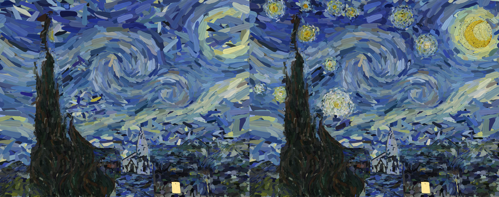

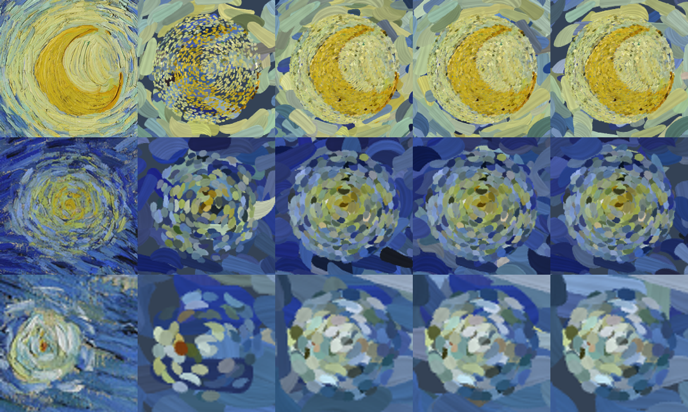

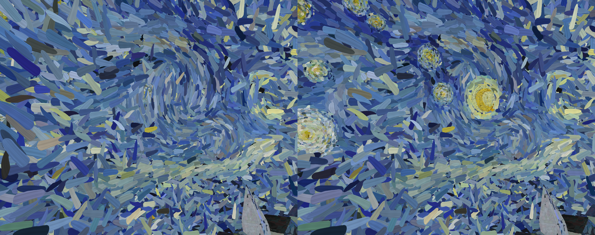

### Pinned lights (fix round 2)

The far band's density was forced in the build (`DEFAULT_BAND_DENSITY.far`) for each column, and the painter view captured as above. The quad overdraw comes from rasterizing every drawn moon quad (stored size × 1.6) into the painter view at 3840 px per painting width, counted per pixel inside the moon's circle (`.superpowers/sdd/overdraw.ts`, not committed). 5696a7f drew a prefix of its 30,729 stored lights, so its overdraw scaled with the density: mean 28.0 and max 42 with all stored strokes drawn (measured), so about 11 at the default 0.4 and about 2.8 at the floor (scaled by the density, not measured). The pinned build draws all 12,294 at every density: mean 11.2, min 3, max 19 over the moon.

| Far density | Moon per-pixel ΔE2000 | Moon, blurred σ 3 px | Moon block (14, 2) | Stars per-pixel ΔE2000 | SSIM | Mean ΔE2000 |
| --- | --- | --- | --- | --- | --- | --- |
| 1 | 6.16 | 2.17 | 1.06 | 13.10 | 0.3753 | 3.9117 |
| 0.4 (default) | 6.18 | 2.12 | 1.05 | 13.14 | 0.3786 | 3.8723 |
| 0.28 (first shed step) | 6.07 | 2.08 | 0.89 | 13.15 | 0.3772 | 3.9296 |
| 0.1 (floor) | 6.21 | 2.21 | 1.10 | 13.08 | 0.3663 | 3.7094 |
| 0.1, 5696a7f | 22.56 | | 15.22 | | 0.3414 | 4.2256 |

The moon disc stays solid at the floor, and its ΔE moves by 0.14 across the densities, against 22.56 at the floor before. The stars stay near 13 at every density. The coverage and fidelity e2e specs run on the default density.

Flicker probe at the default density, 0.1 mm shift, all (top / mid / bottom), %, for the pinned build and the same build with `invariant gl_Position;` and the cull fed from `iPosition` directly (chunk meshes stay at the identity transform, so `iPosition` is already world space):

| Pose | Pinned | Pinned with invariant |
| --- | --- | --- |
| painter-level | 0.116 (0.042 / 0.095 / 0.212) | 0.116 (0.042 / 0.095 / 0.212) |
| painter-down | 0.270 (0.051 / 0.176 / 0.584) | 0.270 (0.051 / 0.176 / 0.584) |
| village-look | 0.350 (0.084 / 0.300 / 0.667) | 0.381 (0.083 / 0.302 / 0.757) |
| back | 0.249 (0.068 / 0.269 / 0.409) | 0.243 (0.067 / 0.255 / 0.408) |
| sky-up-0.5 | 0.063 (0.035 / 0.045 / 0.109) | 0.063 (0.035 / 0.045 / 0.108) |
| sky-up-1.0 | 0.039 (0.040 / 0.036 / 0.040) | 0.039 (0.040 / 0.036 / 0.041) |
| ridge-horizon | 0.249 (0.072 / 0.337 / 0.337) | 0.256 (0.080 / 0.339 / 0.350) |
| paul-strobe1 | 0.435 (0.175 / 0.405 / 0.724) | 0.430 (0.164 / 0.396 / 0.730) |

`invariant` raises village-look (bottom 0.667 to 0.757) and ridge-horizon, so it was not kept. The pinned build's village-look bottom third reads 0.667 again, as 46eb08f does, and its ridge-horizon all reads 0.249 against 0.248 before. `invariant` and the `iPosition` feed were tested together, so neither was measured on its own.

Cost: at the default far density 0.4 the drawn lights barely change (about 12,290 drawn of 30,729 stored before, all 12,294 now). At the far floor they rise from about 3,070 to 12,294, so a full shed saves about 9,200 fewer strokes than before. The before figures are scaled from the stored count by the density (a prefix of the chunk's order), not measured.

Not done here: the P4.3 pulse and additive halo, and a headset run. The headset check is Paul's.

### Brushwork matched to the dome

Paul, in the headset at a649d39: the moon's strokes did not match the surrounding strokes, so it read as a flat disc. The rings above were 0.006 painting widths long on the moon and 0.012 on the stars, against about 0.05 for the dome strokes around them, all running along their ring and stopping at a hard circle.

What changed in `src/world/sky-lights.ts`:

- Size and brushes: every light stroke uses the dome's stroke size at the dome's radius (`strokeSizeAt(WORLD_DOME_SIZE, SKY_DOME_RADIUS)`, 3.97 m stored, the far band draws it 1.6 times larger), the scatter's ±15% length jitter and the sky region's brushes (comma, crescent, ridge). `WORLD_DOME_SIZE` in `world.ts` is the sky size the scatter resolves. The half-length moon strokes are gone.
- Finer strokes only at colour edges, for the stars: a stroke splits into four at half size, at most twice (`SKY_LIGHT_FINE_LEVELS`), where the scan's colour steps across its footprint. The step is the CIEDE2000 difference between the mean colours of the footprint's two halves, end against end or side against side, from 15 samples, and the threshold is 20 (`SKY_LIGHT_EDGE_DE`). By paint area the stars are 49% full size, 29% half and 22% quarter (435, 1,029 and 3,207 strokes), because a star is only one to three dome strokes across and its core's edge splits most of the strokes over it. A first version split on the largest difference from the footprint's mean. It split almost everything into quarter strokes, because brush texture and halo rings read as spread: at threshold 20, 94% of the star strokes were quarter size.
- The moon does not split (fix round 2). At threshold 20 it split only on its outer edge: the crescent's gold and the cream disc it bites into differ by about ΔE 14 in the scan, so the half means across the inner edge never reached 20, and the horns and the concave edge were lost (blurred moon ΔE 4.32). Fix round 1 lowered the moon's threshold to 7, which held the crescent (blurred ΔE 2.22) but put 62% of the moon's paint area at quarter size, with a disc median stroke of 0.0131 painting widths against the dome's 0.0503. That brought back the mismatch Paul reported. Ruling (coordinator, for Paul's complaint): stroke match wins over crescent sharpness. So every moon cell now holds a dome-size stroke, and the crescent's edges get extra quarter-size strokes on top (`SKY_LIGHT_MOON_EDGE_LEVEL` 2). They sit on their own jittered grid over the disc at quad overdraw 3 (`SKY_LIGHT_MOON_EDGE_OVERDRAW`) and are kept only where their footprint straddles the crescent's gold: at least 3 of its 15 samples have CIELAB b* over 50 (`SKY_LIGHT_GOLD_B`) and at least 3 do not. The gold reads b* 55 to 75 and the cream and the halo 35 to 45. An edge stroke takes the highest rank free of its neighbours, and every other light starts its rank search in the lower half, so the edge strokes draw over the dome-size moon strokes (a unit test checks every overlapping pair). The moon is 167 full-size and 97 edge strokes: 96.7% of its paint area is at full size, and the disc's median drawn length is 0.0432 painting widths, 14% under the dome's 0.0503. Overdraw 6 brought the blurred ΔE to 3.07 but put the disc median at a quarter stroke (0.0139). Half-size edge strokes at overdraw 3 read 3.51. Colouring each edge stroke from only its centre's side of the gold made no difference (3.37 against 3.32).
- Orientation from the flow field, as the dome: each stroke runs along `flow.png` at its uv (`cameraDirection`, now exported from `scatter.ts`). The choice rests on a structure tensor of the 3840 px scan (12 px cells, coherence weighted, `.superpowers/sdd/scan-tensor.ts`, not committed). Against the scan's own stroke direction, the flow field is off by 14.0° in the moon disc, 12.0° in its rim band and 36.9° outside it. Tangential to the anchor is off by 27.7°, 13.3° and 36.2°. For the stars the flow field is off by 20.2°, 23.2° and 26.3°, and tangential by 19.3°, 37.8° and 45.9°. The flow field is as good or better in every zone but the star discs, where it is 0.9° worse, and it is the field the dome uses.
- Colour: the mean of the scan at five points along the stroke's drawn length, from `lights.webp` and, past its 1.1-radius crops, from frame.webp. A point sample under a stroke this long painted whole strokes in the colour of a thin dark contour.
- No hard rim: strokes are placed on a jittered grid out to 1.5 anchor radii (`SKY_LIGHT_RIM`). Inside one radius every cell holds a stroke, and from there to 1.5 radii a stroke is kept with probability 1 − smoothstep(1, 1.5, ρ). The dome's strokes, in the tier behind, show through the gaps more and more. The halo colours come from the scan, like the disc's.
- Ranks: one picker for all 12 anchors, because neighbouring stars' reaches overlap, by up to 0.09 painting widths (stars 2 and 3). Two strokes can overlap only when their centres are closer than the sum of their drawn half diagonals, so the reach is per pair. The picker works in metres on the dome (fix round 1). The first version worked in painting widths with one metres-per-width per anchor, measured along u, but a painting width spans a different length on the dome in each direction (the review measured 118 to 142 m around the moon against 125.4, and 109 to 138 m around star 1 against 123.2), and the 1% margin did not cover that. Measured in metres from the stored positions and sizes, that version left 26 same-rank overlapping pairs at seed 1 and 29 at seed 2, though its own metric counted 0. A full-size stroke beside quarter-size ones can overlap more than 256 strokes in all, so the strokes are ranked full size first, then half, then quarter, and each takes a rank its already-ranked overlapping neighbours do not hold. Measured in metres, at most 92 already-ranked strokes overlap any stroke at seed 1 and 88 at seed 2, against 256 ranks. Among 173,865 overlapping pairs at seed 1 and 171,314 at seed 2 none shares a rank, and `lightRankTies` is 0 at both. The unit test measures this from the stored strokes alone (their positions, sizes and the shader's rank hash), independent of the generator's metric.
- Each grid cell's random numbers come from a hash of the anchor, the cell and its split path (fix round 1; the moon's edge grid has a path of its own), so one split that flips, for instance under a different image decoder, moves only the strokes of that cell, not every later stroke of the anchor.
- The haze cones reach the farthest dome point of the 1.5-radius rim plus the longest drawn stroke's half diagonal in metres.
- Pins: 4,935 light strokes, hash `1e63faa8` (6,485 and `6e5aa838` at fix round 1, 4,936 and `65f75ec3` before it, 12,294 and `da2a676f` before this change). World counts at seed 1: moon 264 and star 4,671. `world-coverage.spec.ts` asserts both counts in the browser, so the browser's image decoder must split the same strokes as sharp's. The scatter pin stays `cf326988` and the haze `49bf0339` (both e0eac54's), so SCATTER_VERSION stays 11: the lights are generated outside the scatter cache, and exporting `cameraDirection` changes no scatter output. `createSkyLights` takes 66 to 69 ms in Bun on this host (3 runs, seeds 1 and 2, 1-minute load about 11), against 41-46 ms before fix round 1 and about 92 ms at fix round 1. The metre picker searches 27 cells per stroke where the painting-width one searched 9, and the edge grid tests the crescent mask at each of its cells. The split of the cost was not profiled. The headset's `scatterMs` is still to be read on the Quest.

Stroke orientation and length around the anchors, from the stroke data (`.superpowers/sdd/brush-hist.ts`, not committed), seen from the painter's spot. "Off the scan" is the coherence-weighted mean angle to the scan's structure tensor at the stroke's uv, 0-90°. "Off tangential" gives the share per 15° bin. The tensor gives no stroke length, so the length reference is the dome's own strokes, as item 1 of the card asks. Disc is ρ < 1, rim 1 to 1.5 and outside 1.5 to 2.2 anchor radii.

| Zone | Strokes | Off the scan | Off tangential, % per 15° | Drawn length p10 / p50 / p90, painting widths |
| --- | --- | --- | --- | --- |
| Moon disc, scan | | | 39 / 25 / 13 / 12 / 6 / 5 | |
| Moon disc, a649d39 | 6,351 | 27.9° | 100 / 0 / 0 / 0 / 0 / 0 | 0.0053 / 0.0060 / 0.0067 |
| Moon disc, after | 197 | 13.6° | 61 / 17 / 12 / 5 / 2 / 3 | 0.0115 / 0.0432 / 0.0551 |
| Moon rim, scan | | | 69 / 24 / 3 / 1 / 0 / 2 | |
| Moon rim, a649d39 (dome only) | 469 | 10.9° | 90 / 8 / 0 / 1 / 1 / 0 | 0.0441 / 0.0507 / 0.0565 |
| Moon rim, after (lights over the dome) | 67 | 11.5° | 90 / 10 / 0 / 0 / 0 / 0 | 0.0444 / 0.0508 / 0.0569 |
| Moon outside, dome | 1,045 | 22.3° | 69 / 13 / 4 / 4 / 5 / 4 | 0.0443 / 0.0503 / 0.0565 |
| Star discs, scan | | | 56 / 24 / 10 / 4 / 3 / 3 | |
| Star discs, a649d39 | 5,943 | 19.5° | 100 / 0 / 0 / 0 / 0 / 0 | 0.0106 / 0.0120 / 0.0134 |
| Star discs, after | 3,358 | 20.6° | 66 / 22 / 5 / 3 / 2 / 2 | 0.0094 / 0.0116 / 0.0234 |
| Star rims, after | 1,313 | 21.3° | 44 / 21 / 12 / 7 / 6 / 10 | 0.0093 / 0.0119 / 0.0393 |
| Star outside, dome | 4,200 | 20.7° | 22 / 19 / 18 / 14 / 13 / 14 | 0.0351 / 0.0410 / 0.0492 |

The moon disc's strokes are 13.6° off the scan's direction, against 27.9° for the rings, and their spread off tangential follows the scan's, where the rings were all tangential. Their median length is 0.0432 painting widths, 14% under the dome's 0.0503: the disc holds about 100 dome-size strokes and the 97 quarter-size edge strokes. The count is bimodal, so the median lands on the shortest dome-size stroke and only just clears the 20% target. By count about half the disc's strokes are quarter size, while by paint area 96.7% is full size. The rim band holds only dome-size strokes (median 0.0508). The stars stay short: by stroke count most star strokes are quarter size, for the reason given above. Their direction is about as far off the scan as before (20.6° against 19.5°), and no longer all tangential. These figures come from probes under `.superpowers/sdd/` (`scan-tensor.ts`, `brush-hist.ts`), which are not committed.

Painter view, `?painting=starry-night&diag&shot&noanim&seed=1&painter` at 1280 × 1014, production builds served by `vite preview`, far density forced in the build as above. The branch is rebased onto e0eac54 (the wall raise, the trim on every structure and the building under-paint), and before is e0eac54 itself.

| Far density | Build | Moon per-pixel ΔE2000 | Moon, blurred σ 3 px | Moon block (14, 2) | Stars per-pixel ΔE2000 | SSIM | Mean ΔE2000 |
| --- | --- | --- | --- | --- | --- | --- | --- |
| 1 | after | 6.49 | 3.32 | 0.51 | 12.80 | 0.3405 | 5.4558 |
| 1 | 9fa50c7 (moon threshold 20) | 7.28 | 4.32 | 0.43 | 12.82 | 0.3396 | 5.4160 |
| 1 | bd6fd20 (moon threshold 7) | 5.64 | 2.23 | 0.17 | 12.82 | 0.3478 | 5.4250 |
| 0.4 (default) | e0eac54 | 6.18 | 2.12 | 1.05 | 13.38 | 0.3347 | 5.4964 |
| 0.4 (default) | 9fa50c7 (moon threshold 20) | 7.28 | 4.32 | 0.43 | 12.83 | 0.3391 | 5.3854 |
| 0.4 (default) | bd6fd20 (moon threshold 7) | 5.65 | 2.22 | 0.17 | 12.85 | 0.3494 | 5.4228 |
| 0.4 (default) | after | 6.49 | 3.32 | 0.52 | 12.83 | 0.3420 | 5.4495 |
| 0.1 (floor) | e0eac54 | 6.21 | 2.21 | 1.10 | 13.32 | 0.3222 | 5.3779 |
| 0.1 (floor) | after | 6.46 | 3.29 | 0.52 | 12.77 | 0.3298 | 5.3158 |

The moon stays under the ≤ 10 bar at density 1 and at the floor: per-pixel ΔE 6.49 and 6.46, against 6.18 and 6.21 for e0eac54's rings. Blurred by σ 3 px it reads 3.32 at the default, over the 3.0 aim: dome-size strokes still carry gold past the crescent's edges, and the edge strokes on top recover part of it (4.32 without them, 2.22 with the moon split to quarters). The block ΔE falls from 1.05 to 0.52. In the shot the crescent's concave edge and its horns show from the painter's spot and from 20 m east, softer than in the scan. At the default and the floor, SSIM rises by 0.007 and 0.008 over e0eac54, and mean ΔE falls by 0.047 and 0.062. There is no e0eac54 measurement at density 1. Before the rebase, on a649d39, the threshold-20 version read SSIM 0.3573 to 0.3617 and mean ΔE 4.3370 to 4.2260 at the default. The absolute SSIM and mean ΔE values differ from the tables above, which were measured on earlier bases.

The stars are drawn as at threshold 20, apart from the per-cell random numbers and the lower-half rank starts. Fix round 2 leaves them as at fix round 1. Their cores (mean L* inside 0.25 anchor radii, painter view) are within 5.1 of the scan's for every star. The core of star 6, right of the central swirl (left of the moon in the shot), reads 64.6 against the scan's 68.0 and the rings' 69.7, so it is a little dimmer than in the painting.

Moon quad overdraw, rasterized as above at 3840 px per painting width: inside the circle mean 11.6, min 4, max 21 (a649d39 and e0eac54: 11.2, 3, 19). In the rim band from 1 to 1.25 radii mean 8.5, min 2, max 16 (before: 0.3). From 1.25 to 1.5 radii mean 3.6, min 0, max 11 (before: 0). The lights taper into the dome instead of stopping at the circle. 264 moon strokes are drawn, against 6,351 before.

`E2E_PORT=4301 make e2e` on fix round 2: 37 passed, exit 0, 1-minute load 11.75 before and 10.42 after. `fidelity.spec.ts` reads SSIM 0.3420 and mean ΔE2000 5.4495. `world-coverage.spec.ts` reads max bare 0.451% at hill west (weighted 0.604%), as for SCATTER_VERSION 11 on main, so the wider haze cones uncover no bare dome. Its boot test reads moon 264 and star 4,671 from `__goghDiag()`, the unit pins. At bd6fd20 (fix round 1) the run read the same coverage with SSIM 0.3494 and mean ΔE 5.4228, and at 9fa50c7 SSIM 0.3391 and mean ΔE 5.3854.

Draw calls with `?nogov`: 147 at the painter view and 128 at (20, 1.6, 0) facing the moon, for both e0eac54 and this change (and for a649d39 before the rebase). Pinning still adds no chunk, and the lights stay in the dome's chunks.

`docs/shots/moon-brushwork.png`, columns scan, e0eac54 and this change (fix round 2). Top: the painter view at 2.2 moon radii. Middle: from (20, 1.6, 0), 20 m east of the painter's spot, facing the moon (the scan column shows the painting at 4 radii, for context). Bottom: the moon's lower-left rim band, about 0.6 to 1.6 radii, at 4×.

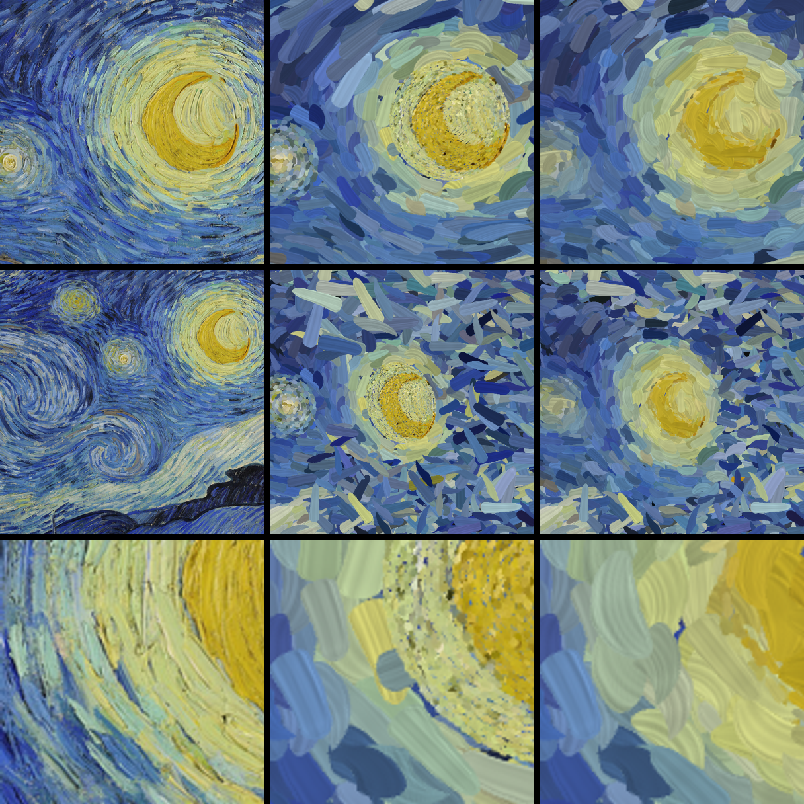

## Building z-fighting report (dab260e)

Paul reported "lots of z-fighting on buildings" in the headset on dab260e. The diagnosis was run on a649d39 (origin/main) against 6dbfc09, the strobe fix, with the scratch probes in `.superpowers/sdd/bz/` (not committed). It used 16 ground-level poses at 3 to 25 m from house 6, house 2 and the church: facing the walls and at grazing angles, headless Chromium on ANGLE Metal (Apple M4 Max), 1280 × 1014, seed 1, `?nogov&nocache&noanim`.

### Diagnosis

No systematic depth regression since 6dbfc09 was found, with one local exception at h6-face-3m, below:

- 46eb08f (village colours) changes colour only, and placement is bit-identical.
- The outline strokes never change winner under a shift, at any pose.
- a649d39's pinned prefix in `batch.ts` holds only the star and moon strokes.
- The `stroke.vert.glsl` changes since 6dbfc09 are the moon and star front tier inside the backdrop branch, and the sky-light cull behind `SKY_LIGHT_CULL_FLAG`, which only the boundary haze carries. Neither reaches a village stroke.
- 2026-11-06: the haze is no longer cleared with a hard edge. Inside each cone it still collapses, and past the cone it is now thinned over a feather of `SKY_LIGHT_FEATHER` (3) anchor radii plus one haze half diagonal, by shrinking each quad, so no rim shows in front of a disc (`src/render/strokes/sky-light-cull.ts`). It too reaches only strokes with `SKY_LIGHT_CULL_FLAG`.

An id build, each stroke coloured by its layer, shifts the camera 0.1 mm and counts the pixels whose winning surface changes. Its per-layer shares are the same on both commits to within 0.03 points of the frame at 14 of the 16 poses. The two exceptions are a649d39's wall share at h6-face-3m (0.329 against 0.255) and its ground share at h2-face-7m (0.361 against 0.166).

The h6-face-3m rise reproduces exactly on two more runs of each build:

- 0.260% of the frame flips on both commits.
- 0.075% flips only on a649d39, and 0.001% only on 6dbfc09.
- The a649d39-only flips sit in two small clusters about 30 px across, each the overlap of one wall stroke pair. A few wall pairs have become near-ties.

Its cause was not found, and the fix below does not address it.

The colour flicker under the same shift is lower on a649d39 at 15 of the 16 poses. The exception is h2-face-7m, whose rise (clustered 0.038 to 0.224) is a ground patch, not a building.

The building fights that remain are the old residual: two wall strokes whose lift shares nearly match. These fights are smallest where the 0.25 m range cap binds, beyond about 14 m. A 4× range removes most of their clustered flips, but those flips are only 0.01 to 0.03% of the frame.

What changed is what a gap between strokes looks like:

- 46eb08f paints the house walls in pale tints, which measure Rec. 709 luma 111 against 63 before. Each stroke's colour is `jitterTint` around its owner's tint, mixed toward the scan by `SEEN_TINT_BLEND` where the face is turned toward the painter (a649d39 `src/render/strokes/scatter.ts:443-456`). The tags come from `src/world/village.ts:598-607`.
- The base meshes under the strokes stayed at the region mean × `UNDERPAINT_SHADE` 0.6, luma 47 (a649d39 `src/paintings/starry-night/base-meshes.ts:23` and `baseColor` at `:53`).
- A gap between wall strokes therefore reads as a dark speck where it used to read as a slightly darker wall.

The gaps move whenever the stroke set changes, so they flash. That happens at a band switch, at 6 m on the 24 m chunks (`NEAR_BAND_MAX_M`, `src/render/strokes/bands.ts:11`; density 1 to 0.9, size × 1.05), and when the governor sheds near density in XR. The desktop probe forces the near band from 1 to 0.9 and counts the building pixels that go from light (luma > 90) to dark (< 60).

The 6 m band switch, the governor's oscillation in the headset, and XR stereo were not measured. The depth buffer is 24-bit in XR, against the desktop default, which was not compared either.

### Fix

`createBaseMeshes` takes the scatter seed, and each tinted village triangle under-paints in its owner's tint (`pickTint`, the same pick its strokes jitter around) × `TINT_UNDERPAINT_SHADE` 0.85, as vertex colours. Other layers keep the region mean × 0.6. This is base mesh only, so the scatter output, its hash and `SCATTER_VERSION` do not change, and the debug paint stays flat magenta.

### Measured

Each cell is % of the frame, before (a649d39) and after.

- Colour flips: 0.1 mm shift, summed RGB difference > 24.
- Clustered: at least 4 of 8 neighbours flipped.
- Id flips: the a649d39 id build's winner changes for wall, roof, church, outline and ground, with the 6dbfc09 values after the slash.
- Density step: building pixels that go from light to dark between near density 1 and 0.9.

| Pose | Colour flips 6dbf / a649 / fix | Clustered 6dbf / a649 / fix | Id flips a649 (wall, roof, church, outline, ground) / 6dbf | Density step light-to-dark 6dbf / a649 / fix |
| --- | --- | --- | --- | --- |
| h6-face-3m | 0.230 / 0.086 / 0.081 | 0.048 / 0.018 / 0.018 | 0.329, 0.038, 0, 0, 0.025 / 0.255, 0.037, 0, 0, 0.037 | 0.386 / 0.172 / 0.012 |
| h6-face-7m | 0.319 / 0.166 / 0.165 | 0.025 / 0.012 / 0.012 | 0.015, 0.011, 0, 0, 0.066 / 0.015, 0.010, 0, 0, 0.074 | 0.028 / 0.007 / 0.003 |
| h6-face-15m | 0.517 / 0.485 / 0.486 | 0.089 / 0.078 / 0.078 | 0.055, 0.019, 0.006, 0, 0.572 / same to 0.001 | 0.045 / 0.013 / 0.011 |
| h6-face-25m | 0.186 / 0.177 / 0.177 | 0.023 / 0.016 / 0.016 | 0, 0, 0, 0, 0.235 / 0, 0, 0, 0, 0.238 | 0 / 0 / 0 |
| h6-graze-6m | 0.211 / 0.112 / 0.110 | 0.047 / 0.025 / 0.025 | 0.160, 0.004, 0, 0, 0.070 / 0.146, 0.004, 0, 0, 0.070 | 0.230 / 0.071 / 0.001 |
| h6-graze-15m | 0.269 / 0.228 / 0.227 | 0.051 / 0.032 / 0.032 | 0.052, 0.019, 0, 0, 0.257 / 0.066, 0.019, 0, 0, 0.256 | 0.098 / 0.028 / 0.009 |
| h2-face-3m | 0.113 / 0.056 / 0.054 | 0.003 / 0.001 / 0.001 | 0.095, 0.081, 0, 0, 0.053 / 0.073, 0.054, 0, 0, 0.053 | 0.758 / 0.118 / 0.005 |
| h2-face-7m | 0.190 / 0.357 / 0.354 | 0.038 / 0.224 / 0.224 | 0.072, 0.053, 0.002, 0, 0.361 / 0.054, 0.057, 0.002, 0, 0.166 | 0.220 / 0.073 / 0.038 |
| h2-face-15m | 0.251 / 0.220 / 0.219 | 0.032 / 0.021 / 0.020 | 0.051, 0.032, 0.004, 0, 0.258 / same to 0.003 | 0.056 / 0.015 / 0.007 |
| h2-face-25m | 0.325 / 0.283 / 0.283 | 0.066 / 0.052 / 0.052 | 0.062, 0.040, 0.004, 0, 0.298 / same to 0.003 | 0.023 / 0.006 / 0.003 |
| h2-graze-6m | 0.196 / 0.178 / 0.177 | 0.018 / 0.017 / 0.017 | 0.048, 0.018, 0, 0, 0.164 / 0.031, 0.017, 0, 0, 0.164 | 0.077 / 0.058 / 0.000 |
| h2-graze-15m | 0.189 / 0.179 / 0.179 | 0.026 / 0.022 / 0.022 | 0.011, 0.014, 0, 0, 0.184 / 0.017, 0.014, 0, 0, 0.186 | 0.027 / 0.037 / 0.007 |
| church-face-7m | 0.086 / 0.081 / 0.079 | 0.001 / 0.001 / 0.001 | 0.035, 0.005, 0.045, 0, 0.041 / same to 0.001 | 0.073 / 0.351 / 0.278 |
| church-face-15m | 0.088 / 0.083 / 0.083 | 0.007 / 0.007 / 0.007 | 0.110, 0.004, 0.012, 0, 0.049 / same | 0.200 / 0.202 / 0.186 |
| church-face-25m | 0.174 / 0.114 / 0.112 | 0.038 / 0.017 / 0.017 | 0.148, 0.004, 0.004, 0, 0.074 / same to 0.001 | 0.194 / 0.071 / 0.040 |
| church-graze-10m | 0.092 / 0.040 / 0.035 | 0.003 / 0.003 / 0.003 | 0.107, 0, 0.006, 0, 0.008 / 0.107, 0.001, 0.006, 0, 0.008 | 1.024 / 0.084 / 0.029 |

The fix leaves the shift flicker where it was, which is expected, since the base meshes play no part in a fight between two strokes. The light-to-dark change falls at every house pose, 0.172 to 0.012 at h6-face-3m and 0.118 to 0.005 at h2-face-3m.

The church front at 7 m is not fixed. It keeps most of its rise, 0.351 to 0.278 against 0.073 on 6dbfc09. By the id capture, those pixels are church (2,623), outline (627) and window (353) pixels whose replacement averages RGB (31, 39, 63). A gap to the church wall's new under-paint, RGB (119, 126, 133) at about luma 125, cannot pass the < 60 test. The result is consistent with dark church strokes showing under the lifted pale strokes painted toward the painter (ruling Q30). It is not settled, though. The nave roof's under-paint, RGB (24, 24, 31), could pass the test, and no `?coverage` capture was taken to rule it out.

Painter-view fidelity (`scripts/fidelity.ts`, production build): SSIM 0.3573 to 0.3571 (limit ≥ 0.2643), mean ΔE2000 4.3370 to 4.3490 (limit ≤ 7.1961).

The `E2E_PORT=4291 make e2e` run on the fix passed 37 of 37. Its `fidelity.spec.ts` read SSIM 0.3571 and mean ΔE2000 4.3490. Its `world-coverage.spec.ts` maximum bare share was 0.451% at hill west (weighted 0.604%), against the 0.5% limit. The coverage sweep paints the base magenta, so the fix cannot move it.

The light-to-dark measure is the gap colour the fix changes, so it shows the gaps read less, not that the headset flicker is gone. The headset check is Paul's.

`docs/shots/building-zfight.png` shows church-face-7m and h6-face-3m at near density 0.9, before on the left and after on the right, with the building pixels that went from light to dark marked red.

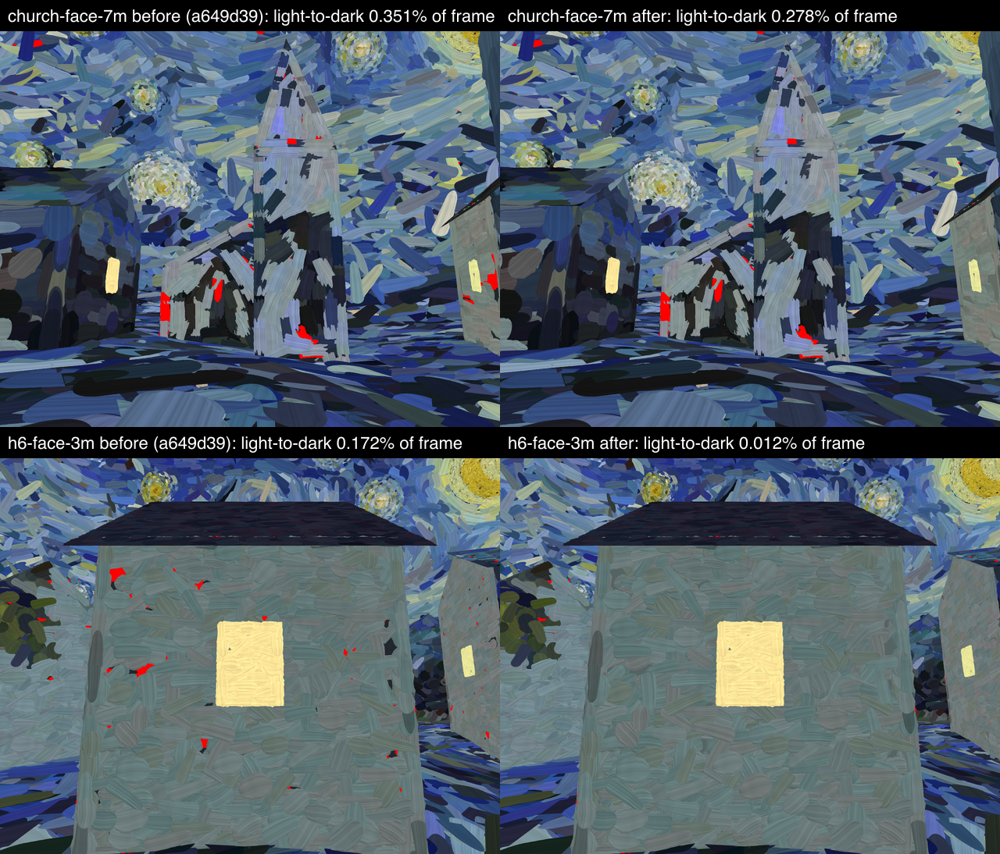

### Residuals re-measured (2026-11-09, on 5171098, card 01a1b4447146)

The two residuals above, the h6-face-3m wall flips and the church front's density step, were measured again on 5171098, which draws strokes without depth writes by default (Nowrite stroke policy, below).

Method:

- The 2026-11-06 scratch probes survived in another worktree and produced these tables, with the id patch changed to keep the colour's alpha byte (the cypress flame). The harness is now committed as two scripts:
  - `scripts/zfight-id-patch.ts` patches a copy of the tree. It exposes the stroke batch so a probe can set band densities, and with `id` it colours each stroke by its class and index.
  - `scripts/zfight-density-probe.ts` runs `flips` for the id flips, `density` for captures at near density 1 and 0.9, and `classify` for the light-to-dark tables. Their headers give the usage.
  - Rerun on 5171098, `flips` reads wall 0.203 and clustered 0 at h6-face-3m. `classify` over the original captures reproduces both church rows below. Builds before 5171098 need the same patch on their own scatter source.
  - Only the scatter's surface and outline strokes get ids. The moon and stars, the boundary haze and the halos keep their paint, and the eave underside copies carry a scaled roof id. Their pixels read `rim` or alias into a nearby class, so the small class counts below (cypress, sky) are approximate. The base count comes from the magenta test, not from R, and neither conclusion rests on the class split.
- Each build is a production build served by `vite preview`, captured in headless Chromium on ANGLE Metal (Apple M4 Max) at 1280 × 1014, seed 1, `?nogov&nocache&noanim`.
- The report's pose generator gives the same 16 poses on 5171098. h6-face-3m is eye (-2.989, -3.503, -9.82), yaw 0.0789, pitch 0.1541. church-face-7m is eye (2.374, -2.733, -28.727), yaw 0, pitch 0.1815. Both are now in `scripts/zfight-probe.ts`.
- The harness reproduces the report: the a649d39 id build reads wall 0.329 and the 6dbfc09 one 0.255 at h6-face-3m, to the digit.
- Load: the 5171098 id, density and `zfight-probe.ts` runs ran at a 1-minute load of 11 to 14. Load from other sessions kept the rest at 26 to 72: 6dbfc09 at 44, 240f498 at 27, 09ace7f at 50 to 72, and the two coverage density captures at 30 to 38. Repeat runs and the two calibration builds read the same to the last digit at every load, so load did not move these pixel counts.

#### h6-face-3m wall flips: gone in the default, removed by 09ace7f

Id flips under a 0.1 mm x shift, % of the frame. Clustered means at least 4 of the 8 neighbours flipped too, which is how a depth fight shows: it flips patches.

| Build | All | Clustered | Wall | Clustered wall |
| --- | --- | --- | --- | --- |
| 6dbfc09 | 0.444 | 0.101 | 0.255 | 0.054 |
| a649d39 | 0.521 | 0.182 | 0.329 | 0.123 |
| 240f498, the last depth-writing default | 0.514 | 0.177 | 0.329 | 0.123 |
| 09ace7f, nowrite becomes the default | 0.285 | 0 | 0.181 | 0 |
| 09ace7f `?zdiag=write` | 0.469 | 0.134 | 0.251 | 0.048 |
| 5171098 (two runs, identical) | 0.310 | 0 | 0.203 | 0 |
| 5171098 `?zdiag=write` | 0.515 | 0.172 | 0.299 | 0.093 |

- The a649d39 rise lasts unchanged to 240f498 and ends at 09ace7f, which stopped strokes writing depth. No clustered flip is left at 09ace7f or on 5171098.
- The wall flips that remain, 0.203%, are isolated pixels with no clustered neighbourhood, so they are not depth ties. That is consistent with anti-aliased stroke edges whose coverage changes under the 0.03 px shift, which was not measured directly.
- The near-tie wall pairs are still in the stroke data. `?zdiag=write` on 5171098 still reads 0.093% clustered wall flips, so they show only when strokes write depth: in that diagnostic mode and the headset A/B's `write` arm.
- `?zdiag=write` on 09ace7f reads 0.251 against 240f498's 0.329, the C5 caveat below: `write` is not the old default byte for byte.
- The rise's own cause between 6dbfc09 and a649d39 was not bisected, since the default no longer depth-tests strokes against each other.
- The committed `zfight-probe.ts` colour flips on 5171098 at 0.1 mm (1 mm) are 0.041% (0.409%) at h6-face-3m and 0.063% (0.604%) at church-face-7m, against 0.081% and 0.079% after the tint fix.

#### Church front at 7 m: not the under-paint, darker strokes under the dropped ones

The density step counts the building pixels (by the density 1 id capture) that go from light (luma > 90) to dark (< 60) when near density drops from 1 to 0.9. For each such pixel, an id capture at density 0.9 with `&coverage` shows what replaced it: a stroke class, or magenta where a base mesh shows through a gap.

| 5171098 | Light-to-dark, % of frame (px) | Building pixels that change at all | Shown at 0.9 |
| --- | --- | --- | --- |
| `?zdiag=write` | 0.205 (2,666) | 4.21% | church 1,517, outline 534, ground 513, rim 74, window 15, roof 5, base 5, sky 3 |
| default | 2.030 (26,354) | 29.93% | outline 12,586, church 11,288, ground 1,042, rim 731, roof 518, window 174, cypress 6, base 5, sky 4 |

- The nave roof's under-paint is ruled out. Under either policy, 5 pixels of the light-to-dark set show a base mesh, at mean RGB (10, 17, 24). Every other pixel shows a stroke: darker church strokes, mean RGB (38, 44, 50), and the dark outline trim, from under the pale strokes painted toward the painter (ruling Q30) that the density cut removed. This rules the nave roof's under-paint out for the current tree. The base-mesh code is unchanged since e0eac54 apart from a copied position attribute, but e0eac54 itself was not captured again, and `write` is not the old default byte for byte.
- The rise over 6dbfc09's 0.073% stays unattributed. What is settled is that the under-paint does not cause it. The 0.205% under `write` on 5171098 and the 0.073% are not like for like, for three reasons. The depth policies differ (C5). The old figure came from the 2026-11-06 harness, which this one follows but whose density captures were not reproduced. And the step was not measured again on 6dbfc09 or e0eac54. This section explains which pixels replace the dropped strokes, not why there are more of them than on 6dbfc09.
- At h6-face-3m the light-to-dark share is 0.000% (1 pixel) under `write` and 0.141% (1,826 pixels) by default, and none of it shows a base mesh. The default's pixels show outline 923, ground 453, roof 241, rim 160, window 48 and cypress 1. 18.42% of its building pixels change at all, against 4.13% under `write`.

At the two poses measured, the default makes the step much larger. At church-face-7m it is about ten times larger. At h6-face-3m it goes from 1 pixel to 0.141%, small in absolute terms. This is a stroke-level cause for its own card, not fixed here, and its first criterion should be a sweep over many poses:

- A density draws a prefix of each chunk's importance order (`importanceOrder`, `geometry.instanceCount` in `src/render/strokes/batch.ts`).
- Without depth writes, the stroke drawn last is on top. The strokes a density cut drops are the last drawn, so they sit on top wherever they overlap a kept stroke.
- Under `write`, the lift decides which stroke is on top, independent of the order, so a cut uncovers only where a dropped stroke happened to win.
- At these two poses, a 10% near-density cut (the 6 m band switch; the governor sheds the same way in XR) changes far more of the facade than under `write`. At church-face-7m it changes 29.9% of the building pixels against 4.2%, and at h6-face-3m 18.4% against 4.1%. Other poses were not measured.

The cause is fixed since 2026-11-09: a nowrite chunk draws a suffix of its order, so a cut drops the strokes under the rest (Density cuts drop strokes from below, below).

`docs/shots/church-density-step.jpg` shows church-face-7m at near density 0.9, under `?zdiag=write` on the left and the default on the right. Light-to-dark pixels are red where a stroke replaced them and magenta where a base mesh shows.

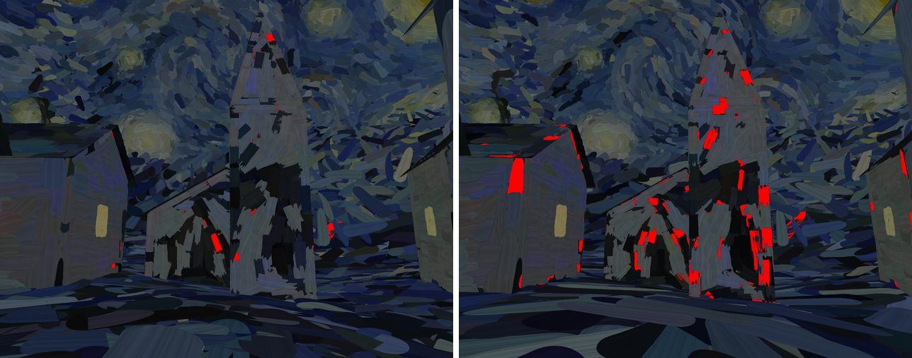

## Density cuts drop strokes from below (2026-11-09, card 01a1bfd7a481)

The church front's density step above had a stroke-level cause. A density drew a prefix of each chunk's importance order, and without depth writes the stroke drawn last is on top, so every cut removed exactly the topmost strokes. Every 6 m near-band switch (density 1 to 0.9, `NEAR_BAND_MAX_M`) and every governor density shed in XR repainted the near facades. A nowrite world or overlay chunk now draws a suffix of its order, so a cut removes the strokes drawn first, which lie under the rest. The dome, lights and cypress keep the prefix (below).

### The change

A density keeps the same number of each chunk's instances as before, `pinned + bandDrawCount(d, count - pinned)`. What changed is which ones (`drawsSuffix` and `SuffixGeometry` in `src/render/strokes/batch.ts`):

- A chunk drawn without depth writes draws the end of its importance order. `StrokeChunk.drawStart` is its first drawn instance, `count - drawCount`, or 0 while it draws none.
- WebGL2 and three 0.186 have no base instance, so a suffix chunk binds each instanced attribute at an offset:
  - Each attribute is an `InterleavedBufferAttribute` over its own `InstancedInterleavedBuffer`, with a stride of one item and an offset of `drawStart` items.
  - three uploads that buffer once and keys its GPU buffer by it, so a new start uploads nothing.
  - three rebinds a VAO only when an attribute object changes, so a new start sets a new wrapper on every attribute.
  - Attributes set later, such as `vertex-arms.ts`'s sky attributes under `?ab=vtx`, are wrapped the same way.
  - `iMeta` keeps its integer binding through the wrapper's `gpuType`.
- These chunks keep the prefix:
  - The lights and the cypress, which write depth while they draw, so the depth order decides there and not the draw order.
  - The dome. It has no facade to repaint, and its far set at 0.4 is what `tests/e2e/motion.spec.ts`'s pinned-phase check block-matches (The dome keeps the prefix, below).
  - Every chunk of a depth-writing batch (the P1 canvas).
  - Any chunk that holds pinned strokes, since a suffix would drop those first. In practice that is only the lights chunks. `drawClassOf` sends every pinned stroke to `lights`, so a lights chunk is all pinned and every other chunk holds none, which `tests/strokes-batch.test.ts` checks.
- The order itself does not change. The importance keys, `(j + u_b) / n_b` per bucket and `(r + 0.5) / n` in `interleaveOrders`, are symmetric, so a suffix is as evenly stratified as a prefix, and a merged chunk's suffix is the union of its parts' suffixes. `tests/strokes-importance.test.ts` checks the suffix the way it checks the prefix.
- Three places read the drawn strokes as `[0, drawCount)`. They now read `[drawStart, drawStart + drawCount)`: `drawnFootprint` in `batch.ts`, `reactiveBoxStrokes` in `src/main.ts`, and the drawn filter in `src/diag/sky-wrap-stats.ts`.

Why a plain suffix:

- The brief's candidate reversed each chunk's order and drew a suffix. That keeps the drawn set at every density but restacks every chunk at density 1, the near band included, which the cypress I3 checks and the reactive specs measure.
- A plain suffix leaves every chunk at density 1 byte-identical, so the near band at its default density draws exactly as before.
- It changes which strokes draw below density 1: the world chunks of the mid band at 0.9 and the far band at 0.4 by default draw another, equally stratified set.
- A density fade was not needed, because the suffix keeps the pinned strokes.

Invariants checked:

- The stroke shader reads no instance index. The ranks, lift shares and tie keys come from the stored attributes, and the draw-class blocks from the chunk order, so none of them moves.
- The dome, lights and cypress chunks are unchanged at every density.
- A merged world chunk built by `interleaveOrders` takes a union of its parts' suffixes, within a stroke per part (tested in `tests/strokes-batch.test.ts`, though the shipped world merges only the dome and lights). The merged dome and lights chunks keep a union of prefixes.
- The haze keeps its chunk and band and draws an equally stratified set.
- `isPinnedStroke` strokes are drawn at every density.
- The scatter output is unchanged, so its hashes and SCATTER_VERSION (16) stay.

### The dome keeps the prefix

The first version of the fix drew a suffix for the dome too. Its first full `make e2e` (load 11.96 before, 13.35 after) passed 127, skipped 5 and failed 1: `tests/e2e/motion.spec.ts:172`, "a pinned coherent phase moves the sky along the TS prediction".

- Patch (0.35, 0.4) locked at calm 1 on (−0.06, −0.25) px, sharpness 2.4 and ratio 25.989, so the measured shift pointed 41.7° away from the prediction.
- On cec2aae the same patch read (7.10, −13.19) px, sharpness 2.8 and ratio 0.489, and passed.
- That patch looks at the far dome, which draws at 0.4. The suffix gave it another set of sky strokes, and the block match on that set found no clear shift.

The dome has no facade that a cut could repaint, and the card's target is the near facades, so the dome went back to the prefix rather than the spec being retuned. After that, `motion.spec.ts` alone passed 4 of 4, and patch (0.35, 0.4) read exactly its cec2aae values. The suffix still changes the far ground and hill chunks under that view, so three horizon patches read slightly differently from cec2aae, all well inside their limits.

A mid or far shed therefore still drops the dome's topmost sky strokes. The follow-up is kanban card 01a1c06cfc3a, "Let density sheds drop the dome's bottom strokes too", which needs `motion.spec.ts`'s pinned-phase patch re-baselined.

### The sweep

Method:

- `scripts/zfight-density-probe.ts density` and `classify … all`, as in the residuals section above, on production builds patched by `scripts/zfight-id-patch.ts`, served by `vite preview`. Headless Chromium on ANGLE Metal (Apple M4 Max), 1280 × 1014, seed 1, `?nogov&nocache&noanim`.
- Near density steps from 1 to 0.9. Light is luma > 90 at density 1, dark is < 60 at 0.9. Building pixels come from the id capture at density 1.
- The probe gained nine poses. `wall-h11-6m` and `ground` come from `scripts/shimmer-probe.ts`, `paul-strobe1` from `scripts/zfight-probe.ts`, and the five village poses, hill slope and under the cypress from `tests/world-poses.ts`.
- Builds:
  - 9ca3fc0, the brief's base.
  - cec2aae, the one canvas uv extent, which moved the seed-1 village up to 2.5 m.
  - The fix, on cec2aae (debc2bd changes only a test), with the dome on the prefix. The first version of the fix also drew the dome's suffix. Its sweep read the same to within 0.001 points in both light-to-dark tables and 0.003 points in the changed share, and church-face-7m read 0.005% (61 px).
- The village poses do not compare across 9ca3fc0 and cec2aae, because the houses moved under them. House 6 at 9ca3fc0 is house 7 at cec2aae and moved 0.05 m, so h6-face-3m still faces the same wall.
- The church moved 0.09 m in x and 0.49 m back. `church-face-7m-moved` is church-face-7m moved with it: 7 m from its south end again, 1.6 m above the ground, at eye (2.464, -2.675, -29.217).
- Load (1-minute average), before and after each run:

  | Run | before | after |
  | --- | --- | --- |
  | 9ca3fc0 | 11.72 | 11.54 |
  | cec2aae | 14.90 | 12.61 |
  | fix | 12.55 | 15.02 |

- Each capture set ran once. The 9ca3fc0 run reproduced the residuals section's figures to the pixel, 26,354 at church-face-7m and 1,826 at h6-face-3m, so these pixel counts do not move with load.

Building pixels that go light to dark, % of the frame:

| Pose | 9ca3fc0 default | 9ca3fc0 `write` | cec2aae default | cec2aae `write` | fix default | fix `write` |
| --- | --- | --- | --- | --- | --- | --- |
| h6-face-3m | 0.141 | 0.000 | 0.420 | 0.043 | 0.001 | 0.030 |
| church-face-7m | 2.030 | 0.205 | 1.832 | 0.450 | 0.005 | 0.223 |
| church-face-7m-moved | n/a | n/a | 2.015 | 0.510 | 0.006 | 0.239 |
| wall-h11-6m | 0.377 | 0.030 | 2.182 | 0.143 | 0.013 | 0.038 |
| village-street | 1.371 | 0.118 | 0.568 | 0.095 | 0.010 | 0.094 |
| village-west | 0.811 | 0.034 | 0.389 | 0.076 | 0.000 | 0.090 |
| village-church | 3.842 | 0.553 | 4.280 | 1.198 | 0.003 | 0.802 |
| village-uphill | 0.939 | 0.043 | 0.253 | 0.043 | 0.001 | 0.032 |
| ground | 0.213 | 0.021 | 0.310 | 0.032 | 0.000 | 0.023 |
| paul-strobe1 | 0.143 | 0.014 | 0.156 | 0.022 | 0.000 | 0.017 |
| hill-slope | 0.295 | 0.035 | 0.450 | 0.025 | 0.000 | 0.023 |
| under-cypress | 0.114 | 0.011 | 0.140 | 0.088 | 0.000 | 0.008 |

Building pixels that change at all, % of the building pixels:

| Pose | 9ca3fc0 default | 9ca3fc0 `write` | cec2aae default | cec2aae `write` | fix default | fix `write` |
| --- | --- | --- | --- | --- | --- | --- |
| h6-face-3m | 18.417 | 4.128 | 21.421 | 4.092 | 0.047 | 4.504 |
| church-face-7m | 29.926 | 4.208 | 30.845 | 6.930 | 0.357 | 3.862 |
| church-face-7m-moved | n/a | n/a | 31.283 | 7.006 | 0.259 | 3.743 |
| wall-h11-6m | 32.044 | 3.077 | 30.683 | 8.718 | 0.098 | 6.253 |
| village-street | 23.812 | 4.556 | 24.185 | 5.111 | 0.615 | 4.294 |
| village-west | 23.088 | 3.948 | 22.691 | 4.247 | 0.133 | 3.965 |
| village-church | 37.087 | 5.601 | 37.513 | 7.373 | 0.262 | 5.137 |
| village-uphill | 21.001 | 3.663 | 15.722 | 3.015 | 0.059 | 2.681 |
| ground | 17.941 | 3.535 | 18.396 | 3.467 | 0.051 | 2.980 |
| paul-strobe1 | 11.800 | 2.209 | 12.096 | 2.332 | 0.037 | 2.206 |
| hill-slope | 17.701 | 3.493 | 17.937 | 2.730 | 0.030 | 3.473 |
| under-cypress | 12.389 | 2.964 | 14.294 | 3.633 | 0.071 | 1.968 |

Every pixel that goes light to dark, % of the frame. It covers the ground and hill poses, where buildings fill little of the view:

| Pose | 9ca3fc0 default | 9ca3fc0 `write` | cec2aae default | cec2aae `write` | fix default | fix `write` |
| --- | --- | --- | --- | --- | --- | --- |
| h6-face-3m | 0.507 | 0.058 | 0.594 | 0.112 | 0.005 | 0.113 |
| church-face-7m | 3.081 | 0.540 | 3.229 | 0.587 | 0.005 | 0.474 |
| church-face-7m-moved | n/a | n/a | 3.367 | 0.680 | 0.007 | 0.477 |
| wall-h11-6m | 0.783 | 0.096 | 2.596 | 0.231 | 0.022 | 0.058 |
| village-street | 3.175 | 0.190 | 4.025 | 1.142 | 0.047 | 0.330 |
| village-west | 2.501 | 0.269 | 3.307 | 0.830 | 0.000 | 0.333 |
| village-church | 3.889 | 0.557 | 4.294 | 1.201 | 0.004 | 0.805 |
| village-uphill | 2.183 | 0.238 | 3.162 | 0.284 | 0.006 | 0.332 |
| ground | 3.742 | 0.803 | 2.914 | 0.484 | 0.016 | 0.809 |
| paul-strobe1 | 3.430 | 0.703 | 2.833 | 0.576 | 0.008 | 0.582 |
| hill-slope | 5.409 | 0.832 | 4.123 | 0.575 | 0.012 | 0.456 |
| under-cypress | 0.326 | 0.027 | 0.179 | 0.103 | 0.015 | 0.024 |

- At church-face-7m the default's light-to-dark share falls from 1.832% (23,781 px) to 0.005% (63 px), and from 2.015% to 0.006% (79 px) at the moved pose, against the 0.3% bar. Of the 63 pixels, 51 read `rim`, a blended stroke edge.
- The default now changes less than `write` at every pose. A cut there leaves 0.03-0.6% of the building pixels changed, against 2-6% under `write`. Under `write` a dropped stroke that won its depth test still uncovers whatever lay under it.
- `write` on the fix also draws the suffix, because the drawn range follows the chunk and not the order policy. Its rows differ from cec2aae's `write` by the strokes that set holds, for example 0.450% to 0.223% at church-face-7m.
- The village church pose (looking up at the church from 5 m) was the worst before at 4.280%, and reads 0.003% now.

### Flicker, fidelity and coverage

Flicker probes on the colour builds of cec2aae and the fix (patched only to expose the batch), production builds served by `vite preview`, 8 frames.

`scripts/shimmer-probe.ts`, flicker / per frame / clustered, % of the frame, with rotation and translation jitter:

| Build | ground | paul-strobe1 | village | wall | ridge | sky |
| --- | --- | --- | --- | --- | --- | --- |
| cec2aae | 8.884 / 3.788 / 2.021 | 9.982 / 4.176 / 2.181 | 9.611 / 3.868 / 2.302 | 2.714 / 1.037 / 0.353 | 8.752 / 3.385 / 1.601 | 7.812 / 2.870 / 1.178 |
| fix | 8.843 / 3.773 / 2.045 | 9.837 / 4.112 / 2.163 | 9.555 / 3.842 / 2.318 | 2.685 / 1.024 / 0.349 | 8.634 / 3.337 / 1.584 | 7.761 / 2.846 / 1.183 |

Translation jitter only (`norot`):

| Build | ground | paul-strobe1 | village | wall | ridge | sky |
| --- | --- | --- | --- | --- | --- | --- |
| cec2aae | 4.127 / 1.787 / 0.528 | 3.265 / 1.370 / 0.459 | 2.190 / 1.016 / 0.251 | 0.462 / 0.204 / 0.003 | 0.824 / 0.352 / 0.035 | 0.413 / 0.196 / 0.002 |
| fix | 4.124 / 1.786 / 0.528 | 3.251 / 1.361 / 0.460 | 2.187 / 1.015 / 0.251 | 0.461 / 0.203 / 0.003 | 0.821 / 0.350 / 0.036 | 0.409 / 0.195 / 0.002 |

`scripts/zfight-probe.ts`, % of the frame that changes under a 0.1 mm and a 1 mm shift. The unmoved repeat read 0.000 at every pose on both builds:

| Pose | cec2aae 0.1 mm / 1 mm | fix 0.1 mm / 1 mm |
| --- | --- | --- |
| painter-level | 0.071 / 0.625 | 0.071 / 0.628 |
| painter-down | 0.194 / 1.824 | 0.193 / 1.827 |
| village-look | 0.172 / 1.428 | 0.173 / 1.427 |
| back | 0.130 / 1.226 | 0.130 / 1.225 |
| sky-up-0.5 | 0.041 / 0.361 | 0.043 / 0.360 |
| sky-up-1.0 | 0.027 / 0.252 | 0.027 / 0.254 |
| ridge-horizon | 0.060 / 0.447 | 0.059 / 0.450 |
| paul-strobe1 | 0.217 / 1.869 | 0.216 / 1.869 |
| cypress | 0.127 / 1.337 | 0.128 / 1.341 |
| h6-face-3m | 0.044 / 0.436 | 0.044 / 0.436 |
| church-face-7m | 0.056 / 0.522 | 0.056 / 0.524 |

The shimmer totals fall by up to 0.15 points, and every shimmer cell is lower or within 0.03 points. The zfight shares are within 0.01 points. These probes hold the densities still, so they measure the stacking, not a cut.

Load during the flicker runs was 12.7 before and 11.0 after on cec2aae, and 13.9 before and 11.8 after on the fix. Every unmoved repeat read 0, so load did not move these numbers.

Fidelity, `scripts/fidelity.ts --url` with the painter URL, against the limits SSIM ≥ 0.2768 and ΔE2000 ≤ 7.1243:

| Build | SSIM | mean ΔE2000 | Worst blocks (col, row) |
| --- | --- | --- | --- |
| cec2aae | 0.3599 | 5.1701 | (11, 11) 39.8, (1, 7) 24.6, (5, 7) 24.2, (10, 10) 23.6, (0, 9) 21.0 |
| fix | 0.3585 | 5.3226 | (11, 11) 39.8, (1, 7) 32.0, (0, 7) 23.6, (15, 6) 23.6, (10, 10) 23.5 |

The painter view draws mid and far chunks at 0.9 and 0.4, whose world chunks now draw another stratified set. Its scores move by 0.0014 SSIM and 0.15 ΔE, and block (1, 7), the far left of the ridge row, rises most. The cec2aae capture matches the one canvas uv extent section's figures to 4 decimals. `tests/e2e/fidelity.spec.ts` alone on the fix read the same SSIM 0.3585 and ΔE 5.3226, 4 of 4 passed (load 16.1 before, 16.3 after). The first version, with the dome on the suffix, read 0.3539 and 5.2739.

Coverage (`tests/e2e/world-coverage.spec.ts` alone, e2e build, limit 0.5% bare): 11 of 11 passed, load 13.7 before and 15.2 after.

- Maximum bare 0.460% and maximum weighted 0.610%, both at hill west, against cec2aae's 0.466% and 0.621% at hill west (One canvas uv extent, above).
- The spot-ahead motion sweep's worst phase reads 0.341% at motiont 9, against 0.354%.
- The pinned-motion rows read at most 0.327% bare at spot ahead, 0.295% in the painter view and 0.112% under the cypress.
- The first version, with the dome on the suffix, read 0.458%, 0.607% and a worst phase of 0.310%.

The suffix moves only the mid and far sets at their default densities. The drawn counts are the same by construction, since a density keeps as many strokes as before. Per-pose values for cec2aae were not recorded, so only the maxima compare.

### The cost of a density step

A suffix chunk swaps its attribute wrappers on every density change, and three then re-specifies that chunk's VAO on its next draw. Before, a step changed only `instanceCount`. To check what that costs, a probe (outside the tree) measured the CPU frame time:

- Builds: debc2bd and the fix-round head (209836e), as production builds patched by `scripts/zfight-id-patch.ts`, served by `vite preview`. Headless Chromium on ANGLE Metal, 1280 × 1014, `?painting=starry-night&diag&nogov&nocache&noanim&seed=1&ab=vtx`, at the village-street pose (eye (1, -3.25, -19), yaw 0). The view held 13 mid chunks (15,491 strokes) and 39 far chunks (51,335 strokes).
- A step is a whole-band `setDensity` called after the app's frame, plus the next frame. A frame is the time from its rAF timestamp to the end of a callback that runs after the app's. The idle row is the same frame with no step, taken between steps.
- `?ab=vtx` `fewer` is the `abSwitch.frameMs` of the V key's switch into `fewer` (a 0.7 cut of every band) and out of it, into `smaller`.
- 15 samples per row. Each build ran twice, in the order debc2bd, head, head, debc2bd.

Median / max ms:

| Row | debc2bd run 1 | head run 1 | head run 2 | debc2bd run 2 |
| --- | --- | --- | --- | --- |
| idle frame | 1.2 / 2.6 | 2.4 / 3.4 | 1.5 / 4.6 | 2.3 / 3.8 |
| mid 0.9 to 0.8 | 0.9 / 2.1 | 2.6 / 3.5 | 1.4 / 2.9 | 1.7 / 3.3 |
| mid 0.8 to 0.9 | 1.1 / 2.3 | 3.0 / 4.1 | 1.5 / 2.9 | 2.6 / 5.4 |
| far 0.4 to 0.3 | 1.2 / 1.7 | 2.7 / 4.8 | 1.9 / 4.3 | 2.4 / 4.3 |
| far 0.3 to 0.4 | 0.9 / 2.5 | 2.8 / 3.9 | 1.7 / 3.1 | 2.5 / 4.1 |
| vtx base to fewer | 0.4 / 0.6 | 0.4 / 0.6 | 0.6 / 0.9 | 0.4 / 0.6 |
| vtx fewer to smaller | 0.4 / 1.0 | 0.5 / 1.9 | 0.6 / 0.8 | 0.4 / 0.5 |

Load (1-minute average), before and after: 13.2 and 11.7, 11.7 and 10.7, 10.8 and 12.0, 12.0 and 12.8.

- The idle frame follows the run order, not the build: the second run of each pair reads slower. Compare each step with its own run's idle frame.
- On that basis a step costs at most 0.6 ms more than idle on the head (mid 0.8 to 0.9, run 1) and at most 0.3 ms on debc2bd. The `fewer` switch moves by at most 0.2 ms at the median.
- That is under the 1 ms bar the review set for caching the wrappers, so they are not cached. A Quest's CPU is slower than this desktop, so the headset shed frame is where to look if the governor's shed frames read high.

### Pins

Nothing is re-pinned. The scatter output is unchanged, so SCATTER_VERSION stays 16 and its hashes hold. debc2bd's `text32` geometry pin (535afd02) passes unchanged, because the change moves no geometry. `docs/shots/p2-painter-spot.png` and `p2-fidelity.png` are not regenerated, so they show cec2aae, where the mid and far chunks drew a prefix.

### For the headset

Check the 6 m band switch on the deployed build, after an approved push. Walk toward a house front, such as house 7 (h6-face-3m's house, about 15 m in front of the painter's spot) or the church's south end, and back across 6 m. Before this change the facade's top strokes vanished and returned at the switch. It should now hold still. Also watch the facade while the governor sheds near density in XR, with `?hud` to see the level.

### Gates

On fe9649f (the dome on the prefix), one run each, in this order:

| Gate | Result | Load before / after |
| --- | --- | --- |
| `tests/e2e/world-coverage.spec.ts` alone | 11 passed | 13.7 / 15.2 |
| `tests/e2e/fidelity.spec.ts` alone | 4 passed | 16.1 / 16.3 |
| `make checkall-ci` | exit 0: 1612 of 1612 unit tests, gitleaks no leaks, `bun audit` no vulnerabilities, asset-check 28 files | 14.1 / 12.4 |
| `make e2e` | 128 passed, 5 skipped, 0 failed | 12.4 / 11.9 |

The e2e run's walk-speed spec logged load 32 mid-run, from another session, and still passed. The first version's `make e2e` (127 passed, 1 failed) is in The dome keeps the prefix, above.

## View-angle strip through the painter's spot (2026-11-09, on 3a4ff50)

Paul's report from the Quest 3, in every mode: a strip divides the world in half and passes through the painter's spot, the spawn at eye (0, 1.6, 0). When the head moves to either side of it, the strokes inside the strip change, on the ground, the buildings and the sky. A still image does not show it.

### Cause

- Strokes write no depth (nowrite default, above), so draw order decides every overlap. Inside a chunk that order is the instance order. Between chunks, the batch sorted the culled chunks by the distance from the eye to each chunk's centre, every frame, back to front.
- The world's 24 m grid is aligned to the origin, so the spawn is a corner of four cells. The cells either side of x = 0 nearly mirror each other, so their centres are the same distance from any eye on that plane. The plane where their order flips is the seam plane itself, and it passes through the eye. The same holds for z = 0 at some headings. The dome sectors are built around the painter's eye, so some of their seams pass close to it too.
- Moving the head across the plane swapped the two chunks' order, so every stroke that overhangs their seam swapped on top. From an eye on the plane, the seam is seen edge-on, as a line up the middle of the view.
- Both eyes in XR always share one order. The batch updates once per frame, in `scene.onBeforeRender`, with three's XR ArrayCamera. That camera sits on the eyes' midline, a few cm behind their midpoint (`setProjectionFromUnion` in WebXRManager.js moves it back by ipd / (rightFov − leftFov)). three sorts the render list once and replays it for each eye (WebGLRenderer.js, `currentRenderList.sort` and then the `cameras` loop). The strip is therefore the same in both eyes: both flip on the frame where that camera crosses the plane. Because it sits behind the eyes, a head turn alone also moves it by a few cm, so a turn at the spawn could flip the strip too.

### Evidence

`scripts/strip-probe.ts` sweeps the eye along x and along z through the spawn, at offsets of −20, −10, −5, −2, −1, −0.5, 0.5, 1, 2, 5, 10 and 20 cm. It does this at six headings and again at a control spot, (6, 1.6, 7). For each step it prints the share of pixels that change by more than 24 summed RGB, and the chunk pairs whose order swapped (`__goghDiag().chunkOrder`, new). A 1 cm step changes 4 to 10% of the frame by parallax alone, so the strip shows up as an excess on the 1 cm step that crosses the plane, compared with the 1 cm steps on either side of it.

| Painter spot, sweep | Crossing step, before | 1 cm steps beside it, before | Crossing step, after | Beside it, after |
| --- | --- | --- | --- | --- |
| north, along x | 10.452% (3 swaps) | 9.692% | 9.701% | 9.709% |
| village (yaw 0.6), along x | 10.331% (3 swaps) | 9.434% | 9.463% | 9.440% |
| south, along x | 8.647% (8 swaps) | 8.159% | 8.151% | 8.157% |
| north, 0.35 up, along x | 4.032% (4 swaps) | 3.986% | 4.009% | 3.986% |

- At north along x, the swapped pairs on the crossing are the two ground cells `strokes-0_-1_-1` and `strokes--1_-1_-1`, the dome sectors `strokes-dome-0_6` and `strokes-dome-0_3`, and one far pair. `docs/shots/strip-before.png` is that step, the −0.5 cm frame dimmed with every changed pixel red. The solid band up the middle of the ground is the strip. `docs/shots/strip-after.png` is the same step on the fix: the band is gone and only the parallax edges stay.
- The other eight painter sweeps show no excess at the crossing, before or after the fix. The control spot shows none either.
- Over all twelve painter sweeps, chunk pairs swapped 191 times before the fix and 0 times after. At the control spot it was 60 before and 0 after.
- Against the brief's bar, "the level of an ordinary 1 cm move elsewhere", the crossing's excess over the 1 cm steps beside it is the measure, since parallax alone differs between views:

  | Where (north, along x) | 1 cm crossing | 1 cm beside | Excess |
  | --- | --- | --- | --- |
  | Painter spot, before | 10.452% | 9.692% | +7.8% |
  | Painter spot, after | 9.701% | 9.691% | +0.1% |
  | Control spot (6, 1.6, 7) | 9.291% | 9.269% | +0.2% |

  The gap between 9.70% at the painter spot and 9.29% at the control is that view's parallax: the frozen order below also reads 9.70% there.
- With `?zdiag=nosort`, which freezes the order, the north crossing reads 9.701% against 9.693% and 9.725% beside it. The order is therefore the whole cause. The band switch, the sky-light cull, the tie key and the backdrop rank are ruled out.

### Fix

- `holdOrderKeys` (`src/render/strokes/chunks.ts`) gives each chunk a sort key: its centre distance, held within `ORDER_KEY_HOLD_M` (0.5 m). A key moves only when the distance leaves [key − 0.5, key + 0.5]. Every chunk's key is updated, culled or not, so a head turn changes no key. The cull sorts the chunks by key, ties by index, in place of the squared distance (`cullAndSortInto`, new `keys` argument).
- The held order can put the farther of two chunks on top only while their centre distances are within 1 m of each other. A head that sways, leans or turns in place keeps one order. From a reset at the spawn, the mirror pair there swaps after about 0.7 m of sideways travel.
- An eye move of more than `ORDER_KEY_RESET_M` (1 m) between two updates sets every key back to its plain distance. A move over 1 m, such as a boot or a long teleport or placed pose, therefore sorts exactly as before. Shorter moves, short teleports and `__goghPose` placements included, keep the held keys. Continuous locomotion moves at most 0.8 m in one update (3 m/s across, 2 m/s up and a 3 m/s boundary push, over a dt clamped to 0.1 s).
- Cost: back to front can be wrong between two chunks whose centre distances are within 1 m of each other, compared with 24 m cells. While walking, a pair still swaps once each time the eye crosses the plane where their distances are equal, delayed until their distances have parted by up to 1 m. A head that sways or leans in place no longer swaps any.

### Coverage, fidelity and flicker

Production builds of 3a4ff50 (with the `chunkOrder` diag only) and of the fix, served by `vite preview`, on headless Chromium on ANGLE Metal at 1280 × 1014.

- Coverage: all 24 coverage poses, in the spec's order, with and without `?coverage`, are byte-identical between the two builds. That is 48 frames compared by SHA-256. Each pose is more than 1 m from the one before it or at the same eye, so every pose sorts by plain distance. The world-coverage thresholds are unchanged.
- Fidelity: the `?painter` capture is byte-identical (SHA-256 `e8c5fd17…bad8afe`), at SSIM 0.3140 and ΔE 5.8213 on both builds. Both differ from the committed `docs/shots/p2-painter-spot.png`, which predates later changes to main. This change does not regenerate it.
- `scripts/zfight-probe.ts`: 10 of the 11 poses read the same. At `paul-strobe1` the 0.1 mm shift reads 0.216% on both builds, and the 1 mm shift reads 1.869% before and 1.883% after. The probe reaches that pose 8 cm from the one before it, so its order comes from keys held since the painter spot instead of from plain distance.
- `scripts/shimmer-probe.ts` (base, 10 frames): every pose reads the same except `paul-strobe1`, for the same reason. Flicker, per frame and clustered read 10.012 / 4.003 / 2.282 before and 10.024 / 4.012 / 2.282 after.
- The probes ran at loads of 130 down to 30. Their results are pixels, not times.

### Tests

- `tests/strokes-chunks.test.ts`, `holdOrderKeys`: a reset sets each key to its distance, a key holds inside the hold and then trails the distance by it, and the keyed sort orders by the keys.
- `tests/strokes-batch.test.ts`, held chunk order: two mirror chunks either side of x = 0. A sway from −0.2 to +0.2 m and back keeps one order. Walking on to x = 2 m flips the pair exactly once, so the nearer chunk ends on top. A jump back past 1 m sorts by plain distance. The sway test fails when the keys are reset every update.
- `tests/e2e/strip.spec.ts`: at the painter spot, heading north, the eye sweeps x from −0.2 to +0.2 m and back, and `chunkOrder` must stay the same throughout. The 1 cm step across x = 0 must change at most 1.02 × the mean of the 1 cm steps beside it. It reads 9.701% against 9.691% beside it, and the control spot's 1 cm step reads 9.291% (logged as the baseline, not gated, because the scene there differs). With the keys reset every update, the spec fails on the order check. The pixel gate fails on the old order too: 10.452 / 9.692 is 1.078, over the 1.02 bar. Load was 16.4 at the end of the green run, and 13.9 before and 19.6 after the red run.

- `tests/e2e/strip.spec.ts`, held coverage (fix round 1): the coverage poses spot ahead, hill west and village street, each reached by a move of 0.9 m from four sides after a reset, keep their held order and stay within the 0.5% bare bar. In 10 of the 12 approaches the held order differed from the plain-distance order at the pose. Bare read 0.292%, 0.306% and 0.124% from every side, the same as the plain order, at the spec's 1280 × 1014 viewport (world-coverage.spec.ts runs at 1280 × 720). The coverage poses themselves are unchanged.
- Fix round 1 gates: `make checkall` exited 0 (1654 of 1654). `strip.spec.ts` alone passed both cases at load 39.5 before and 33.4 after. `world-coverage.spec.ts` alone passed, max bare 0.459% at hill west, at load 33.4 before and 20.0 after.
- Gates on 197201e: `make checkall` and `make checkall-ci` exited 0 (unit suite 1654 of 1654). `E2E_PORT=4293 make e2e` exited 0, with 131 passed and 5 skipped. The 1-minute load was 19.5 before the run and 20.6 after it.

### Not verified

- The Quest. Paul's check: stand at the spawn and sway across the old strip.

## Headset shimmer diagnosis (2026-11-06, on 6d82235)

Paul saw a lot of z-fight on the ground, the buildings and the sky on the Quest 3. It looked the same whether he moved or held still. No fix is applied here. The evidence below does not support a depth-separation change within the Q21 cap (the 2 m cap does reach the nowrite bound). The one change that would cut stroke depth ties is a wider tie-break cap, and that reverses ruling Q21, so it is Paul's call.

### Diagnostics added

- `?zdiag=<mode>` (`src/render/zdiag.ts`, parsed in `src/diag/flags.ts`) applies one change through three's materials, atlas and render order. It is honoured in production like `?slow`. `__goghDiag().zdiag` is `{ mode, applied, frozen }`, extended on 2026-11-07 with `state`, `precompiled` and `precompileMs` (CLAUDE.md, URL flags).
- The modes:
  - `nowrite`: strokes drop depthWrite and draw after the base meshes, back to front by chunk.
  - `strokeorder`: strokes test depth ALWAYS with depthWrite on and draw before the base meshes. This is the live headset A/B.
  - `paintorder`: `strokeorder` with the chunks drawn back to front.
  - `nosort`: each chunk keeps its first frame's render order.
  - `noa2c`: strokes drop alpha-to-coverage and discard below alpha 0.5.
  - `sharp`: strokes keep alpha-to-coverage, and the R3 coverage sharpening runs at twice its gain, so the rim is half a pixel wide (Sharper alpha-to-coverage, below).
  - `sharp4`: `sharp` at four times the R3 gain, a quarter-pixel rim.
  - `nomip`: the brush atlas samples mip 0 only.
  - `mip`: trilinear mips plus the GPU's largest anisotropy.
  - `freeze`: XR only. Every frame renders with the first presenting frame's eye poses and projections. Run under IWER in `tests/e2e/ab.spec.ts` (2026-11-07), not yet in a headset.
- `StrokeBatch.setOrderPolicy` (`batch.ts`) carries the render order changes.
- `scripts/shimmer-probe.ts <base-url> [frames] [modes] [norot]` renders 8 frames per pose. Each frame jitters the eye by ±(0.1-0.3) mm per axis and up to ±0.01° of yaw and pitch, from a fixed seed. It reports per-pixel temporal flicker (`temporalFlicker` in `scripts/zfight-lib.ts`) as three numbers, all as % of the frame:
  - flicker: pixels that change by more than 24 summed RGB between any two consecutive frames;
  - per frame: the mean share that changes per frame;
  - clustered: flickering pixels with at least 4 of their 8 neighbours flickering too. A depth fight flips patches, while edge resampling flips 1 px lines.
- `norot` drops the rotation jitter.
- The runs used a production build served by `vite preview`, on headless Chromium on ANGLE Metal (Apple M4 Max) at 1280 × 1014, with `?painting=starry-night&diag&shot&nogov&nocache`. The 1-minute load average was 11-15. An unmoved repeat changed nothing at any pose.

### The live strokeorder A/B hid the world strokes

The chunks draw front to back, so the sky dome's chunks draw last. Under depthFunc ALWAYS their far-plane depth is the last write at almost every pixel. The base meshes then draw at render order 1e6, pass the depth test, and paint flat over every ground, building, cypress and ridge stroke. Only the dome above the ridge keeps its strokes. The shimmer was gone in the headset because the ground and buildings were flat base meshes. That A/B does not show that stroke-against-stroke depth ties cause the ground and building shimmer. Its sky observation still counts.

Painter view, base on top and `strokeorder` below:

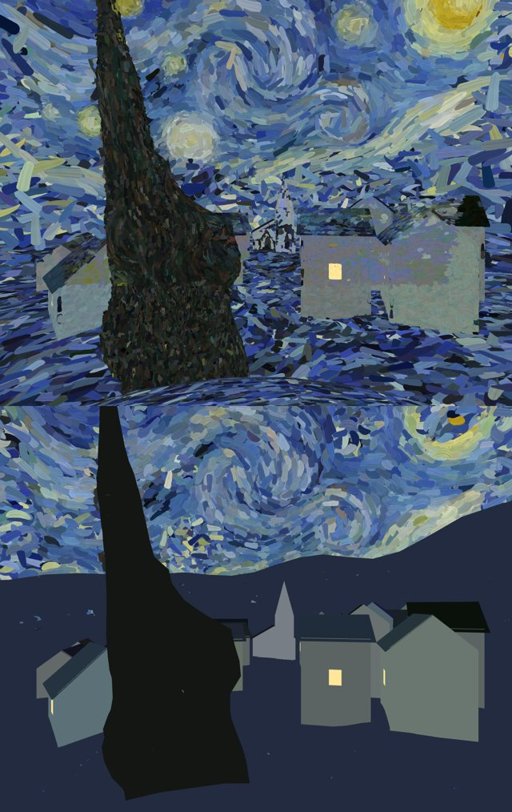

`nowrite` (top) and `paintorder` (below) keep the world strokes visible. They remove stroke-against-stroke depth tests, at the cost of wrong occlusion at chunk seams. For example, dome strokes paint over the far hills, and wall strokes partly cover the lit windows:

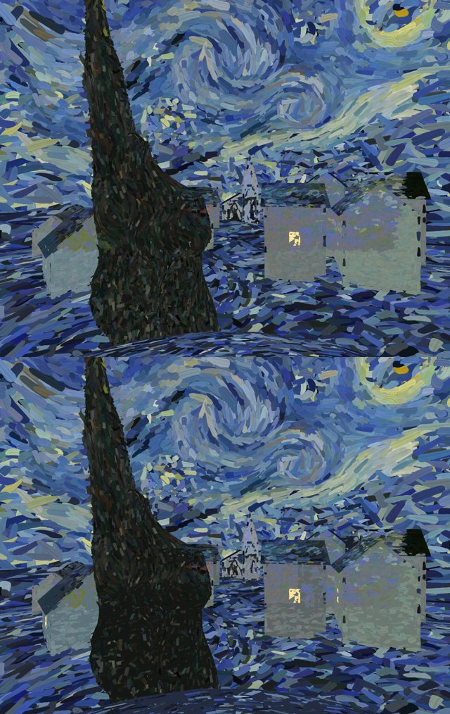

### Flicker per mode

With rotation and translation jitter, 8 frames: flicker / per frame / clustered (% of frame).

| Mode | ground (pitch −0.45) | paul-strobe1 | village | wall (house 11, 6 m) | ridge | sky (pitch +0.5) |
| --- | --- | --- | --- | --- | --- | --- |
| base | 10.09 / 4.32 / 2.83 | 10.83 / 4.56 / 2.88 | 10.35 / 4.22 / 2.88 | 3.56 / 1.37 / 0.71 | 9.47 / 3.71 / 2.22 | 6.93 / 2.54 / 1.16 |
| strokeorder (world strokes hidden) | 0.66 / 0.24 / 0.14 | 1.05 / 0.38 / 0.15 | 3.18 / 1.16 / 0.48 | 1.73 / 0.62 / 0.18 | 2.92 / 1.04 / 0.41 | 5.28 / 1.92 / 0.62 |
| paintorder | 8.70 / 3.68 / 1.91 | 9.16 / 3.78 / 1.82 | 8.62 / 3.42 / 1.76 | 3.29 / 1.28 / 0.47 | 8.70 / 3.35 / 1.57 | 7.07 / 2.60 / 1.00 |
| nowrite | 9.30 / 3.97 / 2.15 | 9.87 / 4.14 / 2.17 | 9.46 / 3.83 / 2.21 | 3.27 / 1.27 / 0.48 | 8.83 / 3.42 / 1.67 | 7.06 / 2.59 / 0.98 |
| nosort | same as base to 0.001 | | | | | |
| noa2c | 6.61 / 2.64 / 0.57 | 6.60 / 2.64 / 0.62 | 6.91 / 2.64 / 0.63 | 2.76 / 1.01 / 0.31 | 5.83 / 2.17 / 0.46 | 4.73 / 1.65 / 0.24 |
| nomip | 10.57 / 4.36 / 2.12 | 11.29 / 4.57 / 2.38 | 11.20 / 4.35 / 2.45 | 4.69 / 1.63 / 0.82 | 10.72 / 3.97 / 2.04 | 9.51 / 3.17 / 1.49 |
| mip (anisotropy) | 10.06 / 4.39 / 2.70 | 10.75 / 4.62 / 2.72 | 10.35 / 4.28 / 2.77 | 3.59 / 1.37 / 0.66 | 9.36 / 3.74 / 2.04 | 7.01 / 2.57 / 1.09 |

The same with translation jitter only (`norot`):

| Mode | ground | paul-strobe1 | village | wall | ridge | sky |
| --- | --- | --- | --- | --- | --- | --- |
| base | 4.92 / 2.14 / 0.99 | 3.98 / 1.66 / 0.80 | 2.82 / 1.29 / 0.61 | 0.76 / 0.34 / 0.17 | 1.28 / 0.55 / 0.19 | 0.58 / 0.27 / 0.14 |
| paintorder | 3.76 / 1.63 / 0.47 | 2.71 / 1.14 / 0.30 | 1.58 / 0.74 / 0.09 | 0.52 / 0.23 / 0.05 | 0.76 / 0.33 / 0.01 | 0.39 / 0.19 / 0.002 |
| nowrite | 4.22 / 1.83 / 0.57 | 3.31 / 1.39 / 0.46 | 2.14 / 0.99 / 0.24 | 0.51 / 0.23 / 0.05 | 0.85 / 0.36 / 0.04 | 0.39 / 0.19 / 0.001 |
| noa2c | 2.86 / 1.22 / 0.36 | 2.33 / 0.94 / 0.28 | 1.80 / 0.81 / 0.30 | 0.64 / 0.29 / 0.17 | 0.82 / 0.35 / 0.13 | 0.46 / 0.22 / 0.13 |
| nomip | 4.50 / 2.02 / 0.73 | 3.62 / 1.57 / 0.61 | 2.71 / 1.26 / 0.55 | 0.78 / 0.34 / 0.17 | 1.30 / 0.56 / 0.20 | 0.62 / 0.29 / 0.14 |

Depth separation sweeps on base, with rotation (shader constants only, reverted):

| Build | ground | paul-strobe1 | village | wall | ridge | sky |
| --- | --- | --- | --- | --- | --- | --- |
| 2048 steps, 0.25 m cap (shipped) | 10.09 / 4.32 / 2.83 | 10.83 / 4.56 / 2.88 | 10.35 / 4.22 / 2.88 | 3.56 / 1.37 / 0.71 | 9.47 / 3.71 / 2.22 | 6.93 / 2.54 / 1.16 |
| 16384 steps, 0.25 m cap | 9.72 / 4.14 / 2.59 | 10.64 / 4.48 / 2.78 | 10.07 / 4.09 / 2.67 | 3.40 / 1.32 / 0.61 | 9.46 / 3.71 / 2.23 | 6.89 / 2.53 / 1.14 |
| 16384 steps, 2 m cap (6 frames) | 8.92 / 3.34 / 2.08 | 9.67 / 3.68 / 2.14 | 9.36 / 3.55 / 2.25 | 3.09 / 1.16 / 0.47 | 8.79 / 3.34 / 1.74 | 6.67 / 2.49 / 0.97 |

### Findings

- **F1. Most of the desktop flicker is resampling, not depth.** Removing stroke-against-stroke depth tests outright (`paintorder`, `nowrite`) cuts total flicker by only 8-25% under rotation jitter. A 0.01° turn moves the image about 0.13-0.15 px near the view centre (1014 px frame height, f = 507 / tan(FOV/2) px: 0.15 px at the 60° painter FOV, 0.13 px at the 70° default FOV). The dense, high-contrast stroke edges then change one or more of their 4 MSAA samples, which crosses the 24-level threshold. No depth or sort change can remove that, and mips and anisotropy do not move it.
- **F2. Depth ties are real and show as clustered patches.** With translation jitter only, removing the depth tests drops clustered flicker as follows:
  - sky: 0.14 to 0.002;
  - ridge: 0.19 to 0.01-0.04;
  - village: 0.61 to 0.09-0.24;
  - wall: 0.17 to 0.05;
  - near ground: 0.99 to 0.47-0.57.

  These are the overlapping-stroke fights the earlier probes found. They are small against F1 in total pixels, but they flip whole patches, which reads as z-fight.
- **F3. Separation helps only with a wider cap.** Eight times the steps alone barely moves clustered flicker, because past 14 m the 0.25 m cap binds and the steps do not reach it. With a 2 m cap, clustered flicker reaches the `nowrite` bound at every pose (ground 2.83 to 2.08, against `nowrite`'s 2.15). That cap lets separate surfaces up to 2 m apart trade places. The stroke flicker section measured 0.41% of the far village swapping surfaces at 0.25 m, 0.78% at 0.5 m and 1.78% at 1.5 m, and ruling Q21 chose 0.25 m. Raising it is Paul's decision.
- **F4. Alpha-to-coverage drives much of the near-ground patching.** `noa2c` cuts ground clustered flicker from 2.83 to 0.57 with rotation and from 0.99 to 0.36 without, more than removing depth tests does. The sharpened coverage (ruling R3) gives every bristle gap a 1 px a2c rim, and those rims re-dither as the view moves. Apple and Adreno lay out a2c sample masks differently, so this is the result most likely to differ in the headset.
- **F5. The sky's remaining depth fight is probably the backdrop rank (hypothesis, not tested).** About 277 dome strokes share each of the 1024 ranks, and same-rank pairs tie at one NDC z (Sky dome strokes, above). The 0.25 m cap does not touch them.
- `nosort` changes nothing, so the chunk sort is stable for a still eye. `nomip` is worse everywhere, and `mip` (anisotropy) changes nothing.

### Sharper alpha-to-coverage (`?zdiag=sharp` and `sharp4`, 2026-11-06, on e5c1cf0)

The brief for this run proposed Ben Golus's sharpened alpha-to-coverage, `alpha = (a − 0.5) / max(fwidth(a), 1e-4) + 0.5`, as the middle ground between base and `noa2c`. Base already is that formula. `stroke.frag.glsl` has computed it since the stroke core (a29943d, ruling R3), so base is sharpened a2c with a rim 1 px wide on an axis-aligned edge and √2 px on a diagonal (`fwidth` is |dx| + |dy|). `sharp` therefore tests the next step: the same formula at twice the gain (`… * float(ZDIAG_SHARP_GAIN) + 0.5` with the define at 2), which halves the rim. `sharp4` sets it to 4, a quarter-pixel rim. Raising the gain further tends to `noa2c`'s cut-out, still with a2c on.

No `sharpmip` mode was added, because the atlas mips do not thin the coverage. A CPU model of the mip chain (a 2 × 2 box filter of the coverage channel, which is what `generateMipmap` usually does, although WebGL leaves the filter to the implementation) keeps the area above coverage 0.5, summed over the 16 brushes, within 1.2% of mip 0 through mip 5, and the mean coverage within 0.1% at every level. Per brush the area stays within 4% through mip 4 and spreads to 0.86-1.07 of mip 0 at mip 5 (about a 15 px stroke), in both directions, so it does not thin systematically. The brushes are solid shape masks, not thin bristles, so the 0.5 contour survives the box filter. Mip 6 is the first level where nearly every brush thins, by 12% on average and 27% at worst (brush 5), and a stroke reaches it only when its 480-texel brush is drawn about 7.5 px long.

Flicker / per frame / clustered (% of frame), 8 frames, the same poses, URL and build path as above (production build, `vite preview`, headless Chromium on ANGLE Metal, Apple M4 Max). The `sharp4` rows were first measured from a temporary shader edit, and the committed mode reproduced them to three decimals. The 1-minute load average was 20-35, over the 15 bar, but the metric is pixel content at fixed poses rather than timing, and base reproduced the earlier table to three decimals.

With rotation and translation jitter:

| Mode | ground | paul-strobe1 | village | wall | ridge | sky |
| --- | --- | --- | --- | --- | --- | --- |
| base (R3, gain 1) | 10.09 / 4.32 / 2.83 | 10.83 / 4.56 / 2.88 | 10.35 / 4.22 / 2.88 | 3.56 / 1.37 / 0.71 | 9.47 / 3.71 / 2.22 | 6.93 / 2.54 / 1.16 |
| sharp (gain 2) | 8.70 / 4.04 / 1.35 | 9.26 / 4.30 / 1.48 | 9.08 / 3.98 / 1.55 | 3.25 / 1.34 / 0.44 | 8.09 / 3.52 / 1.12 | 6.20 / 2.45 / 0.48 |
| sharp4 (gain 4) | 7.71 / 3.61 / 0.84 | 8.03 / 3.83 / 0.93 | 8.11 / 3.61 / 1.00 | 3.05 / 1.26 / 0.36 | 7.04 / 3.16 / 0.70 | 5.59 / 2.28 / 0.32 |
| noa2c | 6.61 / 2.64 / 0.57 | 6.60 / 2.64 / 0.62 | 6.91 / 2.64 / 0.63 | 2.76 / 1.01 / 0.31 | 5.83 / 2.17 / 0.46 | 4.73 / 1.65 / 0.24 |

With translation jitter only (`norot`):

| Mode | ground | paul-strobe1 | village | wall | ridge | sky |
| --- | --- | --- | --- | --- | --- | --- |
| base | 4.92 / 2.14 / 0.99 | 3.98 / 1.66 / 0.80 | 2.82 / 1.29 / 0.61 | 0.76 / 0.34 / 0.17 | 1.28 / 0.55 / 0.19 | 0.58 / 0.27 / 0.14 |
| sharp | 4.31 / 2.02 / 0.60 | 3.53 / 1.59 / 0.49 | 2.60 / 1.24 / 0.47 | 0.74 / 0.33 / 0.17 | 1.24 / 0.54 / 0.17 | 0.56 / 0.27 / 0.14 |
| sharp4 | 3.72 / 1.81 / 0.44 | 3.13 / 1.45 / 0.37 | 2.36 / 1.16 / 0.38 | 0.73 / 0.34 / 0.17 | 1.21 / 0.53 / 0.15 | 0.57 / 0.27 / 0.14 |
| noa2c | 2.86 / 1.22 / 0.36 | 2.33 / 0.94 / 0.28 | 1.80 / 0.81 / 0.30 | 0.64 / 0.29 / 0.17 | 0.82 / 0.35 / 0.13 | 0.46 / 0.22 / 0.13 |

- `sharp` cuts the clustered flicker, the patch flips that read as z-fight, by about half: ground 2.83 to 1.35 and sky 1.16 to 0.48 with rotation. `sharp4` takes it to 0.84 and 0.32, against `noa2c`'s 0.57 and 0.24.
- Per-frame flicker falls much less (ground 4.32 to 4.04), so most of F1's single-pixel edge resampling stays while a2c is on.
- With translation only, `sharp` leaves the wall, ridge and sky clustered flicker where base has it. Those patches are F2's depth ties, which coverage does not touch.
- Fidelity (`scripts/fidelity.ts --url` with `?painting=starry-night&diag&shot&noanim&seed=1&painter&zdiag=sharp`): SSIM 0.3415 and mean ΔE2000 5.4522, and with `zdiag=sharp4` SSIM 0.3412 and 5.4514, all inside SSIM ≥ 0.2643 and ΔE ≤ 7.1961. Base on the same build read 0.3420 and 5.4495.

Stills at the ground and sky poses. The rows are base, `noa2c`, `sharp` and `sharp4`. Each row shows the full frame at half size on the left, and a 4x nearest-neighbour crop of the 160 × 128 px at the view centre on the right. `sharp` keeps anti-aliased edges, slightly crisper than base with faint steps on shallow edges. `sharp4` shows steps on most edges, close to `noa2c`'s hard staircase.

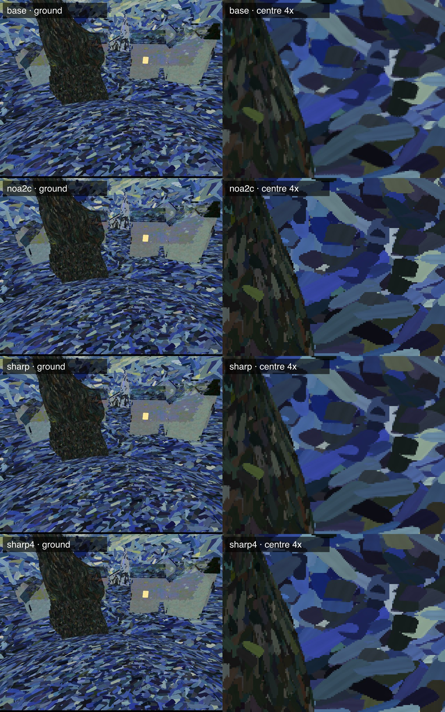

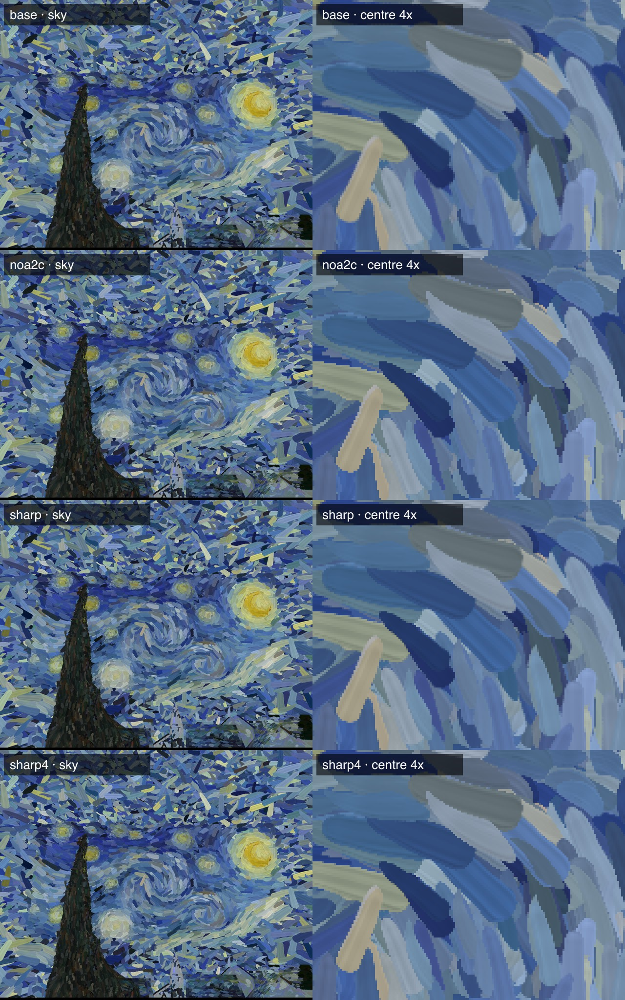

Gates: `make checkall` exited 0, and `E2E_PORT=4297 make e2e` exited 0 with 37 of 37 passed. Without `ZDIAG_SHARP_GAIN` the shader compiles the same alpha line as before, so the default output is unchanged, and SCATTER_VERSION stays 11.

Recommendation: compare base, `sharp`, `sharp4` and `noa2c` in one headset session. On the desktop `sharp` halves the patch flicker, stays within 0.001 SSIM and 0.003 ΔE of base, and keeps anti-aliased edges. `sharp4` comes closer to `noa2c`'s flicker, at the cost of visible steps. If the headset agrees, raising the default R3 gain to the lowest one that clears the shimmer is the cheapest fix, and that is Paul's call.

### For the headset

These URLs need a deployed build, which needs an approved push.

Since 2026-11-07 one boot covers the whole comparison: `?painting=starry-night&ab=shimmer` starts at base, and a single left stick click (V on the desktop) steps through base, nowrite, noa2c, sharp, sharp4 and freeze and wraps back to base (since the nowrite default the cycle is base, write, noa2c, sharp, sharp4 and freeze; see Nowrite stroke policy is the default, below), from the same pose, with no reload. Each click shows the HUD with a line such as `A/B shimmer: noa2c (3/6)`, and the HUD keeps that line while the group is active. Every variant's program is compiled when the batch binds, so a switch links nothing in XR. `?ab=zdiag-all` steps through every mode, and any `?zdiag=<mode>` URL below starts its group at that mode. A click is cancelled if the right stick was pressed during it, because both sticks held is recenter. A full cycle back to base renders the painter view byte-identical to a fresh boot (`tests/e2e/ab.spec.ts`).

- `?painting=starry-night&zdiag=nowrite`: no stroke-against-stroke depth tests, with the strokes still visible. If the shimmer drops, depth ties are the cause.
- `?painting=starry-night&zdiag=noa2c`: tests F4.
- `?painting=starry-night&zdiag=sharp`: the half-pixel a2c rim. If it cuts the shimmer about as much as `noa2c`, a higher default R3 gain can fix it without losing anti-aliased edges.
- `?painting=starry-night&zdiag=sharp4`: the quarter-pixel a2c rim, between `sharp` and `noa2c`.
- `?painting=starry-night&zdiag=freeze`: the same pixels every frame. If the shimmer stays, that points to the compositor's reprojection (or the MSAA / alpha-to-coverage resolve) and not render-time jitter. Leave it with another left stick click, which goes on to base. The A/B button still reads the controllers while the view is frozen, so the Quest button is no longer needed.
- `?painting=starry-night&zdiag=strokeorder`: reproduces the live test, with the world strokes hidden. Reference only.
- Add `&diag&hud` to any of them to read `__goghDiag().zdiag` and `__goghDiag().ab`.
- Also worth reading: frame-to-frame deltas of `__goghDiag().camera` over CDP while Paul holds still. The real rotation noise decides how much of the shimmer F1 accounts for.

### Gates

`make checkall` exited 0. `E2E_PORT=4321 make e2e` exited 0, 37 of 37 passed. The scatter did not change and the default shader output is unchanged (`stroke.frag.glsl` gained an `#ifdef ZDIAG_ALPHA_TEST` block that is off by default), so SCATTER_VERSION stays 11. Fidelity and coverage run inside the e2e suite.

## Nowrite stroke policy is the default (2026-11-07, on 31fc538)

### Decision

In the `?ab=shimmer` headset A/B, Paul picked `nowrite` as the shimmer winner. The stroke batch now draws that way by default, for every scene with a stroke batch except the P1 canvas: the world, `?strokesTest` and the gallery. `?demo=canvas` keeps `write` (fix round 2, below). It is set in the batch, not by forcing `?zdiag` on:

- `BATCH_DEPTH_WRITE` is false in `src/render/strokes/batch.ts`, which passes it to `createStrokeMaterial` (`src/render/strokes/material.ts`).
- A lone stroke mesh, such as the teleport arc or the settings panel, keeps depth writes, because it draws before the world and must occlude it.
- `DEFAULT_ORDER_POLICY` draws the chunks after the base meshes (render order 2e6 on), back to front.
- The strokes still test against the base meshes' depth, so a stroke behind a house wall stays hidden.

The `?zdiag` modes now work like this:

- `?zdiag=write` restores the old depth-writing policy (`WRITE_ORDER_POLICY`: depth writes on, the chunks front to back from 0, before the base meshes).
- `?zdiag=nowrite` still parses and now changes nothing.
- `strokeorder` and `paintorder` turn depth writes on themselves.
- `nosort` freezes the batch's default order: back to front under the nowrite default (fix round 2, below), and front to back for a depth-writing batch.

The `shimmer` A/B group is now base, write, noa2c, sharp, sharp4 and freeze. Base is the new default, and `write` takes `nowrite`'s place, so the headset can still compare the two policies. `write` shares the base program, so the group still precompiles four programs.

### The occlusion fix: draw classes

Without stroke depth writes, draw order alone decides between strokes. Inside a chunk that order is the importance order. Between chunks it is distance.

The old `nowrite` mode got four things wrong in the painter view (the earlier capture in the shimmer diagnosis above, and the middle row below):

1. Dome strokes painted over the strokes that overhang the far hills' silhouette and over the church spire, because a dome chunk's centre can be nearer than a hill chunk's.
2. Dome strokes in the same chunk as the moon and stars painted over most of them.
3. Wall strokes painted over the lit windows they share a chunk with. The 0.25 m depth tie-break pulls them forward past the window quad's 2 cm offset.
4. The moon's own strokes lost their rank order. `RankPicker` (`src/world/sky-lights.ts`) chose that order so the crescent's edge strokes sit on top.

The fix splits each grid cell's strokes by draw class (`STROKE_DRAW_CLASSES`, `drawClassOf`), one chunk per class present. The default policy (`layered`) draws the classes in blocks:

- `dome`: the sky dome strokes (DEPTH_BACKDROP_FLAG). They sit behind everything, so they draw first.
- `lights`: the moon and stars (the pinned strokes). They draw over the dome, and their chunks write depth while they draw (`writeDepthWhileDrawn`). Their front-tier ranks never tie between strokes that can overlap (`lightRankTies` is 0 at seed 1). Depth writes therefore cost them no shimmer and keep their rank order.
- `cypress`: in the Starry Night world, the cypress (`isCypressStroke`) is one chunk of its own, `strokes-<cell>-cypress`, whatever cells it spans. It writes depth while it draws (fix round 1, below), and draws before the world (fix round 2, below).
- `world`: every other stroke, back to front by chunk.
- `overlay`: the lit windows (DEPTH_TIE_BREAK_FRONT_FLAG). They draw last, over their walls.

Why this and not the alternatives:

- Per-layer depth writes would bring back the stroke-against-stroke ties wherever a layer's own strokes overlap, which is what F2 measured on the ground, the buildings, the ridge and the dome. Only the lights are tie-free by construction. They keep depth writes, and so does the cypress, at the cost of its self-ties (fix round 1, below).
- Drawing the windows last adds no per-vertex work and no new program. Its cost: a nearer occluder's stroke overhang can show a farther window through it. Its base mesh cannot, because the base meshes still hide windows behind a house.
- The shader is unchanged. The classes cost chunks, not vertex work.

Chunks and draw calls at the e2e world spot (`__goghDiag().draw`):

| | old | new |
| --- | --- | --- |
| desktop calls / visible chunks | 163 / 157 | 195 / 189 |
| XR calls / visible chunks | 414 / 201 | 480 / 234 |

The sweep captured nine poses in three versions each: the old default, the old `nowrite` mode and the new default. The poses were village street, village west, village church, hill west, boundary north, high over the valley, under the cypress, spot left raised, and the wall pose (house 11, 6 m).

- The old `nowrite` errors recur away from the painter view. Wall strokes chew the village windows, and the moon and stars are gone at the church and street poses. The new default fixes them.
- No new class of error showed up.
- One thing differs from the old default everywhere: which overlapping stroke of one surface lies on top. Before, the tie-break and the lift decided it. Now the importance order inside a chunk decides it, and chunk distance decides between chunks. Near ground and wall strokes therefore stack differently. In the painter view, 45% of pixels differ by more than 24 summed RGB from the old default, against 59% for the old `nowrite` mode.
- Under motion, the cypress lost its texture where its strokes moved past a chunk boundary. Fix round 1 (below) fixes it.

Painter view: the old default on top, the old `nowrite` mode in the middle and the new default below.

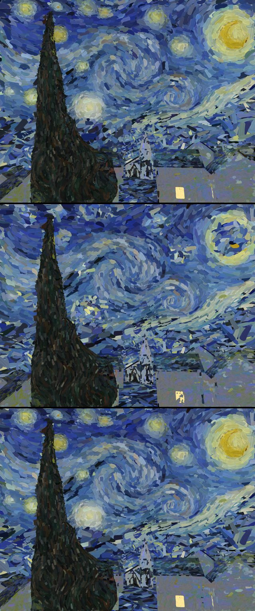

### Measurements

All runs used headless Chromium on ANGLE Metal (Apple M4 Max). "Old" is 31fc538, before this change. "New" is the final build, 8170d50 merged with b48b931 (the 72 Hz default), with the fix round 1 below. The probes ran against production builds served by `vite preview`. The suite and the perf script ran against `--mode e2e` builds.

Coverage, bare / weighted % (limit 0.5% bare), at every pose of `tests/e2e/world-coverage.spec.ts`, from the final full suite run:

| Pose | old | new |
| --- | --- | --- |
| spot ahead | 0.389 / 0.527 | 0.388 / 0.526 |
| spot behind | 0.114 / 0.179 | 0.114 / 0.176 |
| spot left, raised | 0.013 / 0.026 | 0.013 / 0.023 |
| spot right, lowered | 0.297 / 0.370 | 0.297 / 0.370 |
| spot straight down | 0.077 / 0.103 | 0.077 / 0.101 |
| spot straight up | 0.032 / 0.044 | 0.032 / 0.045 |
| hill west | 0.451 / 0.606 | 0.451 / 0.601 |
| hill east | 0.032 / 0.053 | 0.032 / 0.055 |
| hill slope | 0.210 / 0.308 | 0.210 / 0.295 |
| under the cypress | 0.077 / 0.145 | 0.077 / 0.152 |
| hill bowl behind | 0.271 / 0.343 | 0.271 / 0.346 |
| village street | 0.166 / 0.221 | 0.166 / 0.221 |
| village west | 0.236 / 0.291 | 0.236 / 0.287 |
| village church | 0.136 / 0.172 | 0.136 / 0.170 |
| village uphill | 0.449 / 0.555 | 0.447 / 0.551 |
| village down | 0.000 / 0.000 | 0.000 / 0.001 |
| boundary north | 0.063 / 0.069 | 0.069 / 0.079 |
| boundary north-west | 0.020 / 0.026 | 0.016 / 0.024 |
| boundary north-east | 0.013 / 0.022 | 0.013 / 0.020 |
| boundary east | 0.050 / 0.125 | 0.050 / 0.057 |
| boundary west | 0.069 / 0.075 | 0.069 / 0.075 |
| boundary south | 0.010 / 0.011 | 0.010 / 0.011 |
| boundary 47 m inward | 0.086 / 0.121 | 0.086 / 0.119 |
| high over the valley | 0.164 / 0.314 | 0.162 / 0.311 |

The other coverage checks moved by at most 0.007% bare:

- the pinned-motion rows, at the painter view and under the cypress, at motiont 0.5 and 3.7;
- the spot-ahead phase sweep;
- the reactive coverage rows, cypress and village, parked and held, at every controller pose.

The largest move is the painter view at motiont 0.5, 0.334% to 0.341%.

Fidelity (`tests/e2e/fidelity.spec.ts`, limits SSIM ≥ 0.2643 and mean ΔE2000 ≤ 7.1961):

| Build | SSIM | mean ΔE2000 |
| --- | --- | --- |
| old | 0.3494 | 5.4967 |
| new | 0.3482 | 5.2911 |

Coverage and fidelity are pixel content at fixed poses, not timing, so load does not change them. Load (1-minute average) around each suite run:

| Run | before | after |
| --- | --- | --- |
| old | 13.7 | 48 |
| new | 13.8 | 22.1 |

**Flicker probes, `base` against `write`.** Both modes ran on the same final production build: `write` is the old depth policy on the new chunk layout (see C5, below). The first runs of `scripts/shimmer-probe.ts` and `scripts/zfight-probe.ts` this session were invalid, because neither probe passed `noanim`: since the P4 motion layers landed after 6d82235, the moving sky, cypress and stars read as flicker, and an unmoved repeat changed 10-49% of the frame. Both probes now add `&noanim` (committed in 133b4e0). Each table below states the largest unmoved-repeat change, which must read 0.

With rotation and translation jitter, 8 frames: flicker / per frame / clustered (% of frame).

| Mode | ground | paul-strobe1 | village | wall | ridge | sky |
| --- | --- | --- | --- | --- | --- | --- |
| `write` (old) | 10.471 / 4.476 / 3.063 | 11.254 / 4.727 / 3.030 | 10.828 / 4.397 / 3.156 | 3.723 / 1.432 / 0.724 | 9.989 / 3.927 / 2.372 | 7.974 / 2.952 / 1.499 |
| base (new) | 9.790 / 4.185 / 2.380 | 10.264 / 4.288 / 2.305 | 9.729 / 3.928 / 2.301 | 2.984 / 1.130 / 0.353 | 9.097 / 3.530 / 1.762 | 7.711 / 2.827 / 1.160 |

Largest unmoved-repeat change: 0.000% (the probe prints it only when above 0).

Translation jitter only (`norot`):

| Mode | ground | paul-strobe1 | village | wall | ridge | sky |
| --- | --- | --- | --- | --- | --- | --- |
| `write` (old) | 5.107 / 2.210 / 1.125 | 4.059 / 1.705 / 0.843 | 2.973 / 1.352 / 0.734 | 0.775 / 0.344 / 0.166 | 1.301 / 0.560 / 0.198 | 0.745 / 0.340 / 0.282 |
| base (new) | 4.430 / 1.923 / 0.623 | 3.387 / 1.425 / 0.496 | 2.214 / 1.026 / 0.259 | 0.423 / 0.186 / 0.002 | 0.868 / 0.370 / 0.042 | 0.411 / 0.195 / 0.013 |

Largest unmoved-repeat change: 0.000% (the probe prints it only when above 0).

Base flickers less than `write` at every pose: 3-20% less total flicker with rotation and 13-45% less without it. The clustered share falls most, by 22-51% with rotation and 41-99% without.

The zfight probe, eight painter's-spot poses plus the new `cypress` pose, % of the frame that changes on an unmoved repeat, a 0.1 mm shift and a 1 mm shift:

| Pose | `write` (old) same / 0.1 mm / 1 mm | base (new) same / 0.1 mm / 1 mm |
| --- | --- | --- |
| painter-level | 0.000 / 0.090 / 0.709 | 0.000 / 0.076 / 0.674 |
| painter-down | 0.000 / 0.254 / 2.101 | 0.000 / 0.210 / 1.940 |
| village-look | 0.000 / 0.398 / 1.741 | 0.000 / 0.164 / 1.443 |
| back | 0.000 / 0.249 / 1.468 | 0.000 / 0.138 / 1.246 |
| sky-up-0.5 | 0.000 / 0.054 / 0.377 | 0.000 / 0.039 / 0.354 |
| sky-up-1.0 | 0.000 / 0.033 / 0.261 | 0.000 / 0.028 / 0.261 |
| ridge-horizon | 0.000 / 0.310 / 0.753 | 0.000 / 0.062 / 0.458 |
| paul-strobe1 | 0.000 / 0.481 / 2.261 | 0.000 / 0.214 / 1.937 |
| cypress | 0.000 / 0.185 / 1.302 | 0.000 / 0.153 / 1.270 |

Load (1-minute average) before and after each probe run: shimmer with rotation 13.7 and 59.1, without rotation 14.9 and 14.7, zfight base 14.6 and 14.8, zfight `write` 14.8 and 21.3, zfight on the nowrite-cypress build 15.0 and 14.1. Two runs ended above 15. The probes compare pixels, not timing, and every unmoved repeat read 0, so the load does not change their numbers.

**Frame cost.** `scripts/motion-perf.ts --only '(a) noanim'`, the painter view and the spot-ahead view, desktop and XR (IWER). Base boots with `&zdiag=nowrite` and write with `&zdiag=write`, so both carry an A/B group. GPU time comes from EXT_disjoint_timer_query_webgl2 (it worked). CPU time is the summed rAF callback time per frame, desktop only.

| Config, view | `write` GPU mean ms | base GPU mean ms | `write` CPU mean ms | base CPU mean ms | draw calls |
| --- | --- | --- | --- | --- | --- |
| desktop, painter | 3.58 (3.44-3.79) | 4.38 (2.93-4.39) | 0.49 (0.46-0.57) | 0.47 (0.46-0.48) | 156 |
| desktop, spot ahead | 4.22 (3.39-4.74) | 3.64 (3.22-4.94) | 0.50 (0.48-0.80) | 0.49 (0.48-0.51) | 172 |
| XR (IWER), painter | 6.22 (5.53-6.91) | 6.38 (5.90-6.85) | n/a | n/a | 444 |
| XR (IWER), spot ahead | 7.33 (6.83-7.82) | 6.53 (5.91-7.15) | n/a | n/a | 432 |

Each cell is the median of 3 desktop or 2 XR samples, with the range in brackets. Every sample had a 1-minute load of 11.2-14.5 before and after, so none is load-affected, and no other `motion-perf.ts` ran during them. The spread between repeats of one mode, up to 1.5 ms, is larger than the difference between the modes, so on desktop Metal neither policy is measurably faster on the GPU, and the CPU cost is the same within 0.05 ms.

The Quest overdraw cost is pending a headset reading. Desktop Metal GPU time cannot show it: on the Quest's tiler, losing early-Z between strokes shows up as fragment overdraw. Only the HUD's GPU ms, or the governor's level, on the headset settles it.

The stroke benchmark (`?bench`) does not exercise this change. `src/bench/field.ts` builds its own material and never calls `createStrokeBatch`, so base and `write` are the same there by construction.

**Draw calls per class.** Visible chunks per class (each one draw call per view), the same for both modes: desktop painter: dome 66, lights 21, world 57, overlay 4; desktop spot ahead: dome 80, lights 20, world 62, overlay 4; XR painter: dome 120, lights 21, world 71, overlay 4; XR spot ahead: dome 116, lights 21, world 69, overlay 4. Against the old build (painter view: 127 calls, 119 chunks), the class split adds 29 chunks there: 21 lights chunks, 4 window chunks, and 4 more from the class split and the cypress chunk. The lights chunks are the near-empty ones: each holds only the moon or star strokes of one dome cell. They are not merged this round. A chunk takes its band from its own distance, and the band sets its stroke size scale and density: one lights chunk for the whole sky would take its band from a sphere round the whole dome, which changes the moon and star stroke sizes, and merged windows would take another band's size and density. A merge must keep every stroke in the band it has today, for example one lights chunk per band. That is a follow-up.

### C5: `write` is not the old default byte for byte

`?zdiag=write` restores the old depth policy (stroke depth writes on, chunks front to back before the base meshes), but on the new chunk layout. In the painter view it differs from 31fc538 in 2.0% of pixels. The class split and the cypress chunk change which strokes share a chunk. That changes each chunk's importance order and the order between chunks. Where two strokes tie in depth, which one wins depends on that order, so the tied pixels change. The A/B therefore compares the two depth policies on one layout, which is the comparison Paul makes in the headset.

### Fix round 1: the cypress under motion

`motion.spec.ts:1089` (I3, cypress flame trunk patches) failed on the first nowrite default. The cypress straddles the y = 0 cell seam: at seed 1, 20,335 of its strokes fall in cell (-1, -1, -1) and 16,629 in (-1, 0, -1). Projected through the painter camera, the seam crosses the canvas at image v 0.87-0.90, which is the patch at (0.3, 0.9).

Three variants, each run against the two cypress specs, settled the cause:

| Variant | sway (0.3, 0.9) dx | rise (0.2, 0.64) dy | sway (0.25, 0.6) dx | reactive push sharpness |
| --- | --- | --- | --- | --- |
| predicted (limit) | −3.63 (±2.9) | −22.09 (±7.5) | −4.83 (±3.2) | > 3 |
| old (31fc538) | −6.09 | −18.84 | −4.81 | 6.6 |
| nowrite, cypress in two chunks | 32.0 | −14.20 | −9.43 | 3.4 |
| nowrite, one chunk, one importance order | −0.89 | −20.84 | −5.85 | 2.1 |
| nowrite, one chunk, each cell's order kept | −0.03 | −14.20 | −9.43 | 3.4 |
| one chunk, each cell's order kept, depth writes (shipped) | −5.92 | −18.84 | −4.81 | 6.6 |

- The seam explains only the (0.3, 0.9) check. In two chunks the lower chunk's rising strokes slide under the upper chunk's strokes, and the measured sway is 36 px off. One chunk brings it to 3.6 px off, still just outside the 2.9 px tolerance.
- The other two checks sit 2.4-2.9 m above the seam, inside one cell. Keeping each cell's importance order reproduces their failing values exactly, so no chunk boundary causes them. Without depth writes, the instance order decides which overlapping flame stroke shows, and the visible texture no longer moves with the facing strokes the prediction follows. One global importance order passed I3 only as a different permutation, with one check at 2.74 against 2.9, and it dropped the reactive push sharpness below its limit of 3.
- The shipped fix: the cypress is one `world` chunk, each cell's importance order is kept and the cells' cypress strokes interleave by their fraction through that order, and the chunk writes depth while it draws (`writeDepthWhileDrawn`, as the lights do). The two cypress specs then read the old build's values exactly.

The cost is the cypress's own stroke-against-stroke depth ties, which nowrite removed. The `cypress` zfight pose (2.5 m from the hull, facing the trunk) measures it against the production build with a nowrite cypress (one chunk, one importance order):

| Pose | nowrite cypress same / 0.1 mm / 1 mm | shipped (depth-writing cypress) same / 0.1 mm / 1 mm |
| --- | --- | --- |
| cypress | 0.000 / 0.098 / 1.036 | 0.000 / 0.153 / 1.270 |

Depth writes raise the cypress pose's flip share by 56% at a 0.1 mm shift and 23% at 1 mm, against the nowrite cypress. They stay below the full `write` policy at that pose (0.185 / 1.302). That build is the one-chunk, one-order variant, the nowrite cypress that passed I3 but failed the reactive sharpness check. If the headset shows the cypress strobing, the alternative is to keep the cypress nowrite and re-derive I3's prediction for the strokes that instance order makes visible. That choice is the coordinator's.

The same seam mechanism exists for the dome under the sky swirl and for reactive ground strokes that cross a cell seam. No test fails on either, and this round does not change them.

### Fix round 2

**Draw classes (N5).** The cypress is its own draw class, `cypress`, between `lights` and `world`, so the order is dome, lights, cypress, world, overlay. Before, it sorted inside the `world` block by its chunk centre, several metres up the tree, and a ground chunk whose centre was farther drew first and was painted over by the cypress foot. Now the cypress always draws before the world and writes depth, so a ground stroke drawn after it tests against it: ground in front of the foot stays visible, and ground behind it is hidden. The cypress specs read the same values as fix round 1 (rise (0.2, 0.64) −18.84, sway (0.3, 0.9) −5.92, sway (0.25, 0.6) −4.81, reactive push 22.3 px at sharpness 6.6). At "under the cypress" the foot and the ground before it look the same as in fix round 1. Desktop painter view, chunks per class: dome 66, lights 21, cypress 1, world 56, overlay 4.

**Scope (N3).** The P1 canvas (`?demo=canvas`) is layered on purpose: `LAYER_STEP` steps each layer along the normal, so depth decides between them. It now creates its batch with `depthWrite: true`, which makes `WRITE_ORDER_POLICY` its default, and zdiag's `base` and `nosort` follow each batch's own default (`StrokeBatch.defaultOrder`). The single cypress chunk is now opt-in, `cypressChunk: true`, which only the Starry Night world sets. Another painting's cypress-layer strokes, the canvas's included, stay in their grid cells.

**Freeze order (N1).** `nosort` freezes the current order. Under the default policy, which draws back to front (`reverse`), the freeze now stores back-to-front ranks, so the chunks visible in the freeze frame draw like the unfrozen order. Before, it stored front-to-back ranks. A chunk first seen after the freeze frame, for example after a head turn, takes `chunks.length` plus its rank, so it draws on top of every chunk of its class that was frozen earlier. Without stroke depth writes it then paints over nearer strokes of that class wherever they overlap on screen. That is inherent to a diagnostic that never re-sorts, and under the old depth-writing `nosort` it was harmless. `tests/strokes-batch.test.ts` checks both policies.

**The halo (N2).** The star and moon halo is transparent, so three drew it after every opaque stroke. Without stroke depth writes, it then painted over the world strokes that overhang it. It now draws in the opaque queue at `batch.orderBeforeClass('cypress')`, between the lights and cypress blocks, so world strokes paint over it. three keeps its additive custom blending there. Under `?zdiag=write` that order is still above every chunk and base mesh, so the halo draws last among them, as before. `scripts/halo-overhang.ts` captures each view with and without the halo (`?nohalo`), on base and on `write`, and counts the pixels where the halo shows on base but not on `write`, which means over a world stroke:

| View | halo on base, % | halo on `write`, % | base only, before | base only, after |
| --- | --- | --- | --- | --- |
| painter | 5.941 → 5.933 | 5.932 | 0.009% (119 px) | 0.001% (13 px) |
| hill west | 0 | 0 | 0 | 0 |
| under the cypress | 2.204 → 2.161 | 2.161 | 0.043% (559 px) | 0.000% |

Before the fix, the base-only pixels under the cypress were a thin rim at the bottom of a star's glow, over the dark hill strokes. At hill west no halo is in view. Load was 14.5 before and 14.0 after the first run, and 13.7 before and 12.7 after the second.

**Cypress chunk tests (N7).** `tests/strokes-batch.test.ts` checks the interleave invariant (each stroke keeps its order among its own cell's strokes), and the merged chunk's bounds, band and cull across both cells.

**Accepted (N4, N6).**

- N4: the merged cypress chunk takes its band from its nearest point, like every chunk (`chunkDistance` is the distance to the centre minus the radius). The whole tree therefore changes band at once, and its top takes near-band size and density as soon as its foot is near. That follows the band contract, and it removes the density mismatch at the seam. It costs a little more near-band work, and a near-density shed thins the whole tree.
- N6, a known limit: draw order also decides overlaps on other surfaces whose strokes can cross a chunk seam or overlap inside one chunk. These are the dome under the sky swirl, reactive ground and village strokes, and the static overhang at any `world` seam, where chunk centre distance decides the overlap and can flip with head translation. The moon and stars are immune, because they write depth with tie-free ranks. Since 2026-11-09 a chunk pair at a seam no longer swaps under head sway, and `tests/e2e/strip.spec.ts` covers it (View-angle strip through the painter's spot, above). A pair still swaps once while walking, and the overlaps inside one chunk are unchanged.

**Captures.** The default changes the Starry Night world and the gallery, so their reference captures are regenerated on this change:

- `docs/shots/p2-painter-spot.png` and `docs/shots/p2-fidelity.png`, with `bun scripts/fidelity.ts --url "<url>/?painting=starry-night&diag&shot&noanim&seed=1&painter" --capture docs/shots/p2-painter-spot.png` on a production build. SSIM 0.3482 and mean ΔE2000 5.2914, against 0.3494 and 5.4967 for origin/main (240f498) captured the same way. A second capture was byte-identical (SHA-256 `bb9252fd…00ce`). Against main, only the dome, ground and wall strokes change, where overlapping strokes now stack in a different order. The cypress, moon and stars are pixel-identical.
- `docs/shots/p54-gallery-wide.jpg`, `p54-gallery-starry.jpg`, `p54-gallery-west.jpg` and `p54-plaque.jpg`, with `GALLERY_SHOTS=1 E2E_PORT=4285 bunx playwright test tests/e2e/gallery.spec.ts -g "docs/shots captures"`. The scans, frames, plaques and benches read as before. Only the stroke stacking on the walls, floor and ceiling differs.
- `docs/shots/p1-canvas.png` is not regenerated, because the canvas keeps `write`. This branch's capture is byte-identical to origin/main's (SHA-256 `93f0e1de…b6f`). Both differ from the committed file, which dates from bd3bb84 (P1-A2) and predates later changes on main, so that drift is not this change's.
- `docs/shots/p53-panel.jpg` runs in the bare scene, which has no stroke batch, so it does not change.
- The captures for earlier investigations (moon, village, cypress, shimmer and others) record the build they were taken on, and stay as they are.

### Gates

Fix round 2 (merged with 240f498, the wrap and flame A/B groups):

- Unit suite: 1145 of 1145 passed.
- `make checkall-ci` exited 0.
- `E2E_PORT=4285 make e2e` exited 0: 105 passed and 2 skipped. The 1-minute load was 14.2 before the run and 45.0 after it, so the load rose past 15 during the run, which this records.

Fix round 1:

- Unit suite: 1120 of 1120 passed.
- `make checkall-ci` exited 0 on 8170d50.
- `E2E_PORT=4285 make e2e` exited 0 on 8170d50: 101 passed and 2 skipped (load 13.8 before, 22.1 after).

SCATTER_VERSION stays 11. The scatter output does not change, only the chunk partition and the draw order.

## Governor sheds foveation first (2026-11-06, on e0eac54)

### Headset evidence

Quest 3, deployed e0eac54, painter's area, 72 Hz (13.89 ms budget). The runs were driven over CDP (adb forward to `chrome_devtools_remote`), and the frame interval comes from `XRSession.requestAnimationFrame` timestamps over 3.5 s windows. The script patched `gl.viewport`, `gl.drawElementsInstanced` and `XRProjectionLayer.fixedFoveation` live.

| Condition | Mean frame |
| --- | --- |
| As shipped (governor level 3: near 0.7, far 0.28, fb 0.85 requested) | 20.95 ms |
| `fixedFoveation` = 1 | 16.53 ms |
| Every draw into a viewport 1/4 wide and 1/4 high (1/16 of the pixels, same draw calls) | 13.89 ms (vsync cap) |
| Skip every 2nd instanced draw | 14.10 ms |
| Skip 3 in 4 instanced draws | 13.89 ms |
| As shipped again | 21.12 ms |

There are 350 to 400 draw calls per frame. Main-thread JS takes 6 to 7 ms of each 21 ms frame, and the thread then waits. The frame is therefore GPU-bound, not CPU or draw-call bound. A first draft of this section called it fill-bound. The profile below shows pixel count alone does not explain it. The e018c2f reading that called it CPU-bound on per-chunk draws was wrong for the current world. PRD D3 still holds: multiview helps only CPU-bound apps.

A second headset run on 2026-11-06 (deployed build, 72 Hz, governor level 4, mean frame over 3.5 s windows, interleaved, driven over CDP) measured foveation 0.5 and broke the frame down by layer:

| Condition | Mean frame |
| --- | --- |
| Base | 22.39, 21.55 and 21.61 ms (mean 21.85) |
| Foveation 0.5 | 18.31 and 18.22 ms (0.84 of base) |
| Foveation 1 | 18.08 and 17.24 ms (0.81 of base, about 3% past 0.5) |
| Skip every alpha-to-coverage stroke draw | 13.89 ms (vsync cap) |
| Skip the blended draws (the haze) | 20.98 ms, against 21.9 ms |
| Skip the non-instanced base meshes | 22.81 ms (no gain) |

So the cost is in the alpha-to-coverage strokes. The haze buys about 1 ms, and the base meshes nothing.

A third run on 2026-11-06 (72 Hz, governor off) tested pixel count directly. A static render scale of 0.7 applied at layer creation gives an `XRProjectionLayer` texture of 2352 × 1232 side by side, 1176 × 1232 per eye against the default of about 1680 × 1760, so about 0.49x the pixels. With foveation 1 on top it reads 18.71 ms mean, barely better than foveation 1 alone at scale 1 (17.2 to 18.1 ms). `ovrgpuprofiler` on the Quest at that setting:

| Metric | Value |
| --- | --- |
| GPU clock | 545 MHz |
| GPU utilisation | about 78% |
| Shading time on vertices / fragments | about 54% / 46% |
| Pre-clipped polygons | 85M/s, about 1.6M per frame at about 53 fps |
| Vertices shaded | 165M/s |
| Average polygon area | about 25 px |
| Primitives trivially rejected | 23% |
| Bus busy | 16.5% |
| Stalled on memory | 0.1% |

So the frame is bound by geometry, many tiny stroke triangles processed in the tiler's binning and render passes, plus fragment work, with the GPU not fully saturated. It is not bound by pixel fill alone. Halving the pixels barely moves it, while skipping draws (which removes their geometry and their fragments together) and foveation both pay. Foveation 0.5 is most of foveation's gain, and step 1 adds about 3%, which sits on the no-gain bar, so it can read as no-gain against 0.5. That is one reason the two foveation steps hold apart.

### What three 0.186 supports

- `WebXRManager.setFoveation(v)` sets `fixedFoveation` on the projection layer (or on an `XRWebGLLayer` that has it) at any time, mid-session included. The governor uses it.
- `WebXRManager.setFramebufferScaleFactor` refuses while presenting. three never calls `XRView.requestViewportScale`.
- `src/xr/viewport-scale.ts` already did what the brief proposed. It calls `requestViewportScale` on three's own `XRView`, immediately before three's `XRWebGLBinding.getViewSubImage(layer, view)`, inside three's XR frame handler. A second hook through `renderer.xr.getFrame()` would call `getViewerPose` again and get different `XRView` objects, so it could change nothing.
- On Quest Browser three takes the projection-layer path, and the measured `fbScaleApplied` is 1 at a requested 0.85. So Quest ignores `requestViewportScale` for projection layers, and dynamic viewport scaling is unavailable on the path three uses there. The fb-scale step stays in the order, because it does pay on a runtime that honours the request. On Quest the no-gain rule undoes it and holds it with the back-off below.
- Not tried: forcing the `XRWebGLLayer` path (by hiding `createProjectionLayer`), where the WebXR core spec applies the request at `XRWebGLLayer.getViewport`. Whether Quest Browser honours it there is unverified. That changes the MSAA path, and it can only be judged on the headset.

### New shed order

1. Foveation 0 to 0.5 (step `foveation`).
2. Framebuffer scale 1 to 0.85.
3. Foveation to 1 (step `foveation-max`), the last resort, which P0.8 found blocky at the edges. It has its own hold, so a 0.5 step that window noise reads as no-gain does not block it. On Quest fb scale is always no-gain, so foveation 1 is the only measured lever.
4. Far, mid and near density, with the existing floors and yield checks.
5. The 72 Hz request, after 3 s of overrun with nothing left to shed. Since 2026-11-07 only `adaptive-90` (`?hz=90` or `?hz=120`) makes it: the default quality, `adaptive-72`, asks for 72 Hz at session start, and a 72 Hz target never requests a rate.

Restore and recovery run in the reverse order. `__goghDiag().governor.foveation` and the HUD now show the live foveation (0, 0.5 or 1). `xr/session.ts` still sets 0 at session start, but it does so after an awaited `updateTargetFrameRate`, which can land after a governor shed. So every judged frame re-asserts the governor's value when `renderer.xr.getFoveation()` reports another. The bench (`?bench`) never runs the governor and keeps its own foveation steps.

### Why density sheds buy nothing

Each density step multiplies the band's stroke size by sqrt(from / to) (`densityShed` in `src/render/governor.ts`, following the 1/sqrt(d) law in `src/render/strokes/bands.ts`). That keeps drawn × size² constant: a 30% cut in count comes with a 1/0.7 growth in quad area. The unit test "each density shed multiplies by 0.7 and raises the size by 1/sqrt of the density ratio" pins exactly these values. The painted area, and with it the fragment work and overdraw, stays the same by construction. A density shed cuts instances, and with them vertices, by 30%, yet near 0.34 with far 0.28 still reads about 21 ms. Given the geometry-heavy profile above, why that vertex saving does not show is not explained by this evidence. A first draft said fill dominates, which the profile contradicts. `MIN_SHED_YIELD` judges a step by its instance count, which the headset shows does not predict frame time here.

The cheap code fix would be a weaker size law, for example size × (from / to)^0.25, under which a 0.7 step cuts painted area by about 16%. I did not make it. It trades coverage for fragment work, and the profile above suggests fragment work is only part of the cost. Also, the coverage and fidelity specs run on the desktop at the default densities, where the governor never judges, so nothing would catch gaps at shed densities. It needs a density override flag and a coverage sweep at shed levels first. The cut-the-draw-count A/B rows (skip half: 14.10 ms) remove whole strokes with no size growth, which is the upper bound such a change could reach. No desktop fragment-count measurement was taken, although the brief asked for one: the size law fixes the painted-area ratio analytically, so it could only confirm it, and it did not fit the time budget. The haze (30,000 large blended strokes), the sky dome at far density and pinned layers are not density-governed, so they were not the cause of the no-gain result. The layer breakdown above puts the cost in the alpha-to-coverage strokes: skipping them reaches the vsync cap, while skipping the haze saves about 1 ms and the base meshes nothing.

### Hold back-off

A no-gain undo, a recover-back and a kept recovery each hold their step. The density bands share one hold (`density`, fix round 1): under the sqrt size law every band keeps its painted area, so one band's no-gain predicts the others', and a density no-gain or recovery result holds all three. The first hold of a step lasts 30 s, and each further hold of the same step doubles: 30, 60, 120, 240, then 300 s (`MAX_HOLD_MS`). A reported frame-rate change (or an applied 72 Hz request) and a new session (a new machine) restart the doubling. A shed that pays restarts it for that step. An interrupt (a hidden session) still clears the holds but keeps the doubling. Wall flips over 10 minutes of the simulated headset frame (72 Hz, vsync-locked with a deterministic debt, fb scale ignored, density free, at the headset-measured costs: base 21.85 ms, foveation 0.5 0.84 and foveation 1 0.81 of base). A flip is any density event, shed, undo or recovery, since each one adds or removes wall strokes. The script was `bun /tmp/gx-fill-scripts/flips.ts <governor module>`.

| Governor | Density events in 10 min |
| --- | --- |
| e0eac54 (density first, fixed 30 s holds, no foveation) | 124 (62 sheds, 60 no-gain undos, 2 recovers) |
| 819b25a (foveation first, per-band doubling holds) | 32 (16 sheds, 15 undos, 1 recover) |
| Fix round 1 (shared `density` hold) | 10 (5 far sheds, 5 undos, at 0, 30, 90, 210 and 450 s) |

With window noise (random vsync misses at the same costs, 8 seeds, 300 s), fix round 1 makes 8 to 16 density events per seed, from useless sheds that stick by chance and their recovery.

### Unit evidence

`tests/governor.test.ts`, "governor foveation steps and hold back-off", drives 72 Hz vsync-locked traces in which each frame takes one or two vsyncs, with a deterministic debt so the mean tracks the frame cost from the table above.

The costs are the headset-measured ones from the second run above, taken over CDP on 2026-11-06: base 21.85 ms, foveation 0.5 0.84 and foveation 1 0.81 of base. An earlier draft of this section used an assumed 0.89 for foveation 0.5, before it was measured.

- With fb scale applied (cost × scale², a pixel-count model the profile above does not support on Quest): foveation 0.5 and fb 0.85 are shed first and held for more than 95% of 10 minutes. Density is never shed, and foveation never reaches 1. This trace assumes fb scale applies, which Quest does not do on the projection layer.
- As measured on the headset, with fb scale ignored and density free: without noise, foveation 1 (3.6% under 0.5, just over the bar) holds for more than 95% of the time. Only far density is ever tried, 3 to 5 times in 10 minutes, with each gap about double the last. Near density is below full for under 1% of the time. Each recovery test of foveation 1 is reverted.
- The same costs with window noise (8 seeds, 300 s): foveation stays at 0.5 or 1 for at least 97% of the time on every seed. Foveation 1 itself is held for anywhere from 1% to 97% of the time, seed by seed, because its 3% gain sits on the bar. Density events stay at 16 or fewer per seed.
- Hypothetical costs with window noise (8 seeds, 300 s), where 0.5 buys 2% (under the 3% bar) and 1 buys 22%: every seed reaches foveation 1 and holds it for more than 85% of the time (worst 0.89). With the shared foveation id of 819b25a, 0.5's no-gain would have held 1 back.
- A constant overrun shows foveation hold gaps of 30, 60, 120, 240, 300 and 300 s, and a frame-rate change restarts at 30 s.

The CPU-bound recovery traces with window noise keep their original 120 s bounds after fix round 1: per-seed mean level under 3 (worst measured 2.88) and across-seed mean under 2 (worst 0.76). 819b25a had loosened them to 3.5 and 2.5. The recovery-hold doubling never resets on a CPU-bound frame, so a 600 s check was added: the across-seed mean must stay under 1 and the worst seed under 3.5. The measured values are 0.66 and 1.79 at worst, at miss rate 0.31. The shared density hold costs the GPU-bound trace, where every step pays, a little: its worst mean level is 2.46 (bound now 2.2, was 2.5), and at least one recovery restore per seed is reverted instead of half, because a recovery that noise keeps now holds every density band.

### Not verified

There is no headset in this session (no adb). The foveation steps, the back-off and the shed order are verified only in unit tests and in the desktop gates. The governor itself has not been run with these changes on the headset. Foveation does not reach 72 Hz in the painter's area: the measured foveation 1 frame is 17.2 to 18.1 ms. Even 0.49x the pixels with foveation 1 reads 18.71 ms. The remaining cost is the alpha-to-coverage strokes' geometry plus fragment work. Whether 0.5 shimmers acceptably in the world is Paul's check.

## Sky wrap and cypress sway variants (2026-11-07)

Retired later the same day: in Paul's headset passes base beat `fade` and `half`, and the cypress `wind` lost too, so all three were removed, with the `flame` group, `?flame` and the sky base map. The wrap group then held base, opacity and pingpong (Sky wrap variants: opacity and pingpong, below), and later base, pingpong and wave (Sky wrap variants: wave, below). This section is kept as the record of that round.

In the headset Paul found the sky-swirl strokes' size pulse at the wrap distracting (Q39, and Q37 at low calm), and did not notice the cypress sway (Q40). Two A/B groups (`src/motion/variants.ts`, CLAUDE.md, Motion A/B variants) let him pick in the headset with the A/B button (left stick click, or V):

- `https://gogh-xr.pardev.net/?painting=starry-night&ab=wrap`
- `https://gogh-xr.pardev.net/?painting=starry-night&ab=flame`

The variants:

- wrap `base`: the P4.2 shrink to nothing over the first and last 6% of the 8 s loop.
- wrap `fade`: full size through the wrap. Over the same window the colour mixes toward the sky base map under the stroke (the mean colour of the sky strokes by direction from the painter's eye, 64 × 64 octahedral), all the way at the jump.
- wrap `half`: the shrink stops at 0.5 of the size, over a 12 s loop on base's arc (2/3 of base's speed), so every reach bound holds.
- wrap `pair` is not built. Strokes are opaque alpha-to-coverage quads with depth write, so two overlapping strokes cannot sum colour weights (alpha below 1 dithers, R3), and a partner half a period apart needs a second instance per sky stroke, which is new per-instance data.
- flame `base`: the P4.4 sway along each face's tangent, up to 0.14 m × h².
- flame `wind`: the same two travelling sines along the world-fixed `CYPRESS_WIND` (0.928, 0, −0.374), across the painter's view of the cypress, at up to 0.15 m × h². It started at 0.3 m and was stepped down on coverage (below).

### Base is unchanged

`bun scripts/motion-variant-probe.ts capture` took five captures (the `?noanim` painter view, the painter view at `?motiont=0.5` and `3.7`, sky-up and under-the-cypress at `3.7`) from an e2e build of 31fc538 and from this branch at 75f6340. All five are byte-identical with no flag, with `&wrap=base&flame=base`, with `&ab=wrap` and with `&ab=flame` (the HUD hidden). Fix round 1 retook all four sets on the final tree (on 6b5473e, after the wind step-down, the placeholder texture, the map built from any bound batch and the merge of b48b931), against the same 31fc538 shots: all 20 captures are byte-identical (load 13.6 to 14.8 at the start of each run, 13.4 to 17.8 after). `tests/e2e/ab.spec.ts` cycles both groups at a pinned `?motiont` and checks that each non-base variant draws differently and a full cycle back to base matches a fresh boot byte for byte.

### Measurements

`bun scripts/motion-variant-probe.ts measure http://localhost:<port>/` on an e2e build, headless Chromium on the GPU at 1280 × 1014, seed 1. The 1-minute load was 15 or less at the start of each variant (13.7 to 14.8) and 14.3 to 56.7 after (other projects' work spiked it during `wrap base`; coverage, size and flicker are pixel and count measures at pinned times, so load does not change them).

Sky, at the five sky poses (spot ahead, spot behind, spot left raised, spot straight up, boundary north-east). Worst bare is the worst `?coverage` share over `?motiont` 0.5, 2.3, 3.7, 6.1 and 9.9 (limit 0.5%). The size columns are the share of drawn sky strokes below 0.8 of their rest size, and above a 0.2 fade weight, at `?motiont=3.7` (`__goghDiag().wrap`, the range over the poses). Flicker is `temporalFlicker`'s share of pixels that change between consecutive frames, per pose in that order: motion over 12 frames stepped 1/72 s from 3.7, and jitter over 8 frames of 0.1 to 0.3 mm eye jitter at 3.7.

| wrap | Worst bare | Below 0.8 size | Faded | Motion flicker, % | Jitter flicker, % |
| --- | --- | --- | --- | --- | --- |
| base | 0.333% | 8.41 to 8.72% | 0 | 5.04 / 2.70 / 4.99 / 8.21 / 2.30 | 8.55 / 12.20 / 10.57 / 7.81 / 5.52 |
| fade | 0.303% | 0 | 8.41 to 8.72% | 4.73 / 1.59 / 3.76 / 6.05 / 2.64 | 8.44 / 12.02 / 10.27 / 7.48 / 5.47 |
| half | 0.347% | 6.40 to 6.69% | 0 | 4.18 / 1.59 / 3.57 / 5.77 / 1.62 | 8.57 / 12.16 / 10.59 / 7.93 / 5.39 |

`fade` removes the size pulse and cuts the motion flicker at four of five poses (spot straight up 8.21 to 6.05%), and is 0.34 points higher at boundary north-east. `half` keeps 6.4 to 6.7% of strokes below 0.8 (the pulse is half as deep and two thirds as fast) and has the lowest motion flicker at four poses, level with `fade` at spot behind. Jitter flicker, the still-view shimmer, is within 0.4 points of base for both, since neither touches a still frame's rasterisation.

Cypress, at three poses (spot toward the cypress, under the cypress, cypress side on looking along the wind), worst bare over `?motiont` 0.5 to 11.5 in 1 s steps:

| flame | Amplitude at the tip | Worst bare | Per pose |
| --- | --- | --- | --- |
| base | 0.14 m (face tangent) | 0.259% | 0.259 / 0.160 / 0.175% |
| wind | 0.3 m | 1.228% | 0.551 / 1.228 / 0.292% |
| wind | 0.2 m | 0.579% | 0.391 / 0.579 / 0.206% |
| wind (shipped) | 0.15 m | 0.386% | 0.331 / 0.386 / 0.183% |

The wind moves a whole height of the tree the same way, so the upwind side of the cypress mesh shows through by up to the sway, where base's tangent sway largely cancels along the outline. At 0.15 m the hull excess (tests/motion-cypress-flame.test.ts, seed-1 strokes) is p99 11.65 cm (35.4% of the stroke length) and max 22.02 cm (69.0%), against base's p99 7.98 cm (24.6%). The largest offset is 0.191 m and the largest per-stroke reach 0.258 m (base 0.179 m), which the `cypressWind` cull reach covers. In painter-view crops at `?motiont` 0.5 and 3.7, 0.15 m still moves the whole outline sideways against the sky and moon, with no gaps; 0.3 m splayed silhouette strokes visibly.

### Cost

Desktop only: `bun scripts/motion-perf.ts --only "(v)"` on an e2e build, ANGLE Metal on an Apple M4 Max, 1280 × 1014, live motion, `?nogov`, one 4 s window per view (GPU time from EXT_disjoint_timer_query_webgl2). Every kept row had a 1-minute load of 15 or less before and after; rows over 15 after were discarded and re-run.

| Variant | View | GPU mean / p95, ms | Draw calls | Drawn strokes | Visible chunks |
| --- | --- | --- | --- | --- | --- |
| wrap base | painter | 3.57 / 4.17 | 127 | 249,207 | 119 |
| wrap base | spot ahead | 3.54 / 6.21 | 150 | 257,238 | 144 |
| wrap fade | painter | 2.90 / 4.26 | 127 | 249,207 | 119 |
| wrap fade | spot ahead | 4.13 / 6.50 | 150 | 257,238 | 144 |
| flame wind | painter | 3.63 / 4.01 | 127 | 249,207 | 119 |
| flame wind | spot ahead | 4.11 / 4.50 | 150 | 257,238 | 144 |

Draw calls, drawn strokes and visible chunks are identical to base for both variants: the wind's larger cull reach (0.258 m against 0.179 m) passes no extra chunk at these views. The GPU means are single 4 s windows: `fade` is 0.67 ms below base at the painter view and 0.59 ms above it ahead, and `wind` 0.06 ms and 0.57 ms above. This host's run-to-run spread was not measured, so these deltas are not separated from noise. `half` was not measured: its runs were discarded twice on load and then stopped for time. Its shader path is base's with different constants and the same draws. `fade` also builds the sky base map once, at boot, when the wrap group or `?wrap=fade` is active. That build time was not measured.

### Not verified

- No headset run: the variants were judged in desktop captures only, so how `fade`, `half` and `wind` read in the Quest is Paul's A/B call. In the headset, `half` differs from base in two ways at once: the shrink stops at half size, and the whole swirl also moves at 2/3 of base's speed (the same arc over 12 s), so a preference for `half` may be a preference for the slower swirl.
- Quest GPU cost: not measured. The desktop cost is below.

## P5.5 portal and return (2026-11-07)

`tests/e2e/portal.spec.ts`, M4 Max, headless Chromium on ANGLE Metal at 60 Hz. At 60 Hz a frame that misses one vsync reads 33.3 ms, so 16.8 ms means no frame was missed. The first runs had a load average of 8.9 to 10.8. At 0b3ae3e the portal spec ran twice: alone, load-affected (the load stayed above 15 through a 15 minute wait, and read 31.86 before and 21.73 after), and inside the full `make e2e` run (108 passed, 2 skipped), at a load of 12.13 before and 11.40 after.

- Walk: W from 1.2 m in front of Starry Night enters its world (`lastTrigger.cause` `walk`), the rig lands on the painter's spot, G returns it 1.2 m before the frame facing it, and it does not re-trigger there.
- Memory: after a gallery to world to gallery round trip, `renderer.info.memory` reads the baseline plus one geometry at 0b3ae3e. That geometry is the vignette sphere, which the first veil uploads and which is then reused for the rest of the session. Since fix round 2 the spec shows the veil once before it reads the baseline (`__goghVeil`, e2e builds only), and the counts then match the baseline exactly after each trip: 64 geometries, 9 textures and 20 draw calls on the desktop, and 64, 9 and 46 under IWER with the rig at the origin. The vignette is therefore the only geometry a trip adds.
- Longest frame entering Starry Night on the desktop, against the 27.8 ms bar:

| Build | Longest frame | Longest step |
| --- | --- | --- |
| 3522ec0, stroke assembly in one step | 83.3 ms (runs of 83, 117 and 133 ms) | the stroke assembly, 123 to 132 ms |
| 58de723, sky lights and haze sliced | 50 ms | `flow`, the flow field build |
| 0b3ae3e, flow field and canvas histogram sliced | 16.8 ms in all four runs | `geometry` and `batch` |

- Longest frame returning to the gallery at 0b3ae3e: on the desktop 16.8 ms in three of four runs and 33.4 ms in one, and under IWER 30.3 and 30.8 ms. At 58de723 one of the two desktop returns read 33.3 ms.
- Wall time with the e2e build, which bypasses the scatter cache: enter 5.26 to 5.42 s, return 2.49 to 2.54 s.
- Wall time with a production build (`vite build`, then `vite preview`), two round trips from an empty scatter cache, load 16.83 before and 15.56 after:

| Transition | Scatter cache | Duration | Build | Longest frame | Longest step |
| --- | --- | --- | --- | --- | --- |
| enter | miss | 5.24 s | 1.99 s | 16.8 ms | 16.2 ms, `geometry` |
| return | bypass | 2.53 s | 0.27 s | 33.3 ms | 12.1 ms |
| enter | hit | 4.17 s | 0.92 s | 16.8 ms | 13.7 ms, `batch` |
| return | bypass | 2.48 s | 0.25 s | 33.3 ms | 9.0 ms |

The fly style's out and in phases take 2.0 s by themselves, so an entry is at least that plus the build and the upload.

### Fix round 2

The return built the gallery in view: the scans drew under the veil before their programs compiled, and each scan's WebP decoded on the main thread inside `initTexture`, at 16 to 24 ms of work in one frame. Now the incoming world stays hidden until `compileAsync` and the texture queue finish, the scans decode off the main thread with `createImageBitmap`, and the chunks that fail the cull draw once under the veil. The `portal` diag records every transition frame's `phase`, interval, `workMs` (the CPU time of `renderFrame`), slicer and render ms, and a task label, so a 17 ms frame and a 30 ms frame tell apart at 60 Hz vsync.

With that, the IWER entry still read 27 to 35 ms over eight runs. The frame records put the cost in the `bind` frame, with no slicer work in it: 21 to 26 ms spent sampling the world for the strokes' second leg. That sampler drew a random stroke from every chunk with a linear scan and kept only those in view, up to 40 tries each. It now draws only from chunks whose bounds the view intersects, with a binary search over the running counts, and the bind frame's work fell to 2.7 to 3.6 ms.

Full `make e2e` after that change, 108 passed, 2 skipped, load 6.13 before and 9.31 after:

| Run | Transition | Longest frame | Longest work | Duration |
| --- | --- | --- | --- | --- |
| desktop | enter | 16.8 ms, 16.8 ms | 17.3 ms, 15.3 ms | 5.31 s, 5.41 s |
| desktop | return | 16.8 ms, 16.8 ms | 18.5 ms, 15.7 ms | 2.63 s, 2.64 s |
| IWER | enter | 23.1 ms, 17.8 ms | 22.0 ms, 15.8 ms | 5.29 s, 5.33 s |
| IWER | return | 25.6 ms, 19.6 ms | 19.9 ms, 14.7 ms | 2.61 s, 2.60 s |

The spec asserts the 27.8 ms bar for both transitions on the desktop and under IWER. The longest work of every transition lands in the `wait` phase. Under IWER, where the records were read, the three intervals over 19 ms each follow one slicer step of 14 to 22 ms (`geometry` on entry, the gallery build on return).

Default boot capture (F13): a production build at 1600 × 1200 with `?diag&shot`, captured once the plaques are built and 30 more frames have drawn, hashes its raw RGB to sha256 `73a8bf35fba2db6e3ecb15257d3ca525b75e7380aa0ccd5e7b06f863fa1de7b0` on both 09ace7f and this branch, two captures each.

### Not verified

- Single slicer steps of 14 to 22 ms remain the longest work on an M4 Max, which leaves little margin under the bar on the slower Quest. Splitting them is F5, parked for the P5.8 headset check.
- In XR the return pose places the rig origin, not the head, so a head away from the local-floor origin lands off the return spot (F10). The disarm guard still prevents a re-trigger. Left for P5.8.
- The Quest: no headset run yet (P5.8).


## Draw-call cut: dome sectors and one lights chunk (2026-11-07)

Paul's headset read 40 fps at the painter's spot against the 72 Hz target, read on the card as CPU-bound on draw calls. Without multiview each visible chunk is one draw per eye. At 670342c the desktop painter view drew 148 chunks, 66 of them dome and 21 moon and stars. The bar is 2x fewer visible chunks there, with coverage and fidelity green at unchanged thresholds. 24 m cells (lever 1) were already in place.

### The change

- `StrokeBatchOptions.mergeParts` (`src/render/strokes/batch.ts`). Parts (one class in one 24 m cell) of one class that get the same key build one chunk. Each keeps its importance order, interleaved by fraction, and its bounds as a band probe. A merged chunk takes its nearest part's band.
- `createWorldPartGroup` (`src/paintings/starry-night/world.ts`) merges the dome into 36° sky sectors seen from the painter's eye and the 21 lights chunks into one. A dome cell that flight can bring within 25.5 m stays alone. That gives 34 sectors plus 15 single cells instead of 435 dome chunks, and 170 chunks in all instead of 576. The world, window and cypress chunks are unchanged.
- The class blocks, back to front within each class, nosort, the depth policy and the halo slot are untouched.
- The portal reveal takes whole chunks up to 8192 strokes a frame (`revealEnd`), because a sector holds up to 39k strokes. A merged chunk builds in part-sized slicer steps, and the grouping pass yields every 16k strokes. In one step the grouping pass and the flight check pushed the IWER portal entry to 29.1 and 28 ms, against the 27.8 ms bar. Split, the portal spec read 23.5 and 18.9 ms at load 120 to 368, with the pre-existing geometry step now the longest. The parts' orders now interleave through a binary heap, O(strokes log parts) instead of O(strokes × parts), after a full run at load 278 to 644 showed one 36 ms batch step.
- `SCATTER_VERSION` 12 to 13 is a defensive bump. The cache holds the scattered buffers, not the chunk layout, so it only forces one miss.
- Not taken: merging classes in a cell breaks the density prefix, merging the 4 window chunks would draw far windows at a nearer band, and multiview does not change `visibleChunks`.

### Measurements

`scripts/motion-perf.ts`, headless Chromium on the M4 Max GPU at 1280 × 1014, seed 1, `?nogov`. The values are `__goghDiag().draw`, before on 670342c and after on f9f32aa. The flight exclusion keeps the painter, Quest-wide and spawn counts (unit test), and 39b09b3 changed only the build steps.

| View | Calls before | Calls after | Visible chunks before | Visible chunks after | Ratio | Drawn before | Drawn after |
| --- | --- | --- | --- | --- | --- | --- | --- |
| desktop `?painter` | 156 | 80 | 148 | 72 | 2.06 | 248,956 | 265,096 |
| desktop spawn | 172 | 87 | 166 | 79 | 2.10 | 255,172 | 274,456 |
| IWER painter spot | 444 | 200 | 216 | 92 | 2.35 | 265,349 | 290,230 |
| IWER spawn | 432 | 188 | 210 | 86 | 2.44 | 264,859 | 275,802 |

- Per eye under IWER at the painter spot, 216 stroke draws became 92. All draws per eye went from 222 to 100.
- Desktop CPU per frame went from 0.97–1.07 ms to 0.61–0.69 ms. This is the summed animation-frame callback time, not a `performance.now` pair around the render alone, and only the cull and submission changed.
- GPU time was flat on the desktop (3.96 ms at the painter) and went from 7.19 to 6.30 ms under IWER.
- The drawn strokes rise 6 to 9%, because a sector culls as one sphere. The most drawn over the 24 coverage poses is 296k, inside the 325k budget.

### Flight near the cap (fix round 1, F1)

Before the flight exclusion, a crossing at the cap moved the whole sector to the mid band, about 9.2k strokes (at most 9.5k), where a 24 m cell moves about 1.2k (at most 1.3k). Offline, flying out from 40 to 55 m at 40 m over the ground on 64 headings, up to 17.8k sky strokes were in the mid band at once, against 2.6k for 24 m cells. The drawn total stayed far inside the budget, so the problem is the pop, not the budget.

Captured on e2e builds at the first crossing, flying toward the dome cell `-4_3_0` at 40 m over the ground (eye radius 51.05 to 51.1 m, 5 cm apart, `tests/e2e/flight-bands.spec.ts` poses). The 1-minute load was 132 to 139, but the measures are pixels and counts, not times.

| Build | Mid-band strokes drawn after | Drawn before → after | Pixels changed by more than 32 levels |
| --- | --- | --- | --- |
| 670342c | 1,134 | 9,038 → 9,668 | 12.85% |
| sectors, no exclusion (f9f32aa) | 8,487 | 22,044 → 26,759 | 49.38% |
| this build | 1,134 | 21,533 → 22,163 | 12.84% |

Without the exclusion half the frame changes at the crossing, a visible pop over a whole sector. With it the crossing reads like 670342c. The unit tests check that every dome cell within 24.5 m of the flight envelope, measured on a 0.5 m grid, stays alone. A flight sweep checks that no merged sky chunk leaves the far band and that the drawn total stays within the 325k default budget. The most it drew was 262,565. The e2e checks one cell's worth of mid strokes at the crossing.

### Gates and captures

- `E2E_PORT=4288 make e2e`: on 39b09b3, 108 passed and 2 skipped at load 12.5 to 10.0. On aa7ebb8 (fix round 1), 107 passed and 2 failed at load 437 to 217, with no 15-minute window under 15 available: the portal round trips' frame bars (desktop entry 33.3 ms, IWER return to the gallery 36.5 ms, against 27.8 ms). The IWER entries in that run read 23.7 and 17.5 ms. The flight-cap, fidelity, coverage and shimmer specs pass.
  - Fidelity: SSIM 0.3505 and ΔE 5.2735, against 0.3482 and 5.2914 on 670342c.
  - Coverage: max bare 0.451%.
  - Portal under IWER: the longest entry frames were 24.6 and 24.1 ms, against the 27.8 ms bar.
  - The `ab.spec.ts` painter-view cycles of all six shimmer modes return byte for byte.
- `docs/shots/p2-painter-spot.png` and `p2-fidelity.png` are regenerated on a production build, and two captures were byte-identical. 3.4% of the pixels differ from 670342c, all in the top 60% of the frame. Two things cause it. Inside a sector the cells' strokes interleave in one draw instead of stacking cell by cell. And the far density is applied to the merged count, so each 24 m cell can draw one stroke more or fewer than its own floor(0.4 n). Below the horizon the frame is identical.
- The zdiag modes without class blocks, at the painter view against 670342c:
  - `write` differs by 46 pixels.
  - `strokeorder` and `paintorder` differ by 16% of the pixels, all in the sky. The one lights chunk now sorts as a unit in front of every dome sector, so `strokeorder` paints the dome over the moon and stars, and `paintorder` paints them whole on top.
  - The ground, village and cypress read as before. The modes work, but their sky reading is not comparable with earlier ones.

### Not verified

- The Quest. The 72 fps check is Paul's. The 2026-11-06 headset profile ("Governor sheds foveation first") reads the frame as GPU-bound, with main-thread JS at 6 to 7 ms of 21 ms. If the GPU binds, this cut alone may not reach 72 fps.
- The longest portal slicer step is still one 22 to 23 ms batch step under IWER on the M4 Max (F5 of P5.5).

## Sky wrap variants: opacity and pingpong (2026-11-07)

Superseded later the same day: Paul ruled pingpong the best of the three, `opacity` was retired, and `wave` joined the group (Sky wrap variants: wave, below). The fixed-phase opacity checks below went with it. This section is kept as the record of that round.

After two headset passes Paul still disliked the sky strokes growing in and shrinking out at the wrap, and asked for an opacity fade. The `wrap` A/B group now cycles base, opacity and pingpong (CLAUDE.md, Motion A/B variants). Headset: `https://gogh-xr.pardev.net/?painting=starry-night&ab=wrap`.

- `opacity`: full size and base's arc. Over the same 6% wrap window the alpha-to-coverage alpha falls to 0 at the jump and rises again, on base's size curve. The weight reaches the fragment in the flat colour varying's fourth component (`vColor.a`), exactly 1 for every other stroke. At 0 the coverage mask is empty, so the stroke writes no sample, colour or depth. A 90 Hz frame either side of the jump the weight is below 0.002 (unit test).
- `pingpong`: no wrap and no size change. The stroke eases forward along base's arc and back over the same 8 s loop, so it moves twice as far per loop: mean speed 2x base's, peak 3x. |tau| stays within half a period, inside the cull growth and haze thin reach (unit test).
- The desktop canvas reports 4 MSAA samples (`gl.getParameter(gl.SAMPLES)`), the same as the Quest, so the fade steps through five coverage levels on both.
- The stars, moon and halos have their own motions and never fade. The boundary haze is sky-layer, so it fades with the dome.

### Default unchanged

`bun scripts/motion-variant-probe.ts capture` took its five captures (the `?noanim` painter view, the painter view at `?motiont=0.5` and `3.7`, sky-up and under-the-cypress at `3.7`) from e2e builds of 6ab365f and of this change. With no flag, `&wrap=base` and `&ab=wrap`, all 15 captures of this change are byte-identical to 6ab365f's no-flag ones, and 6ab365f's `&wrap=base` matches too. `tests/e2e/ab.spec.ts` cycles the group live at a pinned `?motiont`, checks each variant's `wrap` diag, that no switch links a program, and that a full cycle returns to a byte-identical painter view.

### Measurements

`bun scripts/motion-variant-probe.ts measure` on an e2e build, headless Chromium on the M4 Max GPU at 1280 × 1014, seed 1. Coverage is the `?coverage` sweep's binary share at all 24 poses (`tests/world-poses.ts`) at `?motiont` 0.5, 3.7 and 6.1, against the 0.5% limit. The diag shares are `__goghDiag().wrap` at `?motiont=3.7` over the five sky poses (spot ahead, spot behind, spot left raised, spot straight up, boundary north-east). Flicker is per sky pose in that order, as in the earlier round.

| wrap | Worst bare (pose) | Weighted | Below 0.8 size | Alpha below 0.8 / 0.05 | Returning |
| --- | --- | --- | --- | --- | --- |
| base | 0.475% (village uphill) | 0.536% | 8.47 to 8.82% | 0 / 0 | 0 |
| opacity | 0.474% (village uphill) | 0.536% | 0 | 8.47 to 8.82% / 1.50 to 1.65% | 0 |
| pingpong | 0.473% (village uphill) | 0.533% | 0 | 0 / 0 | 49.9 to 50.2% |

| wrap | Motion flicker, % | Jitter flicker, % |
| --- | --- | --- |
| base | 4.86 / 2.62 / 5.04 / 8.20 / 2.02 | 7.82 / 11.02 / 9.62 / 7.73 / 3.74 |
| opacity | 5.36 / 3.53 / 6.30 / 10.63 / 2.48 | 7.81 / 10.98 / 9.56 / 7.66 / 3.73 |
| pingpong | 5.21 / 1.91 / 4.41 / 7.19 / 2.65 | 7.88 / 10.97 / 9.53 / 7.64 / 3.72 |

- The dissolving strokes expose no extra bare sky: the dome's strokes overlap enough that the 1.5% hidden at any moment leave the worst pose where base has it. The weighted share is over 0.5% for base as well, and the coverage spec's limit is on the binary share.
- `opacity` raises the motion flicker at all five poses (spot straight up 8.20 to 10.63%), because a fading stroke changes coverage samples every frame where base's shrinking one changes its outline. `pingpong` lowers it at three poses. Jitter flicker, the still-view shimmer, is within 0.1 points of base for both.
- Captures: `docs/shots/p4-wrap-base-midwrap.jpg`, `p4-wrap-opacity-midwrap.jpg` and `p4-wrap-pingpong-midwrap.jpg`, the painter view at `?motionphase=0&motiont=7.76` (f = 0.97, every sky stroke half way through its wrap window). Base's strokes are half size with the dome mesh showing between them. Opacity's are full size at alpha 0.5, about two of four samples, and the dome reads as an even, softer mix of strokes and the dome mesh under them. That frame holds every stroke at one alpha level, so it cannot show how a fade looks. Pingpong's strokes are full size and opaque, almost back at the start of their arc.
- Random-phase captures, the look in the headset: `docs/shots/p4-wrap-base-t3.7.jpg`, `p4-wrap-opacity-t3.7.jpg` and `p4-wrap-pingpong-t3.7.jpg`, the painter view at `?motiont=3.7` with each stroke's own phase. Opacity differs from base in 0.25% of the pixels. In an 8x crop, its few fading strokes show a fine 2 × 2 pixel checkerboard: the desktop's alpha-to-coverage (ANGLE on Metal) dithers partial coverage in a fixed screen pattern. The Quest's GPU may use another pattern, so how the fade reads there stays a headset question.
- Load: waiting from 18:13 to 18:32 found no 1-minute load at 15 or less (330 falling to 27.7), so every run here is load-affected. The measure ran at 23.2 to 29.2 and the captures at 48 to 60. Coverage, the diag shares, flicker and the byte compares are pixel and count measures at pinned times, so the load slows them without changing them.

### Gates

- `make checkall-ci`: exit 0, 1205 unit tests.
- `E2E_PORT=4290 make e2e`: exit 0, 108 passed and 2 skipped, after a wait that reached a load of 14.3 at 18:38. The run started at 23.2 and ended at 14.8. Fidelity is unchanged at SSIM 0.3505 and ΔE 5.2735, and the coverage spec's max bare is 0.451% (hill west), as on 6ab365f's tree.

### Not verified

- The headset: how the opacity fade's five coverage steps over 0.48 s and pingpong's 3x peak speed read in the Quest is Paul's A/B call. The mid-wrap capture is one frame with every stroke at the same alpha, so it cannot show the steps over time (about 8 frames each at 90 Hz), and the alpha-to-coverage sample pattern is implementation-defined, so ANGLE Metal on the M4 Max says little about the Quest's GPU. The motion flicker rise above is the better hint. If the fade steps visibly, the follow-up is a `gl_FragCoord` hash dither scaled by 1 − `vAlpha`, which is exactly 0 on the default path and so keeps it byte-identical.
- Cost: not measured, because the host never reached a 1-minute load of 15 or less, so any GPU timing would be noise. Since fix round 1 the weight shares the colour's flat varying, so the default path gains no vertex output, only one multiply per stroke fragment.

### Fix round 1

- GPU-side checks (review F1). The `wrap` diag is the TS mirror, so before this round no test failed if the GLSL fade or pingpong formula broke. A new test in `tests/e2e/ab.spec.ts` boots the painter view with `?motionphase=0&motionlayers=sky`, so f = t / 8 for every stroke and only the sky moves, and moves the pin with `__goghMotionT`. At each pair the two variants compute the same tau, size and alpha exactly in float:
  - Opacity at f = 0.5 is byte-equal to base at f = 0.5 (tau 0, alpha 1).
  - Pingpong at f = 0.25 is byte-equal to base at f = 0.5, because smoothstep(0, 1, 0.5) = 0.5 makes tau 0.
  - Pingpong at f = 0.125 is byte-equal to opacity at f = 0.15625, because smoothstep(0, 1, 0.25) = 0.15625 gives both tau −2.75 s. As a negative control, opacity at f = 0.15625 differs from base at f = 0.5.
  - Under `?coverage`, opacity at f = 0 leaves 35.91% of the painter view bare, against 0.255% for base at f = 0.5 and for opacity back at f = 0.5. The limit in the test is 25%.
  - Each check was proved by breaking motion.glsl, running the test and restoring it. With the fade line deleted, opacity at f = 0 read 0.258% bare, so the bare check failed. With pingpong's sign flipped, the f = 0.125 match failed. With pingpong's formula replaced by base's linear tau, the f = 0.25 match failed.
- Dither experiment (review ruling 2). Interleaved gradient noise on `gl_FragCoord`, one coverage step wide (±0.125), scaled to exactly 0 at weight 1 and at weight 0, was added to the weight. `motion-variant-probe measure`, opacity only, on two e2e builds that differed only in the dither, at load 13.0 to 26.2:

| Opacity | Motion flicker, % | Clustered, % | Jitter flicker, % |
| --- | --- | --- | --- |
| no dither | 5.363 / 3.531 / 6.302 / 10.630 / 2.481 | 2.728 / 2.223 / 3.441 / 6.167 / 1.865 | 7.806 / 10.984 / 9.564 / 7.660 / 3.732 |
| dither | 5.351 / 3.462 / 6.229 / 10.498 / 2.508 | 2.696 / 2.146 / 3.362 / 6.014 / 1.846 | 7.809 / 10.988 / 9.560 / 7.666 / 3.734 |
| base, for the rise | 4.862 / 2.620 / 5.042 / 8.203 / 2.015 | | 7.818 / 11.024 / 9.619 / 7.726 / 3.735 |

  The poses are, in order, spot ahead, spot behind, spot left raised, spot straight up and boundary north-east. The dither cut opacity's rise over base by 0.01 to 0.13 points at four poses and raised it by 0.03 at boundary north-east. Summed over the five poses, the rise went from 5.57 to 5.31 points, under 5%. Coverage was unchanged (worst 0.474%). Because it does not remove the rise and would add a hash to every stroke fragment on the default path, it was left out.
- The weight now rides in `vColor.a` (review F3), so the default path has no extra vertex output. The five probe captures of the round-1 build with no flag, `&wrap=base` and `&ab=wrap` are still byte-identical to 6ab365f's, and the three mid-wrap shots are byte-identical to the round-0 ones.
- The `wrap` diag now uses the `?motionphase` pin when one is set (review F4). The fixed-phase test checks that opacity at f = 0 reports every drawn sky stroke as fading and hidden.
- Load: a wait reached 13.3 at 19:09. The dither measures ran at 13.0 to 26.2, the captures and shots at 19.6 to 25.2, and the mutation runs at about 20.
- Gates: `make checkall-ci` exit 0 (1205 unit tests). `E2E_PORT=4290 make e2e` exit 0, 109 passed and 2 skipped, load-affected: the 15-minute wait before it ended at 31.8, and the run went from 35.6 to 64.2. Fidelity (SSIM 0.3505, ΔE 5.2735) and the coverage spec's max bare (0.451%) are unchanged.

## Roof eaves seen from the ground (2026-11-07, on 9f13784)

Paul's headset note on 670342c: the roof strokes look right from above, but from the ground they are missing where the roof overhangs, because they are not double-sided.

### Cause

- It is not stroke overhang. Roof strokes are face-clamped ([Village stroke overhang](#village-stroke-overhang)): a stroke's paint reaches at most 10% of its own width past its face. Pulling roof strokes back from the edge (fix B in the brief) has nothing left to pull.
- A roof slope is one quad that overhangs its walls by `ROOF_OVERHANG` (0.25 m), with no underside. Its strokes and its base mesh were both front faces only. From under an eave the overhang faces away from the eye, so nothing drew there and the sky showed through. Within a few metres of an eave-side wall the eye is below the whole near slope's plane, so from there the house read as walls with no roof at all.
- From outside a house, the walls and gables hide every part of a roof's underside except the overhang band past the wall line. Only that band needs paint.

### Fix

- Underside copies (`src/paintings/starry-night/eave-undersides.ts`). Every roof stroke whose painted footprint (`BRUSH_FOOTPRINT` times its size, along its decoded axes) reaches past the wall line onto the overhang band gets one copy facing down. The copy is the stroke mirrored through its slope's plane, with its normal negated and its tangent re-measured against the flipped normal's quantised basis, so its long axis is unchanged. Its colour is scaled by `min(1, 0.9 · shade(n) / shade(−n))`, so every underside shows at most 0.9 of its top's brightness (`EAVE_UNDERSIDE_SHADE`). The negated normal alone darkens a slope that faces the moon, but lightens one that faces away from it. There is no shader change and no shader branch.
- Seed 1 has 9,145 copies, against 87,369 building strokes. That is more than a band 0.25 m deep suggests, because village roof strokes are 0.6 to 1.3 m long: many centred inside the wall line still reach over it. A copy over the hidden inner part costs a vertex pass and a depth-test failure, but a missing one leaves a gap.
- The copies are built on every world build in `assembleWorldStrokes`, after the scatter cache read, and appended after the haze. They are `counts.eaves` in `__goghDiag().world`, not counted in `building`. Each joins a part (draw class and cell) that already exists without them, so the batch stays at 170 chunks and no draw call is added. 31 copies land across a cell face from their originals and join that cell's existing village part.
- Soffit (`pushGableSoffit` in `src/world/house-geometry.ts`). The roof and church base meshes gain the overhang band's underside in each slope's plane, facing down: the eave strip along the full width and the two rake strips past the gables, 12 triangles per roof. They are in the same geometries and the same `MeshBasicMaterial`, so no program is linked. The village keeps them in `userData.soffit` until `createBaseMeshes` merges them, so the scatter never paints them.
- Every stroke chunk and base mesh is front-face only again. `SCATTER_VERSION` is 14, a defensive bump: the scattered buffers are unchanged.

### Rejected: double-sided village chunks (round 0, d1277af)

The first fix drew every chunk holding a building-layer stroke with both faces (`StrokeBatchOptions.doubleSidedLayers`), and the roof and church base meshes with `DoubleSide`. Review rejected it on scope and cost: it rasterized every back-facing village stroke (44k of the 87k in a 50° cone around the painter's view) to paint a 0.25 m band, and it linked a sixth base-mesh program. Round 1 reverts it. Its numbers, on 6ab365f against e215d40:

- Ground pose: sky-like 55% to 4%, ΔE soffit to sky 1.93 to 21.48, ΔE soffit to roof 14.77 to 5.87, soffit bare under `?coverage` 0% to 6%, frame bare 0.177% to 0.276%.
- GPU mean, load 20 to 37: desktop `?painter` 4.12 to 4.47 ms (+8%), desktop spot ahead 4.64 to 4.92 ms (+6%), IWER painter spot 6.01 to 6.85 ms (+14%), IWER spot ahead 6.30 to 6.60 ms (+5%).
- The painter captures changed in 0.25% of pixels, along roof, gable and wall edges.

### Measurements

`bun scripts/eave-probe.ts <url>` captures house 10, the house nearest the painter's spot with a clear eave-side pose, at 1280 × 720 on the M4 Max GPU. The ground eye stands 2 m out from its eave-side wall, 1.6 m above the ground and below the roof plane, pitched 0.7 rad up. The raised eye stands 6 m out, 3 m above the ridge, pitched 0.5 rad down. Rays cast on the CPU mark every 4th pixel as soffit (a roof triangle seen from below its plane), the house's roof seen from above, or sky. "Sky-like" counts the soffit samples whose colour is nearer, in CIEDE2000, to the frame's mean sky colour than to the raised view's mean roof colour. Before is 9f13784 and after is 863a58d, both `--mode e2e` builds. The 1-minute load was 107 to 129 for the first pair and 18.3 to 18.7 for the second, which added `soffitL` and `roofL`. Both pairs gave the same numbers.

| Pose | Soffit samples | Sky-like | ΔE soffit to sky | ΔE soffit to roof | Soffit L* | Soffit bare under `?coverage` | Frame bare under `?coverage` | Draw calls | Programs |
| --- | --- | --- | --- | --- | --- | --- | --- | --- | --- |
| ground, before | 755 | 55% | 1.93 | 14.77 | 47.48 | 0% | 0.177% | 79 | 5 |
| ground, after | 755 | 1% | 24.63 | 9.53 | 18.98 | 2% | 0.250% | 79 | 5 |
| raised, before | 3 | | | | | | 0.391% | 77 | 5 |
| raised, after | 3 | | | | | | 0.403% | 77 | 5 |

- Before, the soffit's mean colour sits 1.9 ΔE from the sky: it is the sky. After, 1% of its samples are nearer the sky than the roof, against 4% for the rejected double-sided fix, and it sits 24.6 ΔE from the sky, against 21.5.
- The underside is darker than the roof seen from above: L* 19.0, against 31.3 for the raised view's roof samples. The GPU draws what the copies hold. On the CPU the copies' shown colours average L* 18.9, against L* 23.2 for their source strokes and 23.6 for the other roof strokes. The raised view reads lighter than its strokes' colours in both builds (30.7 before, 31.3 after), so that part of the gap is the view, not the copies.
- Under `?coverage` 2% of the soffit samples are bare, where the soffit strip's under-paint shows between the copies. The ground frame is 0.250% bare, under the 0.5% sweep limit.
- Draw calls and programs are unchanged.

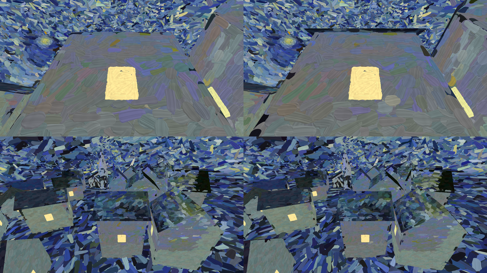

The copies also change pixels away from the eaves. A copy joins an existing village chunk, which changes that chunk's stroke count, so `importanceOrder` reshuffles every stroke in it. With `nowrite` the instance order is the overlap order, so the chunk's original strokes overlap differently even at density 1, and the mid and far prefixes thin a different sample. Over 32 levels, the change covers 7.6% of the ground pose, 20.3% of the raised pose (mostly village ground strokes, which no copy paints) and 4.85% of the painter view. In the painter view it is all below y = 319, so the sky is untouched. It is not noise: a capture of 9f13784 taken in the same window matches its committed `p2-painter-spot.png` byte for byte. A follow-up can remove the reshuffle by leaving the copies (index from `eavesStart`) out of each chunk's `importanceOrder` input and ordering them as a trailing group with a salted seed, as the pinned lights are. The originals would then keep 9f13784's order exactly, but the copies would drop out of the mid and far prefixes first.

`scripts/motion-perf.ts --only "(a) noanim"`, `?nogov`, before and after interleaved in six pass pairs, the order flipped every other pass, each pass one desktop and one IWER run. The load stayed over 15 for every row after a 15-minute wait timed out at 114: 46 to 60 for the first three pairs and 17 to 35 for the last three. These times are load-affected.

| View | Draw calls | Visible chunks | Drawn before | Drawn after | GPU median before | GPU median after | Paired change, median | After higher |
| --- | --- | --- | --- | --- | --- | --- | --- | --- |
| desktop `?painter` | 80 | 72 | 265,096 | 273,796 | 3.57 ms | 3.61 ms | +0.1% | 3 of 6 |
| desktop spot ahead | 87 | 79 | 274,456 | 283,156 | 3.87 ms | 4.00 ms | +3.4% | 4 of 6 |
| IWER painter spot | 200 | 92 | 287,625 | 296,325 | 5.23 ms | 5.57 ms | +6.7% | 6 of 6 |
| IWER spot ahead | 190 | 87 | 278,005 | 286,705 | 5.41 ms | 5.69 ms | +4.9% | 6 of 6 |

- Draw calls and visible chunks are unchanged. Drawn strokes rise by 8,700, the copies in visible chunks.
- On the desktop the change is inside the noise: main's six runs spread 3.48 to 3.62 ms at the painter view, and the branch's paired changes run from −10.6% to +3.1%.
- In IWER the branch is slower in all 12 pairs, typically by 5% to 7%, for 3% more drawn instances. The rejected double-sided fix measured +14% at the IWER painter spot, in a different load window.

### Gates and captures

- `make checkall-ci` passes.
- `docs/shots/p2-painter-spot.png` and `p2-fidelity.png` are regenerated on a production build of 863a58d, because the reshuffle above changes 4.85% of the painter view. Fidelity: SSIM 0.3474 and mean ΔE2000 5.2419, against 0.3505 and 5.2735 on 9f13784, thresholds unchanged.

### Not verified

- The Quest. The underside is checked only in desktop captures, and the GPU cost only on the M4 Max under load.
- The copies are selected by footprint, not visibility: one centred over the hidden inner roof still runs its vertex shader in every view that draws its chunk, and is then culled or fails the depth test.

## Sky wrap variants: wave (2026-11-07)

Since 2026-11-08 wave is the default wrap, Paul's headset choice (Sky wrap default: wave, below).

Paul ruled pingpong the best of base, opacity and pingpong, but each stroke's loop phase is its own phase byte, so about half of any patch of sky moves against its neighbours and the flow breaks up. `wave` keeps pingpong's motion and replaces that phase. `opacity` is retired, and the `wrap` group cycles base, pingpong and wave (CLAUDE.md, Motion A/B variants). Headset: `https://gogh-xr.pardev.net/?painting=starry-night&ab=wrap`.

### Design

- Motion: pingpong's tau, `(smoothstep(0, 1, 1 − |2f − 1|) − 0.5) × 8 s`, with `f = fract(t / 8 + phase)`. The amplitude is pingpong's, |tau| within half a period, so the cull growth and the haze thin cover its reach unchanged. No stroke changes size and none jumps (unit test: 400 strokes over 1440 frames).
- Phase: `skyWavePhase(d)`, a sum of windings in the stereographic plane from the nadir, `z = (x, z) / (1 + y)` of the direction from the painter's eye: `Σ wᵢ · atan2(z − zᵢ) / 2π`. A stroke circling vortex i on its streamline sees its phase change by wᵢ per turn, so the loop runs as a wave round the swirl and the bands of forward and returning strokes travel along the flow. The windings follow each vortex's circulation, `max(1, round(3 × |Γᵢ| / Γ₀))` with its sign: 3, 1, 1, 1. Fix round 1 (below) moves them to the field's velocity zeros, where the eddies have none, so the windings become 3, 1, 0, 0, −4, and its numbers supersede this round's.
- Single-valued: a phase built of windings is single-valued over the dome only if they sum to 0, else a loop round the nadir winds by their sum. One balancing pole of winding −6 sits at the field's stagnation point, (−0.068, 0.838, 0.542), 57° up behind the painter, where the field has no flow. Without it the bands ran against the flow behind the painter (mean cosine −0.83 between band motion and flow). With it at the zenith they ran downstream behind, but within 10° of the zenith the mean cosine fell to 0.20 and the along-flow strain reached 2.67. At the stagnation point the bands run downstream everywhere sampled: mean cosine 0.96 in front, 0.95 behind, 0.93 to the sides, 1.00 overhead and 1.00 within 10° of the zenith, where the strain peaks at 0.10.
- Wavelength: `SKY_WAVE_PER_TURN = 3`, one exported constant. Each band is a 60° sector of the central swirl, about 12° of arc at its core edge, four sky strokes end to end, and wider further out. Neighbours at different phases move by different tau, so the bands stretch and squeeze the stroke spacing along the flow. The along-flow strain, the change in shift along the flow per unit of distance along it, at each point of a 0.5° grid over the painter's view (2° to 45° up, ±35° across) at its worst moment of the loop: base median 0.015 and 99th percentile 0.10, wave at 1, 2 and 3 waves per turn median 0.14, 0.19 and 0.23 and 99th percentile 0.47, 0.60 and 0.79. Strain near 1 means a stroke briefly catches up with the one ahead of it. A first estimate from the central vortex's own winding and flow alone gave 0.29 at the peak, which missed the other windings' share of the phase gradient and the stronger flow between the two central vortices. Pingpong has no smooth strain to compare: its neighbours differ by up to the whole 8 s loop. The counter-flow on the unit-test dome (below) at each value, averaged over 16 times with the jitter: Superseded by fix round 2 (below): the waves per turn are now the `uWaveTurns` uniform, 1, 2 or 3 by `?waveturns`, with a default of 2.

| Per turn | Windings | Dome | In front |
| --- | --- | --- | --- |
| 1 | 1, 1, 1, 1, −4 | 4.09% | 4.82% |
| 2 | 2, 1, 1, 1, −5 | 4.86% | 5.95% |
| 3 | 3, 1, 1, 1, −6 | 5.68% | 7.18% |
| 4 | 4, 2, 1, 1, −8 | 7.34% | 9.60% |
| 5 | 5, 2, 2, 2, −11 | 9.71% | 12.44% |

  Fewer waves per turn lower it by up to 2.4 points in front, but make each band a larger share of the swirl, up to half of it at 1, so the swirl sways in halves instead of carrying waves along. More raise it fast, and the strain with it. 3 is the most bands that keeps the front counter-flow near a seventh of pingpong's. The three small eddies wind once at every value up to 3. This is a judgement on paper: how the band speed and size read in the headset is the A/B question.
- Jitter: `SKY_WAVE_JITTER = 1/32` times the phase byte less a half, a spread of ±1/64 of a loop, a sixteenth of a band. Without it a band edge is an exact curve where every stroke turns at once, which reads as a drawn line. A pair the jitter splits sits within 1/64 of a loop of its turn, where the eased speed is at most 12% of its peak. It costs 0.4 points of counter-flow on the unit-test dome (5.29% without, 5.68% with).
- Hot spots: the bands meet like spokes at each vortex centre and at the stagnation point, so strokes within about 1° of one cross several bands. The worst is the right vortex of the central pair, where the big swirl's flow runs through it.
- Cost: under the default (uSkyWrap 0) a moving sky vertex still pays one compare. Under wave it adds 5 atan2 per moving sky vertex. Not timed, because the host never reached a load of 15 (the load note under Coverage).

### Counter-flow

The local counter-flow (`src/motion/sky-counter-flow.ts`) is the share of nearby sky stroke pairs, centres within 2° of each other from the painter's eye, with one stroke on its way forward and the other on its way back. Each stroke moves along its own `omega × d`, so the sign of its velocity along its arc is the sign of tau's rate.

- Unit-test dome (tests/motion-variants.test.ts): about 35,000 directions on a Fibonacci dome at 0.83° spacing from 10° below the horizon up, each with a seeded phase byte, averaged over 16 times across the loop. Pingpong 50.02%, wave 5.68% (7.18% in front of the painter), wave without the jitter 5.29% (6.93% in front), base 0. Of the pairs 0.5° apart along the flow in front, wave splits 3.93% and pingpong 50.49% of 6931. The bands travel downstream at 98.8% of the sampled strokes in front, 100% behind and 100% overhead.
- Seed 1, `__goghDiag().wrap` on the e2e build (`bun scripts/motion-variant-probe.ts measure`), the drawn sky strokes at each sky pose at `?motiont=3.7`:

| wrap | Spot ahead | Spot behind | Spot left, raised | Spot straight up | Boundary north-east |
| --- | --- | --- | --- | --- | --- |
| base | 0 | 0 | 0 | 0 | 0 |
| pingpong | 49.85% | 50.26% | 50.19% | 50.05% | 50.00% |
| wave | 5.16% | 5.18% | 5.53% | 5.89% | 5.04% |

  Each pose counts 149,000 to 169,000 pairs. Over one period at spot ahead, sampled every 0.5 s, wave's counter-flow is 4.71 to 5.28% (mean 5.08%) and pingpong's 49.76 to 50.14% (mean 49.92%). Wave's returning share there is 48.97 to 51.03% (mean 50.00%), and at the five poses at 3.7 s it is 48.3 to 54.2%, so the forward and returning halves stay balanced over the view. Base's below-0.8-size share is 8.47 to 8.82%, wave's and pingpong's 0.

### Default unchanged

`bun scripts/motion-variant-probe.ts capture` took its five captures (the `?noanim` painter view, the painter view at `?motiont=0.5` and `3.7`, sky-up and under-the-cypress at `3.7`) from e2e builds of 9f13784 and of this change. With no flag, `&wrap=base` and `&ab=wrap`, all 15 captures of this change are byte-identical to 9f13784's no-flag ones, so the default path is unchanged by removing the opacity weight and adding wave. `&wrap=pingpong` is not byte-identical to 9f13784's pingpong: the `?noanim` and `motiont=0.5` captures match, and at `motiont=3.7` the painter view differs in 2 pixels, sky-up in 4 and under-the-cypress in 8, by at most 7 levels in one channel. pingpong's formula is unchanged, and the shared wrap function now also holds wave's phase, so the likely cause is the GPU compiler ordering the same arithmetic differently (not checked further). `tests/e2e/ab.spec.ts` cycles the group live at a pinned `?motiont`, checks each variant's `wrap` diag, that no switch links a program, and that a full cycle returns to a byte-identical painter view.

### Coverage

The `?coverage` sweep (`bun scripts/motion-variant-probe.ts measure`): the binary bare share at the 24 coverage poses (`tests/world-poses.ts`) at `?motiont` 0.5, 3.7 and 6.1, against the 0.5% limit, with the flicker at the five sky poses as in the round before.

| wrap | Worst bare (pose) | Weighted | Spot ahead | Spot straight up | Boundary north-east |
| --- | --- | --- | --- | --- | --- |
| base | 0.475% (village uphill) | 0.536% | 0.338% | 0.101% | 0.119% |
| pingpong | 0.473% (village uphill) | 0.533% | 0.315% | 0.051% | 0.082% |
| wave | 0.473% (village uphill) | 0.533% | 0.336% | 0.065% | 0.117% |

| wrap | Motion flicker, % | Jitter flicker, % |
| --- | --- | --- |
| base | 4.86 / 2.62 / 5.04 / 8.20 / 2.02 | 7.82 / 11.02 / 9.62 / 7.73 / 3.74 |
| pingpong | 5.21 / 1.91 / 4.41 / 7.19 / 2.65 | 7.88 / 10.97 / 9.53 / 7.64 / 3.72 |
| wave | 5.08 / 1.91 / 4.21 / 7.21 / 3.15 | 7.79 / 10.98 / 9.51 / 7.71 / 3.72 |

- The worst pose is village uphill for all three, which sees little sky, so the limit is set by the ground and buildings. Wave's band strain shows at the sky poses: it leaves 0.01 to 0.04 points more bare than pingpong at spot ahead, spot straight up and boundary north-east, still within base's shares.
- Wave's motion flicker is within 0.2 points of pingpong's at four poses and 0.5 above it at boundary north-east, where the bands meet the haze. The jitter flicker, the still-view shimmer, is within 0.1 points of base for both.
- The fidelity thresholds and the coverage spec run in `make e2e` (Gates).
- Load: the 15-minute wait from 21:03 found no 1-minute load of 15 or less (141 at the start, 127 at the end), so every run here is load-affected. The captures ran at 122 to 192, the shots at 114 to 117, and the measures at 49 to 72. These are pixel and count measures at pinned times, so the load slows them without changing them.

### flow: not built

`flow` would hold each stroke still and scroll its paint detail along its axis, with the alpha mask fixed. The brush atlas (`src/render/strokes/brush-atlas.ts`) has no detail that can scroll without a seam:

- The channels are coverage (R), height (G, premultiplied by coverage), tone (B) and a spare A at 255. Tone and height are defined only inside the shape: outside it they are neutral (128) and 0. Each shape's coverage spans 47 to 75% of its rect width per row, so a scroll pulls the neutral border into the stroke.
- The detail is not periodic along the stroke. It carries a load ramp (ridge 1 falling to about 0.65 along the stroke, comma to about 0.55), a pile at the end, an `endFade` of the height to 0 at the tail, a non-periodic value noise in tone along the stroke, and a half-sine drift. Any wrap of that detail has a seam where the tail meets the head.
- Most of the visible structure runs along the stroke, not across it. The bristle streaks are indexed by the across-stroke coordinate, so a scroll along the axis slides them along themselves. Tone changes by 0.004 to 0.04 over 8 texels along u, against 0.04 to 0.14 across v.
- The sky draws comma, crescent and ridge, and 5 of its 9 brushes are arcs, where atlas u is not the stroke axis.
- A back-and-forth scroll would put pingpong's counter-flow inside each stroke. A two-phase flow-map crossfade hides the seam but pulls the neutral border in and halves the contrast mid-cycle.

A route that could work, not built: bake a periodic along-centreline detail into the spare A channel and scroll that. It changes the atlas and the fragment shader's tone path, so it is Paul's call.

### Captures

`docs/shots/p4-wrap-wave-t3.7.jpg` and `p4-wrap-wave-t5.7.jpg`: the painter view under wave at `?motiont=3.7` and a quarter period later at 5.7, each stroke at its own phase byte as in the headset. In a crop of the central swirl, its core is crowded and broken at 3.7, and at 5.7 its strokes lie in a cleaner spiral: whole arcs of the swirl have moved together. The dome stays covered in both. Two stills cannot show whether the travelling bands read as flow, which is the headset question. 

### GPU check

`tests/e2e/motion.spec.ts` checks the GPU's wave phase against the TS mirror, since the `wrap` diag is the mirror. At `?motionphase=0&motionlayers=sky&nohalo` every stroke's loop phase is the mirror's wave phase at its direction. The first version block-matched 48 px patches at one pinned time, `?motiont=6`, and failed with the correct shader and with the winding sign flipped alike, at patch (0.35, 0.2): the predicted shift varies across that block by twice its size (12.7 px against 6.0), because the block straddles a band edge, so the match read noise. The wave's shift changes fast across the view: at any one time only 0 to 2 of the 14 motion patches move within 25% of uniform. Each patch is now shot at its own two turns, the mirror's times of its largest shift ahead and back (tau ±4 s), where tau is flat to first order, and a turn whose predicted shift still varies by over 30% across the block is skipped. A patch at (0.45, 0.1) then read no shift at a 24 px turn, because its block reaches the still star at (0.41, 0.06), so the patches are a 0.05 grid over the sky less any whose block reaches a star or moon ring's rim. Each kept turn needs the measured shift within 30° of the prediction and 0.5 to 1.5 times its length, with at least 8 turns each way. On this change it keeps 13 patches, 26 turns, 13 each way, and every one matches: angles 0.0 to 4.4°, length ratios 0.86 to 1.00, shifts of 14 to 29 px. With the winding sign flipped in motion.glsl it fails at its first turn, (0.35, 0.15) ahead at t 5.10: predicted (17.27, −13.04) px, measured (7.64, −2.19), ratio 0.37. Restored, it passes again in the gate run.

### Gates

- `make checkall-ci`: exit 0. Unit tests 1211 passed in 89 files, gitleaks found no leaks, `bun audit` found no vulnerabilities, and asset-check verified 28 files.
- `E2E_PORT=4292 make e2e`: not exit 0. Three full runs, each after the load wait. The first (21:43 to 21:47, load 21 to 64) failed the old wave test and the IWER portal round trip. The second (22:27 to 22:31, load 21 to 19) passed the new wave test and failed both portal round trips on their longest-frame bar (desktop 66.6 ms on return, IWER 34.1 ms on enter, against 27.8 ms). The third (22:39 to 22:44, load 14.7 rising to 91 from other work on the host) had 109 passed, 2 skipped and 1 failed, the desktop portal round trip at 33.3 ms on enter. `tests/e2e/portal.spec.ts` alone passed twice in a row (3 of 3 each, 22:34 to 22:37, load 14.5 to 77). A full run of the same specs against a 9f13784 build (22:44 to 22:49, load 74 to 134) failed only the three specs that need wave and passed both portal round trips. Every run here was load-affected. This change adds no program, texture or upload at portal entry: the gallery's stroke batch already links the same stroke program, which three's program cache reuses. At base, the only state the portal runs, the per-frame shader work is unchanged. The roof eave branch fails the same frame bar, and `portal.spec` passes alone on both main and a branch at about 22 to 24 ms on MiniMac. The cause is open, and the controller is attributing it.
- Every other spec passed in the third run, including the wave test, the wrap cycle and fixed-phase checks in `tests/e2e/ab.spec.ts` (live diag on seed 1: counter-flow pingpong 49.8%, wave 5.7%, base 0; wave at the painter view under `?coverage` 0.319% bare at t 4 and 0.342% at t 6, against base's 0.255%), the coverage spec (max bare 0.451%, hill west, unchanged) and fidelity (SSIM 0.3505, ΔE 5.2735, unchanged).

### Not verified

- The headset: whether wave's travelling bands read as flow in the Quest, and whether the band speed at 3 per turn suits, is Paul's A/B call. Superseded by fix round 2 (below): the default is now 2 per turn, and `?waveturns=1|2|3` picks the band speed in the headset.
- Cost: wave's 5 atan2 per moving sky vertex are untimed on the desktop and on the Quest, because no run here found a load of 15 or less. Fix round 1 cuts them to one atan (below), also untimed.

### Fix round 1

The task review found the round-0 windings on the painted vortex axes. Every loop phase meets at a winding, and on the axes the drift and the other vortices carry the strokes at about the front's median speed (2.8 to 3.7 × 10⁻³ rad/s against 3.4 × 10⁻³), so the heart of the big swirl counter-flowed like pingpong: 49% of pairs within 1.5° of its centre. Only the stagnation pole sat at a true zero.

- Poles: `skyVortexCentre` finds the field's velocity zero inside each vortex's core by Newton's method on the velocity's two tangent components from the axis, with a central-difference Jacobian. It accepts the zero only inside the core and at |velocity| under 10⁻¹² rad/s. The big swirl's zero is 6.5° off its painted axis, inside its 11.3° core (residual 7 × 10⁻¹⁸ rad/s), and the right vortex's is 3.7° off, inside its 4.6° core (residual 0). On a 0.5° ring round each, the flow turns the same way at all 36 samples, so both are centres. The moon and large-star eddies have no zero in their cores: the background outruns their own turn. They wind 0, and the stagnation pole balances the rest at −4, so the windings are 3, 1, 0, 0, −4.
- Counter-flow near each painted vortex centre and at the stagnation point, on a 400,000-point Fibonacci dome (0.32° spacing, from 10° below the horizon up), seeded phase bytes with the jitter, pairs within 2°, averaged over 16 times across the loop. Pingpong is about 50% at every site.

| Site | Round 0 (1.5° / 3° / 4°) | Round 1 (1.5° / 3° / 4°) |
| --- | --- | --- |
| Big swirl, left | 49.4 / 40.1 / 33.0% | 15.6 / 15.8 / 16.1% |
| Central pair, right | 31.2 / 18.3 / 14.5% | 15.3 / 16.5 / 16.6% |
| Moon eddy | 30.9 / 18.0 / 14.1% | 4.9 / 4.8 / 4.9% |
| Large-star eddy | 31.2 / 18.4 / 14.6% | 5.8 / 5.9 / 5.9% |
| Stagnation point | 50.4 / 51.7 / 49.5% | 50.4 / 46.9 / 40.3% |

  Near the central pair this misses the review's example bound of 15% within 3°: 15.8% and 16.5% here, and 16.4% and 18.9% on the coarser unit-test dome, where the test asserts under 20% and under 0.4 of pingpong's share at each site. The whole dome: 4.2% (round 0 5.4%). The unit-test dome (0.83° spacing): 4.32%, 6.08% in front, 3.77% without the jitter (5.70% in front), pingpong 50.02%. Neighbours 0.5° apart along the flow in front split 3.56% under wave and 50.49% under pingpong, and the bands now travel downstream at 100% of the sampled strokes in front, behind and overhead (round 0: 98.8% in front).
- At the zeros themselves every phase still meets, but the strokes there barely move:

| Zero | Counter-flow within 1.5° / 3° / 4° | Mean speed there, × front median |
| --- | --- | --- |
| Big swirl | 49.3 / 40.5 / 33.5% | 0.13 / 0.27 / 0.36 |
| Central pair, right | 32.5 / 21.9 / 19.7% | 0.31 / 0.55 / 0.69 |
| Stagnation point | 50.4 / 46.9 / 40.3% | 0.01 / 0.02 / 0.02 |

  Weighting each pair by its mean speed changes these by at most 4 points, so the spokes at the big swirl's zero still show, at an eighth to a third of the median speed within 4° of it. That zero is 6.5° from where the swirl is painted, inside its 11.3° core. Derived, share times speed ratio: about 6%, 11% and 12% at 1.5°, 3° and 4°, against the whole dome's 4.2% at the median speed. Fading wave's amplitude to 0 near each winding would remove the spokes, and is not built in this round. Superseded by fix round 2 (below), which builds the fade.
- Strain over the painter's view, as in Design: median 0.185, 90th percentile 0.400, 99th percentile 0.516 (round 0: 0.226, 0.488, 0.785; base 0.015, 0.049, 0.101).
- The wavelength stays 3. With the poles at the zeros, the trade at 1, 2 and 3 waves per turn:

| Per turn | Windings | Within 3° of the big swirl's centre | Dome | Strain median / p99 |
| --- | --- | --- | --- | --- |
| 1 | 1, 1, 0, 0, −2 | 7.0% | 2.8% | 0.095 / 0.313 |
| 2 | 2, 1, 0, 0, −3 | 11.4% | 3.4% | 0.140 / 0.406 |
| 3 | 3, 1, 0, 0, −4 | 15.8% | 4.2% | 0.185 / 0.516 |

  At 1 the bands are half the swirl each, the trade the round-0 choice weighed. Whether to drop to 1 or 2 is a headset call.
- One atan (F4): every winding is an integer, so Σ wᵢ·arg(z − zᵢ) equals arg Π (z − zᵢ)^wᵢ up to whole turns, which the loop's `fract` removes. `skySwirlGlslDefines` writes `SKY_WAVE_PRODUCT`, the unrolled statements of that product for the non-zero windings: each factor normalised by one `inversesqrt`, conjugated for a negative winding, its power by repeated squaring, then one `atan`. Normalising each factor keeps the product from overflowing near the nadir or underflowing near a pole. The TS mirror stays the sum of atan2. A unit test runs the define's statements as written, 20,000 random directions, against the mirror: the largest gap is under 10⁻⁶ of a loop (the defines carry 9 significant digits), and `skyWaveProductPhase`, the same product in double, is within 10⁻⁹. On the GPU, `tests/e2e/motion.spec.ts` (the GPU check above) block-matches the new phase against the mirror: it keeps 19 patches and 38 turns, 19 each way, and every one matches, with angles 0.1 to 5.1°, length ratios 0.86 to 1.03 and shifts of 14 to 29 px. The run also shows that ANGLE compiles the one-line define.
- Cost: under wave a moving sky vertex now pays 3 `inversesqrt`, 6 complex multiplies and one atan in place of 5 atan. It is untimed. A `scripts/motion-perf.ts --only wrap=` run, comparing the round-1 build against round 0's (one atan against five), started at 23:24 at load 17. It had 3 of its 18 rows, none of them wave, when the load rose to 115 at 23:31, so it was stopped. At about 3.9 ms GPU per frame on this desktop, the saving is likely below the run-to-run noise anyway. The Quest is where it matters.
- The compare notes (F5): under base a moving sky vertex pays one compare in `skyMotion`. Pingpong and wave add a second inside `skyWrapMotion`.
- Default unchanged: the probe's five captures from the round-1 e2e build, with no flag, `&wrap=base` and `&ab=wrap`, are all 15 byte-identical to 9f13784's no-flag captures (`cmp`, 23:22 to 23:24, load 19 to 13). The larger program, with `skyCmul` and the product in place of the pole loop, leaves the default path's output unchanged.
- Coverage, the `?coverage` sweep under wave (`bun scripts/motion-variant-probe.ts measure`, 24 poses at `?motiont` 0.5, 3.7 and 6.1, load 28 to 20): worst 0.473% (village uphill), weighted 0.533%, the same as round 0 and within the 0.5% limit. At the sky poses: spot ahead 0.327% (round 0 0.336%), spot straight up 0.055% (0.065%), boundary north-east 0.126% (0.117%). Motion flicker at the five sky poses: 4.88 / 1.95 / 4.62 / 7.24 / 1.90%, within 0.5 points of round 0 at four and 1.25 below at boundary north-east. Jitter flicker 7.76 / 10.97 / 9.51 / 7.70 / 3.69%, unchanged.
- Counter-flow from the live diag on seed 1 at `?motiont=3.7`: spot ahead 3.99%, spot behind 3.43%, spot left raised 3.89%, spot straight up 4.20%, boundary north-east 4.60% (round 0: 5.04 to 5.89%), each over 149,000 to 169,000 pairs. Over one period at spot ahead it is 3.92 to 4.36% (mean 4.21%), and the returning share there is 46.9 to 53.1% (mean 50.0%).
- Captures: `docs/shots/p4-wrap-wave-t3.7.jpg` and `p4-wrap-wave-t5.7.jpg` are retaken with the new poles (load 34.7 to 35.9). In a crop of the central swirl the core at 3.7 is crowded with crossing strokes, and at 5.7 its strokes lie in a cleaner spiral. The dome stays covered in both. Two stills cannot show whether the bands read as flow.
- Gates: `make checkall-ci` exit 0 (unit tests 1214 passed in 89 files, no leaks, no vulnerabilities, asset-check 28 files). The full `make e2e` was not rerun here: the controller's integration gate runs it. The specs this change touches ran one at a time from 23:17, after the load wait reached 13: `tests/e2e/ab.spec.ts` 14 passed (load 13 to 21), `tests/e2e/motion.spec.ts` 12 passed (21 to 28) and `tests/e2e/world-coverage.spec.ts` 8 passed (28 to 22), so the last two ran above 15. In the ab spec the live diag on seed 1 reads counter-flow pingpong 49.8%, wave 4.26% and base 0, and wave's returning share is 50.7%. The fixed-phase painter view under `?coverage` leaves 0.290% bare under wave at t 4 and 0.304% at t 6, against base's 0.255% (round 0: 0.319% and 0.342%). The coverage spec's worst pose is unchanged at 0.451% (hill west).

### Fix round 2

The review's rulings: fade wave's travel near each winding (C2), and make the waves per turn a uniform behind a flag (C3).

- Fade (C2): `skyWaveFade` scales the wave's tau by the product, over the windings that are non-zero at any turns value (the big swirl's zero, the right vortex's zero and the stagnation point), of smoothstep(0, R², chord²), where chord is the chord from the stroke's direction to the winding and R the chord of `SKY_WAVE_FADE_RADIUS`. It is 0 at a winding and 1 from the radius out, and motion.glsl applies it on the wave branch only, to the amplitude, so base and pingpong run unchanged. The two zeros are 6.54° apart. The right vortex's painted centre is 3.71° from its zero and the big swirl's 6.50° from its own. The radius is 3°, the widest whole degree that leaves both painted centres at full amplitude (4° would dim the right vortex's), under the right vortex's 4.6° core and under half the gap between the zeros, so the ramps do not meet.
- Waves per turn (C3): `uWaveTurns`, an `int` uniform beside `uSkyWrap` in `src/motion/variant-uniforms.ts`, set by `?waveturns=1|2|3` (trimmed, any other value keeps the default). The default drops from 3 to 2, the middle of the round-1 trade. Each winding is linear in the turns over 1 to 3 (the big swirl winds turns, the right vortex 1, the stagnation point −(turns + 1)), so `SKY_WAVE_PRODUCT` now builds two products, `q` from the part fixed across the turns and `a` from the part per turn, and skyWavePhase multiplies `a` into `q` `uWaveTurns` times in a loop bounded by `SKY_WAVE_MAX_TURNS` (3) before its one atan. `windingSplits` throws if a winding is ever not linear. The uniform is read only in skyWavePhase, which only the wave branch calls. `__goghDiag().wrap.waveTurns` reports it. The unit test runs the define's statements as written, then the loop, at each turns value against the mirror's sum of atan2: under 10⁻⁶ of a loop over 20,000 directions, and `skyWaveProductPhase` within 10⁻⁹.
- Counter-flow, on the 400,000-point dome as in round 1 (seeded phase bytes with the jitter, pairs within 2°, 16 times across the loop; the dome and front-view rows take every 20th and every 5th stroke as a centre, so the dome reads 3.5% at 2 waves per turn against round 1's 3.4% over every centre). Three measures:
  - Unweighted: the share of pairs with one stroke forward and one returning. The fade does not change it.
  - Speed-weighted: each pair weighs the slower stroke's instantaneous speed (fade × |velocity| × the eased loop's speed, 12g(1 − g) with g = 1 − |2f − 1|), and the share is the opposed weight over the window's total weight.
  - View-normalised: the same opposed weight divided by the window's pair count times the front view's mean pair weight, the share of pairs counter-flowing at the view's typical speed.

  The speed-weighted share is scale-free inside a window, so it falls only as far as the fade reshapes the window's speeds: within 1.5° of the big swirl's zero the strokes still moving counter-flow about a third of the time, but at 16% amplitude or less on a field already slow there, which is what the view-normalised measure shows. Pingpong is 50.0% unweighted and speed-weighted, over the dome and in front.

| Waves per turn, measure | Dome | Front view | Big swirl's zero, 1.5° / 3° | Right vortex's zero, 1.5° / 3° | Big swirl's centre, 3° | Right vortex's centre, 3° |
| --- | --- | --- | --- | --- | --- | --- |
| 1, unweighted | 2.8% | 3.4% | 30.9 / 18.2% | 31.0 / 18.2% | 7.0% | 11.3% |
| 1, speed-weighted, no fade | 0.2% | 0.3% | 18.9 / 6.3% | 19.7 / 6.9% | 1.2% | 2.5% |
| 1, speed-weighted, 3° fade | 0.2% | 0.3% | 12.1 / 3.9% | 12.8 / 4.2% | 1.2% | 2.1% |
| 1, view-normalised, no fade | 0.1% | 0.3% | 1.9 / 1.3% | 4.5 / 2.9% | 0.9% | 2.3% |
| 1, view-normalised, 3° fade | 0.1% | 0.3% | 0.1 / 0.4% | 0.2 / 0.9% | 0.9% | 1.7% |
| 2, unweighted | 3.5% | 4.5% | 44.6 / 30.9% | 31.8 / 19.6% | 11.4% | 13.9% |
| 2, speed-weighted, no fade | 0.3% | 0.6% | 37.9 / 17.9% | 21.1 / 8.5% | 2.9% | 3.8% |
| 2, speed-weighted, 3° fade | 0.3% | 0.5% | 33.0 / 12.6% | 14.7 / 5.9% | 2.9% | 3.2% |
| 2, view-normalised, no fade | 0.2% | 0.6% | 3.7 / 3.4% | 4.8 / 3.5% | 2.1% | 3.4% |
| 2, view-normalised, 3° fade | 0.2% | 0.5% | 0.2 / 1.3% | 0.2 / 1.3% | 2.1% | 2.7% |
| 3, unweighted | 4.2% | 5.7% | 49.3 / 40.5% | 32.5 / 21.9% | 15.8% | 16.5% |
| 3, speed-weighted, no fade | 0.5% | 0.9% | 47.4 / 31.3% | 23.2 / 11.1% | 5.6% | 5.4% |
| 3, speed-weighted, 3° fade | 0.5% | 0.9% | 46.8 / 25.3% | 17.6 / 8.5% | 5.6% | 4.7% |
| 3, view-normalised, no fade | 0.3% | 0.9% | 4.7 / 5.9% | 5.4 / 4.5% | 3.9% | 4.8% |
| 3, view-normalised, 3° fade | 0.3% | 0.9% | 0.3 / 2.7% | 0.3 / 1.9% | 3.9% | 3.9% |

  At the stagnation point the strokes barely move with or without the fade: 0.3 to 0.4% normalised within 1.5° unfaded, 0.0% faded. The radius sweep at 2 waves per turn within 1.5° / 3° of the big swirl's zero, speed-weighted then view-normalised: none 37.9 / 17.9% and 3.7 / 3.4%, 2° 33.1 / 14.5% and 0.9 / 2.3%, 3° 33.0 / 12.6% and 0.2 / 1.3%, 4° 32.9 / 12.4% and 0.1 / 0.6%. The 4° gain is small, and 4° dims the right vortex's painted centre. Within 3° of the zero at 3 waves per turn 2.7% remains, from the ring between 1.5° and 3° where the fade is partway up, and a larger radius would trade that against amplitude at the painted centres. The probe was a scratch script outside the repository, built on the mirror's exported functions. Strain was not re-measured with the fade.
- Gates: `make checkall-ci` exit 0 (unit tests 1216 passed in 89 files, no leaks, no vulnerabilities, asset-check 28 files). The full `make e2e` was not rerun. The load wait reached 14.9 at 00:01, and the three touched specs ran one at a time: `tests/e2e/ab.spec.ts` 14 passed (load 15 to 27), `tests/e2e/motion.spec.ts` 12 passed (27 to 55) and `tests/e2e/world-coverage.spec.ts` 8 passed (55 to 71), so the last two ran above 15.
  - In the ab spec the live diag on seed 1 at `?motiont=3.7` reads counter-flow pingpong 49.8%, wave 3.38% at the default 2 waves per turn and 4.26% at `&waveturns=3` (round 1, at 3: 4.26%), and base 0. Wave's returning share is 51.2%, and every variant reports `waveTurns` 2. The `?wrap=wave` and `&waveturns=3` boots report the same program count and draw different skies. A count cannot tell a uniform from a define, so the unit tests pin the uniform-only design: the stroke material's defines and shader source are unchanged by `setWaveTurns(3)`, and `uWaveTurns` appears only in its declaration and the wave branch's loop. Under `?coverage` the fixed-phase painter view leaves 0.268% bare under wave at t 4 and 0.285% at t 6, against base's 0.255% (round 1: 0.290% and 0.304%).
  - The motion spec's GPU check of the wave kept 23 patches and 46 turns, 23 each way (round 1: 19 and 38), and every one matches, with angles 0.0 to 4.7° and length ratios 0.87 to 1.04.
  - The coverage spec, under base, is unchanged: worst pose 0.451% (hill west), spot-ahead sweep worst 0.478% at motiont 7.
- From a fresh `--mode e2e` build of 614d2f7, served on its own preview (`bun scripts/motion-variant-probe.ts`). Every leg after the load wait ran at loads of 70 to 350, so its timings and flicker are load-affected, though the captures and bare shares do not depend on load.
  - Shots: `docs/shots/p4-wrap-wave-waveturns1-t3.7.jpg`, `-waveturns2-` and `-waveturns3-`, each also at t 5.7, the painter view at `?motiont`. In crops of the central swirl at t 3.7 the swirl reads at all three and the dome stays covered. The three differ in how the core's strokes cross, which only the headset can judge in motion.
  - Coverage at the default 2 waves per turn, 24 poses at `?motiont` 0.5, 3.7 and 6.1 (load 120 to 156): worst 0.473% (village uphill), weighted 0.533%, as in round 1 and within the 0.5% limit. Spot ahead 0.310% (round 1 0.327%), spot straight up 0.054% (0.055%), boundary north-east 0.105% (0.126%). The live counter-flow at `?motiont=3.7` is 3.28 to 4.85% at the five sky poses, and over one period at spot ahead it is 3.21 to 3.61% (mean 3.44%, round 1 at 3 waves 4.21%) with a mean returning share of 50.0%.
  - Default unchanged: the probe's five captures with no flag are byte-identical to 9f13784's no-flag captures (`cmp`, load 156 to 349).
  - At 1 and 3 waves per turn (`measure ... wave '&waveturns=N'`, load 160 to 460): coverage worst 0.473% (village uphill) at both, weighted 0.533%, spot ahead 0.301% and 0.327%. Counter-flow over one period at spot ahead: mean 2.92% (2.65 to 3.19%) at 1 and 4.21% (3.92 to 4.36%) at 3, the round-1 value.

### Rebase onto 67b072d

The branch was rebased onto 67b072d, the roof eave fix. The only conflict was the two sections both appended at the end of this file, and both are kept. The branch does not touch the painter captures (`docs/shots/p2-painter-spot.png`, `p2-fidelity.png`) or the scatter, so main's stand.

- Default unchanged: the probe's five no-flag captures from an e2e build of the rebased branch are byte-identical to those from an e2e build of 67b072d (`cmp`, 00:31 to 00:33, load 30 to 39).
- Gates: `make checkall-ci` exit 0 (unit tests 1222 passed in 89 files, no leaks, no vulnerabilities, asset-check 28 files). The load wait reached 14.1 at 00:28, and the specs ran one at a time: `tests/e2e/ab.spec.ts` 14 passed (load 14 to 15), `tests/e2e/motion.spec.ts` 12 passed (15 to 17), with all 46 wave turns matching, and `tests/e2e/world-coverage.spec.ts` 8 passed (17 to 23), worst pose 0.460% (village uphill) and spot-ahead sweep worst 0.481% at motiont 7, under base on 67b072d's scatter.

## Vertex cost or fill: the vtx A/B and the count density law (2026-11-08, card 01a1b472)

The 2026-11-06 headset evidence conflicts. Drawing everything into 1/16 of the viewport reaches the vsync cap, which points at fill or binning. Render scale 0.7 with foveation 1 still takes 18.71 ms, and the profiler puts about 54% of shading time on vertices (85M polygons/s at about 25 px each), which points at vertex work. Density sheds bought nothing, because the governor grows each survivor by sqrt(from / to) and keeps the painted area. This card builds an experiment that one headset pass can settle, and the levers each outcome calls for. Nothing here was measured on a Quest: the desktop numbers below come from an M4 Max under load and are indicative only. Round 1 (after review) made `hoist` a precompiled define, `smaller` a multiply, moved the sky's rest field into attributes under `hoist`, put the CPU depth key on every stroke geometry, made the footprint honour fit caps and both XR views, and rewrote the protocol below.

### What the stroke vertex shader runs

- Topology: each stroke is an instanced quad of 4 indexed vertices (`createQuadAttributes` in `src/render/strokes/batch.ts`, Uint16 index [0, 1, 2, 0, 2, 3]). The arc, settings panel and portal fly strokes use the same quad. 6 vertex shader runs per instance is the worst case, if the post-transform cache misses the shared corners. three r186's WebGL `WebXRManager` has no multiview (only its WebGPU path does), so each chunk draws once per eye: at least instances × 4 × 2 vertex shader runs a frame, before Adreno's binning pass runs the position-only part again.
- Work that depends only on the instance, run 4 times per instance per eye: the octahedral normal decode and the tangent basis (cos, sin, cross), the colour, brush rect and fit-level decode, and the uniform-only (projection × view) matrix product. For sky strokes the swirl field at the rest direction (omega × d and omega · n) and the wave's static phase product are instance-only too. The two integer depth hashes used to be on this list; the CPU now computes them once per instance. The motion itself depends on `uTime`, so it is the same at each corner but changes every frame. Taking it out of the vertex shader would need a per-frame pre-pass (transform feedback), not an attribute.
- Scalar ops per vertex, a SPIR-V proxy, not Adreno ISA: each path's specialised shader compiled with glslangValidator, unrolled and optimised with spirv-opt, and counted with mat4 × mat4 at 64, dot and mat × vec by components, normalize 2n + 1, cross 6 and smoothstep 5n. The haze cone loop does not unroll, so it counts one cone (about 117 ops per cone that passes, 12 at worst). Full shader / position-only (the binning-pass proxy). The "matrices only" column is `hoist` with the sky rest field left in the shader, a proxy column and not an arm:

| Path | 93fce70 | Default (CPU depth key, size multiply) | `hoist`, matrices only | `hoist` |
| --- | --- | --- | --- | --- |
| ground, building, still sky (`?noanim`) | 314 / 257 | 267 / 210 | 155 / 146 | 155 / 146 |
| base sky (dome, moving) | 435 / 375 | 388 / 328 | 276 / 264 | 209 / 197 |
| wave sky (dome) | 528 / 468 | 481 / 421 | 369 / 357 | 215 / 203 |
| haze (one cone counted) | 552 / 492 | 505 / 445 | 393 / 381 | 329 / 317 |
| cypress | 401 / 341 | 354 / 294 | 242 / 230 | 242 / 230 |
| reactive (ground in the box) | 940 / 880 | 893 / 833 | 781 / 769 | 781 / 769 |

  The default path drops 49 ops, 48 of them integer, with the depth hash and adds 2 for the `uVtxSize` multiply. On the ground path about 70 of the 267 ops depend on the corner. The rest repeats for every corner and eye.

### The levers

- The CPU depth key (default, byte-identical): every stroke geometry carries `iTie`, a float attribute holding the top 24 bits of the hash the shader used to compute per vertex (`src/render/strokes/tie-key.ts`). That is the batch chunks and the lone meshes: the teleport arc and the settings panel, which rewrite it with their instances, and the portal fly strokes, which write it once: their depth test and write are off, so the key only nudges clip z inside the tie-break range and cannot change a pixel. The shader has no hash left and no fallback. A ranked stroke off the backdrop keys on the size hash, every other stroke on the position hash, which the backdrop rank also reads (`h8 >> (shift - 8)` is `h >> shift`). The hash is integer maths on the stored float32 bits, so the key equals the old one exactly: `tests/strokes-tie-key.test.ts` checks the depth it yields against a TS mirror of the old GLSL key for every flag byte on every layer, and the batch, arc and panel keys against the hash (the fly strokes' against their creation keys). It adds 4 instance bytes (34 → 38, +12% fetch and upload). `tieKeys` takes 0.08 ms for 39k strokes on the M4 Max once warm and 2.1 ms cold, once per chunk inside the build slicer. Round 1 rewrote the portal fly strokes' keys every frame of a transition (0.04 ms for their 3000 strokes warm, 0.54 ms cold). Round 2 writes them once.
- `smaller` is a plain multiply: `vec2 size = iSize * sizeScale * uVtxSize`, with `uVtxSize` 1.0 outside the arm. Times 1.0 is exact in float32, and the byte check below covers it.
- `hoist` is the `VTX_HOIST` define, not a branch, so the default program has no hoist code. Under it the shader applies projection × (view × p) in place of (projection × view) × (model × p), drops the identity model matrix, and skips the three varying renormalisations. The axes are unit to within rounding, plus a sub-percent axis-length change under the motion turn's polynomial cosine and sine. The sky's rest field is two per-instance attributes, built on the CPU when the arm prepares: `iSkyField` (omega × d and omega · n, the swirl's sweep and turn per unit tau) and `iSkyWave` (the wave wrap's static phase and its fade), 24 bytes per instance on every chunk, zero off the sky: 14.0 MB for Starry Night's 582,196 strokes, allocated only once `?ab=vtx` activates. Under `hoist` every drawn stroke fetches them, not only the sky's, so its instance bytes go from 38 to 62. Only the time-dependent part (the fract, the smoothstep and the scale by tau) stays per vertex. That saves 67 ops per base-sky vertex and 154 per wave-sky vertex on top of the matrix hoist, and 64 on the haze. The field is built in float64 at the wave turns the session booted with (`setWaveTurns` runs only at boot), so it differs from the shader's float32 field by rounding.
- `?densitylaw=count`: a density shed keeps the band's survivors at their size, so it cuts instances and painted area together. `area`, the sqrt growth, stays the default. Under `count` each band holds apart after a no-gain, because a band's step then cuts its own fill and vertex work and one band's no-gain predicts nothing for the others. Under `area` the three bands still share the `density` hold.

### The arms (`?ab=vtx`)

Each measuring arm cuts its target quantity by 30%.

| Arm | Instances and vertex runs | Painted area | Fragment work, estimated | Vertex : fill ratio | How |
| --- | --- | --- | --- | --- | --- |
| `base` | 1 | 1 | 1 | 1 | as shipped |
| `fewer` | 0.7 | 0.7 | 0.7 | 1 | each chunk draws 0.7 of its unpinned importance order, survivors unchanged |
| `smaller` | 1 | 0.7 | about 0.74 to 0.77 | about 1.3 | `uVtxSize` = sqrt(0.7) |
| `sparse` | 0.7 | 0.967 by `drawnSr`, 1.05 by world area (fit caps) | about 0.90 to 0.92 with the measured fit caps (0.92 to 0.95 without them) | about 0.78 | `fewer`'s strokes grown by 1/sqrt(0.7) through the band size: the `area` law at 0.7 on every band |
| `hoist` | 1 | 1 | 1 | 1, with 42 to 55% fewer ops per ground and sky vertex (32% on the cypress, 13% on reactive strokes) | the `VTX_HOIST` define, 24 more instance bytes fetched (38 → 62) |

- What each arm cuts. `fewer` cuts instances, vertex runs, primitives, binning and fill together, since strokes write no depth (the nowrite default) and every stroke fragment shades. `smaller` keeps every vertex run and primitive and cuts the painted area by 30%. Its fragment cut is smaller, because at about 25 px per triangle the partially covered 2 × 2 pixel quads along each edge are a large share s (about 0.3 to 0.5) of the fragment work, and the perimeter only falls to sqrt(0.7) = 0.84: 0.7 (1 - s) + 0.84 s. Its smaller quads also touch fewer bins, so it cuts some binning work. `sparse` cuts vertex runs and primitives by 30% and keeps the area where the strokes can grow, but its total perimeter falls to 0.7 × 1/sqrt(0.7) = 0.84, so it also cuts the overshaded edge work: up to about 16% of that share, (1 - s) + 0.84 s overall. Fit-capped strokes cannot grow past their cap, so where they bind `sparse` cuts some area too (the drawn solid angle below). Its larger quads each touch more bins and take a coarser brush mip. `hoist` cuts shader ALU only, and adds 24 bytes of fetch per drawn instance.
- The consistency check. With frame time about a × vertex + b × fill, `fewer` saves 0.3 a + 0.3 b, `sparse` 0.3 a + (0.08 to 0.10) b and `smaller` (0.23 to 0.26) b, so `fewer` should save about what `sparse` and `smaller` save together, within about 15% of `fewer`'s saving, inside the 20% the outcome table allows. A sum far off that means the frame time is not additive in vertex and fill (the bound moves between arms), and the single-arm readings cannot be trusted.
- `fewer` draws a density cut (`applyDensity`) rather than testing a per-instance hash in the shader. A hash test would still run every vertex of a dropped instance, the binning pass included, and kept and dropped instances share each shader wave, so neither the invocations nor the ALU would fall.
- No arm links a program mid-session. When the group activates, each stroke batch prepares once, on a microtask after its first frame (`renderer.compile` cannot run inside a render): it adds the sky attributes to every chunk geometry, then compiles its three band materials with `VTX_HOIST` on and then off. After that an arm switch only flips the define and `needsUpdate`, and three finds the cached program. `fewer` and `sparse` change draw counts and band sizes on the CPU, and `smaller` sets one uniform shared by the batch's band materials. Lone stroke meshes keep their own `uVtxSize` of 1 and never take the define.
- `__goghDiag().vtx` reports per arm the instances, vertex invocations (instances × 4 × views), whether every batch has prepared (`prepared`), the active program (`program`, `base` or `hoist`), the drawn world area and `drawnSr`, the drawn strokes' summed solid angle, the fill proxy. Both walk each visible banded chunk's drawn strokes at their band size, with each stroke's fit cap applied and `uVtxSize` after it, as the shader does. `drawnSr` sums over every view, each stroke's area / d² inside that view's frustum from that view's eye, and `drawnSrViews` gives it per view. Both still leave out the haze growth, the sky-light thin, motion, occlusion and the angle to the eye, so `drawnSr` is an upper bound on the fragments shaded. The world area is dominated by the far dome, so it is not a fill measure.

### Measurements (M4 Max desktop, indicative)

`GX_VTX_SWEEP=1 bunx playwright test tests/e2e/vtx.spec.ts` in the round 1 combined run (the vtx spec with its sweeps and nine touched specs, 70 of 71 passed, the XR test failing on a stale footprint memo fixed since), seed 1, `noanim`, `nogov`. The load was 14.76 before the run and 25.06 after it. These are counts and pixel coverage, not timings.

The arms at the painter camera (one view), each ratio against `base`. `drawnSr` now applies each stroke's fit cap, so `sparse` reads lower than in round 0 (1.007 then):

| Arm | Instances | Vertex invocations | Ratio | `drawnSr` | Ratio | Drawn world area ratio |
| --- | --- | --- | --- | --- | --- | --- |
| `base` | 273,796 | 1,095,184 | 1 | 107.86 | 1 | 1 |
| `fewer` | 193,122 | 772,488 | 0.705 | 76.02 | 0.705 | 0.707 |
| `smaller` | 273,796 | 1,095,184 | 1 | 75.50 | 0.700 | 0.700 |
| `sparse` | 194,690 | 778,760 | 0.711 | 104.27 | 0.967 | 1.052 |
| `hoist` | 273,796 | 1,095,184 | 1 | 107.86 | 1 | 1 |

- `sparse` keeps slightly more than 0.7 of the instances, because its larger strokes pass the cull a little more often. Fit caps hold back its growth by about 3% of the solid angle, so it is not a pure vertex arm: it cuts about 3% of the painted area and its edge work as well. The spec checks it lies above 1.05 × `fewer`'s and below 1.07 × `base`'s.
- `smaller`'s 0.700 is exact by construction (`drawnSr` scales each stroke's area by `uVtxSize`²), so it proves the readout, not the shader. The shader check is on pixels: under `?coverage` at the painter camera the bare share rises from 0.246% (`base`) to 0.890% (`smaller`), falls back to 0.246% with `uVtxSize` forced to 1 (the negative control, which the check must fail), and returns to 0.890% when restored.
- `hoist` against `base`, pixel by pixel at the painter camera: 0.0153% of the channels move by more than 8 levels (max 94) with `noanim`. With the sky moving (`motiont=3.7`, `nogov`) it is 0.0123% (max 94) under the base wrap and 0.0117% (max 94) under the wave wrap, while the motion itself moves 50.1% and 51.2% of the channels between t 0 and t 3.7, so the check sees the sky move. The spec's tolerance is 0.2%. The differences are float rounding (the reordered matrix product, the float64 rest field), not a missing term: a field that dropped or misread a term would move a large share of the sky, not 0.01%.
- The `hoist` program is asserted by name (`program: 'hoist'`), and the cycle links no new program after the arm prepares.
- In XR (IWER, `base`, the spawn pose, 2 views) the readout counts both eyes: 300,151 instances, 2,401,208 vertex invocations, and `drawnSr` 486.76, the sum of the two views' 243.39 and 243.37. The spec checks there are two views, that they sum to `drawnSr` and that they agree within 25%. The spawn pose is not the painter camera, so the per-view value does not compare with the 107.86 above. The round 1 combined run's XR test caught the 1 s memo serving the desktop read just after entering XR (one view, 187.34). The memo now keys on the view count too, and the check passes.

The coverage sweep, the 24 poses of `world-coverage.spec.ts` under `?coverage`, against its unchanged 0.5% bar per pose. Every row matches round 0 digit for digit:

| Sweep | Max bare | Mean | Poses over 0.5% |
| --- | --- | --- | --- |
| `base` | 0.460% (village uphill) | 0.145% | 0/24 |
| `fewer` | 1.120% (village uphill) | 0.501% | 12/24 |
| `smaller` | 1.898% (village uphill) | 0.687% | 13/24 |
| `sparse` | 0.437% (village uphill) | 0.127% | 0/24 |
| governor level 4, `area` | 0.460% (village uphill) | 0.138% | 0/24 |
| governor level 4, `count` | 1.414% (spot ahead) | 0.655% | 16/24 |
| governor level 6, `count` | 4.192% (spot straight up) | 1.777% | 21/24 |

- `fewer` and `smaller` are measuring arms only: both open holes past the bar. `sparse`, the `area` law at 0.7 on every band, keeps coverage, so the `area` law is a vertex lever that costs no coverage.
- The governor levels are simulated, not read from a headset (`levelsAt` in the spec): the real governor fed the 2026-11-06 painter-spot overrun (22 ms against the 72 Hz budget), with foveation 0.5 paying ×0.84, foveation 1 ×0.955 more, the fb-scale step paying nothing (so the governor undoes it) and each density step 3.5%. From the defaults (near 1, mid 0.9, far 0.4), level 4 lands on foveation 1 and two far sheds (far 0.196), and level 6 adds a mid and a far shed (mid 0.63, far 0.137). Under `count` the far size stays 1.6, and under `area` it grows to 2.29.
- At the painter's spot (the `spot ahead` pose) the bands draw near 171,267, mid 53,994 and far 58,535 strokes, so the level-4 sheds touch only the far fifth: the spot-ahead pose draws 256,441 strokes under `count` and 256,860 under `area`, against `base`'s 283,796, about a 10% cut under either law. Under `count` that cut already fails the bar at 16 of 24 poses, spot ahead the worst. If the headset reads fill bound, `count` alone cannot carry the governor: its sheds need a coverage answer first (underpainted base meshes, or a floor on far density).

### Default unchanged

- `scripts/compare-builds.ts` boots six URLs on an e2e build of 93fce70 and one of the branch and compares the canvas readbacks byte for byte: `?painting=starry-night&noanim&seed=1&painter`, the same with `nogov&motiont=3.7` (motion pinned at 3.7 s), `?painting=starry-night&noanim&seed=1`, no flag, `?strokesTest&noanim` and `?demo=canvas&noanim&seed=1` (5,191,680 bytes each).
- Round 1, at 44d61c7: two branch-against-main runs and two main-against-main runs. Five URLs are identical in all four runs. The no-flag URL was identical in the first branch run and differed in 9,781 bytes in the second, and it differed in 9,781 bytes, the same count, in both main-against-main runs, where the two builds are the same files. The no-flag boot is the gallery (`resolveBootMode` in `src/boot-mode.ts`), which carries stroke batches and boots without `noanim`, so its readback is not deterministic run to run. Its identity on the branch rests on the one identical run, the first, at load 14.71: the three runs that differed had no load wait. The first run started at load 14.71. The three repeats ran straight after it, with no load wait, on purpose, and are flagged at 27.5 to 34.4 (they test pixel identity, which does not depend on load).
- The vtx spec cycles `base` through every arm and back, links no new program on the way, and the returning `base` frame matches a fresh boot byte for byte.

### Headset protocol (Paul)

Run it on one deployed build, at the painter's spot, standing still and facing the canvas (the spawn heading). Take timings from the HUD only. A CDP poll of `__goghDiag()` adds main-thread work (the `vtx` key reuses its stroke walk for 1 s), so read `vtx` over CDP at most once per arm, after its timing. `&diag` itself adds no per-frame work.

1. The arms, with the governor off so nothing else moves. Foveation is pinned with `&fov`, because `?nogov` leaves it at the session default of 0 while the level-4 frame the question is about runs at foveation 1. Fixed foveation cuts fragment work only, so the fill share is larger at 0.
   - The decision run, at the governor's foveation: `https://gogh-xr.pardev.net/?painting=starry-night&ab=vtx&nogov&hud&diag&fov=1`
   - The control run: `https://gogh-xr.pardev.net/?painting=starry-night&ab=vtx&nogov&hud&diag&fov=0`
   - In each, enter VR and wait 10 s: the first frame after the world binds compiles the `hoist` program, so the first seconds hitch. The HUD's last line reads `A/B vtx: base (1/5)`, and it reads "governor off" and "target 72 Hz". Note `mean` and `p99` on the first line and `visible` on the third.
   - Once per run, read `__goghDiag().xr.foveation` over CDP: it should read 1 in the decision run and 0 in the control run. The HUD shows no foveation line with the governor off, so this is the only check that the pin took. If it reads otherwise, stop and report it. `?nogov` draws the level-0 densities, not level 4's two far sheds, so at the spot it draws about 10% more strokes than the governed level-4 frame.
   - Click the left stick once (not both sticks) to step to `fewer`, wait 10 s, note the same. Repeat for `smaller`, `sparse`, `hoist` and back to `base`. `visible` drops by about 30% under `fewer` and `sparse` and is unchanged under the others.
   - Do the full cycle twice in each run. The two `base` reads of a cycle bound its drift (heat, tracking). An arm gains when its saving against the cycle's mean `base` is larger than both the drift and 0.3 ms, and is near 0 otherwise. Average the two cycles.
2. Read the outcome from the fov 1 run. `sparse` saves up to about 0.45 of what `smaller` saves through its fill cut alone (the fragment estimate above), so only a `sparse` saving beyond that points at vertex or primitive cost.

| Outcome at fov 1 | Reading | Next |
| --- | --- | --- |
| `fewer` is off `sparse` + `smaller` by more than the drift plus 20% of `fewer`'s saving | the frame time is not additive in vertex and fill, so no single arm can be read | re-run the cycle; if it repeats, read only `fewer` (it cuts both) and go to step 3 |
| `sparse` saves more than 0.45 of `smaller`'s saving plus the drift, `smaller` near 0 | vertex or primitive bound | read `hoist` (the table below) |
| `smaller` gains, `sparse` within 0.45 of `smaller`'s saving | fill bound | step 3 (`count`), smaller strokes, foveation. The `area` law cannot help, which is what the 2026-11-06 sheds showed |
| both gain, `sparse` past its fill share, `fewer` about their sum | both | `count` sheds pay on both counts (step 3); read `hoist` too |
| `fewer` gains, `smaller` and `sparse` both near 0 | neither cut alone binds: vertex and fill bind together, or something that scales with strokes drawn (binning) | step 3 |
| nothing gains | not the strokes | look at the base meshes, the halo pass, the CPU (main thread 6 to 7 ms of 21 ms on 2026-11-06), or the compositor |
| `smaller` gains clearly more than `fewer` | contradicts the model | re-measure; check the drift against the two `base` reads |

   Read `hoist` only when vertex work binds (the second and fourth rows). It removes 112 ops per ground vertex and 179 to 266 per sky vertex, but the 64 of them in the projection × view product depend only on uniforms, and GPU compilers often compute such a product once per draw (Mesa's ir3 does, in its preamble). The sky rest field (67 to 154 ops per sky vertex) depends on the instance, so no compiler can fold it.

| `hoist` at fov 1 | Shows | Does not show | Next |
| --- | --- | --- | --- |
| gains past the drift | vertex shader ALU costs time in this frame, and the work it moves was not already folded | how much of the vertex cost left is ALU | move more per-instance work off the GPU; consider `VTX_HOIST` as the default after a pixel review, since it changes pixels by rounding |
| near 0 | the ALU saved, net of the fetch added, buys nothing on this view | that ALU is cheap everywhere: the matrix saving may be one the driver already makes, and the 24 bytes of fetch it adds per drawn instance may cancel an ALU gain | treat the vertex cost as fetch, primitive setup, binning or invocation count: cut instances (the `area` law shedding deeper and earlier, fewer and larger strokes in the scatter) |
| slower past the drift | the added fetch costs more than the ALU saved | whether ALU binds | keep the default; cut instances as above |

   Then compare with the fov 0 run. `smaller` should save more at fov 0 than at fov 1, and `sparse` about the same. If so, the arms read what they claim. If `sparse` changes a lot with foveation, its saving is mostly fill (its edge-work cut), not vertex work, so re-read it as fill.
3. The count law under the governor, after step 1. Two boots one after the other at the same spot, with no `&fov` (the governor sets foveation):
   - `https://gogh-xr.pardev.net/?painting=starry-night&hud&diag` (the `area` default) and `https://gogh-xr.pardev.net/?painting=starry-night&densitylaw=count&hud&diag`.
   - Wait 60 s in each, then note `mean`, `gov level N` and the `near`, `mid` and `far` densities on the fourth line, and look for holes in the sky and the far hills (the coverage numbers above). Under `area` the level-4 frame stays at about 40 fps.

| Step 1 read | `count` against `area` | Meaning | Next |
| --- | --- | --- | --- |
| fill or both | a deeper level, or a lower `mean` past 0.3 ms at the same level, and no holes | `count`'s sheds pay | file making `count` the default behind a coverage fix (a far-density floor or underpainted base meshes), then re-run the coverage sweep |
| fill or both | a deeper level or a lower `mean`, with holes | the sheds pay, but coverage fails | the coverage fix first, keep `area` meanwhile |
| fill or both | the same level, `mean` within 0.3 ms | the cut each shed makes is too small to show in this frame | the fill is not in the stroke count: look at foveation and at the base meshes' overdraw |
| vertex | no better than `area` | as expected, since `area` already cuts the vertex work | keep `area`; let density shed deeper and earlier |
| vertex | clearly better than `area` | contradicts step 1 | re-run step 1 at fov 1 |

4. Optional: `&hz=90` or `&beauty` change the target, not the experiment. Keep the default 72 Hz for comparison with 2026-11-06.

### Portal A/B

Round 0, at 3fa602c against 93fce70, before the fly strokes carried `iTie`. `tests/e2e/portal.spec.ts` (3 tests) ran three times on each build (e2e builds on ports 4296 and 4297), interleaved main then branch, one suite at a time on the host. All 18 tests passed. Every run started between load 15.6 and 32 and is flagged, so the timings are indicative only. The longest frame of each transition in ms, against the 27.8 ms bar (the desktop transitions read 16.8 ms in every run, the 60 Hz vsync):

| Run | IWER enter 1 | IWER return 1 | IWER enter 2 | IWER return 2 | Worst |
| --- | --- | --- | --- | --- | --- |
| 93fce70, 1 | 22.9 | 23.7 | 19.6 | 20.6 | 23.7 |
| 3fa602c, 1 | 23.6 | 21.5 | 18.5 | 20.8 | 23.6 |
| 93fce70, 2 | 23.0 | 21.2 | 18.4 | 20.1 | 23.0 |
| 3fa602c, 2 | 23.0 | 21.7 | 18.3 | 20.2 | 23.0 |
| 93fce70, 3 | 23.3 | 21.5 | 18.6 | 20.7 | 23.3 |
| 3fa602c, 3 | 23.2 | 21.9 | 18.1 | 20.2 | 23.2 |

The worst frames average 23.3 ms on both builds. Round 1 added one cost inside a transition: the fly strokes rewrote their 3000 keys every frame, 0.04 ms warm and 0.54 ms cold on the M4 Max. Round 2 removed it. Round 1, in the combined run (the branch with the fly-stroke keys, load 14.76 before and 25.06 after, one run, so indicative only): IWER enter 1 22.6, return 1 22.5, enter 2 18.6, return 2 19.9 ms, worst 22.6 ms, inside round 0's spread on both builds. The desktop transitions read 16.8 ms, the 60 Hz vsync, and the IWER round trip returns to the baseline counts (64 geometries, 9 textures).

### Gates

- `make checkall-ci` exits 0: biome over 275 files, tsc, vitest 1248 tests in 91 files, the build, bundle-check, both gitleaks scans, `bun audit` and asset-check (28 files).
- The round 1 combined e2e, one Playwright invocation of the vtx spec with `GX_VTX_SWEEP=1` and the specs the change touches (ab, portal, panel, settings, teleport-ring, locomotion, canvas, strokes, governor): 70 of 71 passed in 8.6 minutes, at load 14.76 before and 25.06 after. The one failure was the XR vtx test, on the footprint memo, fixed since.
- After the fix, `tests/e2e/vtx.spec.ts` and `tests/e2e/ab.spec.ts`: 18 passed and 2 skipped (the sweeps, without `GX_VTX_SWEEP`) in 1.1 minutes, at load 14.75 before and 15.61 after.
- The full `make e2e` was not run in round 1.

### Not verified

- Any of it on a Quest. The arm fractions, the ALU proxy and the level-4 levels are desktop and simulation numbers, and the desktop timings are on an M4 Max under load.
- The ALU proxy counts SPIR-V ops, not Adreno instructions. The driver may already hoist or schedule some of the corner-invariant work, the projection × view product above all.
- The fragment-work estimates for `smaller` and `sparse` assume an edge share s of 0.3 to 0.5 at about 25 px per triangle. It was not measured.
- The level-4 levels are simulated from the 2026-11-06 frame times (foveation 0.5 ×0.84, foveation 1 ×0.955 more, 3.5% per density step), not read from a headset governor.
- The `tieKeys` and `skyStatic` costs on the Quest's CPU, and the hitch of the `hoist` precompile on the first frame after each batch binds. A batch that binds later in a session (a portal swap to another world) prepares on a microtask after its own first frame, and draws its base program until then, even under `hoist`, so under `?ab=vtx` that frame pays the compile in XR.

## Sky wrap default: wave (2026-11-08, card 01a1bbc7)

Paul compared the wrap variants in the headset on 2026-11-08 and chose `wave` at the default 2 waves per turn. Every boot now draws the wave: the shipped boot, `?painting=starry-night`, the gallery and the canvas demo all take `DEFAULT_SKY_WRAP` through the one `motionVariants.setWrap` call in main.ts, and the canvas demo's strokes stay static anyway because its motion layers are closed. `?wrap=base` restores the P4.2 wrap and `?wrap=pingpong` still selects pingpong. Base and pingpong are not retired.

### Order and cost

- `SKY_WRAPS` is wave, base, pingpong, so `uSkyWrap` is 0 for wave, 1 for base and 2 for pingpong, and `?ab=wrap` starts at wave and cycles wave, base, pingpong. That keeps the default first and keeps base stepping to pingpong, so the fixed-phase test still cycles base, pingpong, wave.
- Both `skyMotion` bodies, the default and `VTX_HOIST`, test `uSkyWrap == SKY_WRAP_WAVE` first. Base and pingpong pay a second compare. The uniform stays a uniform, so a switch still links no program. A define for the default would have cost `?ab=wrap` a second program.
- `?noanim` is unchanged: `skyMotion` runs only behind the sky layer's gate in `motionOffset` (`layerMoves`), which `?noanim` closes, so a still vertex pays no wrap compare.
- Ops per sky vertex in `skyMotion`, the SPIR-V proxy of the vtx card. A wrapper shader calls `skyMotion` once with the material's own defines. `uSkyWrap` is specialised to each code and `uWaveTurns` to 2, compiled with glslangValidator `-G`, loops marked `[[unroll]]`, and run through spirv-opt (merge-return, exhaustive inlining, loop unroll, `-O`). The counting weights are the vtx card's. The wave's turns loop has a `break` and does not unroll, so its executed count adds the second iteration and the exit test (11 ops) to the static 157. The compares come from the unspecialised program, which holds two `uSkyWrap` compares in each body before and after.

| Path | Ops before (path + compares) | Ops after (path + compares) |
| --- | --- | --- |
| default wave | 168 + 2 = 170 | 168 + 1 = 169 |
| default base | 77 + 1 = 78 | 77 + 2 = 79 |
| default pingpong | 78 + 2 = 80 | 78 + 2 = 80 |
| `hoist` wave | 18 + 2 = 20 | 18 + 1 = 19 |
| `hoist` base | 13 + 1 = 14 | 13 + 2 = 15 |
| `hoist` pingpong | 14 + 2 = 16 | 14 + 2 = 16 |

  The specialised path ops are identical before and after, so the reorder moves one compare from wave to base and nothing else. The roughly 91 ops the default wave costs over base per sky vertex are the wave motion itself (the phase product, its atan and the three-pole fade), which no compare order removes. On the vtx card's full-shader totals (base sky 388, wave sky 481 on the default program) that is wave 480 and base 389.

### Default and base checks

- Captures at `?painting=starry-night&diag&shot&nogov&painter&seed=1&motiont=3.7`, 1280 × 1014, from e2e builds of 0b5f31e and of this change: 0b5f31e's no-flag capture and this change's `&wrap=base` capture are byte-identical (`cmp`), so `?wrap=base` restores the old default exactly. This change's no-flag capture against 0b5f31e's `&wrap=wave` differs in 12 pixels (0.0009%) by 1 level. The wave's arithmetic is the same, but `skyWrapMotion` now takes its phase and amplitude as arguments, and the driver's float contraction rounds a few vertices differently. Load 332 before, 434 after.
- `tests/e2e/ab.spec.ts` checks that a no-flag boot reports `wrap` wave and draws byte for byte as `&wrap=wave` at 2 waves per turn.

### Re-baselined checks

Nothing byte-compared to a committed golden moved. The fidelity metric and every `?noanim` capture are unchanged, because the gate holds the sky still.

- `tests/e2e/fidelity.spec.ts` (`?noanim`): SSIM 0.3474 and mean ΔE2000 5.2419, the values recorded at 863a58d, thresholds unchanged.
- The world-coverage `?noanim` sweep: worst 0.460% (village uphill), the value recorded on main.
- The world-coverage motion checks now measure the wave. Base values come from the same spec run once with `&wrap=base` added to those boots, then reverted. Its sweep worst, 0.481% at motiont 7, equals the value recorded for main. The limit stays 0.5% bare.

| Check | Base (old default) | Wave (new default) |
| --- | --- | --- |
| spot ahead, motiont 0.5 / 3.7 | 0.460% / 0.451% | 0.417% / 0.419% |
| painter view, motiont 0.5 / 3.7 | 0.335% / 0.320% | 0.299% / 0.289% |
| under the cypress, motiont 0.5 / 3.7 | 0.126% / 0.145% | 0.125% / 0.101% |
| spot ahead 24-phase sweep, worst | 0.481% at motiont 7 | 0.428% at motiont 11 |
| spot ahead drawn, every layer and reactive bit closed | 283,796 | 283,796 |

- The tests that check base's own formulas now pin `?wrap=base`, so their captures do not move. These are the motion.spec calm ratio test (`?motionphase=0`, the mirror asked for `'base'` explicitly, mean ratio 0.495), the ab.spec fixed-phase test (`&ab=wrap&wrap=base`, which starts at base, then pingpong, then wave), and the vtx.spec hoist-under-motion loop, now `&wrap=base` and the no-flag default. vtx.spec measured hoist off base by 0.0123% (max 94) under base and 0.0117% (max 94) under the default wave.
- The ab.spec wrap cycle expects wave, base, pingpong. The first variant matches a fresh boot, and base and pingpong each draw a sky different from the default.
- The motion.spec ring tests open the sky layer with `?motionphase=0` in the moon clip crest shot and the halo pair, so their sky follows the default and moves. Neither is byte-compared. The moon disc clips 0.00% at rest and at the crest (under 1%), and the halo test passes.
- `tests/e2e/reactive.spec.ts` boots with the sky moving, so its coverage rows now measure the wave: 6 passed, load 131 before and 116 after. The worst held row is 0.326%, at the cypress at motiont 3.7 with the controller 0.1 m inside, and the worst row overall is 0.342%, which the spec measures but does not hold. The village rows read 0.054% or less. The limit is unchanged. No base reference was run for these rows.

### Gates

- `make checkall-ci` exit 0: vitest 1248 tests in 91 files, gitleaks, `bun audit`, asset-check 28 files.
- Every e2e run here is load-affected: the 15-minute wait from 14:22 found no 1-minute load of 15 or less (258 to 581). Each spec ran alone with `--project=e2e --no-deps` on port 4294:
  - world-coverage: 8 passed, load 581 before and 507 after.
  - The base reference run of its 3 motion checks: load 403 before, 381 after.
  - ab.spec: 14 passed, 391 and 327.
  - motion.spec: 12 passed, 319 and 311.
  - fidelity.spec: 1 passed, 311 and 304.
  - vtx.spec: 4 passed and 2 skipped (the sweeps), 301 and 352.
  - reactive.spec: 6 passed, 131 and 116.
  
  These are pixel and count measures at pinned times, so load slows them without changing them.
- The full `make e2e` was not run here.

## P5.7 gallery, portal and settings journey (2026-11-08, card 01a1ae07)

`tests/e2e/journey.spec.ts` is the P5-A2 test. It has two tests, one under IWER and one on the desktop preview, and both walk the same path with real input:

1. Boot the gallery and check the vignette reads its default, 0.6.
2. Walk from the gallery spawn (0, 0, 0) into Starry Night's frame with the left stick (IWER) or W held (desktop). The test asserts that the portal's `lastTrigger` is `{ id: 'starry-night', cause: 'walk' }` and that `painting` is `starry-night`.
3. Open the settings panel. Under IWER that is the left thumbrest, button index 6, which is the app's `menu` slot. On the desktop it is M, which opens the DOM panel.
4. Set the vignette. Under IWER the right laser goes onto the slider at 20% of its width, and the trigger is pressed and released. On the desktop it is a mouse click at 20% of the DOM range input. Both set 0.2. The test waits until no save is pending and localStorage holds the value.
5. Press Return to gallery: the XR panel's button by laser and trigger, or a click on the DOM button. The test asserts that `lastTrigger` is `{ id: 'gallery', cause: 'return' }` and that the gallery has settled.
6. Reload with `page.reload()`. The test asserts that `settings.stored.vignette` and `settings.effective.vignette` are both 0.2. Under IWER it then re-enters XR and walks backward at full stick, and `rig.vignette` settles at 0.2, so the kept value reaches locomotion. On the desktop the vignette never draws, so instead the test reopens the panel with M, and the slider reads 0.2.

The journey changes the setting inside the world and then returns, which is the plan's order. PRD.md's P5-A2 lists the return before the change, and both orders cover the same PRD steps. The spec asserts state only, so it is in the `e2e` project, not `timing`. Its diag readers, and the panel aiming helpers that portal.spec and panel.spec used to hold privately, now live in `tests/e2e/helpers.ts`.

Runs used headless Chromium on ANGLE Metal (Apple M4 Max), `--project=e2e --no-deps`, `E2E_PORT=4297`. Loads are the 1-minute averages.

| Run | Result | Load before | Load after |
| --- | --- | --- | --- |
| 1 (before the `[e2e]` log line was added) | 2 passed | 20.55 (load-affected: still above 15 after the 15-minute wait) | 15.81 |
| 2 | 2 passed | 14.98 | 14.43 |
| 3 | 2 passed | 14.43 | 14.36 |
| 4 | 2 passed | 14.25 | 13.71 |

Runs 2 to 4 ran the committed spec, so it passed 3 times out of 3 at a load of 15 or less. Each test takes about 15 s.

The helper move was checked once each: panel.spec passed 5 of 5 (load 14.05 before, 18.25 after), and portal.spec passed 3 of 3 in the `timing` project (load 14.96 before, 31.01 after, so the frame bars met at a rising load). The full `make e2e` was not run here.

Not verified: whether a real Quest exposes its left menu button at index 6 (see Controls in CLAUDE.md). The test presses IWER's thumbrest there, because that is the button the app binds.

## P7-A1 served update check (2026-11-08, on 791893f)

`make update-ab` (`scripts/update-ab.ts`) built e2e bundles A (`20bbd6cb…`) and B (`4a08cd7e…`) from one tree with different `GOGH_BUILD_SHA`, so their chunks and chunk names differ. It served A on port 4298 with `Cache-Control: max-age=600` on every response, then switched that origin to B. B served alone on port 4299 reported its own manifest id as its running id. Both legs are load-affected: the 1-minute load stayed over 15 through each 15-minute wait. They are behaviour passes, not timing measurements.

- **Desktop.** The page reloaded by itself 30.1 s after the switch, on its next 30 s poll, with no click. Its one document request was `?diag&update&scene=bare&noanim&_reload=…`, so the start query was kept byte for byte. Once booted, the address bar was the start URL again, `#desk` included, with `_reload` stripped. It ran B, with no update notice and the loop guard not engaged. Load was 89.7 before and 102.0 after.
- **XR (IWER).**
  - In a presenting session the update notice showed 29.9 s after the switch. Its Reload button was visible as computed on the HUD stack (the button and every ancestor up to the scene visible, `xr-update-notice.png`). The page's notice and its Reload button passed `checkVisibility()` with `display: flex`.
  - Two more polls, one forced and one on the 30 s interval, left the page on A and in XR with no navigation.
  - A right trigger on Reload ended the session first: session `end` at 60105 ms, `pagehide` at 60109 ms, in page time.
  - The page came back 131 ms later running B, not presenting, with no notice. Its document request kept the start query and added `_reload`, and the address bar was then the start URL with `#xr`.
  - Load was 60.3 before and 73.9 after.

## Reactive hand velocity on `predictedDisplayTime` (2026-11-08, card 01a1bb2274e5)

`trackDisturbers` now hands the reactive tracker `frame.predictedDisplayTime` when the frame has one, and the XR callback time otherwise (`src/motion/tracker-time.ts`, unit test `tests/tracker-time.test.ts`). IWER makes the two times equal, so the emulator cannot show a difference. The headset check is Paul's and has not been run.

To measure, on the Quest 3, run the build before this change and the build after it with `?diag&painting=starry-night&slow=20`, which forces frame drops. Wave the right controller at a steady pace for about 10 s each time and sample `__goghDiag().reactive.disturbers` for that controller slot. Record the spread of the `velocity` magnitude (minimum, median, p95, maximum) and the range of `wakePeak`. The expected result is a narrower spread and a steadier `wakePeak` after the change.

## Portal wait: continuous motion through the world build (2026-11-08)

Paul, Quest 3, on 486bb47: about 5 s of black between entering the painting and the world showing. The cause was in the draw order, not only the frozen strokes. The fly strokes were opaque and the veil is transparent, and three draws every opaque object before the transparent list whatever its render order, so the veil covered the strokes for the whole wait. Desktop captures of the new swirl, taken before this sort fix, were pure black for the same reason. The fly and cue meshes are now transparent with no blending, which sorts them after the veil and keeps the alpha-to-coverage pixels. The program does not change. While the world builds, the fly strokes swirl about axes through the eye, round 16 irregular vortices laid out in mirrored fours (fix round 1, below), and the fade style shows a dim, fixed field of night-coloured strokes that breathes in brightness (`src/portal/wait-motion.ts`).

Measurements: `tests/e2e/portal.spec.ts`, desktop round trip, M4 Max, headless Chromium on ANGLE Metal at 60 Hz, E2E_PORT=4310, e2e build (scatter cache bypassed). The wait figures sum the `wait` frames of `__goghDiag().portal.frames`. Before is 3fcc225, two runs (load 14.24 before and 20.26 after, then 14.94 and 20.29). After is the change, one run (load 14.02 before and 30.99 after). The post-run load rose above 15 in every run, the runs' own Chromium and build included, so the timings are indicative.

| Transition | Wait ms (frames) | Longest wait interval ms | Wait work ms, mean / max | Whole transition ms |
| --- | --- | --- | --- | --- |
| Enter, before | 3616 (217), 3666 (220), 3483 (209) | 16.8 | 4.65 / 7.9, 4.66 / 9.5, 4.49 / 9.5 | 5644, 5682, 5515 |
| Enter, after | 3617 (217), 3500 (210) | 16.8 | 4.70 / 8.2, 4.57 / 8.6 | 5615, 5505 |
| Return, before | 983 (59), 1000 (60), 1000 (60) | 16.8 | 2.49 / 6.9, 2.53 / 7.0, 2.46 / 6.9 | 2979, 3027, 3026 |
| Return, after | 1000 (60), 1000 (60) | 16.8 | 2.60 / 7.2, 2.62 / 7.0 | 3011, 3009 |
| Enter, fix round 1 | 3700 (222), 3483 (209) | 16.8 | 4.74 / 8.3, 4.63 / 10.0 | 5713, 5492 |
| Return, fix round 1 | 1017 (61), 1000 (60) | 16.8 | 2.64 / 7.7, 2.54 / 7.2 | 3013, 3028 |

The fix round 1 rows are one run at 6e91757 (load 13.87 before and 166 after). The wait length and the frame intervals are unchanged within run-to-run spread, and no wait frame missed a vsync. Under IWER at fix round 1 the waits read 3683, 3533 ms (enter) and 1000, 1000 ms (return), the longest frames 17.2 to 22.6 ms. Under IWER after the change the waits read 3617, 3483 ms (enter) and 999, 984 ms (return), the longest frames 17.6 to 20.5 ms against the 27.8 ms bar. The swirl's own CPU, measured in bun on the same machine at load 21.8: `swirlOffsets` 0.027 ms per frame for 3000 strokes, the first design's `createSwirl` 0.26 ms once per transition (fix round 1's `planSwirl`: 0.40 ms, and `swirlOffsets` 0.046 ms, at load 25), the pulse field's colours 0.006 ms per frame. The slicer budget is 6 ms per frame (`createSlicer(6)` in main.ts) and does not shrink with the frame's other work, so the build's pace is unaffected. The fly and cue each stay one draw per view.

Fix round 1 (review of the change). The first swirl was a checkerboard lattice of vortex cells, which read as a grid. Its net rotation, 1.2 to 1.6% of the strokes' own, cancelled only on average. `planSwirl` replaces it with 4 groups of 4 vortices, each group with a random tilt, centre, radius (0.35 to 0.7 of the strokes' half-extent, which is at least 0.3 rad) and rate (±30%, scaled down by the half-extent over 0.3 so a wide cloud does not swirl faster), the 4 mirrored about the strokes' mean direction with the mirrors' spins flipped. The strokes hover in slots of eights: one stroke's place, the place opposite it on its circle, and the images of both. Each slot is filled by the stroke whose own view direction is nearest (grid buckets, greedy), so a stroke leaves its own line by 0.12 to 0.17 rad on average for the walked-in and return clouds. Filling the slots in stroke order instead scrambled the painting's colours (0.73 rad walked in, against the frame's 0.82 rad half-angle). A mirror image of a motion has angular velocity −Mω, so each four's net angular velocity is (I + R − M₁ − M₂)ω = 0, and two strokes opposite on one circle have opposite velocities. The field's net rotation and mean velocity are therefore 0 at every instant by construction, and the measured residue is float rounding.

Comfort (`tests/portal-wait-motion.test.ts`, 3000 strokes, 80 samples over 20 s): the mean over strokes of each stroke's angular velocity about the eye, against the strokes' own mean.

| Cloud | Net ω mean / worst, rad/s | Per-stroke ω, rad/s (central 30°) | Net / per-stroke | Mean velocity |
| --- | --- | --- | --- | --- |
| Frame from 4 m | 4.9e-9 / 1.5e-8 | 0.103 (0.103) | 4.7e-8 | 0 |
| Walked in | 3.4e-8 / 8.8e-8 | 0.109 (0.124) | 3.1e-7 | 0 |
| Walked in at a slant | 2.1e-8 / 4.7e-8 | 0.106 (0.108) | 2.0e-7 | 0 |
| Return from a world | 1.8e-8 / 5.1e-8 | 0.110 (0.113) | 1.7e-7 | 0 |

The test holds the worst at 1e-4 rad/s, the mean under 0.5% of the strokes' own, and the strokes' mean and the central strokes' mean above 0.05 rad/s (each cloud is about twice that floor, where the lattice gave the frame from 4 m 0.063 and the others 0.12 to 0.13), and each stroke keeps its distance from the eye to 10 µm. The first design's figures, for the record: net 0.00096 to 0.0020 rad/s mean, 0.0023 to 0.0039 worst, 1.2 to 1.6% of the strokes' own.

The other review findings: a second leg that fails now keeps the strokes swirling and shrinks them away over the first 0.6 of the in phase, rather than freezing them over the new world. A desktop spawn, which resets the mouse look during the wait, turns the waiting strokes, their swirl and the pulse field with the camera, so the field holds still in view. In XR the spawn's look reset is overwritten by the head pose at the next render, so the strokes are not turned there. The pulse field faces the level heading, the camera's pitch dropped. The gallery starts loading every live scan when it binds, and strokes whose scan still lands after the trigger grow in over 0.3 s. `diag().cue` reads `swirl` only once the strokes have a first leg. The strokes upload only the attributes that change each frame: never the brush meta and tangent, and the pulse field's positions only when they move.

Captures (`PORTAL_SHOTS=1`, `tests/e2e/portal-shots.spec.ts`, 1280 × 720, from 1.2 m before the frame, retaken after fix round 1 at load 14.48 before and 14.26 after): `docs/shots/p55-wait-fly-a.jpg` and `p55-wait-fly-b.jpg`, 1.0 s into the wait and 0.5 s later, and `docs/shots/p55-wait-fade.jpg` at calm 0.2, 2.5 s into the wait.

In the fix round 1 shots the grid is gone and the strokes circle irregular vortices, but the mirror symmetry shows: the cloud reads as a four-lobed rosette about the view centre with a gap on the mean direction, because each group's four vortices sit symmetrically about it. More groups, or groups whose mirror axes are not shared, would hide it.

Not verified: the headset. Whether the swirl reads as calm and painterly at Quest scale is Paul's call.

Fix round 2 (cards 01a1bef96c0b and 01a1b86b7cd9, 2026-11-08). The rosette: raising `SWIRL_GROUPS` from 4 to 8 alone (option 1) still left a ring with a hole on the mean direction in an offline projection of the planned cloud (`planSwirl` and `swirlOffsets` run in bun, strokes projected through the desktop camera at 1.6 s from the trigger), so it was not tried in the browser. Every group shared the mean direction as its centre, which made the whole cloud symmetric under a half turn about it. The strokes nearest that direction sit far from every vortex, on circles their own vortex's strokes barely fill, so they sweep away within the first second and nothing replaces them. What shipped is option 2 with 8 groups: each group mirrors its four vortices about its own centre, an axis through the eye within 0.6 of the half-extent of the mean direction, so the cloud has no centre of symmetry. The images are 3D reflections in the group's frame (a, b, k), so (I + R − M₁ − M₂)ω = 0 still holds exactly for every group. The other constants: the least half-extent rose from 0.3 to 0.45 rad (`SWIRL_MIN_HALF`), the base rate stays pinned to a 0.3 rad half-extent (`SWIRL_RATE_HALF`, so a stroke's speed across the view is unchanged), the vortex radius share fell from 0.35 to 0.3 of the half-extent (`SWIRL_RADIUS_SHARE`), and the new `SWIRL_CENTRE_SHARE` (0.6) and `SWIRL_OFFSET_SHARE` (0.15 to 0.6) place the groups.

Comfort after fix round 2 (same test, same clouds):

| Cloud | Net ω mean / worst, rad/s | Per-stroke ω, rad/s (central 30°) | Net / per-stroke | Mean velocity |
| --- | --- | --- | --- | --- |
| Frame from 4 m | 7.5e-9 / 1.9e-8 | 0.102 (0.102) | 7.4e-8 | 0 |
| Walked in | 1.7e-8 / 4.1e-8 | 0.098 (0.098) | 1.7e-7 | 0 |
| Walked in at a slant | 1.2e-8 / 3.1e-8 | 0.102 (0.102) | 1.2e-7 | 0 |
| Return from a world | 1.3e-8 / 3.0e-8 | 0.101 (0.100) | 1.3e-7 | 0 |

A stroke now leaves its own line by 0.13 to 0.17 rad on average for the walked-in and return clouds. Two new checks in `tests/portal-wait-motion.test.ts` pin the rosette's absence for every cloud. A stroke turned by π about the mean direction lands 1.06 to 1.27 times as far from its nearest stroke as strokes lie from each other: the cloud has no centre of symmetry, where the shared centre gave exactly 0. Mid-wait (1.6 s from the trigger), 8.1 to 10.5% of the strokes lie within a quarter of the half-extent of the mean direction, about the 1/16 of an even disc, where the shared centre left 0 to 1.6% at the test's seed and at most 5.3% over three seeds (the hole). Over a 10 s wait half the strokes stray under 0.22 m from where the out leg left them, as before, and the outermost circles reach 0.86 m (0.65 m before), so `tests/portal-switcher.test.ts` bounds the stray at 1 m instead of 0.8.

Captures retaken (`PORTAL_SHOTS=1`, E2E_PORT=4331, load 13.50 before and 11.62 after): `docs/shots/p55-wait-fly-a.jpg` and `p55-wait-fly-b.jpg` show one irregular cloud about half the frame wide (about 38% before), denser in the middle, with no lobes and no hole. `p55-wait-fade.jpg` came out byte-identical. The same run's `tests/e2e/portal.spec.ts` (the timing teardown) passed, IWER waits 3568 and 3433 ms entering and 1015 and 984 ms returning, the longest wait intervals 18.4 to 18.9 ms. Not verified: the headset, which is Paul's call.

Stalls (N1). A fetch that never failed kept the veil at 1 and input frozen forever: `prepareWorld` awaited the build and `handle.ready` (the gallery's plaques) and `prepareIn` awaited the return's scan, with no limit. Each of these waits is now given up after 15 s (`STALL_TIMEOUT_S`) of wait frames with nothing queued on the slicer. The build's own sliced work therefore never counts, so a slow Quest build is never cut short, while a stalled fetch, a stalled chunk import or a stalled plaque typeset is. A slow Wi-Fi fetch of a warm build has the full 15 s. A world given up on throws into the existing F3 fallback: the gallery, then the bare scene with input back. A stalled entry therefore lands in the gallery after about 15 s, and on the bare scene after about 30 s only if the gallery stalls too. A return's scan given up on is skipped as a failed one is (the strokes shrink away over the in phase) and is not cached. A build that lands after it was given up on is disposed at once, never bound or spawned into, and that world cannot be entered, nor rebuilt as a fallback, until it has landed, because worlds are module singletons. The watchdog counts frame intervals, each clamped to 250 ms since fix round 1 below, so a paused XR frame loop adds nothing while paused and at most 0.25 s on its first frame back. Unit tests (`tests/portal-switcher.test.ts`, a fetch that never lands): a stalled build, a `ready` that never lands, a stalled return scan, and a build held for over 30 s of wait while the slicer stays busy, which is not cut short.

N4. A gallery build that throws after `loadScan` started closes each scan's `ImageBitmap` as that scan lands (since fix round 1 below, without waiting for the others) and disposes its stroke batch. Before, only `dispose()` closed them, which a failed build never reaches (`tests/gallery-build.test.ts`). F2: strokes whose out leg was ready within 0.3 s of the in phase now keep growing in through it, rather than jumping to full size at its start.

Fix round 1 (the stall review). F1: one frame adds at most 250 ms to a stall count (`STALL_FRAME_MAX_MS`). Before, the first frame after a paused loop carried the whole pause, so a 20 s Meta-button pause gave up a healthy build on its first frame back. F2: `loadRaster` (`src/demo/canvas/demo.ts`) aborts its fetch, body included, after 30 s (`RASTER_TIMEOUT_MS`, at least twice `STALL_TIMEOUT_S`), so a Starry Night build waiting on a raster rejects rather than hangs and the world can be entered again. The abort runs on wall time and the stall count on frames, so the portal gives up first only while frames run: after a paused frame loop the abort can land first, and the build fails as a throw would. F3: `registerDiag` returns a token and `unregisterDiag(key, token)` removes only that registration, so a late build's dispose no longer removes the live world's `world` key. F4: a failed gallery build closes each scan as it lands, so one scan that never lands keeps none of the others open. F5: the first leg's wait on its prefetched scan counts every transition frame, since the build does not wait on it, and is given up after 15 s (`stall-out` in `frames`), which also drops the scan from the cache, so the return fetches it afresh. Unit tests: one 20 000 ms frame after 60 normal ones, then the build lands, with no fallback; a world given up on is entered again once its late build fails; a stalled prefetch is noted `stall-out` and refetched on the return; a fetch that never answers rejects on the timeout; a diag token removes only its own registration; a scan that never lands leaves the other six closed. With its fix reverted, each of the F1, F4 and F5 tests fails.

Fix round 2 (the re-review's N1). The F5 wait outlived its transition: `finish()` left it in place and its rejection handler cleared `outLeg` and `swirl` whatever transition was running. So a stalled prefetch on an entry shorter than 15 s could, during the next return, expire on its carried-over count or reject on the 30 s raster abort, and wipe that return's swirl mid-wait. `finish()` now drops the first leg's wait, and each transition takes a generation that both prepareOut's success path and its rejection handler check, so a first leg that settles after its own transition touches nothing. The unit test enters with a stalled prefetch and a 10 s build, then returns with a 10 s gallery build and aborts the stalled fetch 7 s in: the return's cue reads `swirl` on every frame, with no `stall-out` and no warning. It fails with either half of the fix removed.

## Portal slicer margin, batch and gallery-scatter steps (card 01a1bda7cf4d)

The card's MiniMac figures (load 2 to 5, before this change) read 4.1 to 5.7 ms for `batch`; they are a different machine from the local runs in the table below. The slices are now smaller and the single big steps are cut: `CLASS_SLICE` and `PARTITION_SLICE` 65,536 to 16,384 strokes, the cell loop's five per-class filters become one counting pass (`splitByClass`), the cypress cell's split, sort and merge yield between their sorts and filters, `motionReachesOfSteps` yields every 8192 strokes, `createChunkGeometry` and, for a single-part chunk, its three scans each get a step, and `computeBounds` drops its per-stroke closure. The gallery scatter's slices halve (placements 1024 to 512, filter 8192 to 4096) and the buffer allocation is a step of its own. Output is unchanged: `tests/slicer-split-identity.test.ts` passes with the same seven hashes, and `scripts/compare-builds.ts` matches c678539 on all six boots (5,191,680 bytes each, 0 differing).

Portal `stepsMs` from `tests/e2e/portal.spec.ts` on the dev machine, all runs load-affected (1-minute load 30 to 245, so not MiniMac and not at load 15 or below):

| Step | Before (local, 1 run, load about 50) | After (local, 2 full runs, load 30 to 245) |
| --- | --- | --- |
| `batch` | 4.3, 4.3 | 1.3 to 2.0 |
| `gallery-scatter` | 1.3 to 1.4 | 1.2 to 1.6 |

In bun (JavaScriptCore, load 30), the minimum over 7 runs of the longest `batch` step fell from 2.17 ms to 0.81 ms. The 6.5 ms gallery-scatter step seen once in the full gate was not reproduced here and is consistent with GC. The MiniMac criterion (3 isolated runs at load 15 or below, 4.5 ms) is for the controller to confirm.

## One canvas uv extent (2026-11-09, card 01a1b27d2184)

Canvas uv [0, 1]² is now the painted canvas with the mat excluded, for every source. Before, the colour read `frame.webp` past its mat by `COLOR_INSET` ([12/1024, 4/811]), while `regions.png`, `flow.png` and `regions.json` were baked and authored over the whole 3840 × 3041 scan, mat included, and `CANVAS_ASPECT` was the whole scan's 3840 / 3041 = 1.2627.

- The bake (`scripts/bake/bake.ts` `canvasRect`) crops the scan by `COLOR_INSET`, rounded to whole pixels, before it writes `palette.json`, `flow.png` and `regions.png`: 3750 × 3011 at (45, 15). The flow angle correction uses that rectangle's aspect. `lights.webp` still cuts from the whole scan, through `sky-scan.ts` `scanPixel`, which already applied the inset.
- `regions.json` was rewritten into canvas uv: u' = (u − 12/1024) / (1 − 24/1024) and v' = (v − 4/811) / (1 − 8/811), with circle and vortex radii divided by 1 − 24/1024 and vertices on the frame edge kept at exactly 0 or 1, rounded to 4 decimals. Its `aspect` is 1.2454. The literal copies of it in `src/world/village.ts` (roofline, church apex and u extent) and `src/world/cypress.ts` (outline and apex) follow, and `CYPRESS_LOWER_TIP_UV` moved with the notch it sits under.
- `CANVAS_ASPECT` is 3750 / 3011 = 1.2454. `CAPTURE_SIZE` is 1280 × 1028 (was 1280 × 1014), and the fidelity grid is 256 × 206 (was 256 × 203), both derived from `CANVAS_ASPECT`. `HORIZON_V` stays 0.28: v_down 0.72 is still inside the ridge band (0.507–0.728 in the new uv) and above the village roofline.
- `SCATTER_VERSION` is 15, then 16 for the window pane coverage fix below.

Misregistration. For a canvas uv, the colour read scan x = 45 + u · 3750 px while the region and flow read x = u · 3840 px, so the two disagreed by 45 · |1 − 2u| px: up to 45 px (1.17% of the width) at the left and right edges and up to 15 px (0.49% of the height) at the top and bottom. The same offset separated the colour from everything `regions.json` places directly: the moon's anchor read its `lights.webp` crop 36 px left of the painted moon. After, all of them read the same rectangle, so the only disagreement is the sub-pixel rounding of the inset (0.0012 px: the bake crops 15 px where the colour inset is 14.9988 px) and the 1024² raster quantisation.

Fidelity (`tests/e2e/fidelity.spec.ts`, e2e build, ANGLE Metal; `scripts/fidelity.ts` on the production build gives the same values to 4 decimals). Before is 5171098, measured against the old metric (capture 1280 × 1014 against the inset scan at 256 × 203, a 1.4% anamorphic stretch). After is this change, with the capture and reference at one aspect:

| Build | Capture | Grid | SSIM | mean ΔE2000 | Worst blocks (col, row) |
| --- | --- | --- | --- | --- | --- |
| 5171098 | 1280 × 1014 | 256 × 203 | 0.3474 | 5.2419 | (11, 11) 41.7, (1, 7) 23.6, (10, 10) 23.3, (11, 10) 20.0, (5, 7) 19.9 |
| this change, SCATTER_VERSION 15 | 1280 × 1028 | 256 × 206 | 0.3550 | 5.2038 | (11, 11) 40.1, (1, 7) 24.6, (5, 7) 24.2, (10, 10) 23.6, (0, 9) 21.0 |
| this change, SCATTER_VERSION 16 (final) | 1280 × 1028 | 256 × 206 | 0.3599 | 5.1701 | (11, 11) 39.8, (1, 7) 24.6, (5, 7) 24.2, (10, 10) 23.6, (0, 9) 21.0 |

Thresholds. Paul accepted the bf9d9a9 floor (SSIM ≥ 0.2643, ΔE ≤ 7.1961) on 2026-11-06, with about 0.08 SSIM and 1.95 ΔE of headroom over the renders since. Its anchor was measured on the old reference and capture, so the floor moves by this change's own measured delta and keeps that headroom: SSIM + (0.3599 − 0.3474) = + 0.0125 and ΔE + (5.1701 − 5.2419) = − 0.0718, so the anchor is 0.3068 and 5.6243 and, by the unchanged margins (− 0.03 SSIM, + 1.5 ΔE), the thresholds are **SSIM ≥ 0.2768** and **mean ΔE2000 ≤ 7.1243**. An earlier draft re-anchored on this change's render (0.325 and 6.7038), which cut the headroom to 0.03 SSIM and 1.5 ΔE without Paul's acceptance, and the controller ruled for the shift instead. The final production build (load 15.60 before and 14.05 after, deterministic captures) was captured twice and byte-identical (SHA-256 `31706eff…b122`), and `docs/shots/p2-painter-spot.png` and `docs/shots/p2-fidelity.png` are those captures. The e2e build gives the same values to 4 decimals.

Coverage (`tests/e2e/world-coverage.spec.ts`, limit 0.5% bare at any pose) stays green: max bare 0.460% (village uphill) and max weighted 0.602% (hill west) before, 0.468% (hill west) and 0.625% (hill west) at SCATTER_VERSION 15, and 0.466% (hill west) and 0.621% (hill west) at the final SCATTER_VERSION 16. The spot-ahead motion sweep's worst phase moved from 0.428% to 0.392%, then 0.354%.

Re-pinned seed-1 values (exact, no tolerance changed):

| Pin | Before | After |
| --- | --- | --- |
| Scatter total | 538,116 | 554,834 (550,785 at SCATTER_VERSION 15) |
| Building strokes | 87,369 | 103,973 (99,924 at SCATTER_VERSION 15) |
| Cypress strokes | 36,964 | 37,078 |
| Lights (moon + star) | 4,935 (264 + 4,671) | 4,960 (265 + 4,695) |
| Eave underside copies | 9,145 | 10,053 (10,100 at SCATTER_VERSION 15) |
| Window quads (triangles) | 142 | 130 |
| Dome parts | 435 | 436 |
| Scatter, opaque, lights, haze and eave hashes | f49484bf, cf326988, 0ba1901f, 49bf0339, 8cf37162 | 38922948, d46272d4, b4a55fd9, 01933fb0, 6b13c209 |

The house, roof, window, church and cypress bounds, the seed-7 cypress box, the slicer split-identity world hashes, the cypress GPU probe fixture (`tests/fixtures/cypress-probe.json`, now at 1280 × 1028), the seed-1 audio anchors in `src/audio/placement.ts` (steeple tip, cypress tip, main radius, lower base and tip) and the e2e boot counts in `world-coverage.spec.ts` were re-pinned the same way. The houses moved most: with the narrower horizontal field of view and the moved roofline, the seed-1 house bounds shift by up to 2.5 m (max x 21.3 to 23.6 m, max z −12.7 to −10.2 m, min z −38.8 to −40.7 m).

E2E guards that followed the move:

- `motion.spec.ts` moon ring: the share of the moon's band outside the painter frame is 24.0% (16.7% before), since the moon now sits at its painted place nearer the top-right corner. `FRAME_OUT_SHARE` re-centres from [0.15, 0.19] to [0.22, 0.26], the same width.
- `motion.spec.ts` cypress probe (I3): the patch centres carry into the new uv (axis u 0.2 to 0.1928; v 0.8, 0.64 and 0.51 to 0.803, 0.6414 and 0.5101; flanks 0.15 and 0.25 at v 0.6 to 0.1416 and 0.244 at v 0.601; lower mass (0.3, 0.9) to (0.2952, 0.904)), and the fixture is rewritten at 1280 × 1028. The rise pair drops the v 0.5101 axis patch: its climb block-matched at sharpness 2.0 to 2.2 and locked onto a wrong stroke (measured (−30.9, 32.0) px against a predicted (3.9, −20.9) px), under the bar the probe already used to exclude the upper trunk. Its sway is still checked (sharpness 9.3).
- `reactive.spec.ts` R-P4o village rows: the pose is now derived from `createVillage(1, createTerrain(1))`, not written as literals. The rule: the seed-1 house with a 3.89 × 3.76 m footprint (house 10 at 5171098, house 11 now), with the eye out from the centre of its front wall (local +z) at half its eave height, where its first window, the always-lit one, hangs. Both trees' generators put the same window 0.02 m along the wall from that point, about 0.28 m above the eye, so it is the same target from the same relative pose. The spec asserts the window is there.
- `tests/world-sky.test.ts`: the angular-radius check uses the rewritten radii (0.0666, 0.0696, 0.044 and 0.0307). With the old ones it passed only on its off-axis slack.
- The probe scripts that capture `?painter` (`scripts/halo-overhang.ts`, `compare-builds.ts` and `motion-variant-probe.ts`) take their size from `CAPTURE_SIZE`, so they keep the canvas aspect. `zfight-probe.ts` and `shimmer-probe.ts` do not pass `?painter`, so their 1280 × 1014 frames are not stretched, and they keep the size their recorded results were taken at.
- The P1 test canvas plane (`CANVAS_LAYOUT`, 4 × 3.17 m, aspect 1.262) now stretches regions and flow as well as colour onto itself, so its flow angles, corrected at 1.2454, are drawn 1.3% off. Nothing is pinned to it. Retake the P1 shots with the plane at `CANVAS_ASPECT` if they are retaken.

Window pane coverage (fix round 1). At SCATTER_VERSION 15, `reactive.spec.ts` R-P4o failed on its village rows. The controller-free frames read 1.125% at 0.3 m off the wall and 0.539% at 0.4 m, over the 0.5% limit, while base 5171098 read 0.000% there. The first draft blamed the village move for putting a lit window at the guard's eye height. That was wrong: both trees' generators put the same always-lit first window of the same house in front of the guard from the same relative pose. What changed was that one pane's draw. A static probe showed the weakness is general to the window panes, on base too. It placed the eye 0.3 and 0.6 m out from the first window of every house facing the painter, with all motion closed (`?coverage&motionlayers=`) and the window 0.27 m above the eye as in the guard.

- Base 5171098: up to 3.65% bare at 0.3 m (house 18), and 1.6% to 3.4% on three other houses. The guard's house read 0.096%.
- SCATTER_VERSION 15: up to 1.89% (house 14), with five of the 15 panes over 0.5%. The guard's house read 0.768%.
- Bare pixels are of two kinds. Near panes (strokes 0.25-0.35 m on a 0.7 × 0.9 m pane) show interior holes where independently drawn strokes clump: 0.43% bare inside a pane 14 m out, with 235 strokes on it. Far panes (strokes 0.5-0.75 m, as large as the pane) show bare corners and rims, because the clamp shrinks every stroke to fit and the face loses its planned overdraw.

The fix is two rules in `src/render/strokes/scatter.ts` for every FACE_CLAMPED_LAYERS face, with `SCATTER_VERSION` 16:

1. A triangle's strokes are placed along a randomly shifted R2 lattice (Roberts' plastic-number sequence), each jittered by ± `FACE_PLACEMENT_JITTER` (0.5) of the lattice step, in place of independent uniform draws. On its own this took the near panes to 0.07-0.10% (the guard's house 0.101%), but left the far panes up to 3.98%.
2. A stroke's graded size is capped at `FACE_SIZE_SHARE` (0.5) of its face's narrowest width (`faceWidth`), and the count follows the capped size the way it follows the graded one, so a small face keeps the layer's overdraw. On a window pane the cap is 0.35 m.

With both rules, the 15 panes read at most 0.317% at 0.3 m and 0.194% at 0.6 m. The guard's house reads 0.149% and 0.148%.

- A share of 0.4 also covered the panes (at most 0.303%) but cost 8,903 strokes. It put the village uphill pose at 325,953 drawn, over the 325k default budget, so 0.5 was kept.
- At 0.5 the scatter total rises by 4,049 strokes (550,785 to 554,834, all on the building stroke layer), and every pose stays within the 325k budget.
- The cap also binds on far walls, roofs and narrow church faces, where the clamp shrank strokes the same way.

The cap alone was not measured.

Notes on the two rules (fix round 2, seed-1 output unchanged):

- The cap has a floor: it never goes below the layer's near size, so a sliver face's count stays at most the layer's near density and its strokes at least the near size. On seed 1 the narrowest clamped face, a 0.7 m window pane, caps at 0.35 m, 1.62 times the window near size (0.216 m), and walls, roofs and church faces sit at 3.0 to 3.6 times theirs. So the floor binds nowhere, and the pins and hashes are unchanged. `tests/strokes-scatter.test.ts` checks a 1 cm × 3 m sliver.
- Budget headroom: `FACE_SIZE_SHARE` is also a budget lever. At 0.5 the tightest pose of the 325k default budget, village uphill, draws 320,993, about 4.0k (1.2%) of headroom. Spot ahead draws 317,959. At 0.4 village uphill drew 325,953.
- Outline strokes keep the uncapped graded size. On a capped face an outline's lift share can then exceed its fill neighbours' and disagree with their tie-break order (`depth-tie-break.ts`), so their order could flip as the viewer walks. This only matters with depth writes on (the `?ab=shimmer` `write` variant, `?zdiag`): under the nowrite default the chunk's importance order decides. The outline sizes are unchanged so the seed-1 output stays put.
- The fidelity delta in `UV_CHANGE_*` is measured on the final build, so it carries this fix as well as the uv change.

R-P4o now passes, with every motion layer open and the head pushing. The village rows read 0.000% at 0.3 m (parked and held), 0.064% parked at 0.4 m, and 0.155% parked and 0.019% held at 0.6 m, at both motion times. The cypress rows read at most 0.168% parked and 0.361% held. Load was 8.21 before and 8.60 after.

## Portal entry: build from the trigger, reveal on a time budget (card 01a1b83d2e2c, 2026-11-09)

Measured with `tests/e2e/entry-time.ts` against a production build (`vite build`, `vite preview --port 4334`). The tool runs three round trips in one browser context, so the first entry misses the scatter cache and the later two hit it. The setup was an M4 Max, headless Chromium on ANGLE Metal at 60 Hz, 1280 × 720. Phases are the summed frame intervals of `__goghDiag().portal.frames`, and the entry time is `durationMs`, from the trigger to idle. Before is a30c919.

Before, the warm entry split like this (entries 2 and 3, load 13.98 before and 14.57 after):

- `out` took 600 ms. The slicer sat idle, at 0.5 ms of work a frame.
- The build took 1150 to 1200 ms of `wait`. Its frames ran at 6.0 ms of slicer work: the build was bound by the slicer's budget, not by I/O. Only two idle frames came before it, for the raster fetches.
- The reveal took 1133 ms over 68 frames. These frames did 0.5 to 0.7 ms of work and 0.2 to 0.3 ms of render, so the fixed 8192-stroke quota, not the cost, set the pace.
- Show and bind took 33 ms, and `in` took 1400 ms.

Two changes (`src/portal/switcher.ts`):

1. The world builds from the trigger, behind the old world, which is still disposed at the end of `out`. The `out` frames now carry build steps.
   - A world that lands before that dispose stays out of the draw, keeps the old world's background showing and leaves the rig alone until the dispose.
   - Each world module swaps `scene.background` in its build and back in its dispose, so a world that lands early saves the old world's background as its own restore value. After every dispose the switcher puts back the background under every world, which it reads at the first dispose.
   - A fallback gallery build waits for the dispose, because the old world may be the gallery and worlds are module singletons.
   - The stall watchdog, the transition generation and the `abandoned` set are unchanged. The watchdog still counts only `wait` frames with the slicer idle.
2. The reveal runs on a time budget.
   - The quota starts at 8192 strokes.
   - After each reveal frame, `nextRevealQuota` aims it at 4 ms of render, by at most ×2 up and ÷2 down, never below the old fixed 8192 and never above 65,536. The pricing is in "Fix round 1" and "Fix round 2" below, which replaced the first version's.
   - A reveal frame followed by an interval over 1.5 times the median of the last 15 caps the rest of the reveal at half the quota it used, never below 8192. The upload runs mostly in the GPU process, so on a Quest the cost can show in the next interval and not in `renderMs`.

The phase lengths are unchanged (out 0.6 s, in 1.4 s, fade 0.3 s and 0.3 s).

| Transition | Before | After |
| --- | --- | --- |
| Enter, cache miss | 5567 ms | 3987 ms |
| Enter, cache hit | 4371, 4341 ms | 2745, 2707 ms |
| Return | 2817, 3005, 3007 ms | 2082, 2230, 2257 ms |
| Warm-entry wait | 2367, 2317 ms | 733, 700 ms |
| Reveal frames, Starry Night / gallery | 68 / 25 | 7 / 5 |
| Longest entry frame | 16.8 ms | 16.8 ms |
| Longest entry work | 7.4 ms | 8.1 ms |

The after runs had a load of 12.08 before and 11.17 after. Return 1 read 166.7 ms in both builds. It is the first return of a session, a return and not an entry, and it predates this change.

`tests/e2e/portal.spec.ts` alone on the e2e build (cache bypassed, E2E_PORT=4334, load 8.94 before and 10.12 after) passed 3 of 3:

- Desktop: enter 4001 and 3782 ms (5.5 to 5.7 s before), return 2264 and 2259 ms, every longest frame 16.8 ms.
- IWER: enter 3906 and 3826 ms, with longest frames 21.0 and 18.6 ms, and return 2237 and 2256 ms, with 18.5 and 18.7 ms, against the 27.8 ms bar.

Criterion 1 (2.5 s or less) is not met: 2.71 to 2.75 s.

- The warm build takes about 1.1 s of 6 ms slicer frames, and the fixed phases take 2.0 s, so overlapping `out` leaves about 0.55 s of build in `wait`.
- One uncommitted variant quantifies the build lever. With `createSlicer(10)`, the warm entry read 2339 and 2349 ms with 16.8 ms frames. Those runs are load-affected (load 32.4 before and 69.3 after). The variant's frames did 11 to 15 ms of work, which overruns the 11.1 ms XR frame at 90 Hz, so a larger budget would have to follow the XR frame rate and the frame's other work.
- Shortening `in` from 1.4 s to about 1.15 s would also reach 2.5 s, but PRD D11 asks for an unfurl of "about 2 s", and `tests/portal.test.ts` holds out plus in at 2 s.
- Both levers are outside this card's scope, so the 2.7 s is the best result within it.
- The scatter-cache read could not start earlier without editing `starry-night/index.ts`. The frame records show it is not the bottleneck: the build has no idle frames past the fetches.

Not verified:

- The headset.
- On a Quest the `out` frames now carry 6 ms of build steps while the old world still draws. Whether that holds 72 or 90 Hz is for the P5.8 headset check.
- Two worlds are resident for up to the 0.6 s `out`, a few tens of MB on the Quest.
- MiniMac. The controller re-measures there.

### Fix round 1 (review F1 to F9)

The first version's reveal cost model had three defects, now fixed in `src/portal/switcher.ts`:

- F3, the price. The first version priced each reveal frame against the cheapest frame before the reveal, so every frame was charged for drawing everything revealed so far, and on a draw-bound device the quota could collapse to 1024. `revealCost` now prices the new strokes as the frame's `renderMs` over the frame before, which already drew every chunk revealed so far. It never prices them below a per-stroke floor, because the difference misses a cost that recurs every frame in the new strokes alone. Fix round 2 changed how that floor is taken.
- F2, the cap. The quota never passes 65,536 strokes (`REVEAL_MAX_STROKES`, 8 frames of the old fixed quota), whatever the main thread reports, because the upload and the forced draw land partly off it.
- F1, the back-off. A long interval after a reveal frame now caps the rest of that transition's reveal at half the quota it used. The first version halved the quota once, and the next frame's growth brought the stalling size straight back.
- Every transition starts the quota, the cap and the price afresh.

The other findings:

- F5. During `out` the slicer runs at `OUT_BUILD_BUDGET_MS` (6 ms, unchanged), which the switcher hands `main.ts` through `slicerBudgetMs()` and the slicer takes as a per-frame budget (`slicer.frame(budgetMs)`).
- F6. A first leg whose scan lands after the spawn is now placed against the rig's inverse captured at the trigger, not against the spawned rig. If a desktop spawn reset the look before it landed, the late leg is turned with the look, as the earlier strokes were.
- F7. `compileAsync` compiles only the new world's hidden objects, lit by the scene, so the old world's materials are not prepared again.
- F8. The old world's dispose at the end of `out` is wrapped, and the release of the build's wait on it runs in a `finally`, so a throwing dispose no longer leaves the transition in `wait`.
- F9. The `transition.ts` header comment is rewrapped to 100 columns.

The unit tests in `tests/portal-switcher.test.ts` model a render cost per new stroke, per stroke already revealed and per phase (2 ms in `out`, 0.5 ms otherwise). They fail on each of these mutations: the price base set to 0, the pre-reveal minimum made a maximum, the price taken against the cheapest pre-reveal frame (the first version), the per-stroke floor removed, the cap removed, the ceiling not kept, each of the quota, cap and price resets removed, the late leg sampled against the live rig, the late leg not turned, the whole scene compiled, the dispose unwrapped and the `out` budget never returned.

Re-measured on the production build with `tests/e2e/entry-time.ts` (load 12.55 before and 12.02 after):

| Transition | First version | Fix round 1 |
| --- | --- | --- |
| Enter, cache miss | 3987 ms | 4119 ms |
| Enter, cache hit | 2745, 2707 ms | 2868, 2799 ms |
| Return | 2082, 2230, 2257 ms | 2103, 2219, 2257 ms |
| Reveal frames, Starry Night / gallery | 7 / 5 | 13 / 5 |
| Longest entry frame | 16.8 ms | 16.8 ms |
| Longest entry work | 8.1 ms | 7.8 to 8.8 ms |

The cap costs about 100 ms of the warm entry: Starry Night's reveal now takes 13 frames (217 ms) where the uncapped quota took 7. Return 1 still reads 166.7 ms, as before this card.

Not verified, for the P5.8 headset check:

- `OUT_BUILD_BUDGET_MS`. The `out` frames carry up to 6 ms of build steps while the old world still draws and the veil is only rising. If that judders at 72 or 90 Hz on the Quest, lower `OUT_BUILD_BUDGET_MS` alone. The build then runs longer into `wait`, where it is under the black veil.
- `REVEAL_MAX_STROKES` was sized from the desktop and the old fixed quota, not from Quest headroom.
- `main.ts` passing `slicerBudgetMs()` to the slicer has no unit test. The switcher's getter and the slicer's per-frame budget are each tested.

### Fix round 2 (re-review N1 to N3)

Controller ruling: the reveal must never be slower than the shipped fixed 8192 strokes a frame.

- The quota's floor, `REVEAL_MIN_STROKES`, is now `REVEAL_START_STROKES`, 8192 (it was 1024). Neither the price nor the back-off ceiling can take a frame below it. The cap stays at 65,536.
- N1. The per-stroke floor is now the lowest price per stroke any reveal frame has shown against the frame before the first reveal, the `show` frame, which draws the world but none of its strokes. A later frame's price also carries the draw of what was revealed before it, so it only overstates. A one-off slow first reveal frame (a GC pause, a deferred driver compile) therefore stops counting once a cheaper frame follows. The first version took the price from the first reveal frame alone, against the cheapest frame before the reveal, which also charged the shown world's base meshes to the strokes.
- N2. A long interval still caps the rest of the reveal at half the quota it used, and the cap is still permanent within the transition, but it stops at 8192. A device that overruns steadily as the world fills the view therefore reveals at the old fixed rate, not at about one chunk a frame. A ceiling that grows back was not added: with the 8192 floor it would only speed up a device that is already overrunning.
- N3. The two F6 tests now use chunks larger than any quota can grow to, so every reveal frame takes exactly one chunk whatever the quota logic does. Removing the cap no longer fails them.

New unit tests: a one-off 30 ms first reveal frame recovers to 64,000 strokes a frame and finishes within the fixed quota's frame count (N1). Intervals that go long from the third reveal frame on and stay long never take a frame below 8000 strokes and finish within the fixed count (N2). A slow machine holds at 8000 a frame. Both the N1 and the N2 tests fail on the round 1 switcher, and the floor set back to 1024 fails both.

Re-measured on the production build with `tests/e2e/entry-time.ts` (load 11.00 before and 9.87 after): cold entry 4070 ms, warm entries 2846 and 2797 ms, returns 2094, 2233 and 2249 ms. Starry Night still reveals in 13 frames on the desktop, where nothing triggers the floor or the back-off. Every entry frame was at most 16.8 ms, and the longest entry work 7.5 to 8.3 ms. Return 1 again read 166.6 ms.

`tests/e2e/portal.spec.ts` alone (load 9.90 before and 9.34 after) passed 3 of 3. Desktop entries took 4118 and 3933 ms and returns 2253 and 2254 ms, all at 16.8 ms longest frames. IWER entries took 4091 and 3944 ms with 20.3 and 19.1 ms, and returns 2235 and 2232 ms with 19.3 and 18.8 ms.

## Sky wrap variants: dive and lift (2026-11-09)

This change added two `?wrap` arms for the headset A/B, `?wrap=dive` and `?wrap=lift`. Paul dropped `dive` the same day (fix round 1 below), so `SKY_WRAPS` is now wave, lift, base, pingpong, and `?ab=wrap` reaches lift with one press from wave. The measurements before fix round 1 were taken with dive present. Removing it changes no lift pixel. Fix round 2 moved lift's corner remap into its own branch and gave lift its own 4 s loop, so the first build's lift pace, cost and coverage figures below are superseded where fix round 2 says so. `wave` stays the default on every boot. Both arms move only the main sky layer. Stars, moon, sky-rings, the halo and the sky lights keep their own motion.

### What they draw

- **Loop.** It is base's arc, forward only: `tau = (f − 0.5) × SKY_SWIRL_PERIOD`, where `f = fract(t / period + phase)` and `phase` is the stroke's own phase byte. The period was base's 8 s in the first build and is lift's own `SKY_LIFT_PERIOD`, 4 s, since fix round 2. There are no direction bands, so the strokes in transition are spread over the whole sky at any moment.
- **Length.** There is no size gain.
  - Over the last `SKY_LIFT_WINDOW` of the loop (0.1 of the loop: 0.8 s on the first build's 8 s loop, 0.4 s on the 4 s loop since fix round 2), a stroke shortens along its length toward its head. The head is the end the flow carries it towards, `sign(longAxis · (omega × d))` at rest.
  - The stroke jumps back along its arc while it has zero length. Over the first 0.1 of the loop it grows again from its tail.
  - The cut is `1 − smoothstep(0, 1, min(f, 1 − f) / 0.1)`.
- **Width.** The width never changes. The quad corner along the stroke becomes `x (1 − cut) + clip / 2`, where |clip| is the cut and its sign picks the kept end. In the first build and fix round 1 the vertex shader applied it from a global, `skyClip`, for every moving vertex. Since fix round 2 `skyLift` returns it into an `inout float along` that the vertex shader seeds with `position.x`, so only lift's branch moves the corner. The uv keeps the rest corner, so the whole brush scales into the shorter quad and is not cropped. No attribute was added: the head comes from the rest long axis that the vertex shader already decodes, which `motionOffset` now takes as `l`.
- **Share in transition.** 2 × 0.1 of the sky strokes are in a window at any time, give or take the windows' open ends. A unit test checks this over 64 times and 256 phase bytes, to within 2/256. At the painter view on seed 1, `cutShare` measured 0.1973 in the first build: 8961 of 45,423 drawn sky strokes. On average the sky loses 0.1 of its stroke length.
- **Speed and arc.** The arc is the same length as base's, so `SKY_SWIRL_MAX_ANGLE` and the reach bounds hold unchanged. In the first build the speed was base's too: a rate of 1, in units of the stroke's sweep per second, against the wave's mean of 2 and peak of 3, so the sky moved at half the wave's mean speed. A forward-only loop over the same arc and 8 s period cannot match the wave's mean, because the wave sweeps the arc twice per loop. Fix round 2 gave lift its own 4 s loop on Paul's controller ruling, so it now runs at the wave's mean, 2, with a constant peak of 2, still under the wave's 3.
- **Calm and rest.** Calm scales the offset and the turn, as before. The envelope has no `uCalm` term, so the cut keeps its full depth at any calm above 0. Calm 0 and `?noanim` close the sky gate, so `skyMotion` never runs and the corner stays `position.x`. The dome rank is the pre-lane line under every wrap, since fix round 1.

### Dive layering: draw order decides

Draw order, not the backdrop rank, decides which of two dome strokes is drawn on top.

- The stroke batch writes no depth (`BATCH_DEPTH_WRITE = false` in `batch.ts`, the nowrite default Paul chose for the shimmer). Only the lights and the cypress take `writeDepthWhileDrawn`, and the dome strokes draw before them. With `depthFunc` LessEqual and no depth written, a later dome stroke always draws over an earlier one, whatever its clip z.
- Measured under the default, `?wrap=dive` and `?wrap=lift` at motiont 3.7 are byte-identical at 1280 × 1028. The coverage sweep below also reads the same for both at all 24 views.
- Under `&zdiag=write`, which turns depth writes on, the two arms differ at 41,280 of 1,315,840 pixels. The rank is in the clip z, but it decides only when depth is written.

The options for making a stroke dive behind its neighbours:

| Option | Cost | Verdict |
| --- | --- | --- |
| O1: depth writes on for the dome under dive | No draw call or program. It reverses the nowrite verdict and brings back same-rank tie flicker in the dome. It also changes the rest layering of every dome stroke, so the A/B would compare two layerings, not two wraps. It touches batch.ts and the shimmer group. | Not built |
| O2: draw the transitioning strokes first, in an extra pass | One more draw call per chunk and view, plus a per-frame split of the instances | Rejected by the brief |
| O3: sort the dome strokes by their sink every frame | A per-frame CPU sort and upload of the sky instances | Rejected by the brief |
| O4 (built): sink the rank in the shader | A multiply and a floor per dome vertex | Takes effect only when depth writes are on |

So `dive` was `lift` plus a rank sink. While a dome stroke was in its window, its backdrop rank became `floor(rank × skySink)`. `skySink` was `SKY_DIVE_SINK` (1/16) over the outer half of the window and eased back to 1 over the inner half. The floor kept the rank on the rank grid and inside the dome tier. Under the shipped nowrite default, dive drew byte for byte like lift, which is why fix round 1 dropped it. The sink showed only with `&zdiag=write` (the dive-write strip, removed with dive in fix round 1).

### Cost per sky vertex

Superseded. This is the first build's record, with dive. Fix round 1 removed dive and its rank sink, and fix round 2 took the corner remap off every path but lift's. Their tables below are current.

The arms add no draw call and no program. They are codes of the existing `uSkyWrap` uniform, so `?ab=wrap` still has nothing to precompile.

The `skyMotion` ops on each path were counted the way the wave card counted them:

- A wrapper shader calls `skyMotion`, with `uSkyWrap` specialised to each code and `uWaveTurns` to 2.
- It is compiled with glslangValidator `-G` and run through spirv-opt (merge-return, exhaustive inlining, loop unroll, `-O`).
- Loads, stores, access chains, composites, phis and control flow are not counted.

The vortex loop stays rolled in both builds. These are static counts, so the totals are smaller than the wave card's executed counts. Only the differences are meaningful.

| Path | Before (0a9aaaf) | After |
| --- | --- | --- |
| default wave | 78 | 78 |
| default base | 25 | 25 |
| default pingpong | 26 | 26 |
| default lift | none | 31 (base + 6) |
| default dive | none | 33 (base + 8) |
| `hoist` wave | 16 | 16 |
| `hoist` base | 11 | 11 |
| `hoist` pingpong | 12 | 12 |
| `hoist` lift | none | 17 (base + 6) |
| `hoist` dive | none | 19 (base + 8) |

- Lift drops base's fade and adds these to base's path: a dot (`l · v`), a multiply, a smoothstep, two compares, their equality and a select. Dive adds a second smoothstep and a mix.
- Each moving sky vertex pays these `uSkyWrap` compares in the unspecialised program:
  - wave: 1, unchanged.
  - pingpong: 2, unchanged.
  - base: 3, up from 2.
  - dive and lift: 4, three in `skyMotion` and one in `skyLift`.
- `stroke.vert.glsl` adds work under every wrap, the default included:
  - About 4 ops on the corner (an abs, a subtract and two multiply-adds) for every moving vertex.
  - A multiply and a floor on the rank of every dome vertex, moving or not.

### Default and rest unchanged

Seven captures were taken from e2e builds of 0a9aaaf (an export of the commit) and of this change, at `?painting=starry-night&seed=1&shot&painter&nogov` and 1280 × 1014, then compared with `cmp`. All 7 are byte-identical:

- no flag, at motiont 3.7 and at 6.1
- `?noanim`
- `&wrap=base` at 5.2
- `&wrap=pingpong` at 2.3
- `&motionlayers=star,moon` at 3.7 (stars and moon alone, with the sky still)
- the straight-up pose at 3.7

So the default wave, base, pingpong, stars, moon and halo draw exactly as before.

- No pinned stroke hash moved (lights, assembled, batch, slicer identity). The change is in the shaders only, and no stroke data changed.
- In the first build, `tests/e2e/sky-lift.spec.ts` checked that dive and lift at `&noanim`, and dive at `&calm=0&motiont=3.7`, each drew the no-flag `&noanim` rest sky byte for byte. Since fix round 1 it checks lift alone, at `&noanim` and at `&calm=0&motiont=3.7`.
- `tests/e2e/vtx.spec.ts` checks that the `hoist` arm draws within tolerance of the default arm under each wrap. In the first build, hoist differed from it by 0.0112% (max 44) under base, 0.0119% (max 69) under dive and lift, and 0.0115% (max 43) under wave.

### Coverage

Measured in the first build, with dive present and lift on the 8 s loop (fix round 2 has the current sampling). This is the bare share with `?coverage` at 8 motion times, from 0.5 s to 7.5 s, 1 s apart. It was measured at the painter view and at two sky-heavy world-coverage poses, `spot straight up` and `spot left, raised`.

The first table is the share of the whole frame. Its painter view includes static non-sky bare, which is the same under every wrap. Its straight-up view is almost all sky. The second table is the painter view's share of the sky alone. Each cell is the mean, then the worst, of the 8 times, in %.

| Wrap | Painter | Straight up | Left, raised |
| --- | --- | --- | --- |
| wave (default) | 0.294 / 0.310 | 0.064 / 0.066 | 0.004 / 0.004 |
| base | 0.320 / 0.366 | 0.107 / 0.134 | 0.011 / 0.016 |
| dive | 0.345 / 0.381 | 0.143 / 0.168 | 0.015 / 0.020 |
| lift | 0.345 / 0.381 | 0.143 / 0.168 | 0.015 / 0.020 |

For the share of the sky alone at the painter view, the denominator is the sky, stars and moon of `regions.png` (ids 0 to 2), resized to the 1280 × 1028 frame, which is canvas uv [0, 1]². That mask covers 59.1% of the frame. The world's sky dome follows the painting's sky closely but not exactly, so pixels along the hills' edge can be counted on the wrong side. This was measured in a second run of the coverage test. Its whole-frame rows matched the first run exactly. Load was 81.8 before and 53.6 after.

| Wrap | Painter, of the sky |
| --- | --- |
| wave (default) | 0.120 / 0.150 |
| base | 0.162 / 0.238 |
| dive | 0.203 / 0.263 |
| lift | 0.203 / 0.263 |

Per time, of the sky, dive and lift: 0.244 0.195 0.199 0.183 0.179 0.176 0.186 0.263.

At the painter view, dive and lift leave about 0.025 points more of the frame bare than base, and 0.041 points more of the sky. Straight up, they leave 0.036 points more. They stay under the 0.5% limit everywhere, and the spec holds them to it. Dive equals lift in every cell, because draw order decides.

The per-time values for dive and lift are the same:

- Painter: 0.367 0.346 0.335 0.333 0.333 0.330 0.334 0.381.
- Straight up: 0.153 0.160 0.147 0.157 0.141 0.085 0.134 0.168.

### Flow alignment

The head is taken from the stroke's rest long axis, which follows the painted flow, not the swirl's motion field. At the painter view on seed 1, measured as `__goghDiag().wrap.alignment`:

- 30.6% of the drawn sky strokes lie within 30° of `omega × d`.
- 35.8% lie more than 60° off it.
- The median |cos| is 0.68.

When a stroke lies crossways to its motion, the cut still runs along the stroke. It shortens sideways to its travel, toward whichever end leans downstream. This comes from the field, not from the arm, and the headset A/B will show it.

### Strips

The strips show six frames 0.5 s apart (motiont 3.7 to 6.2) of the big central swirl, in a 480 × 400 crop around canvas uv (0.518, 0.335) at the painter view. The sky-lift spec writes them when `SWIRL_STRIPS=1` is set, as JPEG at quality 85, about 0.26 MB each. Fix round 1 converted the PNG captures to JPEG with the same settings, and dropped the dive and dive-write strips.

- `docs/shots/swirl-wave-strip.jpg`
- `docs/shots/swirl-lift-strip.jpg`

### Gates

- Unit, in the first build: 1691 of 1691 passed.
  - In `tests/motion-variants.test.ts`, the `dive and lift` tests covered:
    - the forward-only tau
    - the cut and the forward motion of every point of the stroke
    - TS against GLSL corner parity
    - the constant transition share and the mean length loss
    - that neither arm is faster
    - the dive rank grid, removed with dive in fix round 1
    - the GLSL text and the rest no-ops
  - `tests/ab.test.ts` and `tests/flags.test.ts` cover the order and the parsing.
- `make checkall` exit 0 at load 36 to 45, then `make checkall-ci` exit 0 with the docs and specs in: vitest 1691 tests in 123 files, gitleaks, `bun audit`, asset-check. Load was 38.3 before and 39.4 after.
- Every e2e run used one worker, on port 4281 (4282 for the identity captures), on macdaddy at load 35 to 94. These are pixel and count measures at pinned times, so load slows them without changing them.
  - The sky-lift selection test passed. Load was 53.1 at the start and 43.7 at the end.
  - The sky-lift coverage test passed. Load before and after each wrap:

    | Wrap | Before | After |
    | --- | --- | --- |
    | wave | 43.3 | 42.2 |
    | base | 42.2 | 51.5 |
    | dive | 51.5 | 81.2 |
    | lift | 81.2 | 93.7 |

  - The coverage test's second run, which added the sky-only share, passed alone at load 81.8 before and 53.6 after.
  - The ab.spec wrap tests (the cycle and the fixed phase) passed, 2 of 2. Load was 61.3 before and 57.1 after.
  - The vtx.spec hoist-under-motion test passed. Load was 59.9 before and 42.4 after.
  - The sky-lift strips test passed. Load was 42.0 before and 37.9 after.
- The first six of these Playwright runs broke the lane's load rule.
  - They were started without `--project=e2e --no-deps`, so the config's `timing` teardown project (`tests/e2e/portal.spec.ts`, 5 tests) ran after each one.
  - 29 of the 30 portal runs passed. The one that failed was "a round trip returns the GPU geometry and texture counts to the baseline (IWER)". Its longest frame was 42 ms against the 27.8 ms bar, at load 44.6 to 47.4. That is a timing bar under load, and nothing in this change touches the portal or its frames.
  - Every later run used `--project=e2e --no-deps`.
- The full `make e2e` was not run here.

### Not verified

- Lift has not been seen in the headset. It is for Paul's A/B against wave.
- The dive sink had no effect under the shipped nowrite default, by construction. Dive was dropped in fix round 1.

### Fix round 1: dive dropped, the head follows the travel (2026-11-09)

Paul's ruling: compare lift only against wave, and drop dive.

- **Dive is removed.** That covers the `SKY_WRAPS` entry, `SKY_WRAP_DIVE`, `skySink`, `SKY_DIVE_SINK` and `skyDiveRank`. The dome rank in `stroke.vert.glsl` is again `float(h8 >> (BACKDROP_RANK_SHIFT - 8u))`, byte for byte the pre-lane line. The diag's `sunk` count, dive's tests and the dive strips are gone.
- **Order.** `SKY_WRAPS` is wave, lift, base, pingpong, so the codes are wave 0, lift 1, base 2, pingpong 3. `?ab=wrap` reaches lift with one press from wave, then base, then pingpong, as before.
- **Branches.** Both `skyMotion` bodies test wave first and base second, as before the lane. Lift and pingpong share the third test. `skyLift` no longer reads `uSkyWrap`.

Ops per sky vertex in `skyMotion`, counted as above with `uSkyWrap` specialised:

| Path | Pre-lane (0a9aaaf) | Now |
| --- | --- | --- |
| default wave | 78 | 78 |
| default base | 25 | 25 |
| default pingpong | 26 | 26 |
| default lift | none | 31 (base + 6) |
| `hoist` wave | 16 | 16 |
| `hoist` base | 11 | 11 |
| `hoist` pingpong | 12 | 12 |
| `hoist` lift | none | 17 (base + 6) |

- `uSkyWrap` compares per moving sky vertex, in the unspecialised program:

  | Wrap | Pre-lane | Now |
  | --- | --- | --- |
  | wave | 1 | 1 |
  | base | 2 | 2 |
  | lift | none | 3 |
  | pingpong | 2 | 3 |

  Pingpong pays one more compare, because lift splits from it there.
- In `stroke.vert.glsl`, the dome rank costs what it did before the lane. The corner remap stayed in this round: 5 SPIR-V ops (abs, subtract, two multiplies and an add, so 4 with a fused multiply-add) for every moving vertex under every wrap, the default included. Fix round 2 moved it into lift's branch through the existing uniform branch, with no new program.

**The head already followed the travel.** Within a loop, tau only grows, so the offset `tau (omega × d)` always moves along `+omega × d`, and that is the travel. The head was already `sign(longAxis · (omega × d))`, the end that faces the travel. So the rule did not change, and the comments now say so.

A new unit test derives the travel from the offset itself, `skySwirl` at two times 1 ms apart inside each window. It runs at 4 dome points and 12 angles between the long axis and the flow (0° to 300°, including 59°, 61°, 89° and 91°). It checks that the kept end faces the travel on the way out and faces away from it on the way in, at all 96 cases.

The head reads the rest long axis, not the turned one. The turn reaches `SKY_SWIRL_MAX_TURN` (0.4 rad, 23°) at the window ends. A turned axis could cross square to the travel inside the window for a stroke within 23° of square, swapping the anchor mid-cut, which would pop.

**Strokes far off the flow (more than 60°, 35.8% of the drawn sky strokes at the painter view).** The cut runs along the stroke, so its vanishing end moves along the stroke axis. Under half of that movement (|cos| < 0.5) is along the travel, and over 87% (sin 60°) is across it. Such a stroke reads as collapsing sideways into its leading end while the whole stroke drifts with the flow. Near 90° the leading end is decided by a small dot product, so neighbouring strokes that lie almost square to the flow pick opposite ends. That reads as arbitrary, though it is stable over the loop.

No new strip was captured this round. Without a browser, the existing lift strip cannot separate these strokes from the rest.

Alternatives if they look wrong (proposed, not built):

| Option | What it does | Cost |
| --- | --- | --- |
| P1: weight the anchor shift by the alignment | `skyLift` returns `along` as `x (1 − cut) + 0.5 clip |cos θ|`, where `|cos θ|` is `|l · normalize(omega × d)|`. An aligned stroke keeps its head anchor, and a crossways one shrinks toward its centre with no chosen end. | The vertex remap's op count is unchanged. The lift path gains an inversesqrt, two multiplies and an abs. |
| P2: a fragment wipe along the travel | A varying carries each fragment's position along the travel, and fragments past a moving threshold are discarded. Every stroke is eaten from its trailing side at any angle. | A varying and a compare and discard per fragment for every stroke, with discard under alpha-to-coverage. Far more than P1. |
| P3: base's shrink for strokes more than 60° off | Those strokes shrink uniformly in their window. | Cheap, but their width changes, which the brief rules out. |

P1 is the recommended fallback.

**Strips.** The wave and lift strips are now JPEG at quality 85. They were converted from this lane's PNG captures with the same settings the spec now writes (`docs/shots/swirl-wave-strip.jpg` 263 KB, `swirl-lift-strip.jpg` 268 KB). The lift strip was exact for this round's code: neither the head rule nor lift's maths changed, and dive's rank sink never touched lift. Fix round 2 changed lift's pace, so the lift strip is stale until it is recaptured. To recapture them in a booked window:

```
E2E_PORT=4281 SWIRL_STRIPS=1 bunx playwright test tests/e2e/sky-lift.spec.ts -g "strips:" --project=e2e --no-deps --workers=1 --reporter=line
```

**Gates.** Unit tests and `make checkall` passed. No Playwright run was made this round. `tests/e2e/sky-lift.spec.ts`, `ab.spec.ts` and `vtx.spec.ts` were edited for the four wraps, and only typecheck and lint have checked them.

### Fix round 2: the corner off every other path, lift at the wave's pace (2026-11-09)

The review of fix round 1 (Spec PASS except the pace, Quality CHANGES) asked for these fixes.

- **F1, the corner remap.** It is gone from every path but lift's, with no new program.
  - `stroke.vert.glsl` seeds `float along = position.x;` inside the motion gate and passes it as the last, `inout`, argument of `motionOffset`, which hands it to `skyMotion`.
  - Only the lift branch of each `skyMotion` body writes it: `along = skyLift(f, head, along)`.
  - `skyLift` returns `x (1 − cut) + 0.5 clip`, with the cut in place of `abs(skyClip)`. The `skyClip` global is gone.
  - Every other wrap, and every other layer, draws `position.x` exactly as before the lane.
- **F6, lift's pace.** This was the controller's ruling: the headset A/B should compare flow against pulse, not speed.
  - Lift has its own loop, `SKY_LIFT_PERIOD = SKY_SWIRL_PERIOD / 2 = 4 s`, read through the lift-only define `SKY_LIFT_INV_PERIOD` (0.25) in the `fract` of both lift branches. `skyWrapLoop` mirrors it in TS.
  - `tau` keeps `SKY_SWIRL_PERIOD`, so the arc, `SKY_SWIRL_MAX_ANGLE`, `SKY_SWIRL_MAX_TURN` and the reach bounds are unchanged.
  - `SKY_SWIRL_PERIOD` stays 8 s and is shared, unchanged, by wave, base and pingpong.
  - Lift's mean rate is 2, equal to the wave's mean, with a constant peak of 2 against the wave's 3. Base stays at 1.
  - The window stays `SKY_LIFT_WINDOW`, 0.1 of the loop, which is now 0.4 s. 20% of the sky strokes are in transition, as before.
  - The unit tests pin all of this, with the travel test at the 4 s period and lift at t matched against base at 2t.
- **F4.** The unused `SKY_WRAP_PINGPONG` define is removed. Pingpong is the fall-through past `SKY_WRAP_LIFT`, and a test checks that no GLSL names it.
- **F2, F3.** The dive leftovers and the remap claim above are marked superseded, and CLAUDE.md's lift bullet is updated.

Ops per vertex, counted as above with `uSkyWrap` specialised. Each wrapper now also computes the corner along the stroke, `longAxis × (along × size.x)`:

- for 0a9aaaf, from `position.x`
- for f0151f2, through round 1's remap from `skyClip`
- now, through the `inout` seed

The skyMotion rows are therefore 2 higher than in the tables above. The motionOffset rows call `motionOffset` for one specialised layer, with the gate open.

| Path | 0a9aaaf | f0151f2 | Now |
| --- | --- | --- | --- |
| skyMotion, default wave | 80 | 83 | 80 |
| skyMotion, default base | 27 | 30 | 27 |
| skyMotion, default pingpong | 28 | 31 | 28 |
| skyMotion, default lift | none | 38 | 36 |
| skyMotion, `hoist` wave | 18 | 21 | 18 |
| skyMotion, `hoist` base | 13 | 16 | 13 |
| skyMotion, `hoist` pingpong | 14 | 17 | 14 |
| skyMotion, `hoist` lift | none | 24 | 22 |
| motionOffset, sky, default, under wave | 84 | 87 | 84 |
| motionOffset, sky, default, under lift | none | 42 | 40 |
| motionOffset, cypress, default | 60 | 63 | 60 |
| motionOffset, sky, `hoist`, under wave | 22 | 25 | 22 |
| motionOffset, sky, `hoist`, under lift | none | 28 | 26 |
| motionOffset, cypress, `hoist` | 60 | 63 | 60 |

- Every non-lift path is back to 0a9aaaf, the cypress included, under both arms.
- Lift costs 2 fewer ops than in round 1: an abs and a subtract are gone, because the remap reads the cut directly instead of `abs(skyClip)`.
- The `uSkyWrap` compares are as in fix round 1: wave 1, base 2, lift and pingpong 3.

**Strips.** Both strips must be regenerated, because lift's pace changed. The wave strip's code is unchanged, but the pair should come from one run. Run this in a booked window:

```
E2E_PORT=4281 SWIRL_STRIPS=1 bunx playwright test tests/e2e/sky-lift.spec.ts -g "strips:" --project=e2e --no-deps --workers=1 --reporter=line
```

It writes `docs/shots/swirl-wave-strip.jpg` and `swirl-lift-strip.jpg` as JPEG at quality 85, six frames 0.5 s apart from motiont 3.7. On lift's 4 s loop those frames cover 62% of a loop.

**Coverage.** The sky-lift coverage test now samples each wrap's own loop at 8 evenly spaced times: wave and base at 0.5 to 7.5 s, 1 s apart, and lift at 0.25 to 3.75 s, 0.5 s apart. The coverage figures above are from the first build's 8 s lift loop. The share in transition is the same 20%, but the per-time values will differ.

**Gates.** The unit tests and `make checkall` passed. No Playwright run was made this round. The controller runs sky-lift.spec, the ab.spec wrap tests, the vtx.spec hoist test, a default capture `cmp` against 0a9aaaf and the strips on MiniMac.
